<!--
=====================================================================================================
NOTES FOR THE CHATS THAT EDIT THIS GUIDE (an HTML comment: not shown in the guide itself)
=====================================================================================================

Who reads it: Sebastian (the owner) and his colleagues. Engineers, not programmers, not Blender users.

Rules for the guide
- A task that changes what the owner sees updates its chapter here, in the same commit (CLAUDE.md
  section 6). Write for what is in main after your merge.
- Plain words, short sentences, the words on the screen (button names in **bold**, exactly as shown).
  Numbered steps for anything done in order; say what the user sees when it worked.
- One chapter per side-panel section, in the order of the panel. Each chapter: what it is for (one or
  two sentences), the panel picture, the steps, then the other buttons.
- Pictures: docs/img/, made with tools/guide_screens.py from the generic test crane only (the repository
  is public: never the owner's machines, part names or renders). Re-run the "panels" mode after
  changing a panel and replace the pictures of your sections; look at them before committing.
- Never promise numbers that were not measured; say where a measurement was made.
- Every ##, ### and #### heading has  on the line above it (task 0124): the function
  list (fresing_render/core/functions.py), the website and later the app link to it. Never change or reuse an
  id; a new section gets a new one and an entry in the function list names it (the precheck checks both).
- Check the result: ~/venv/bin/python tools/build_guide.py, then open dist/guide/user_guide.html.

TOOLTIP STYLE GUIDE (every button and setting, CLAUDE.md section 6)
Blender shows the operator's docstring (or its description() for a button with options) and a
property's description when the mouse rests on it. The check: tools/tooltip_report.py; the list of
tooltips still to do: docs/TOOLTIPS-TODO.md.

 1. First what it does, starting with a verb ("Puts…", "Shows…", "Saves…"); for a setting, what it
    changes ("How finely round faces are turned into triangles").
 2. Then how to use it, or what happens next / where the result goes ("Then pick its material below",
    "Find it in 7 Render queue").
 3. The owner's words: part, subassembly, group, view, render, queue. No Blender or programming words
    (object, collection, operator, keyframe, viewport, enum, ID).
 4. Name other buttons exactly as they are labelled ("Show all brings them back").
 5. Numbers: unit and meaning ("in mm", "0 = CAD position", "lower = more blur").
 6. Say what cannot be undone and what is kept ("Parts you hid yourself stay hidden").
 7. One or two sentences, about 10–30 words. No full stop at the very end: Blender adds one.
 8. Never only the label again ("Open: Open this render" tells nothing).
 9. One operator on several buttons that do different things (Add / Remove / Select, Stop / Stop now,
    the queue_add buttons): give the operator a description(cls, context, properties) classmethod
    with one text per variant. Same text on different buttons = weak.
10. Icon-only buttons (+, −, ↻, arrows, ×, eyedropper): the tooltip is all the user gets: always say
    what it does to which item ("Removes the selected pose; the model does not move").
11. Choices (EnumProperty items) get their own description too: shown on each button of a row of
    choices and in the drop-down list.
12. Name fields in lists: give the PropertyGroup's `name` a description ("Name of the pose, used in
    saved scenes and animations. Double-click to rename"); without one the tooltip is empty, or
    Blender's programmer text "Unique name used in the code and scripting…".

Good examples
- Max size (mm): "Parts whose largest side is smaller than this (in mm) are picked by Select the small
  parts"   (now: "Size in mm" – too short)
- Render animation: "Renders this animation in the background and starts the queue (7 Render queue).
  Keep working, or close the app: it keeps going"   (now: "Add a render to the queue", shared by five
  buttons)
- Stop now: "Stops the render at once; the frame being rendered is lost. Start queue continues an
  animation where it stopped"   (now: the text of Stop after this frame – wrong for this button)
- ↻ next to Find in the tree: "Reads the model tree again (after parts were added, removed or
  renamed). Open and closed subassemblies stay as they are"   (now: "Rebuild the subassembly list")
- Detail (Draft / Normal / Fine): "How finely round faces are turned into triangles. Normal suits most
  renders; Fine for close-ups (slower import, more memory)"   (now: none)
=====================================================================================================
-->

# Fresing Render user guide

Fresing Render makes photo-realistic pictures and videos of large STEP assemblies – machines with
thousands of parts – without any 3D modelling. It is built on Blender, but you only need its
**Fresing** tab: work through the sections 1 to 8 from top to bottom.

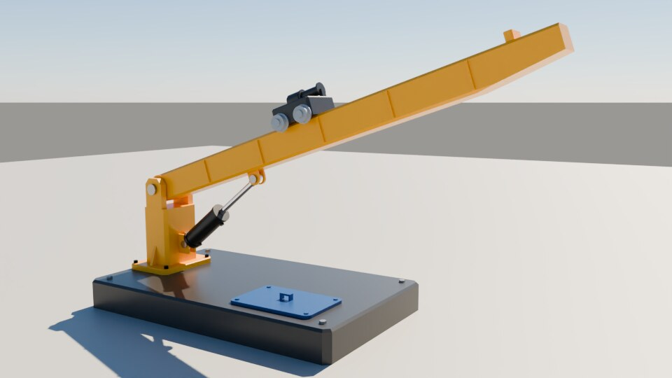

*All pictures in this guide show the small test crane that comes with the app's tests.*

*Using the app in a company (what it sends over the network, holding one approved version, the licence in plain words):
[Using Fresing Render in a company](https://github.com/smholte/CAD-render-animation/blob/main/docs/COMPANY-USE.md).*

## How the app is laid out

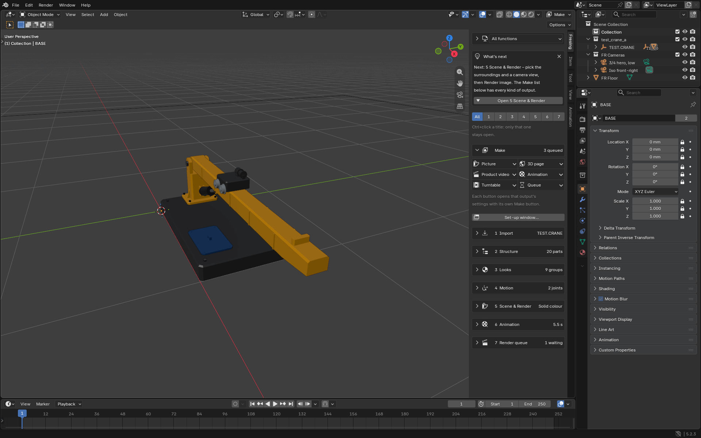

- The big area in the middle is the **view**: your model in 3D.
- On its right edge is the **side panel** with the **Fresing** tab: the steps of the work. Hidden? Click the
  **Fresing** button in the view's header, or move the mouse over the view and press <kbd>N</kbd>.
- On its left edge is the **left panel** ([below](#left-panel)): Live preview, Build & play, your Workspace, the
  Learning hub, Favourites and What's next.
- The other areas (the lists top right, the timeline at the bottom) are Blender's own. You rarely need
  them.

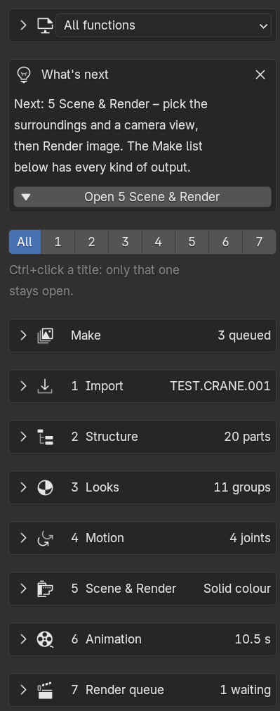

The side panel has eight sections, **1 Import** to **7 Render queue** in the order you work, and **8 Lifting
plan** for lifting plans ([below](#lifting)). Above them are only **Make**, the section tabs and (for a CNC
mill or a mechanism) **Set-up window…** – so the first step is always at the top.

Every section works the same way:

- Work from top to bottom: what you choose comes before the button that uses it.
- Each section has **one blue button**: the one thing the section is for (**Import STEP…**, **Sort parts
  into groups**, **Render image**, **Start queue**). **Live preview** and **Build & play** are on the left panel
  (top left), once. The main button of a sub-panel is big and grey.
- The steps of a panel stand apart, with a little space between them. A grey text is a hint; a red text
  is a problem.
- A numbered how-to is in a fold **How it works**. It is open the first time and folds away by itself
  once the project has the thing (a cut, a cylinder, a cable). Click it to read it again.
- Click an item in a list; its details appear right under the list. Double-click a name to rename it.
- Rarely used settings are in folds that start closed (for example **More**).
- Rest the mouse on a button or setting to see what it does.
- <kbd>Ctrl</kbd>+<kbd>Z</kbd> undoes almost everything, <kbd>Ctrl</kbd>+<kbd>Shift</kbd>+<kbd>Z</kbd>
  redoes it.

The same word always means the same thing: **Remove** takes something out of the project, **Clear**
empties a list or a result, **Delete** deletes a file in the library, **Show in folder** opens the folder
in Explorer, **Add** makes a new thing, **Use as** takes the part you clicked, **Back to …** says where
you go back to.

### The left panel

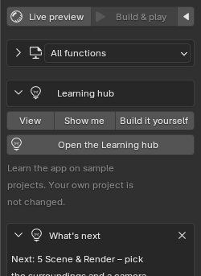

Everything that is not a step of the work sits on the left of the view, top to bottom:

- **Live preview** and **Build & play** – always there, outside every fold. Live preview shows the real render in
  the view ("Live preview: on" while it is on); Build & play builds the selected animation and plays it (greyed until
  there is an animation: make one in 6 Animation). They are only here: 5 Scene & Render and 6 Animation do not
  repeat them.
- **Update available** – only after an update is found ([Updates](#updates)).
- **Workspace** – which functions this project shows ([below](#workspaces)).
- **Learning hub** – View, Show me or Build it yourself in one click ([Learning hub](#learning-hub)); in a sample
  project also its stops, and the Lesson while a lesson runs.
- **Favourites** – your most used buttons ([below](#favourites)).
- **What's next** – what to do next in this project ([below](#whats-next)).

**Fold it away:** the small **◀** at the right of the top row folds the left panel to a narrow strip with three icons:
**▶** (opens it again), Live preview and Build & play – so they stay one click away. The app remembers it for every
project. Drag the panel's edge to make it wider or narrower; projects open with it as wide as you left it.

**Fold a part of it:** Workspace, Learning hub, its stops, Lesson, Favourites and What's next each have a small arrow
in their title row. Folded, only the title row shows (Favourites then says **1 question** when it has a question for
you). The app remembers each one for you: closed and opened again, in another project and after an update, they are
as you left them.

In **Full access** (Fresing > Show all of Blender) Blender's own tool buttons come back at the top of the left panel,
the Fresing parts stay under them. Hidden left panel (Blender's View > Toolbar or <kbd>T</kbd>)? The **Fresing**
button in the view's header brings both panels back.

### Sections: folded at the start, tabs, Ctrl+click

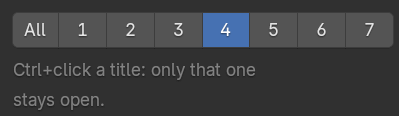

- **Every time the app starts or a project opens, sections 1 to 8 are folded.** Each title row still
  shows the section's state on the right: the model, the number of parts, unsorted parts (in red),
  joints, the surroundings, the animations, the queue. So does every sub-panel ("2 cuts", "3 decals",
  "1920 × 1080").
- **Click a title** to open or fold it.
- **<kbd>Ctrl</kbd>+click a title**: only that one stays open, the others on its level fold. The quick
  way to a calm panel.
- **The tabs All · 1 … 8** under Make show one section at a time, opened. **All** brings them
  all back.
- Want the sections as you left them instead? **Fresing > Settings… > Side panel > Keep sections as I left
  them**. There too: **Keep How it works open**.

### Workspaces: only the functions your work needs

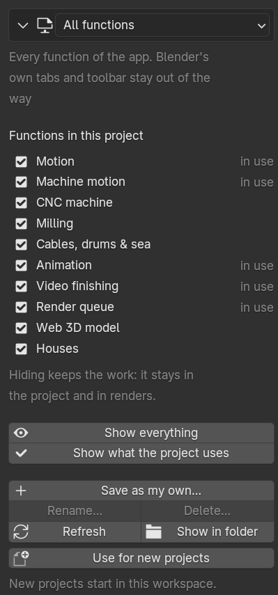

A crane project never needs milling; a mill demo never needs the sea. The **Workspace** row at the top of
the Fresing tab picks what the side panel shows:

| Workspace | Shows | Hides |
| --- | --- | --- |
| **Essentials** | what a first good picture and a simple motion need: import, sort into groups and materials, surroundings and light, camera views, a joint and a pose, Build & play, render a picture or a turntable, saved scenes (**new projects start here** until you choose another) | everything else |
| **All functions** | everything | – |
| **CNC & machining** | CNC machine, tools, tool changes, milling, way covers, clash check | sea, vessel, cables and drums, weather, exploded views |
| **Offshore & cable laying** | sea and seabed, vessel motion, cables, drums and carousels, weather | CNC machine, milling, way covers |
| **Product design & R&D** | looks, exploded views, assembly sequence, slice, turntable, web 3D model | CNC, milling, cables, sea, weather |
| **Client view** | import, surroundings, camera views, saved scenes, turntable, render, queue | everything else – and the project is locked (below) |
| **Education & training** | every kind of motion, animation, camera | web 3D model |
| **Lifting plans** | 8 Lifting plan, import, structure, looks, scene, animation, render queue | CNC, milling, cables, sea, joints by hand |
| **Sales** | saved scenes, looks and paint schemes, logos, surroundings and weather, pictures, turntable, product video, video finishing, 3D page, render queue | import, structure and all motion (the project is **not** locked: unlike the Client view you can still change looks, scenes and outputs) |
| **Quick render** | import a STEP, sort into groups and looks, surroundings, light, camera, one picture or a turntable | everything else |
| **Animator** | joints, cylinders, mechanisms, poses, animation steps, cameras and camera paths, labels, video finishing, render queue | CNC, milling, cables, sea, web 3D model |
| **Reviewer** | saved scenes, slice, X-ray, poses and exploded views, labels, visibility sets, Build & play, clash check | import, joints, looks, outputs |
| **Full access** | everything, plus Blender's own tabs, toolbar and menus | – |

**Essentials is the start.** Anyone who has not chosen a workspace yet starts new projects in Essentials. If you used
the app before Essentials came, nothing changes for you: the update writes down **All functions** as your
choice. A project keeps the workspace it was saved in.

**Sales, Quick render, Animator and Reviewer** are made for one job each and show only that job's functions – hover
over a name in the list to read what it is for. Need one more function? Tick its family under **Functions in this
project**, or pick another workspace.

**Favourites on top.** Every workspace in the list has a star. Click the star and that workspace moves to the top of
the list, above a line, in the order you starred them; click it again to take the star away. The workspace for new
projects ("· new projects") is always on top too. The stars are kept for you, also after a restart.

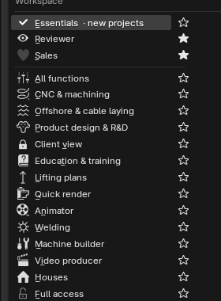

**Hiding never deletes or switches off anything.** What is set up stays in the project and keeps working
in renders, in the queue and after a model update; only the panels go away. Pick another workspace, or
**Show everything**, and it is all back as it was.

Blender's own row of tabs at the top of the window (Layout, Modeling, Sculpting …) is hidden in every
workspace except **Full access**: the word "workspace" means only one thing in the app.

The workspace is saved with the project. A project made before workspaces opens in your default
workspace **with everything it uses shown**. To choose the workspace new projects start in: open the
Workspace row (the small arrow) and press **Use for new projects**, or pick it in **Fresing > Settings… > General >
Workspace for new projects**.

### Functions in this project: families on and off

Open the Workspace row with the small arrow. Under **Functions in this project** every family of
functions has a tick: Motion, Machine motion, CNC machine, Milling, Cables, drums & sea, Animation, Video
finishing, Render queue, Web 3D model, Houses. Click a tick to show or hide that family in this project,
as often as you like. "in use" behind a name means the project has something of that family.

Hiding a family the project uses asks first. The question names what is set up – "This project has a CNC
machine, 3 tools and a G-code step. They stay in the project and keep working in renders; only the panels
are hidden." – with **Hide anyway** and **Cancel**. When something in use is hidden, a red line under
the Workspace row says so, with **Show**.

### Your own workspaces

1. Pick the workspace that is closest and set the ticks the way you want them.
2. Press **Save as my own…**, give it a name ("Offshore cranes", "Mill demos") and press **Save**.

Your workspace is one file in your **Workspaces** folder ([Locations](#locations): your own one first,
`Documents\Fresing Render\Library\Workspaces` from the start). **A colleague gets it by copying that file into
his own Workspaces folder** and pressing **Refresh**. **Show in folder** opens the folder; **Rename…**
and **Delete…** work on your own workspaces only – the built-in ones cannot be changed. A workspace of
your own with the name of a built-in one is used instead of it, and the panel says so. A project keeps
its own copy of the workspace, so it opens the same on a PC that does not have the file.

### Client view: the project locked against changes

For showing a finished project, or handing the PC to someone who should only look and render. In the
**Client view**:

- every button that changes the project is greyed out (its tooltip says why), and the editing panels are
  hidden;
- no part can be clicked, moved or deleted – also not with Blender's own keys (<kbd>G</kbd>,
  <kbd>X</kbd>, <kbd>Delete</kbd>, <kbd>Tab</kbd>);
- Blender's Outliner and Properties editor at the right are hidden, also when you chose to see them
  (**Fresing > Show Blender's editors** is greyed: "Not in the Client view – Full access brings it back"); any other
  Outliner (Blender's list of objects) is replaced, and it stays away: picking it again in an area's
  editor menu, <kbd>Shift</kbd>+<kbd>F9</kbd>, a new window, another of Blender's workspaces
  (<kbd>Ctrl</kbd>+<kbd>Page Up</kbd>) or an area made full-size with <kbd>Ctrl</kbd>+<kbd>Space</kbd> all
  show the Info area instead, within a tenth of a second;
- <kbd>Ctrl</kbd>+<kbd>Z</kbd> never frees a part or the camera, also right after an import, and never takes the project
  out of the Client view (undo of earlier work still happens; only the Workspace switcher leaves the Client view);
- <kbd>X</kbd> and <kbd>Delete</kbd> do nothing, also with <kbd>Shift</kbd>, and a part that was selected before you
  switched is no longer selected;
- File > Save As, Import and Export are off.

Importing, the surroundings, camera views (also **New camera view**), saved scenes (also **Save scene**),
the turntable, **Render image** and the queue (also **Every paint scheme**) still work. A new camera is
locked like the rest. What still gets through on purpose: the settings of a Properties editor you opened yourself
in another area, and Blender's Python console. **Workspace > Full access** (or any other workspace) undoes the lock completely. There is
no password: it stops accidents, not people.

### The What's next card

In a new project a small card at the bottom of the left panel says what to do next (import, sort the parts into
groups, then the surroundings and **Render image**) with a button that opens that section. It goes away after the
first render; the **×** hides it for this project. The small arrow in its title row folds it to that row – it stays
folded, also in other projects, until you open it again.

### Make: every picture, video and 3D page in one place

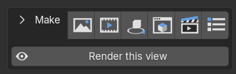

**Make**, at the top of the Fresing panel, is one row: the word **Make** and six large icons – **Picture**,
**Product video**, **Turntable**, **3D page** (the web 3D model), **Animation** and **Queue** (rest the mouse on an icon
for its name). Click **Make** for the list with names; click it again for the row. The app keeps your choice. Under
the row is **Render this view** ([below](#render-this-view)).

Each icon opens that output's **own window** with its settings and its Make button – the same settings as in
5 Scene & Render, 6 Animation and 7 Render queue: a change in one shows in the other. Drag the window anywhere, also
onto a second screen; it stays open while you work in the main window or another output window, until you close it
(**×** at its top). Pressing the same output again does not open a second one: on Windows it comes to the front, and
it opens where it was last time. A window left open is saved with the project. The same list is in the header of the
3D view (**Make**, top of the view): the main button there makes the output at once, the gear beside it opens its
window.

**Switching outputs in the window.** On the left of every output window is a strip with all six outputs; the one the
window shows is blue. Click another icon and the same window shows that output – no need to go back to the Fresing
panel. The strip is one icon wide; drag its right edge wider and the names show beside the icons (the settings beside
it get narrower; drag it back to make room again).

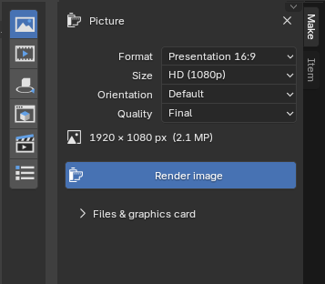
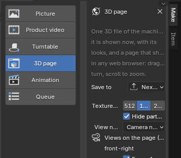

#### Render this view: no camera needed

Turn and zoom the 3D view until you like what you see, then press **Render this view** (under the Make row, or in
**Make** in the header of the 3D view). The app renders exactly that view – its angle and zoom, perspective or
orthographic – with the **Picture's** settings: its format and size, quality, file type, background and folder. The
picture is saved as *project*\_View\_*date*\_*time* and shown as Render image shows it, with Open and Show in folder
under Image size & render.

- **The picture's shape.** When the Picture's shape is not the view's (a wide view, a square picture), the picture is
  fitted **around** the view: nothing you see is cut off, a little more shows above and below or at the sides.
- **No camera is added.** The app uses a camera of its own for this one render and deletes it afterwards – also when
  you cancel the render or something goes wrong. The active camera, your saved cameras and the animations stay as they
  were.
- **In camera view** (Numpad 0, or a saved camera's view) it renders the camera you look through.
- It waits while a render, the render queue or a long job (House bake, web 3D export, clash check) runs, and says so.

This guide is in the app under **Help > Fresing Render user guide**, and as the shortcut **User guide** in the
app's Tools folder (**Fresing > Tools and checks > Open the app folder**).

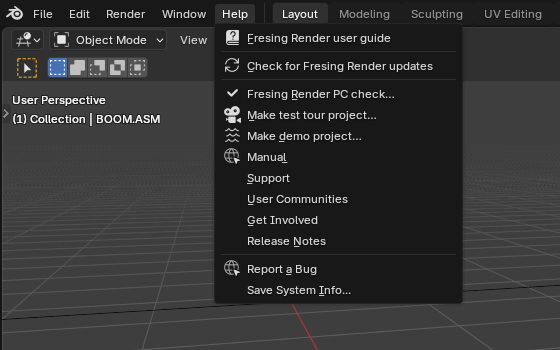

### The Set-up window: one step at a time

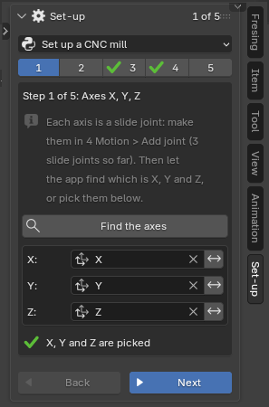

Setting up a CNC mill or a mechanism takes a handful of steps in a long panel. The **Set-up window** shows
them one at a time, in a small window of its own that you can drag anywhere – also onto a second screen –
while you click parts in the main window.

1. Press **Set-up window…** (under the section tabs, in 4 Motion > CNC machine or in 4 Motion > Mechanisms).
2. Pick what to set up at the top: **Set up a CNC mill** (axes X, Y, Z → spindle → tool and workpiece →
   work zero → G-code program) or **Set up a mechanism** (type → base → moving links → add it).
3. Do what the step says – its buttons are the same ones as in the side panel, so what you do here shows
   there too – and press the blue **Next**. **Back** goes back; the numbers at the top jump to a step. A
   green tick marks a step that is done.

The step you are on is saved with the project: the window opens where you left off, and a project saved
with the window open brings it back. Close the window like any other window.

## Start here – the Fresing menu

At the top of the window, after **File, Edit, Render, Window, Help**, there is a menu **Fresing**. It holds the app's
own things in one place, whatever workspace you are in (also in the Client view):

- **Open the Learning hub** – opens the [Learning hub](#tour) of this version; when it is not made yet, it is made first
  (in the background: the bottom line of the window shows how far it is, and **Cancel making the Learning hub** appears
  in the menu while it runs).
- **Learn…** – the sample projects to learn on: View, Show me, Build it yourself ([Learn](#learn)).
- **What's new in 0.2.…** – what this version brings (see below). A dot after it means you have not opened it yet.
- **Show the Fresing panel** – brings the side panel back on the Fresing tab ([If the Fresing panel is gone](#panel-gone)).
- **Show Blender's editors** / **Hide Blender's editors** – Blender's Outliner and Properties editor at the right
  ([below](#blender-editors)).
- **Show all of Blender** / **Back to the Fresing window** – all of Blender's own menus, tools and tabs, and back
  ([below](#quiet-window)).
- **Make demo project… / Open demo project** – the [demo project](#demo).
- **User guide**, **Check for updates** – the same as in the Help menu (the Help menu keeps them).
- **Tools and checks** – **Run the self-test**, **PC check…** and **Open the app folder** (the Tools folder with the
  shortcuts that used to be in the Start menu; [One shortcut](#tools-and-checks)).
- **Restore a backup…** – the automatic backups of the open project, and Restore ([below](#backups)).
- **My usage…** – what the app counted about your work: Fresing Settings on its tab My usage ([below](#my-usage)).
- **Settings…** – all of the app's own settings in one window ([below](#settings)).
- **Welcome screen…** – the welcome below, again.

### The Fr mark in the top bar

At the far left of the top bar, where Blender shows its own logo, stands the green and white **Fr** mark – in every
workspace, also in Full access and the Client view. Click it for a short menu:

- **About Fresing Render…** – version, licence and third-party licences ([About](#about-licences)).
- **Fresing Settings…** – all of the app's own settings in one window ([below](#settings)).
- **Blender** – Blender's own menu, unchanged: Splash Screen, About Blender, Install Application Template…, System.

The **Fresing** menu after Help stays as it was. When the Fresing Render extension is switched off, Blender's own
logo comes back.

### Fresing Settings

**Fresing > Settings…** (or the gear button at the top of the left
panel) opens one window with all of the app's own settings – a box of its own, with nothing of Blender's in it. Click
a tab along its top to change page; the window
opens on the page you had last, also after a restart. Drag it where it suits you – also onto a second screen; it stays
open while you work in the main window, until you close it with its **X**. Opening it again brings it to the front.
On Windows it opens where it was and as big as you left it. It also opens in the Client view.

| Tab | What is there |
| --- | --- |
| **General** | The default template, the default rule set, the workspace for new projects, the highlight while you pick on the model; **Graphics**: which GPU draws the window and which renders ([below](#graphics-card)) |
| **Locations** | The folders the app reads from – STEP models, materials, logos, stickers, 360° photos, templates, rule sets, workspaces, brand kits, lifting equipment – of your company, your department and your own; set-up files ([below](#locations)) |
| **Exports** | Where pictures, videos and 3D pages go; the default place; also a copy to a second place ([below](#export-places)) |
| **Side panel** | Keep sections as I left them, keep How it works open, the favourites bar (on/off, how many buttons), the quiet questions about unused panels (hide, teach, after how many starts) and **Suggest what to learn next** |
| **Lessons** | How a lesson shows the button, a folded section and a part; its colour; **Play on** |
| **Backups** | The [automatic backups](#backups): on/off, every how many minutes, how many are kept |
| **Updates** | The check at start-up, **Check now**, the installed version, the last result |
| **My usage** | What the app counted about your work ([below](#my-usage)) |
| **About** | Version, licence, third-party licences, using it in a company ([About](#about-licences)) |

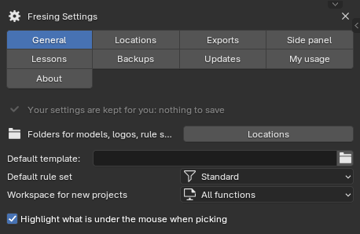
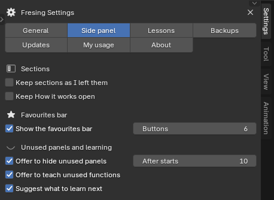
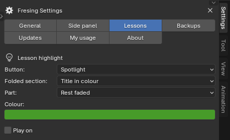
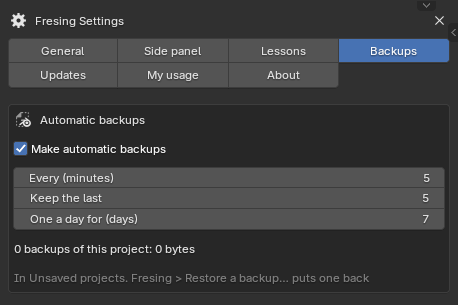
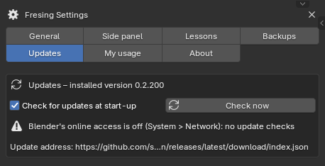
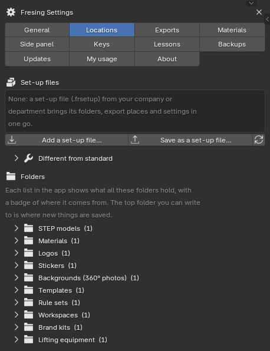
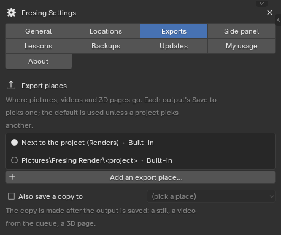
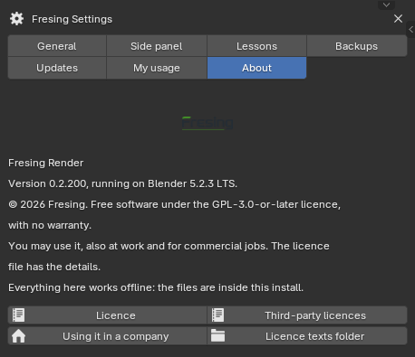

**Your settings are kept for you – nothing to save.** Whatever you change here (and choices the app remembers by
itself, such as Live preview on or off, or the tab this window opened on) is written within a second to the app's own
settings file and is back at the next start, also after an update. **General** says so at its top. If that file was
ever damaged (a crash of the PC while it was written, a copy that went wrong), the app starts with the default
settings, keeps a copy of the damaged file next to it and says so in one red line on **General**; set your settings
again and they are kept as before. Where the file is, and how IT can give the same settings to every PC:
[using it in a company](#about-licences).

**Edit > Preferences > Add-ons > Fresing Render** now only says where the settings are and has a button **Open
Fresing Settings**. Your settings from before stay as they were.

### Function windows: forms that stay open

A function that asks you for a few things first – **Make a crane…**, **Save as my own workspace…**, **Save pose…**,
**Save scene…**, **Copy… / New, empty…** rule set, **Make demo project…**, **Learn…**, **My learning list…**,
**Restore a backup…**, **About**, the **PC check**'s choices and the others in the table below – opens them in a
**window of its own**, like [Fresing Settings](#settings):

- It **stays open** while you click in the main window: select a part, turn the view, look something up – your
  values stay in it.
- **Drag it anywhere**, also onto a second screen. Next time it opens **as big as you left it** (on Windows also
  **where** you left it).
- Its button at the bottom (**Make**, **Save**, **Start** …) does what it is for **with what is in the project at that
  moment** – the part selected then, the model as it is then – and the window closes. When it cannot (no name typed, no
  model, a job still running, the Client view), the window stays open and says why in red.
- **Cancel**, the **X** or **Esc** with the mouse over the window closes it; **Return** there is its button.
- Press the function's button again while its window is open: the window comes to the front, with what you typed.
  Two different function windows can be open at once.
- Opening another project closes them (their values belonged to the project before).

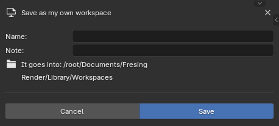

A short question that needs one click – "Remove this?", "Switch to rule set …?", "Clear my usage data?", the question
about a newer backup when a project opens – stays a small popup that closes when you click elsewhere.

| Opens in a window | Where |
| --- | --- |
| Make a crane… · Box… | 8 Lifting plan > Equipment · 8 Lifting plan > Load |
| Save pose (+) · Save visibility set (+) · Save scene (+) | 4 Motion > Poses & exploded views · 2 Structure > Visibility sets · the saved scenes' list |
| New group (+) · Save paint scheme (+) | 3 Looks |
| Copy… (Save as new rule set) · New, empty… · Rename | 3 Looks > Rule set |
| Details (of a program) · Go to line … | 4 Motion > CNC machine |
| Save as my own workspace… · Rename my workspace | Workspace (left panel) |
| Export profile | Fresing > Settings… > My usage |
| Make the Learning hub… · Note… | Fresing menu · a stop of the Learning hub |
| Learn… · My learning list… · Restore a backup… · About Fresing Render | Fresing menu |
| Make demo project… · Fresing Render PC check… | Help menu |

### Locations: the folders the app reads from

Every place the app takes things from – **STEP models, materials, logos, stickers, backgrounds (360° photos),
templates, rule sets, workspaces, brand kits, lifting equipment** – can have **several folders**, each with a badge:

- **Company** and **Department** folders come from a **set-up file** that whoever looks after the app at your firm
  gives you (one file, `<name>.frsetup`).
- **Mine** are your own folders. From the first start you have one per kind, ready to use:
  `Documents\Fresing Render\Library\Logos`, `…\Rule sets`, `…\Lifting equipment` and so on – nothing to set up.
  If you had set a **Shared library** folder in an older version, that folder is your own one now (with its
  sub-folders as before); nothing is moved.

Every list in the app – logos and stickers, rule sets, templates, 360° photos, brand kits, your workspaces, lifting
equipment – shows the items of **all** these folders together, sorted by name, each with its badge
(**Acme · Company**, **Acme · Mine**). The same name in two folders shows twice: nothing hides anything.
**Saving** something new (a rule set, a workspace, a crane) goes into the first folder you can write to, your own
first; when you can write into more than one, the window asks **Save in**.

**Fresing Settings > Locations** shows, from the top:

1. **Set-up files.** Each with its badge and version (**Company v4**), linked or copied, and the buttons
   **Show changes**, **Edit this set-up file…** and **Remove**. Under them **Add a set-up file…**, **Save as a set-up
   file…** and **Look again** (every folder is looked at again).
2. **Different from standard** (a fold): every setting and folder that is not as the app comes, with where it comes
   from (Company v4, Offshore department v2, Mine); your own rows have **Back to standard**.
3. **Folders**, one fold per kind: each folder with its badge and path. Your own ones can be switched off and on
   (an off folder is not read and nothing is saved into it), moved up and down (the top one is where new things go)
   and removed (nothing in it is deleted); **Add a folder…** adds one. **Show in folder** opens it in Explorer.

**A folder that cannot be reached** (the network is down, the VPN is off) shows greyed with one line why; its items
are left out of the lists until it is back. The app never waits for it: it is looked at in the background, so the
start and the panels stay quick.

**Bring a set-up file in:** **Add a set-up file…**, or drop the file on the 3D view. **Keep it** chooses: **link** (the
app reads the file where it lies – a network folder or a synced one – and takes a changed one at its next start; the
default for a network path) or **copy** (the app keeps its own copy). Its folders, export places and settings are then
in use. A set-up file put by IT next to the approved version (see [Using it in a company](#about-licences)) is
picked up by itself. **When such a set-up was there before your first start**, your own folders are made but
**switched off**, and one note says so: **Switch my folders on** turns them all on, or switch them on per kind.

**A newer set-up file**, whatever its file name: the app knows it is the same set-up (by its id) and shows
**Update Offshore department from version 3 to 4?** with the list of what changes – settings, folders, content added,
changed or removed. **Update**, or Cancel to keep the old one. An older file says so first. A linked set-up that
changed on the network is updated by itself at the next start, with one line "Company set-up updated (3 → 4)" and
**Show changes**.

**Save as a set-up file…** makes one from your own settings, folders and export places: give it a name, a level
(Company or Department) and a label, tick what goes in, and which of your folders' **content** is packed inside the
file (so a colleague without the network share gets the logos or rule sets too). Saved over a file of the same
set-up, its version goes up by itself. **Edit this set-up file…** does the same on a set-up in use and writes it back
where it lies – only when Windows lets you write there.

### Exports: where pictures, videos and 3D pages go

**Fresing Settings > Exports** lists the **export places**: **Next to the project (Renders)** – the standard, as before
– and **Pictures\Fresing Render\<project>** come with the app; a set-up file can add places (e.g. "Marketing
share"), and **Add an export place…** adds your own (with or without a folder per project). The ticked one is the
**default**. **Also save a copy to** saves a second copy of every picture, every video from the queue and every
3D page into another place, after the output itself is saved.

Each project's outputs show **Save to** – in 5 Scene & Render > Render image > Files & graphics card, in 7 Render
queue and in the Web 3D model panel: **Default** or any place of the list. A folder typed into **Own folder** (as in
older versions) wins over it.

### Blender's Outliner and Properties (hidden)

The 3D view reaches the right edge of the window: Blender's **Outliner** (its list of objects, top right) and its
**Properties editor** (below it) are hidden in every project – also in one saved with them. Fresing Render does not
need them: the Fresing tab has the parts tree and every setting the app uses. They are for users who know Blender.

- **Fresing > Show Blender's editors** brings both back at the right of the 3D view (Outliner on top, Properties
  below, Blender's usual width). The same entry then says **Hide Blender's editors**.
- Your choice is kept: every project you open, the Learning hub and the demo follow it, also after a restart (it is
  stored in Blender's settings folder, not in the project).
- In the **Client view** they are always hidden and the entry is greyed; **Full access** brings back what you chose.
- Only the Outliner and Properties editor right next to the 3D view are hidden. A layout you split yourself stays.

The side panel is **solid**: it no longer lets the 3D view shine through, so its texts and boxes stay readable on a
light background. (The app switches Blender's preference **Region Overlap** off once. You can turn it on again in
**Edit > Preferences > Interface > Editors > Region Overlap**; the app keeps your choice.)

### A quiet window: what is hidden and how to get it back

Fresing Render runs inside Blender, a program for modelling and animation. The parts of Blender that edit a model
are hidden, so the window shows only what you need to look at your model and make pictures:

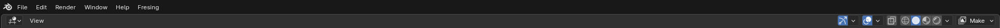

- **The 3D view's header** has the **View** menu, gizmos, overlays, X-ray and the shading buttons (Solid, Material,
  Live preview) and the app's own **Make** button. Blender's **Object Mode**, **Select**, **Add** and **Object** menus
  and its modelling settings (orientation, pivot, snapping, proportional editing) are not drawn – they were about
  460 px of the header (measured on the 1,800 px test window).
- **The tool row** under the header (select-box buttons, Options) is off.
- **The top bar** has no **Scene** and **View Layer** fields on the right.
- **The start-up screen** shows the app's own lines: **New project**, **Open…**, **Recover Last Session**, your
  recent projects, **Open the Learning hub**, **Demo project** and **User guide**. Blender's templates and web links are
  not shown.
- **File > New** (and **Ctrl+N**) offers only **New project**: a new project starts exactly like the app does –
  millimetres, Cycles and the app's layout. (Blender's **General** template opened in metres with another render engine.)

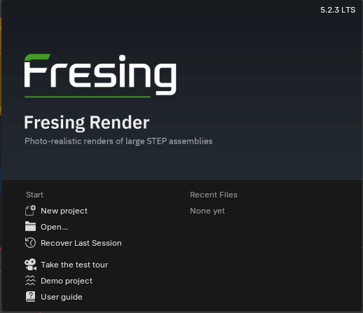

**To get it all back:** **Fresing > Show all of Blender**. It switches the project to the workspace **Full access**:
Blender's menus, tools, workspace tabs, the Scene and View Layer fields, its start-up screen and File > New list come
back at once. Nothing in your project is changed. The entry then says **Back to the Fresing window**: it hides them
again and puts the project back in the workspace it was in before. Picking **Workspace > Full access** at the top of
the Fresing tab does the same; leaving it hides everything again.

- In the **Client view** the entry is greyed (Workspace > Full access unlocks the project first).
- If you are in Blender's **Edit Mode** (or another mode) when you go back, the header stays Blender's own until you
  are in Object Mode again, so you never lose the menu that gets you out.

### Keys and the right-click menu

Blender has a key for almost everything, and a few of them delete or change your model in one press. Outside
**Full access** those keys do nothing to the project; the status bar at the bottom says *"That is a Blender key –
Fresing > Show all of Blender gives you Blender's keys"*:

- **Shift+D**, **Alt+D** (copies), **Ctrl+J** (join), **Ctrl+P**, **Alt+P** (parent),
  **Ctrl+A** (apply), **M**, **Shift+M** (collections), **Shift+A** (add), **Ctrl+H**, **Ctrl+0 … Ctrl+5**, **Tab**,
  **Ctrl+Tab** (Edit Mode and the other modes), **Ctrl+Page Up / Page Down** (Blender's workspaces) and **I**,
  **Alt+I**, **K** (keyframes – they would mix with the keys Build makes).
- **Delete** and **X** (also with Shift) open the app's **Remove** window for what is selected: it lists what goes,
  and nothing is lost until you click Remove ([Remove](#remove-model)).
- **Ctrl+C** copies what is selected and **Ctrl+V** pastes a copy beside it, with its joints and mechanisms
  ([Copy and paste](#copy-paste)).
- **These stay:** **G** / **R** move and turn what is selected ([Moving and turning parts](#moving-parts)), **H** hides the selected part, **Alt+H** shows everything again, **A** selects all, **Home** and the
  number pad move the view, **Z** and **Ctrl+Space** for the shading and a bigger view, **Space** plays, **Ctrl+Z**
  undoes, **F3** searches, **N** shows or hides the side panel, **Ctrl+S** saves, **Ctrl+O** opens.
- **F12** renders a picture with the app – the same as the blue **Render image** button. **Ctrl+F12** renders the
  animation picked in 6 Animation in the background, as Make's **Render animation** does.

**Right-click on a part** in the 3D view: the part becomes the selected one (as a left click makes it – with the pick
mode "Subassembly", its subassembly) and a short menu opens:

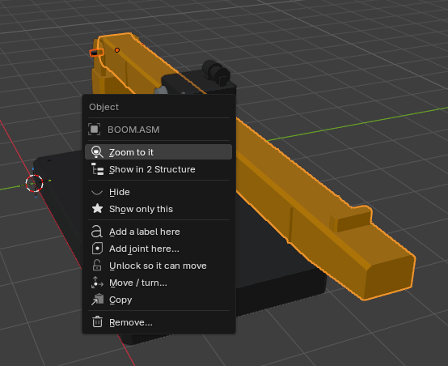

- **Zoom to it** – the view fills with that part (the camera does not move).
- **Show in 2 Structure** – the side panel opens 2 Structure at the part's row.
- **Hide**, **Show only this** – as the buttons in 2 Structure; **Show all** appears when something is hidden.
- **Add a label here** – a label that points at the spot you right-clicked; type its words in 6 Animation > Labels.
- **Add joint here…** – Add joint starts with this part: click its pivot (a hole, a shaft or a flat face) next.
- **Unlock so it can move** – unlocks the part's subassembly, so **G** moves it and **R** turns it
  ([Moving and turning parts](#moving-parts)); once unlocked the entry reads **Lock in place**.
- **Move / turn…** – [Place](#place) in a window of its own: X / Y / Z, turns, steps, Put on the floor.
- **Copy** – remembers the part's model, subassembly or parts (what is selected); **Paste here** – once something
  was copied – puts a copy of it where you right-clicked ([Copy and paste](#copy-paste)).
- **Remove…** – the window that lists what goes with it ([Remove](#remove-model)).

**Right-click on empty space:** **Zoom to all** and **Show all** (and **Paste** once something was copied: the copy goes
beside the original). In the **Client view** the menu has only Zoom, Show in
2 Structure, Hide, Show only this and Show all (no Move / turn…, no Copy, no Remove…) – and its Hide only hides in the view: renders, the built animation and
the project stay as they are, and leaving the Client view shows those parts again.

**Blender's keys and menu back:** **Fresing > Show all of Blender** (or Workspace > Full access) gives every key and
Blender's own right-click menu back at once; **Back to the Fresing window** takes them away again. If you moved one of
these actions to another key in Blender's Preferences, that key is not swallowed: only the keys above are.

### Automatic backups – your work is saved every few minutes

While you work, Fresing Render saves a **backup copy** of the open project every **5 minutes** – only when something
changed since the last backup or since you saved. Your project itself is not touched: its name, its "not saved yet"
mark and Ctrl+Z stay as they were. The bottom line of the Fresing tab says **Backup saved 14:35**.

- **Where:** in a folder **Backups** next to the project file, named `<project> backup 2026-11-20 14-35.blend`. A
  project you never saved gets its backups in **Documents\Fresing Render\Backups\Unsaved projects**. When the folder
  next to the project cannot be written (a read-only network folder), they go to
  Documents\Fresing Render\Backups\Projects\<project> … and the app says so once; the same when a colleague has
  the project open (their backups next to it are theirs: not offered to you, not cleaned by you) or when the path next
  to the project would be too long for Windows. When OneDrive keeps your Documents folder, it uploads these backups
  too.
- **How many:** the **last 5**, plus the **newest one of each of the last 7 days**. Older backups are deleted; the
  app deletes only files with exactly that name pattern – nothing else in the folder, never the project.
- **When not:** in the **Client view**, while a render, the render queue, a clash check, a web 3D export, a House bake,
  a cable re-bake, an import or the animation is running (it tries again half a minute later), and when the disk has
  less than twice the project's size free (said once).
- **Fresing > Restore a backup…** lists this project's backups (time, size, **newer than your saved project**).
  **Restore** first keeps your work as it is now as a backup too, then the chosen backup replaces the project file and
  opens – nothing is lost. The folder button opens the Backups folder with the file selected. A project that was never
  saved opens as a new file in Documents\Fresing Render\Recovered projects: save it with **File > Save As**.
- **A question when you open a project:** when its newest backup is newer than the saved file (Blender or the PC
  stopped before you saved), a small window asks: **Open the backup** or **Cancel** (keeps the saved project; the
  backup stays in Restore a backup…). At the start of the app, work that was never saved (from the last 24 hours) is
  offered the same way. When the welcome or What's new shows, the question waits until it is closed.
- **Settings:** Fresing > Settings… > **Backups**: the switch (on), **Every
  (minutes)** 1–60, **Keep the last** 1–50 and **One a day for (days)** 0–60. The box shows how much room this
  project's backups take. A big project (the demo is about 226 MB) takes that much per backup.
- Open a backup only through **Restore**: a backup keeps the project's own links to its files (cache, pictures), so
  opened straight from the Backups folder it may miss them.

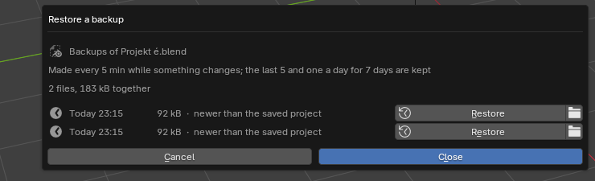 Restore a backup…: this project's backups with their time and size, Restore and a folder button">

Blender's own auto-save (File > Recover) still works as before.

### The welcome (the first starts)

The first time the app starts on a PC (in a new settings folder) the start-up screen shows a short welcome at its
top: what the app is for, and the Learning hub, with how long making it takes ("about 3 minutes" – measured on the
4-core test machine; once you have made the tour, the time it took on your PC). Three buttons:

- **Open the Learning hub** – makes the tour in the background and offers to open it when it is ready.
- **Later** – asks again at the next start, at most three starts.
- **Don't show this again** – never again at the start. It stays in **Fresing > Welcome screen…**.

When the app opens a project you double-clicked, the welcome shows as a small window once the project is open.
On the very first start Blender asks for language and keyboard first: the welcome follows when you press
**Continue**.

### What's new after an update

The first start of a newer version (after **Update now**, or a new installer) shows **What's new in 0.2.…** – or
"What's new since 0.2.…" when you skipped versions – once, at the top of the start-up screen. **Show What's new…**
opens it:

1. **New functions** – the functions this version adds, at most eight lines: first what you meet first (workspaces,
   the Client view, the folded sections, the Fresing menu), then the newest. The line above the list says "N new, M
   better". **Better since …** is a second short list of functions that got visibly better. **Show in guide** opens
   this guide at that function. **All release notes** opens the release page with every change.
2. **The test models** – "2 new test models, 1 changed", with their names. Pick **Only the new and changed test
   models** (much quicker to make than the whole tour) or **The whole tour**, then **Make the tour**. When it is
   ready, open it: the Learning hub panel marks the new stops "– New" and the changed ones "– Changed", and says
   which test models are new or changed since the version you had.
3. **Cancel** = later: What's new stays in the **Fresing** menu (with a dot) until you open it.

It never shows after going back to an older version or installing the same version again.

## Learn – lessons on the sample projects

**Fresing > Learn…** opens a window with the app's sample projects (the projects of the [Learning hub](#tour), each one
small model with its own surroundings). There are three ways to learn on each of them:

- **View** – the finished project: the Learning hub opens at that sample, its first stop set up (when the Learning hub is not
  made yet, it is made first – a few minutes in the background – then press View again).
- **Show me** – the app does each step itself while you watch.
- **Build it yourself** – you do each step; the app shows you where and goes on once the project shows it is done.

**Crane** (11 steps: a light look, a rotate joint and a joint on it, a camera, a saved scene, an animation with a step,
Build & play, an exploded view and a picture in the render queue) and **Milling a slot** (13 steps: three slide axes, the
bit and the workpiece, raw steel, chips, a close-up, the cut as two steps, Build & play and a picture of the cut) have a
lesson now. The other samples have **View**; their lessons follow with later updates.

Show me and Build it yourself start a **new project** with the sample's plain model, as the import leaves it. Your open
project is not changed – save it first. The new project is not saved until you save it.

### The Learning hub switch: View · Show me · Build it yourself

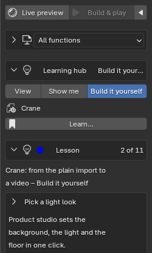

At the top of the left panel's **Learning hub** three buttons switch between the three ways to learn, in one click. The
way you are in shows pressed, also after the project is opened again.

- **In a sample project** (one the Learning hub or a lesson opened): **View** opens the finished sample with its stops;
  **Show me** and **Build it yourself** start its lesson. Between Show me and Build it yourself the lesson switches at
  once, at the step you are on. Opening another project asks first when this one has unsaved changes. A sample without
  a lesson shows Show me and Build it yourself greyed: **Lesson coming**.
- **In your own project** the block has **Open the Learning hub**, and the three buttons open the **Learn** window with
  that way chosen – pick a sample there.

### Show me

The app points at the button of each step – the button stands out in the side panel (the rest is dimmed, as set in
**Fresing > Settings… > Lessons**), the parts it works on are shown in the 3D view and
a card beside them says what happens. After a moment the app presses the button itself: a new joint swings out and back
once so you see what it does. Then it waits for **Next** in the **Lesson** panel on the left panel.

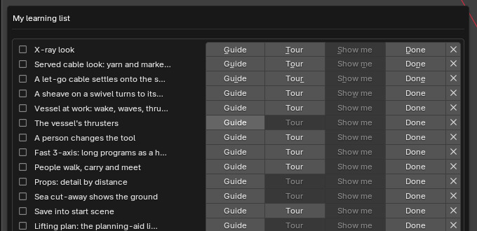

- **Back**, **Next** and **Play on** sit at the top of the Lesson panel, above the step's text, and stay in the same
  place from step to step: you can click **Next** again and again without moving the mouse.
- **Play on** lets the lesson go on by itself after a short pause. The app remembers it for your
  next lessons.
- **More …** shows a longer text about the step; **This in the user guide** opens its section here.
- **Back** takes the last step back (the same as **Ctrl+Z**) and shows it again.
- **Go on as Build it yourself** goes on in the other way from the step you are on; **Stop the lesson** ends it –
  everything made so far stays in the project.

### Build it yourself

The app points the same way, but **you** press the button – or do the step your own way: any way that leaves the project
showing the step done counts (a joint made from the list's **+**, a camera from another view, a scene under your own
name). The card turns to **Done** and the next step follows by itself. **Do it for me** does the step for you, as Show me
would.

Where the lesson is, is read from the project: the first step it does not show done yet. So **Back** and **Ctrl+Z**
move the lesson back too, and a project you saved half-way and open again shows the **Lesson** panel with **Show me** and
**Build it yourself** to go on where you stopped (**Forget the lesson** takes the panel away).

From your [learning list](#learning-list) (**Show me**, **Build**) and from the question about a panel you never use
(**Show me in a lesson**), a function that has a lesson opens it at its own step: the steps before it are done for you.

## Your usage and the favourites bar

The app counts which of its functions you use – **on your own PC only; nothing is ever sent anywhere** – and uses
that to keep your side panel short: a favourites bar with your most used buttons, now and then a quiet offer to
hide a panel you never use, and a page **My usage** in [Fresing Settings](#settings) with where your time goes.

**What is stored, and where.** One small text file, `fresing_usage.json`, in your Blender settings folder (the
same folder as your preferences; **My usage > Show the file** opens it). It holds: how often you clicked each
function's button and opened each panel, how many times the app was started, the active time per stage, the
estimated time saved, your pins and the panels you hid. It holds no part names, no file names and nothing of your
models. It belongs to your Windows user and stays when the app is updated. **Track my usage** (Settings > My usage) switches
the counting off; **Clear my usage data** deletes what was counted (your pins, hidden panels and learning list stay unless you tick the list). The test
runs, the PC check and the render queue never count.

### The favourites bar

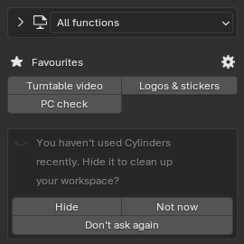

On the left panel, under the **Learning hub**, the bar shows the functions you use most (6 buttons; 5
to 8 in Settings > Side panel). A function joins it once you have used it twice. **The bar is sorted when the app starts and
never while you work**, so a button does not move under your mouse.

- **Click a favourite**: its section opens (as with the section tabs; **All** shows every section again) down to
  its panel, and its button is pointed at for a few seconds. A menu function (PC check, Check for updates) runs
  straight away.
- **Pin** a function so it always stays on the bar: **Fresing > My usage…**, the pin beside it in the list (the
  small gear at the right of its title row opens the same window). A new pin shows at once at the end of the bar; pinned
  buttons have a pin icon and always come first.
- **Switch the bar off**: untick **Show the favourites bar** in Fresing > Settings… > Side panel.

The bar shows only functions your workspace shows, and only once it has buttons: in a new installation it appears
after a few starts. The arrow in its title row folds it; it stays folded or open, also after a restart. Folded, its
title row says **1 question** when a question below is waiting.

### A panel you never use: learn it or hide it

When you have not used a panel in **10 app starts** (a setting in Settings > Side panel), a quiet question appears at the top of
the Fresing tab: *"You haven't used Way covers recently. Maybe you do not know it yet?"* – with what the function does
in one line, and:

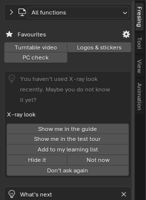

- **Show me in the guide** – opens the user guide at that function's section. The question stays, with a tick on the
  button, so you can come back and choose.
- **Show me in the Learning hub** – sets up the Learning hub's stop for it and points at its button (greyed, with the reason,
  when the tour has no stop for it; if the tour is not made yet it says so).
- **Add to my learning list** – you come back to it later ([the list](#learning-list)).
- **Hide it** – the panel goes out of your side panel, in every workspace except **Full access**.
- **Not now** – the panel stays; it is not asked about again.
- **Don't ask again** – no more questions (switch them back on with **Offer to hide unused panels** and **Offer to
  teach unused functions** in Settings > Side panel). With teaching switched off the question only offers to hide, as before.

A panel that **What's new** has just listed is not asked about until 10 app starts have passed: you cannot have used
what you have not seen yet. A panel you hid shows again by itself when the project starts using it.

The three **Show me** buttons leave the question open and do not put the function on your learning list: **Add to my
learning list** does that. At most one question per start, each panel once.
**Never about a panel the open project uses**: a project with a way cover shows Way covers even when you hid it, and
is never asked about it. Hiding changes nothing in the project or in renders, and it does not change the workspace
itself – it is your own layer on top. To undo it: **Workspace > Back as it came** (it shows how many panels you hid)
or **My usage > Back to the workspace as it came**: your hidden panels show again and your pins are dropped.

### Learn as you go

A function you never use may be one you do not know yet – not one you do not want. So the app offers to **teach** it as
readily as to hide it, and keeps a short list of what you want to learn. Everything stays on your PC, like your usage
counts. There are three ways onto the list: the question above; a **right-click on any button** that belongs to a
function (**Add to my learning list**); and **What's new** after an update (**Add the new functions to my learning
list**). Switch the whole thing off with **Offer to teach unused functions** and **Suggest what to learn next** in My
usage.

### My learning list

**Fresing > My learning list…** opens the list in a [window of its own](#function-windows).

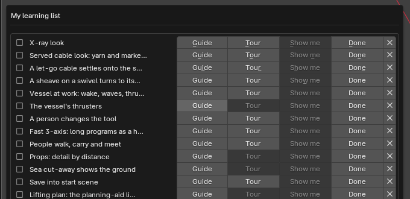
 Each line has the function's name and **Guide** (its section in this
guide), **Tour** (its stop in the Learning hub, with the button pointed at), **Done** (tick it yourself; click again to take
the tick away) and a cross (take it off). **Show me** and **Build** open the function's [lesson](#learn) at its own
step (greyed while its sample project has no lesson yet). **A function is
ticked by itself when you use it on 3 different days** (a setting in Settings > My usage: *Days of use = learned*); the list says so
once: *"You've got the hang of …"*. **Clear my usage data** asks whether to clear the list too; the list only goes in an
exported profile when you include your usage counts.

### Next to learn

Now and then – at most once per start – the **What's next** card has one quiet line: *"Next to learn: Way covers – you
work with Machine motion, and have not tried this yet"*, with **Learn** (puts it on your list and opens its guide section)
and **Not interested** (never suggested again). It picks, by plain rules and without looking at your models: a function
that your workspace shows, in a kind of work you already use, that you never used, did not hide or turn down, and the open
project does not use. Switch it off with **Suggest what to learn next** in Settings > Side panel.

### My usage

**Fresing > My usage…** (also at the end of the **Help** menu) opens [Fresing Settings](#settings) on its tab
**My usage**:

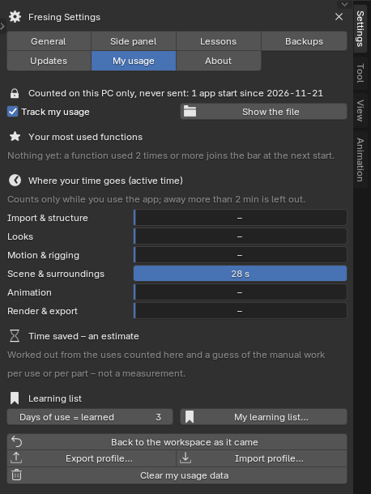

1. **Track my usage**, **Show the file** – the switch, and the file in its folder.
2. **Your most used functions** – how often you used each, and a pin that keeps it on the favourites bar (the bar's
   switch and size are on the tab **Side panel**).
3. **Where your time goes** – a bar per stage: Import & structure, Looks, Motion & rigging, Scene & surroundings,
   Animation, Render & export. Time counts to the stage of the last function you used, and **only while you use the
   app**: a mouse move, a click, the wheel, a button. When none of these comes for 2 minutes, that time is left out –
   also while the app plays an animation, renders, shows a Live preview or works through the queue by itself.
4. **Time saved – an estimate** – what the app's automatic functions (sorting parts into material groups, the
   exploded view, model update, cylinders, hoses, cables, way covers, the assembly sequence, the turntable, the
   product video, the clash check, the web 3D model, every paint scheme, the toolpath) saved you, each with how it is
   worked out ("about 5 s per part by hand: pick the part and give it its material"). **This is not a measurement**:
   it is the number of uses counted here times a guess of the manual work – the guesses are in the app's function
   list and can be changed.
5. **Learning list** – the days of use that count as learned, and **My learning list…**.
6. **Back to the workspace as it came**, **Export profile… / Import profile… / Clear my usage data**.

### Profiles: your side panel as one file

**Export profile…** saves the project's workspace together with your favourites bar (its pins, on/off, size) and
the panels you hid (kept apart from the workspace's own settings), as one file in your **Workspaces** folder – the same kind of file as
[your own workspaces](#own-workspaces), with the bar added. Your usage counts go in only when you tick **Include my
usage counts**. The project uses the profile from then on.

**Import profile…** takes such a file (from a colleague, or one a team keeps in a shared folder): it is copied
into your Workspaces folder – replacing your own workspace of the same name –, the project switches to it and your
favourites bar takes its pins; the panels it hides are added to your own, so **Back to the workspace as it came**
(Settings > My usage) shows them again. Counts in the file are added to yours only when you tick **Add the usage counts in
the file**. An older version of the app opens a profile as a plain workspace.

## Getting started: your first render in 10 minutes

### Install (once per PC)

1. Unzip the installer folder (FresingRender-…-windows.zip) anywhere, for example in Downloads.
2. Double-click **Install.bat**. If Windows says "Windows protected your PC", click **More info**, then
   **Run anyway**. Unpacking takes a few minutes without a progress bar: let it finish.
3. Start **Fresing Render** from the Desktop: the shortcut, the Start menu, the window and the taskbar show the
   Fresing **Fr** (the white F with its green swoosh and an r), and the start-up screen carries the Fresing logo. Right-click the taskbar icon
   > **Pin to taskbar** to keep it there. (A PC that had the app before 0.2.136 gets the new icon at the first
   start after **Update now**; if a pinned taskbar icon still shows Blender's, unpin it and pin it again.)
   Task Manager shows the app as **Fresing Render** too: the shortcuts start `Fresing Render.exe`, Blender's own
   program under the app's name and icon, which the app makes next to `blender.exe` (at the first start after
   **Update now** on a PC that had an older version). If Fresing Render ever does not start from its shortcut – a
   virus scanner can remove that copy – use **Safe start** in the app's Tools folder (below): it starts
   the app with Blender's own program, and Task Manager says "Blender" then. While Windows 11's *Smart App Control* is
   on, the app always works this way (that setting blocks programs without a signature).
4. Once, recommended: in the app **Fresing > Tools and checks > Run the self-test**. After a few minutes
   "Fresing Render self-test.txt" appears on the Desktop; every line should start with `[ OK ]`
   (see [Troubleshooting](#troubleshooting)).
5. To test every function on your PC (after each update too): **Fresing > Tools and checks > PC check…**
   ([The PC check](#pc-check)).

#### One shortcut: everything else is in the app and in its Tools folder

The Desktop and the Start menu hold one shortcut only: **Fresing Render**. Everything else is in the app, in the
**Fresing** menu (top bar, after Help) > **Tools and checks**:

- **Run the self-test** – checks the installation in its own window; the report lands on the Desktop.
- **PC check…** – tests every function on this PC ([The PC check](#pc-check)).
- **Open the app folder** – opens the **Tools** folder of the app in Explorer
  (`%LOCALAPPDATA%\FresingRender\Tools`). It holds the same things as shortcuts, all with the Fresing **Fr** icon:
  **Self test**, **PC check (quick)**, **PC check (full)**, **PC check (heavy)**, **Safe start** and **User guide**.
  Drop a STEP file on a PC check shortcut there to test your own model too.

A PC that had an older version gets this at its first start after **Update now**: the extra shortcuts on the Desktop
and in the Start menu (the folder "Fresing Render" with the self-test, the PC checks, safe start and the user guide)
are removed and made in the Tools folder. Only shortcuts that start this install are removed; a shortcut of your own
is left alone. (Install.bat does the same.)

**Remove Fresing Render:** Windows **Settings > Apps > Installed apps > Fresing Render > ⋯ > Uninstall**. A window shows
what is removed and says that your projects, renders and backups stay; close Fresing Render first. The entry shows the
installed version and size, and **Update now** keeps it right. (An older install gets the entry at its next start.)
The installer folder's **Uninstall.bat** does the same.

README.txt in the installer folder has the details: company PCs, updates, removing the app.

### Updates: one click

New versions come to the app by themselves. A few seconds after the app starts it looks on GitHub for
a newer version. When there is one, **Update available** appears at the top of the left panel:

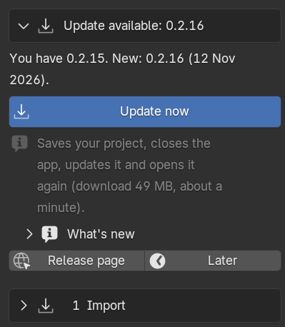

1. Open **What's new** to read what changed (it is the same text as on the release page).
2. Click **Update now**. A small window asks:
   - **No unsaved changes:** click **Update now** again.
   - **Unsaved changes in a saved project:** **Save and update** saves them first. **Update without
     saving** leaves them out: the app opens again with the project as you last saved it – the changes
     since then are lost.
   - **Unsaved changes in a project that was never saved:** **Save as… and update** opens Save As; choose
     a name and a folder, and the update goes on by itself once it is saved (Cancel in Save As: nothing
     happens, **Update now** stays). **Update without saving**: the app opens again empty – this project
     is not kept as a project file.
   - With automatic backups on ([Backups](#backups)), **Update without saving** first keeps **one backup
     copy** of the work as it was (the window says "A backup copy is kept"). The next start does not ask to
     restore it – you chose not to keep it –, but it is in **Fresing > Restore a backup…** if you need it.
   - **Cancel** closes the window; nothing is downloaded or changed.
3. The app downloads the new version (a minute or less), saves your project (or not, as you chose),
   closes, installs the update and opens again. Nothing else to do.
4. At the top of the left panel it says **Updated to …**, with what's new. **Close** hides it.

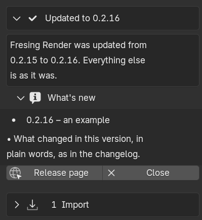

- **Later** hides the notice until the app starts again. **Help > Check for Fresing Render updates**
  asks at any time.
- While the render queue runs or a STEP file is being imported, the update waits until you start it again.
- **Update now refuses** (it says why in a red line, the button stays) when:
  - a colleague has the same project open ("In use by …", [1 Import](#import)): the update saves the
    project before closing and would save over their work. Use **File > Save As** (a new name) or open
    another project, then **Update now**;
  - the project is also open in a second Fresing Render window, or another Fresing Render still runs (a
    second window, a queued render, the PC check): close it first.
- **When an update fails** the app opens again with the old version and says **The update did not
  work**, with the reason. It works as before; press **Update now** again later. Even when Windows held
  a file so the new version could not be put in place, the app puts the old version back first, so the
  Fresing tab is always there. If the PC was switched off during an update, the next start finds that
  out by itself and offers **Update now** again.
- Your projects, renders, templates and settings stay as they are.
- Versions before 0.2.16 cannot do this yet: run the newest installer once over them
  ([Install](#start)). A version that needs a newer Blender also comes as an installer; the app then
  says so and links to its release page.
- The check needs internet access to github.com. Switch it off in **Fresing > Settings… > Updates > Check for
  updates at start-up**.
- After an update, run the **PC check** once: it tests every main function of the new version on your PC
  ([The PC check](#pc-check)).

### Moving around in the view

| To | Mouse | Without a middle mouse button |
| --- | --- | --- |
| Turn the view | hold the wheel (middle button) and drag | drag the coloured axis ball, top right of the view |
| Slide the view | <kbd>Shift</kbd> + wheel button, drag | drag the hand icon under the axis ball |
| Zoom | turn the wheel | drag the magnifier icon |
| Zoom to what is selected | numpad <kbd>.</kbd> | **Zoom to it** in 2 Structure |
| Everything in view | <kbd>Home</kbd> | View menu > Frame All |

### Your first render

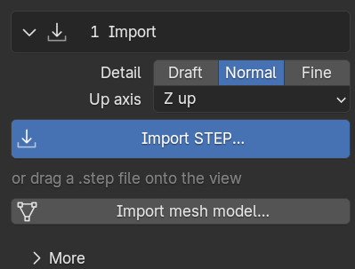

1. In **1 Import**, leave Detail on **Normal** and Up axis on **Z up**. Click **Import STEP…**, pick
   your .step file and click **Import STEP** in the file window. (Or drag the file from Explorer onto
   the view.)
2. A progress bar shows while the model is read; a big machine takes a minute or two. Then the model
   appears in the view and the sections 2 to 7 appear under 1 Import.
3. Save the project: **File > Save As**, in the folder of the job. Renders then go to a folder
   "Renders" next to the project file.
4. Look at the header of **3 Looks**. Most parts already have a material. Red "… unsorted"? That can
   wait for a first try; [3 Looks](#looks) explains it.
5. In **5 Scene & Render**, click a **Light look**: **Product studio** looks good straight away. The
   import has already added a camera ("Iso front-right").
6. Under **Image size & render**: Format **Presentation 16:9**, Size **HD (1080p)**, Quality
   **Preview** for a quick first look. Click **Render image**.
7. A render window opens and the picture builds up. When it is finished it is saved by itself;
   **Open** and **Show in folder** appear under the button.

For a better picture: Quality **Final**, another camera angle (**3/4 hero, low** under **Camera**, or
turn the view and click **Where I look now**), and **Live preview** to judge the light first.

## 1 Import – bring in the STEP model

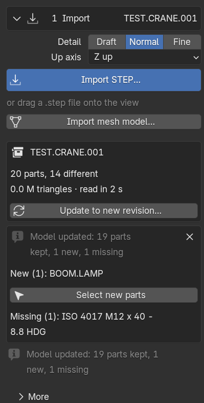

Reads a STEP assembly from Inventor, Fusion or any other CAD program, with its assembly tree, part
names, colours and material names. Later it updates the model to a new revision without losing
your work.

**Import**

1. **Detail**: **Draft** (fast, coarse curves), **Normal** (good for most renders) or **Fine** (smooth
   curves for close-ups; slower, more memory). Round parts get their facets by size: a big carousel,
   drum or slewing ring stays smooth on its outline (the flat spots are at most 2 mm deep at Draft, 0.5 mm at
   Normal, 0.2 mm at Fine; a Ø10 m ring used to have 3.7 mm at Normal), while bolts, nuts and washers that
   the app recognises by name get fewer segments (about 12 / 20 / 32 round), which you cannot see in a render
   but which makes big models lighter. Other small parts (cutters, lamps, workpieces) stay as detailed as before.
   A project imported earlier keeps its meshes until its next **Update to new revision…**: then the round parts
   come in with the new facets, and painted faces, joints and looks stay.
2. **Up axis**: **Z up** for most files. **Y up** when the model comes in lying on its back. You can still
   change it after the import, per model (below).
3. Click **Import STEP…** and pick the file, or drag a .step file onto the view.
4. Wait for the progress bar. Big files are read on all processor cores but one, so the PC stays
   usable. <kbd>Esc</kbd> with the mouse over the view cancels.

The box under the button then shows the model: its parts (placed, and how many different), its
triangles and how long the import took. An unchanged file imports again in seconds, from a stored
copy (**More > Clear import cache** throws those copies away if disk space is short).

**Drop a file on the view.** Dragging a .step / .stp file (or a glTF, OBJ or FBX mesh model) from Explorer onto the
3D view or the Outliner does exactly what **Import STEP…** does: the side panel opens on **1 Import** (also when
another section's tab was chosen or the side panel was hidden), the **Detail** and **Up axis** chosen there are used,
the progress bar with <kbd>Esc</kbd> to cancel shows, then the model's box and the same message; one
<kbd>Ctrl</kbd>+<kbd>Z</kbd> takes the import back. Several files dropped at once: the **first** one is imported and
the panel says so – drop the others one at a time once it is in.

**Up axis after the import.** Each model's box has **Up axis: Z up / Y up**. Clicking the other one turns the whole
model at its own origin, exactly as the import's Up axis would have. Everything you made on it keeps working: joints,
cylinders, mechanisms, slices, poses, saved scenes, labels and cameras riding on its parts. When the project holds
only this model, its other cameras turn with it, so saved views still look at it. A built animation is taken off
(the message says **Build again**); built again it gives the same motion, turned. One <kbd>Ctrl</kbd>+<kbd>Z</kbd>
undoes it. A model update to a new revision keeps the chosen axis. The **Up axis** above **Import STEP…** stays the
choice for the next import.

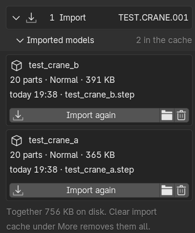

**Imported models** (a fold under the model boxes; its title row says how many are stored) lists every model in
the import cache, newest first: its name, parts, detail, size on disk, when it was stored and the file's name. A file
that was moved or deleted since is greyed with **File moved**; a changed file says **File changed since**. More than
10 stored: a search field narrows the list. Each row:

- **Import again** adds that model to this project. An unchanged file comes from the stored copy in seconds (nothing
  is read); a changed file is read again, and the message says so; a moved file comes from the stored copy.
- The folder button (**Show in folder**) shows the file in Explorer (a moved file: the stored copy's folder).
- The bin (**Remove from cache**) asks first, then deletes the stored copy and frees its space. Models already in a
  project are not touched; the next import of that file reads it in full again.

Where the cache lives: in the app's settings folder,
`%LOCALAPPDATA%\FresingRender\…\portable\extensions\.user\user_default\fresing_render\cache` (one folder per
stored model). How big it grows: about 40 bytes per triangle
(measured on the test crane: 5,890 triangles, 244 KB) – a model of a million triangles takes about 40 MB. Nothing
is thrown away by itself, except copies made by an older version of the app (at the next import) and the older copy
of a file that was read again. The fold shows the total; remove what you no longer need, or **More > Clear import
cache** for all.

**The same file twice** (two cranes on one quay): import it again. Each copy is its own machine: hiding
a part, visibility sets, poses, Show/Hide steps and model updates of one copy never touch the other.
Sorting rules and materials treat both copies alike. Projects made before 0.2.44 with a file imported
twice are sorted out when they are opened: the first copy keeps everything that was saved for it.

**Placing a copy:** select the model's top row (its root) and move or turn it in the 3D view (<kbd>G</kbd>,
<kbd>R</kbd>). The whole model stays where you put it: through Build & play, poses, saved scenes, the start
scene, **Everything back to CAD position** and model updates. A part moved by hand *inside* a model is different:
that goes back to its place at the next pose or Build, unless a pose or an animation step holds it.

**Update to a new revision**

1. Click **Update to new revision…** under the model's name and pick the new STEP file.
2. Your work stays: materials, painted faces, logos and stickers, hidden parts, joints, cylinders,
   mechanisms, way covers, slices, poses, saved scenes, animations, labels and the camera's sharp spot. Joints,
   cylinders and mechanisms that link this model to another one in the project (a crane on a ship's
   deck) stay too, whichever of the two you update.
3. A report lists the parts that are **New** (**Select new parts** selects them, so you can give them
   a material) and **Missing**, parts whose faces changed so their painted faces are gone (paint
   them again) and labels whose part is gone (pick their point again). × closes the report.
4. If the update cannot finish (for example a damaged file, or the PC runs out of memory), the status
   line says **Model update failed** and why, and the project stays exactly as it was: nothing is
   half-updated.

### Mesh models (glTF, OBJ, FBX)

A model you did not draw yourself – a vessel or a truck downloaded from Sketchfab, a model a client sends as glTF –
comes in like a STEP model: an explorer tree, groups and looks, joints, poses, animation, clash check, renders
and the web 3D model.

1. **File > Import > Mesh model (glTF, OBJ, FBX)…**, the button **Import mesh model…** under
   Import STEP, or drag a .glb, .gltf, .obj or .fbx file onto the view.
2. In the file browser (the gear at the top right) three settings:
   - **Units**: glTF is always in metres and FBX says its own units. An OBJ file does not: **Auto** guesses
     millimetres when the model is 500 units or more across, else metres, and says what it guessed in the
     status line and under the model's name. Wrong? Import again with the right units.
   - **Up axis**: most OBJ files are **Y up** (the Auto choice); pick **Z up** when the model comes in lying on
     its back. glTF and FBX say it themselves.
   - **Split by loose parts**: a model that comes as one big mesh gets every separate piece as a part of its
     own, so you can move it and give it a look. **Auto** does this when the file has fewer than 5 meshes. A
     mesh of more than 999 pieces keeps its smallest pieces together as one part "… small pieces".
3. The progress bar and <kbd>Esc</kbd> work as for STEP. An FBX file is read by Blender's own FBX importer in
   the background first (a few seconds more).

**What you get**

- **Parts and names** from the file's node tree; a part the file uses several times (four wheels) is stored
  once, like a repeated bolt. A mesh with several materials becomes one part per material.
- **The look "From file"**: every part shows the colour, shine and pictures (textures) its file gave it.
  The pictures are packed into the project, so it stays one file. The material groups are named after the
  file's materials; pick another **Ready-made material…** for a group and it replaces the file's look as usual
  (pick **From file (the model's own look)** under *Other* to have it back). A part that lands in a group an
  earlier model already made (a pin among your own machine's pins) takes that group's look; pick **From file** for
  that group if its parts should keep their file's looks (parts without one show the group's colour).
- **Faces like a CAD model**: a mesh has no CAD faces, so the app finds them – flat faces, round faces (a
  facetted shaft, hole or slewing ring of 16 sides or more) and the rest. Clicking a round face for a joint
  gives its axis through its centre, as with a STEP part; hover, painting faces and stickers work the same.
- **Credit**: many downloaded models are free only if you name their maker (CC BY). The app reads the credit
  line the file carries (glTF) or the *license.txt* next to it (Sketchfab) and shows it under the model's name.
  The text block **Model credits** in the project keeps the full text of every mesh model (Blender's Text
  Editor shows it). Put that line under any picture or video you share. When the line says "No credit line in
  the file", check the licence where you downloaded the model.

**Update to new revision…** under a mesh model's name reads a new version of the same file. Parts are matched by
their names; a part renamed in the new file is found by its shape and place, keeps its work and is named in the
report ("BOOM is now called MAIN BOOM"). Names the app makes itself – the numbers of split pieces
("WELDMENT 3") and "Node 7" for a node without a name – change when a piece is added or removed, so those parts are
matched by their shape and place, never by that number. A group without a name ("Node 5") follows its parts: work
on it – a Hide or Show step, the eye in 2 Structure, an Assembly sequence – stays on the same parts when another group
is added or removed, when the new revision moves the group (its parts with names of their own are found by
name wherever they went), and when only that group is left in the file. When the group moved and one of its parts
also changed shape, or its parts have no names either, its parts are found by their shape and the move they share;
a part that changed keeps its work too, and the report says what happened ("Node 4 moved 100 mm; 1 part changed –
its work is kept"). Names with letters such as å or ö stay as they are, also when another line of an older OBJ file
is in Windows' own code page. A change to the files next to the model – the OBJ's material
file (.mtl), a picture or a glTF's .bin – is noticed too: the model is read again, also by a new import. The file's
own looks stay in the project when no part shows them (a group with another look), so **From file** always brings
them back.

> **Projects on a shared drive:** when someone else has the project open, a red box "In use by
> *name* on *computer*" appears here. Save your changes under another name (File > Save As).
> The same happens when you open one project in two Fresing Render windows on your own PC: the second
> window says "In use by you, in another Fresing Render window on this PC". Work on in the first
> window, or save the second under another name. When the first window closes (or crashed), the
> second one takes the project over within two minutes.

## 2 Structure – find, select, hide and lock parts

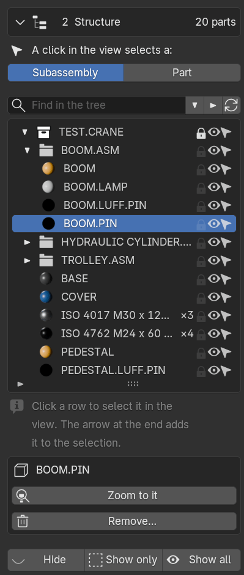

The tree shows the model like Windows Explorer: subassemblies with the parts inside them.

- **A click in the view selects a**: **Subassembly** (the whole subassembly of the part you click) or
  **Part** (only that part).
- Open or close a subassembly with its arrow. The two arrows next to the search box open or close all;
  ↻ reads the tree again.
- **Find in the tree**: type part of a name. The tree shows the matches with the subassemblies above
  them.
- Click a row to select it in the view. The arrow at the end of a row adds it to the selection, so you
  can select several. The eye hides or shows it (also in renders). After **Build & play** the eye, **Hide**,
  **Show only**, **Show all** and a visibility set take the built animation off (a line in 1 Import says so): build it again, so
  the video shows the parts as you left them.
- Click a part in the view: the tree opens down to it and marks its row.
- Identical parts next to each other are one row ("× 4"). Identical subassemblies get a number at the
  end (":1", ":2"). The coloured ball is the part's material.
- Under the list: the selected row, **Zoom to it** and, for a subassembly, its lock. **Locked in place**
  (the normal state): it moves only with the subassembly it is in. Click it to unlock: it can then be
  moved on its own with G / R ([Moving and turning parts](#moving-parts)).
- **Hide** hides what is selected. **Show only** hides everything else; a red box "Showing only: …"
  with **Show everything again** brings the rest back. **Show all** shows everything you hid.

### Moving and turning parts

After an import every subassembly is **Locked in place**: it moves only with the subassembly it is in, so a
stray key cannot pull the model apart. Unlock what you want to move first.

1. **Right-click** the part in the 3D view and click **Unlock so it can move** (or click the **lock** at the end of
   its row in 2 Structure: closed = locked in place, open = free to move; greyed when a subassembly above it is
   locked – it still moves with that one). This unlocks the subassembly the part is in.
2. **Click** the part: its subassembly is selected. To move the **whole model**, select the top row of the tree in
   2 Structure (and unlock that one).
3. With the mouse over the 3D view press **G** to move or **R** to turn.
4. Press **X**, **Y** or **Z** to keep to that direction, then type a number: millimetres for G, degrees for R
   (for example **G X 500** moves it half a metre along X, **R Z 90** turns it a quarter turn).
5. Press **Enter** (or click with the left mouse button) to keep it there. **Esc** or a right-click puts it back.

When it cannot move, the status bar at the bottom says why at once and nothing starts:

- *"'…' is locked in place – right-click it > Unlock so it can move …"*: unlock it (step 1).
- *"The animation is built: a move now would be undone at the next Build …"*: click **Stop it to move joints by
  hand** at the top of 4 Motion, move it, then **Build & play** again – the new place is kept.
- *"Parts keep their size from the CAD model"*: **S** never scales a part.
- In the **Client view** nothing can be selected or moved.

Good to know: **Go to pose** puts subassemblies back where that pose had them – save the pose again after a move
(4 Motion > Poses & exploded views). To move something **for good** (it stays through poses and Build), use
[Place](#place) instead. A part with a joint keeps moving with its joint.
Clicking twice on the same spot selects the next part behind it (Blender's own): click once, or on empty space
first.

### Move, turn and remove: Place

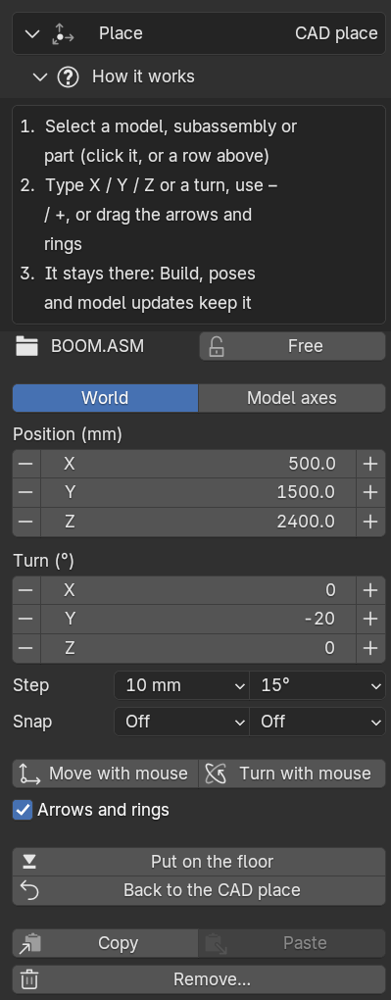

**2 Structure > Place** moves and turns a model, a subassembly or parts **by numbers** and keeps them there. The same
panel opens in a window of its own from the right-click menu: **Move / turn…**.

1. Select what you want to place: click it in the view, or click its row in 2 Structure. The name shows at the top
   of Place. A closed lock beside it means **Locked in place**: click the lock to free it.
2. Choose **World** (positions and turns in the world's X / Y / Z) or **Model axes** (how far it is from where the
   CAD file has it, along the model's own axes – 0 means on its CAD place).
3. Type a number in **Position (mm)** or **Turn (°)**, or click **–** / **+** to step it (the **Step** row under the
   fields: 10 or 100 mm, 15 or 90°). A turn turns it about the middle of its box.
4. **Snap** rounds what you type or drag (1 / 10 / 100 mm, 5 / 15 / 45°). Off keeps the exact number.
5. Or move it with the mouse: **Move with mouse** / **Turn with mouse** (X / Y / Z keeps to that axis, type a number,
   click to place, Esc cancels), or drag the **arrows and rings** that show on it while Place is open (switch them
   off with **Arrows and rings**).
6. **Put on the floor** moves it straight down (or up) until its lowest point sits on the floor (the surroundings'
   floor, else height 0). **Back to the CAD place** puts a subassembly or part back where the CAD file has it;
   for a whole model the button is **Back to where it was imported**.

What a Place move does:

- **It stays.** Build & play, poses, Reset pose, saved scenes and a model update keep the new place (a move with **G**
  / **R** by hand is a pose's move: Go to pose and Reset pose put it back).
- **A whole model** moves with everything on it: joints, cylinders, mechanisms, hoses, cables, labels and cameras
  that ride on its parts.
- **A subassembly with a joint** (the boom on its pin): when you move everything the joint moves, the joint's axis
  goes with it. When the joint also moves other parts, only what you chose moves and the axis stays.
- **A built animation** is taken off first – Build again afterwards.
- In the **Client view** nothing can be moved.

### Remove a model, subassembly or parts

**Remove…** – at the bottom of Place, in the selected row's box in 2 Structure, in the right-click menu, and outside
Full access the **Delete** and **X** keys – opens a window that lists what goes with it:

- the parts, its joints, cylinders, mechanisms and way covers, hoses and drag chains, cables, drums, tracks, labels,
  logos and stickers on it, and animation steps that only move it;
- what only loses something: a joint that keeps moving other parts, a camera step that looked at it.

Click **Remove** to take it all out of the project, or **Close** to keep it. **Ctrl+Z** brings everything back in one
step. Saved poses and scenes keep working. The import stays: **1 Import > Imported models** brings a removed model
back.

**Remove or Clean-up?** Remove takes things out of the project for good (only Ctrl+Z brings them back). **Clean-up**
(below) only takes parts out of the view and the renders – the joints and everything else stay, and **Restore all**
brings them back at any time.

### Copy and paste a model, subassembly or parts

**Copy** and **Paste** – at the bottom of 2 Structure > Place, in the right-click menu (**Copy**, **Paste here**), and
outside Full access **Ctrl+C** / **Ctrl+V** – make a second one of a model, a subassembly or parts, **with its joints
and mechanisms**:

1. Select what you want twice (click it, or its row in 2 Structure) and click **Copy** (or press **Ctrl+C**).
2. Click **Paste** (or **Ctrl+V**): the copy stands **beside the original**. Right-click a spot and **Paste here**:
   it stands there (the middle of its box over the spot, on it).
3. The copy is selected, free to move, and **Move / turn** opens for it: type where it goes, or drag its arrows.
   At the bottom the window says what came along and what was left out. **Ctrl+Z** takes the copy away again.

**What comes along:** its parts (they **share their shapes** with the original, so the project hardly grows), their
looks and groups, its **joints** (limits, the pose it is in, couplings between them), **cylinders**, **mechanisms**,
**way covers**, **hoses and drag chains** whose both ends are in the copy, **labels** on its parts and **logos and
stickers**. Names count up: the copy of "TEST.CRANE" is "TEST.CRANE (2)", its joint "Boom (2)", the next one "(3)".

**What reaches outside the copy is left out – the copy moves by itself:** a joint that also moves parts outside the
copy, a cylinder, mechanism, hose or way cover with a piece outside, and a coupling to a joint outside the copy (the
copied joint then moves on its own). A joint that sat on something outside sits on the copy. **Cables, drums,
tracks**, trail lines, animation steps and cameras stay with the original: add them on the copy where you need them.

**Model updates:**

- A copy of a **whole model** is a second one of the same model: when you update the original to a new revision of
  its STEP file (1 Import > Update model), the copy is updated too – and the other way round. Each keeps its own
  place, joint positions and work.
- A copy of a **subassembly or parts** becomes a model of its own (its own top row in 2 Structure) with its own parts.
  It stays as it is when the original is updated, and it cannot be updated itself: update the original, then copy it
  again.

### Clean-up

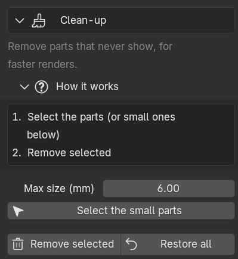

Removes parts that are never seen (inside parts, tiny screws), so renders get faster.

1. Select the parts, or set **Max size (mm)** and click **Select the small parts**.
2. Click **Remove selected**. They disappear from the view and from every render, but stay in the
   project: **Restore all** brings them back.

### Visibility sets

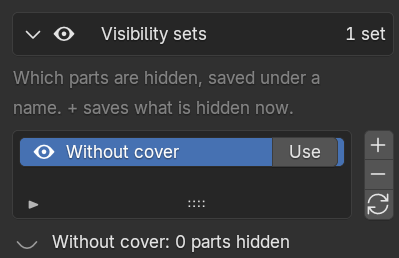

Saves which parts are hidden, under a name such as "Without cover".

1. Hide parts (the eye in the tree, or **Hide**).
2. Click **+** and type a name.
3. Later, **Use** hides and shows the parts exactly as saved. ↻ overwrites the selected set with what is
   hidden now, − removes the set.

## 3 Looks – materials and colours

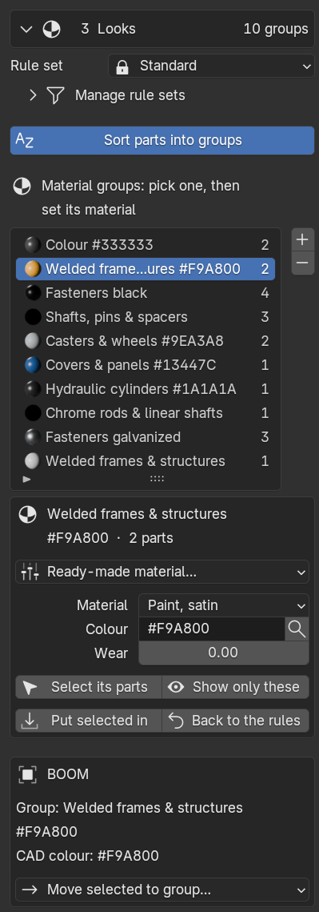

Every part is in a **material group**, and every group has one material. The import sorts the parts
into groups by itself, with the project's **rule set** (at the top of 3 Looks, see
[Rule sets](#rule-sets)). The built-in rule set **Standard** uses:

- **fasteners** – bolts, nuts, washers recognised by their DIN/ISO names – by type and finish
  (galvanised, stainless, black…);
- **part types** by name: profiles, shafts, chrome rods, cylinders, bearings, hoses, cables, cable
  chains, motors, sensors, guards and many more – also Dutch and German names and supplier order
  codes (Misumi, SMC, Festo, igus, HIWIN, THK, SKF, Sick, Omron and many more), also when the code
  sits inside a longer name such as "PSFJ20-300_SHAFT" or "_LMUW20_1". Since 0.2.222 also hose ends and tube
  fittings ("Schneidring", "SNIJRING", "HOSE TAIL"), test points, rotary unions, compressors, coolers,
  receivers, pressure and temperature sensors, linear scales, claw and bellows couplings, crossed roller
  guides, wire rope ends and lifting points ("Kausche", "PERSHULS", "Lastöse"), rod seals and wipers,
  index plungers, magnet catches, thrust washers and more, and the German and Dutch one-word fasteners
  ("Federscheibe", "Nutmutter", "SLEUFMOER", "Senkniet");
- the **shape**, only for parts whose name says nothing ("Part123", "Onderdeel4", a drawing number): a
  thin flat ring with a round hole is a **washer**, a hexagon with a bore about as high as a nut is a
  **hex nut** (both go to the fasteners), a torus is an **O-ring** (Seals & O-rings). Anything else
  keeps the group its CAD material or colour gives it;
- the **material name** in the STEP file (Fusion writes it);
- the **CAD colour**.

A part that fits nothing goes to **Unsorted**; the header then says "… unsorted" in red.

Faces painted in CAD come in painted: a face with its own colour or appearance in Inventor or Fusion
keeps it, and the rest of the part gets the part's material (see [Paint faces](#faces)).

**Give a group its material**

1. Click the group in the list (the number is how many parts it has; a brush with a number: a group
   used only by painted faces).
2. **Ready-made material…**: pick a machine material (aluminium profile, anodised, stainless, ground
   or turned steel, chrome, hydraulic chrome rod, cast iron, galvanised, rubber, POM, RAL paint…). Or choose a **Material** yourself and, for paints and
   plastics, a **Colour**: a RAL code (RAL 5010) or a hex code (#13447C). The magnifier picks from the
   RAL list.
3. The view shows the new colour at once (the real material in **Live preview**, top left).
4. **Wear** (slider under the material, 0 = new): how used the parts look. Sharp edges turn lighter or
   bare metal in places and corners get a little dirt. 0 is right for marketing pictures; 0.2–0.4 looks
   "in service". The edges show in Cycles renders; Fast preview (EEVEE) shows only the dirt in corners.
5. **Rust** (slider under Wear, 0 = none): see [Rust](#rust) – only steel and iron have it.

**What the materials look like**

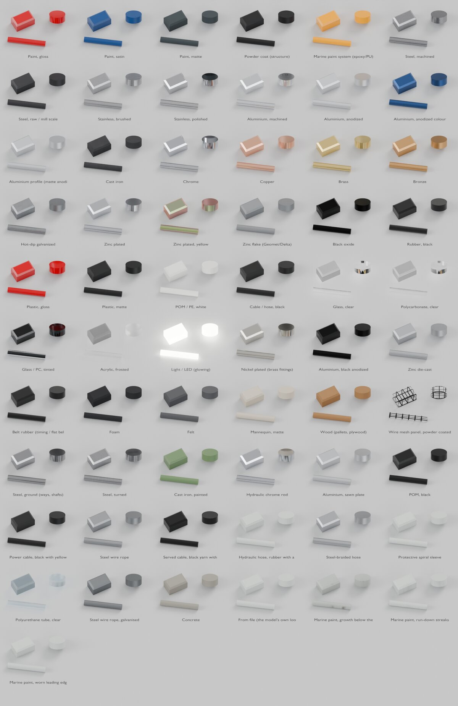

- **Metals** have the fine marks of how they were made, read from the part's own shape, so every copy
  looks the same: **Steel, ground** (fine straight lines along the part's longest side – ways, shafts),
  **Steel, turned** (rings round the part's round axis), **Aluminium, machined** (faint face-milling
  arcs), **Stainless, brushed** (brushed along the longest side), **Hydraulic chrome rod** (mirror-like,
  polished along the rod). The marks are smaller than a millimetre: close up you see them, from a
  distance the metal just looks real.
- **Anodised aluminium** (natural, black, colour) has the soft satin sheen of real anodising.
- **Raw stock for milling**: **Aluminium, sawn plate** (rolled plate, a little dull, faint rolling lines
  along its longest side), **Steel, raw / mill scale**, **Cast iron**, **POM / PE, white** and **POM,
  black**. Give the block one of these: the faces the bit cuts get a fresh-cut look of their own (4 Motion >
  Milling > Cut faces).
- **Cast iron** as cast (rough, slightly mottled) and **Cast iron, painted** (paint over the casting's
  waviness, any RAL colour).
- **Paint**: gloss, satin and marine paint have a little orange peel (seen in reflections), powder
  coat its fine structure.
- **Rubber** is not pure black: a soft sheen and a little dust. **Glass and polycarbonate** look like
  glass in Cycles and in Fast preview.
- **At sea and outdoors**: **Marine paint, growth below the waterline** is marine paint in your colour with
  dark green-brown sea growth below the water (its top edge ragged, a little below the waterline) and a
  splash zone of about 2.5 m above it with a greenish tint and thin rust streaks. The waterline follows the
  sea of 5 Scene & Render > Background & surroundings (without a sea: height 0). **Marine paint, run-down streaks**:
  light dirt and rust streaks running down upright faces (towers, walls), never on decks.
  **Marine paint, worn leading edge (blades)**: for a wind turbine blade. Along the blade's front edge, from
  about 60 % of its length to the tip, the paint is worn away in patches: dull grey glass-fibre shows, with
  small chips. It expects the blade as the CAD file draws it (length along the part's z axis, front edge
  towards -y); a blade drawn the other way round wears on its back edge.
  **Concrete**: cast concrete for foundations and pedestals, matte light grey.

Projects made with an older version get the new looks when you open them; every group keeps its
material and colour.

**More in this section**

- **Select its parts** selects them in the view; **Show only these** hides all other parts
  (**Show everything again** in 2 Structure brings them back).
- **Put selected in**: the parts selected in the view go into this group, whatever the rules say.
  **Back to the rules**: the rules decide again for them.
- **Make it a rule** under "Everything in … to this group" (shown when a subassembly is selected in
  2 Structure): every part in that subassembly goes into this group, also in later revisions.
- **+** adds a group; **−** removes the selected group (its parts are sorted again by the rules).
- Click a part in the view (with **Part** chosen in 2 Structure): a box shows its group, CAD colour
  and CAD material, with **Move selected to group…**.
- **Sort parts into groups** sorts everything again with the rules. Parts you put in a group yourself
  stay there.

### Finishes: knurls, spun ends, plate patterns, blasted metal, textures

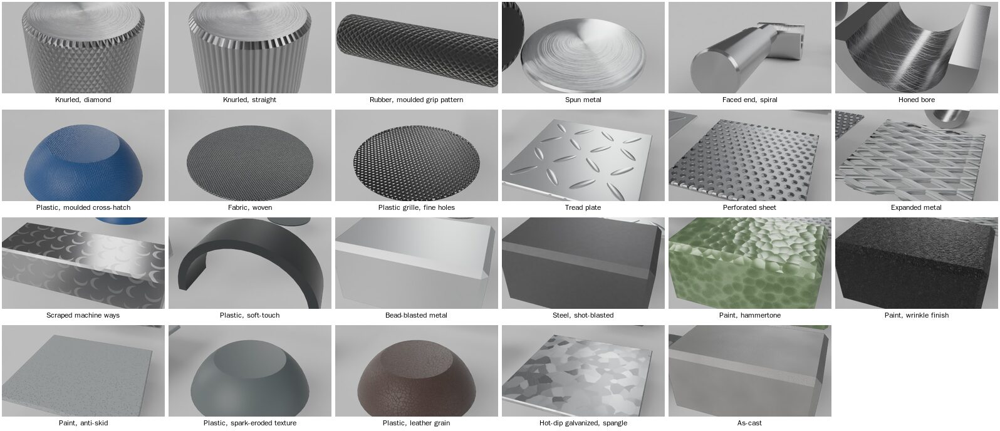

**Finishes** are ready-made materials with a pattern of their own: a knurled knob, the rings of a spun
cap, a tread plate, a perforated sheet, a moulded plastic texture. Pick one as a group's **Material**
(they are in the lists with the other metals, plastics and paints, or under **Ready-made material…**).
Nothing else to set up: the pattern finds its own direction and size on every part, without UV maps,
and looks the same on every copy of a part and after a model update.

- **On round parts** – the pattern follows each round face of the part: **Knurled, diamond** and
  **Knurled, straight** (knobs, thumb screws, handles; the end faces get fine rings), **Rubber, moulded
  grip pattern** (handles), **Spun metal** (rings round the centre of caps and discs: the radial highlight
  moves round as the light moves), **Faced end, spiral** (the faced end of a turned part, turned rings on
  its round faces), **Honed bore** (the honing cross-hatch inside bores, turned rings outside).
- **Sheet and plate patterns** – in the part's own directions: **Tread plate**, **Perforated sheet** (round
  holes or slots, see-through), **Expanded metal** (see-through), **Scraped machine ways** (the half-moon
  flaking), **Plastic grille, fine holes** (see-through), **Plastic, moulded cross-hatch** (follows curved
  shells), **Fabric, woven** (speaker cloth).
- **Carbon fibre** and **Perlage** – see [Carbon fibre](#carbon) below. Perlage (engine turning): brushed
  circles laid in rows, each later spot over the earlier ones, each with its own swirl and highlight; on
  stainless, aluminium or brass, **Spot size** 4 mm.
- **Grains** – a 3-D grain without a direction: **Bead-blasted metal**, **Steel, shot-blasted** (before
  paint), **Paint, hammertone**, **Paint, wrinkle finish**, **Paint, anti-skid** (decks, walkways),
  **Plastic, spark-eroded texture (VDI 3400)**, **Plastic, leather grain**, **Plastic, soft-touch**,
  **Hot-dip galvanized, spangle** (large zinc crystals), **As-cast** (sand-cast aluminium or iron).

**A finish's own settings** sit under the group's material – only the ones it has:

- **Metal** – the metal under the finish (a knurl on steel, stainless, aluminium or brass; tread plate on
  aluminium, galvanized or steel …). Paints and plastics take the group's **Colour** instead.
- **Kind** – bead-blasting **Fine / Medium / Coarse**, **Round holes / Slotted holes**, the **VDI 3400 class**
  (24 fine … 36 coarse), the cast metal (**Aluminium / Iron**).
- **Pitch**, **Feed**, **Hole size**, **Grain size**, **Mark size**, **Crystal size** … – the size of the
  pattern in mm (a diamond knurl 0.8 mm, a tread plate 25 mm). Tread plate and scraped ways keep a size that
  fits the web 3D model's tiles (25 mm stays 25 mm, 12 mm becomes 11.8 mm).
- **Angle** – of a diamond knurl's grooves (30° is usual), of the honing cross-hatch, of a moulded grid.
- **Strength** – how far spun metal's highlight stretches.

**Far away a pattern fades by itself** to the look it averages to: a 0.8 mm knurl is crisp in a close-up
and a calm, slightly duller metal on a machine 10 m away – no flicker, no moiré. The app works this out from
the camera and the picture size; nothing to set.

Good to know:

- The round-part finishes use the round faces the STEP file has. A knob made of flat facets in CAD gets no
  knurl on them (the end faces still get their rings).
- Tread plate, expanded metal and the grille are relief in the material: the plate's outline stays flat.
  The see-through finishes show the part's back face through the holes.
- In the **web 3D model** the fine finishes (knurls, spun, blasted, VDI, fabric, carbon, perlage …) are exported
  as their average colour and shine; the coarser ones (tread plate, perforated, expanded, hammertone, spangle,
  leather, scraped …) as a texture.
- A rule set or a paint scheme keeps a group's material and colour; a finish's own settings start at their
  defaults there.

### Carbon fibre

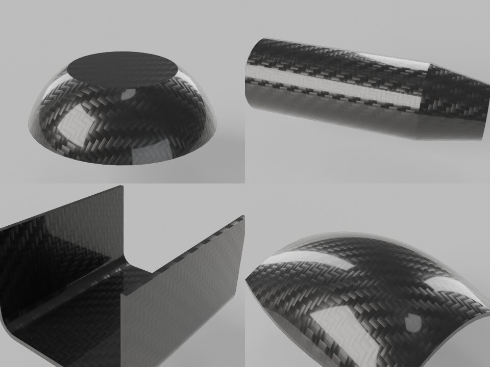

**Carbon fibre (twill / plain weave)** is a material like the others (in **Other**, or **Ready-made
material…** > Carbon fibre). The weave lies on **every CAD face of its own**: round the round faces (a whole
number of tows round a tube, so they meet without a seam), draped over a dome from its middle, flat on flat
faces – and it runs on across a fold or a bend into the next face, as a draped ply would. It never switches
direction in the middle of a curved face (the 45° seam other programs show). Where two faces cannot continue
each other (the end of a tube against its round side, the flat top of a cup) the weave meets as at a ply
joint, where a real part has one too.

- **Kind** – **2x2 twill** (the usual diagonal look) or **Plain weave** (a calm chequer).
- **Tow width** – 2 mm for the common 3K cloth; 1–8 mm.
- **Gloss** – 1 = a glossy clear coat, 0 = matte. The weave shows under the clear coat; each tow's
  highlight runs along its fibres, so neighbouring tows shine in turn as the part or the light moves.
- Far away it becomes an even dark grey with a soft sheen.
- It needs the part's CAD faces (a STEP model); a mesh model shows the weave on its own flat faces.

### Rust

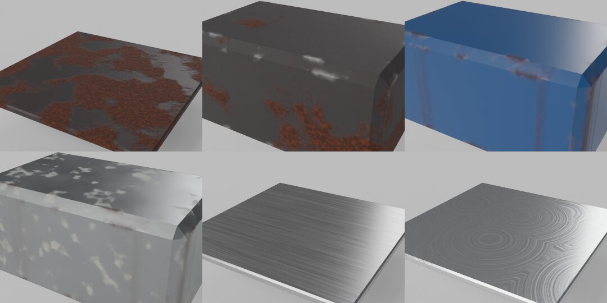

**Rust** is a slider under a group's **Wear** (0 = none, 1 = heavy), only where it is logical:

- **Bare steel and cast iron** (machined, ground, raw, cast iron, a steel knurl …): rust patches 10–40 mm
  that start in the corners; a little gives a thin brown film (flash rust), a lot flaking rust.
- **Painted steel**: rust only where the paint is worn through – at the edges and scratches Wear makes (a
  higher Rust wears a little more off) – with short streaks running down the sides below.
- **Galvanized and zinc-plated steel**: red rust only where the zinc is worn, dull white rust on the zinc.
  Chrome and nickel plating: red rust only where worn.
- **Stainless steel, aluminium, brass, copper, plastics, glass**: no slider – the row says why (stainless
  steel does not rust, aluminium only greys …).

It is the same rust as the marine streaks and the welds: welds on the group's parts follow the slider (a
bare steel weld and its heat zone rust first). Rust in corners and at worn edges shows in Cycles; in the
web 3D model the rust patches of bare steel keep their colour, the corners and edges do not.

### Rule sets

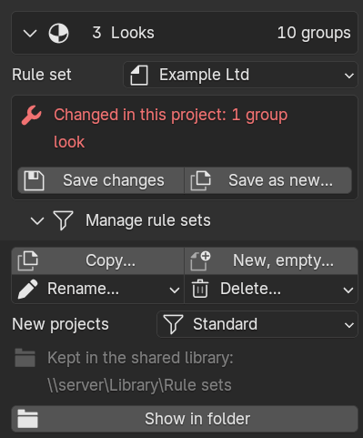

A **rule set** is one way of naming and sorting: the sorting rules, the material of each group, and the
group names. Make one for your company, and one for each client whose STEP files use other names. Each
project uses one rule set, shown at the top of 3 Looks next to **Rule set**. **Standard** is built in
and cannot be changed; make a copy to change it.

**Make your own rule set**

1. Open **Manage rule sets** and click **Copy…**. Type a name, for example your company, and click
   **Save**. The project now uses the copy.
2. Change what you want: group materials (above), [sorting rules](#rules), **Make it a rule** in
   [Find & sort parts](#find).
3. A box appears: **Changed in this project: …** lists what differs from the saved rule set.
   **Save changes** puts the changes into the rule set, so other projects can use them. **Save as
   new…** makes another rule set of it. Changes you do not save stay in this project only.

**Switch a project to another rule set**

1. Click the name next to **Rule set** and pick another rule set.
2. A window first shows what will change: how many parts change group, which groups are new and which
   go away, how many parts are unsorted now and after. Click **Switch**.
3. The parts get their new groups and the groups their new materials. Parts you put in a group by hand
   stay where they are. <kbd>Ctrl</kbd>+<kbd>Z</kbd> goes back.

**More in Manage rule sets**

- **New, empty…** starts a rule set without rules: every part goes to Unsorted, and you build it up
  with Find & sort parts and **Make it a rule**.
- **Rename…** and **Delete…**. Projects that use the rule set keep their own copy of it.
- **New projects**: the rule set every new project starts with (also in Edit > Preferences >
  Add-ons > Fresing Render, **Default rule set**).
- Rule sets are files in the **Rule sets** folders of [Locations](#locations): the company's, a department's and
  your own, so colleagues use the same ones. The list shows them all, each with its badge (**Acme · Company**); the
  same name in two folders is listed twice. **Save as new…** asks where when you can write into more than one
  folder (your own first). **Show in folder** opens the folder new ones go to.

**Good to know**

- A project keeps its own copy of its rule set, so it opens the same on another PC or when the shared
  library cannot be reached.
- When a colleague saved a newer version of your rule set, a box says "The library has a newer version
  of …": **Load it…** takes it over. **Save changes** warns you before it replaces a colleague's newer
  version.
- A rule set that is only in this project (for example after its file was deleted) shows "Only in this
  project" with **Save to library…**.
- Projects made with an older version open unchanged: their rules become a rule set called "From this
  project" (or Standard, when they were never changed).
- A [template](#schemes) remembers its rule set by name and keeps a copy: loading it uses the rule set
  from the library when it is there, otherwise the template's copy.

### Paint faces

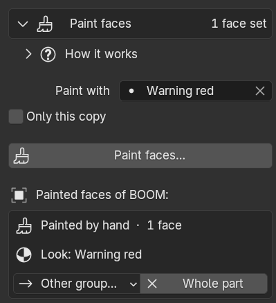

Gives single faces of a part another look: a painted end face, a coloured edge strip, a label area.

1. **Paint with**: the group whose look the faces get. Empty: the group selected in the list above.
   For a new colour, first add a group with **+** and give it its material.
2. **Only this copy**: tick it to paint only the copy you click. Unticked, every copy of the part gets
   the same painted faces.
3. Click **Paint faces…**, then click faces on the model. A click paints the whole CAD face under the
   mouse; <kbd>Shift</kbd>+click gives a face back the look of its part. You can still turn and zoom
   the view. <kbd>Enter</kbd>, <kbd>Esc</kbd>, a right-click or **Done** ends and keeps what you
   painted; <kbd>Ctrl</kbd>+<kbd>Z</kbd> afterwards takes the painting back.
4. Click a part to see its painted faces under the button. **Other group…** gives a set of faces the
   look of another group; **Whole part** makes them look like the rest of the part again.

Faces painted in CAD are listed the same way. A sorting rule on their colour can give them another
material, for example "CAD colour is #C0C0C0 → Anodised"; only colour and CAD-material rules act on
single faces. A model update keeps the painted faces of parts whose faces did not change.

### Logos & stickers

Puts a logo, text, a type plate or a sticker on the machine itself. It lies on the face like a real
sticker, moves with its part (joints, animations, exploded views) and hides with it.

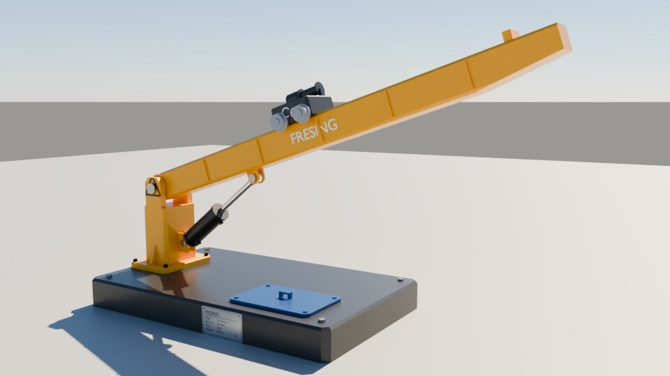

1. **Picture / Text / Sticker**: what goes on.
   - **Picture**: a logo or picture file. A PNG with a see-through background looks best; a JPG works
     too. The button right of the field lists the logos in the library (below).
   - **Text**: type it; `|` starts a new line, as in `Fresing|CNC 400`.
   - **Sticker**: ready-made, drawn by the app: CE mark, type plate, warning signs (general, hand
     crush, electricity, hot surface, hanging load), a straight arrow and a turning arrow.
2. **Only this copy**: tick it for something that differs per copy, such as a serial number.
   Unticked, every copy of the part gets it (a type plate on a bought motor).
3. Click **Add decal…**, then click the spot on the model where its centre goes. It lands flat on
   that face, upright. On a round face (a cylinder barrel, a drum, a tank) it wraps round like a real
   sticker. Before you click, the face under the mouse lights up and the note says "lies flat" or "wraps round".
  <kbd>Esc</kbd> or a right-click cancels.

Click a part to see its decals. The dot opens a decal's settings, the eye switches it off (it is kept,
but not shown or rendered) and × removes it (<kbd>Ctrl</kbd>+<kbd>Z</kbd> brings it back).

- **Move with the mouse**: the decal follows the mouse over its part, also onto another face of it.
  The mouse wheel turns it (15° a step, with <kbd>Shift</kbd> 5°), <kbd>Ctrl</kbd>+wheel makes it
  bigger or smaller. Click to put it down; <kbd>Esc</kbd> puts it back where it was.
- **Fit to face**: as big as fits on its face, centred on it. **Upright**: turned upright again.
- **Width** and **Height** in mm (with **Keep proportions** the other one follows), **Right** and
  **Up** move it on the face from the spot you clicked, **Turn** turns it, **Mirror** swaps left and
  right.
- **See-through**: 0 is a solid sticker. **Finish**: Matt, Satin, Gloss or Metal (a printed aluminium
  plate).
- Text and stickers: the **Colour** of the letters or symbol, and a **Background** and a **Border**,
  each on or off with its own colour. Text and type plates: the **Font file** (the button on the
  right lists the fonts on this PC). A type plate has Company, Type, Serial no., Year and Weight, and
  a small CE mark.
- Pictures: **White see-through** makes a white background see-through (for JPG logos).
- **Put it on this copy only** / **Put it on every copy** moves the decal between the two.

**All decals in this project** lists every decal; a click on one clicks its part. **Library of logos
and stickers**: put your logos as PNG files in the folder `Logos`, and stickers of your own in
`Stickers` ([Locations](#locations): your own, and the company's and department's – each picture shows its badge).
They then show in the list next to Picture. The panel has two rows, **Logos** and **Stickers**, each with
**Show in folder**, which opens your own folder of that kind.

Good to know:

- In the normal view (Solid) a decal shows as a see-through coloured patch. The picture itself shows
  in Material Preview and in renders.
- Pictures are kept inside the project: renders in the queue and the project on another PC have
  them, also when the picture file is gone.
- A model update keeps decals whose spot is still on the part, also when the part changed elsewhere.
  A decal whose face moved is switched off and named in the update report: open it, click **Move
  with the mouse** and click its new spot.
- A [template](#schemes) keeps the decals with the names of their parts: used on another machine, it
  puts them on parts with the same name, where the spot lies on the part.

### Welds

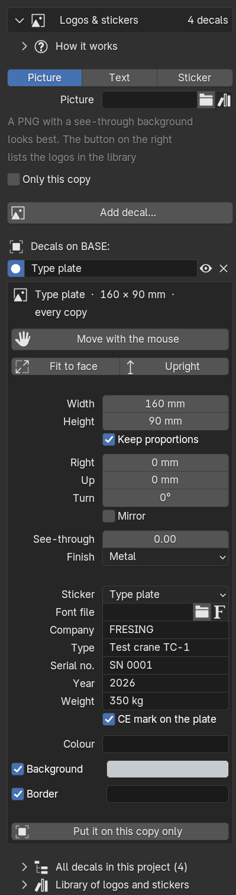 Welds with a weld opened: its seams, size, metal and finish">

Lays a real weld bead where two parts meet – picked like Inventor's welds: the faces of one part, then the faces
of the other, and a bead is laid on every line where the two sets meet. Steel, stainless or aluminium, painted
over or bare, rusty where it would be. The bead moves, hides, fades and is sliced with its part.

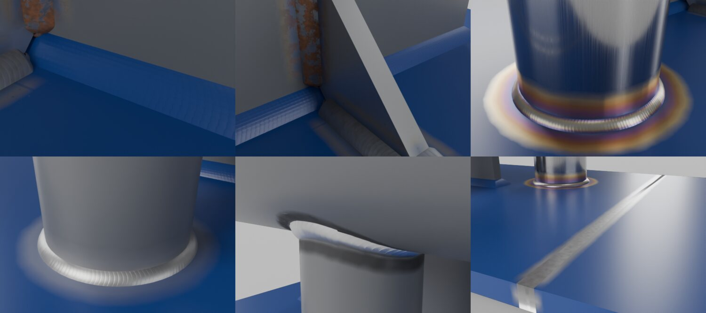

1. Click **Add weld…**, then click the faces of the **first part** – the bead moves with this part.
   A click picks that face; <kbd>Shift</kbd>-click adds a face or takes it away again. Picked faces turn blue,
   the face under the mouse magenta.
2. Press <kbd>Enter</kbd> (or **Next** in the panel), then click the faces of the **part it is welded to**
   (orange). The seams where the two sets meet show in the view at once, in green.
3. The panel lists the seams with a tick each (length, fillet / butt / all round, the corner's angle). Untick
   the ones you do not want – for a fillet on one side only, untick the other side. Press <kbd>Enter</kbd> or
   **Done**. <kbd>Esc</kbd> or a right-click cancels.

**The quick way**: select two parts (click one, <kbd>Shift</kbd>-click the other) and press **Weld two parts**:
every line where they meet gets a bead, each seam with a tick. Or right-click a face and choose **Weld to another
part…**: that face is the first part's face.

Where the parts meet: faces that touch, or with a gap up to 2 mm (a root gap, a loose fit in the CAD model; change
it with **Gap up to** under Seams). A plate on a plate, a gusset in a corner, a tube in a plate's hole (all round),
a coped tube on a tube (the saddle), a tube pushed through a plate without a hole, two plates edge to edge (a butt
weld) – each is found the same way. Faces lying on each other (the inside of the joint) never get a bead.

Click a weld in the list to see its settings:

- **Seams**: the ticks, **Gap up to**, **Find seams again** (after you moved a part) and **Pick again**.
- **Kind**: As found (a fillet in a corner, a butt where two faces lie flush), Fillet or Butt. **Size a**: the
  throat of a fillet, as on a drawing ("a5"); it starts at half the thinner plate. **Cap width** for a butt weld.
  **End craters**: a small dip where the bead starts and stops. **Intermittent**: pieces of **Piece** length every
  **Pitch**.
- **Metal**: From the parts (their looks: stainless, aluminium, else steel), or chosen. **Process**: MAG for steel
  (even ripples, a blue-grey oxide), TIG for stainless and thin aluminium (fine ripples), MIG for aluminium (wide
  "stacked coins", a sooty band beside it), Stick for steel (coarse, darker).
- **Finish**: **As welded**; **Painted** – the bead and its heat zone take the paint of the part you choose under
  **Paint of** (it starts painted when a part is painted); the ripples show through the paint, and with Wear the
  paint goes first at the bead's edges; **Ground flush** – no ripples, a brushed band.
- **Heat tint**: the colours the heat leaves beside the bead – stainless straw, purple and blue bands, steel a
  narrow blue-grey. **Pickled** (stainless): cleaned after welding, no tint, a matt bead. **Spatter** (MAG, stick):
  small drops beside the bead.
- **Rust**: a bare steel weld and its heat zone rust first, more than the plate; a painted weld only where Wear
  took the paint off; galvanised parts rust where the weld burnt the zinc, unless **Zinc sprayed after welding**;
  stainless only gets a faint tea stain (none when pickled); aluminium never rusts.
- Two different metals welded: a calm note says so. The eye in the list hides a weld; **Remove** takes it away.

Good to know:

- **Motion**: the bead goes with the first part. When a joint moves one welded part and not the other, the weld says
  "These parts are welded but move apart" with **Make them move as one**: the second part joins the first part's
  joint (or leaves its own when the first part stands still).
- **Model update**: a weld finds its faces again on the new parts. A weld whose faces or part are gone stays in the
  list, marked "Weld lost its faces – pick again", and is named in the update report: press **Pick again**.
- Hidden parts, the X-ray look, fades and the [Slice](#slice) take the weld along. The clash check leaves welds out.
- The [web 3D model](#web3d) has the beads in their colour (and paint); the ripples and the heat tint are only in
  renders.
- In the Client view welds show but cannot be changed.

### X-ray look

 X-ray look with the cover in X-ray">

See inside or behind a part in a still picture: an X-ray part is see-through with glowing edges.

1. Pick the **Colour** (light blue by default) and the **Strength**.
2. Select a subassembly or a part and click **X-ray the selected**; or pick a material group in the list
   above and click **X-ray this group** (the parts in it now).
3. **Selected back to own look** takes the look off the selected parts, **All parts back to own look** off every part. Changing the
   colour or strength changes every X-ray part.

It shows in the rendered view, in pictures and videos (Cycles and EEVEE), and is kept with the project. For a
housing that turns X-ray *during* a video, use a **Fade out** step with **Fade to X-ray** (6 Animation).

### Slice

 Slice with a plane slice through the pedestal and the boom">

Show the inside of a machine: a slice takes away part of the parts you choose, and the faces where it cuts through
the material are filled with a **cap colour** (a strong red, as on a section drawing). The parts are not changed –
switch the slice off and they are whole again.

1. Choose **Plane** (cuts the parts in two) or **Box** (takes away a corner or a quarter).
2. Select a subassembly (or a part) and click **Add slice: the selected**; or pick a material group in the list
   above and click **This group**; or **Whole model**. The slice goes through the middle of what it cuts and takes
   away the side that faces you in the view (or the camera), so you see the inside at once.
3. Under the list of slices: **Flip** (the other side goes; for a box: everything outside it), the **Cap colour**,
   **Hatch lines** with their spacing, and for a box its size. **Cuts … parts** lists what it cuts: **Add
   selected** / **Add group** adds more, the × takes one out (a gearbox housing sliced, the gears inside whole).
4. Move it: **Select the arrow**, then in the view press **G** to move it or **R** to turn it. The arrow points to
   the side a plane takes away. Or set it in **Place by numbers** (in the model's coordinates). **To the middle**
   puts it back.

Several slices per project are fine; the tick in the list switches one on or off, and the panel header shows how
many are on. Slices are kept with the project, in saved scenes (which are on), in the render queue and through a
model update (**Update to new revision…**, 1 Import).

**A slice that moves in a video.** Each slice has its own slide joint with the same name (**Slice 1** …): the
**Slide** value moves the slice along its arrow (0 = where you put it). In 6 Animation, a **Move joint** step with
that joint slides the slice in – "the housing opens up". Poses keep the slide too.

Good to know:

- Slices show in the rendered view (**Z > Rendered**), in pictures and videos, Cycles and EEVEE. The grey solid view
  shows the parts whole.
- Light falls in through the slice as it would through a real cut; parts inside cast their shadows.
- The cap colour is right for closed solids (every STEP solid is). A part made of open surfaces (a sheet drawn as a
  single surface) shows its inside face in the cap colour.
- Glass and logos/stickers are cut, but get no cap.
- Adding the first slice sets the **Floor gap** (5 Scene & Render) to 0.1 mm, if it was 0: a floor touching the
  bottom of a sliced part would otherwise show through its cut face.
- A slice and a [fade](#animation) work together: a sliced part that fades, fades with its cut faces.

### Find & sort parts

The quickest way to sort the unsorted parts, or to give one kind of part its own look.

1. Type a word of the part name. Several words: all must be in the name. `*` stands for any text, as
   in `M6*20`.
2. The list shows the names found, how many parts, and their group now. Tick the ones you want (the
   two buttons on the right tick or untick all of them). **Select the ticked parts in the view** shows
   where they are.
3. **Put ticked in new group '…'** makes a new group named after your search; **Put ticked in a
   group…** uses an existing one. Then give the group its material (above).
4. **Make it a rule → …** saves the search as a sorting rule for the selected group: the next
   revision sorts itself the same way.

Also here: **Common words in unsorted parts** (only when parts are unsorted; one click searches for
the word) and **Only inside …** (searches only the subassembly selected in 2 Structure). **Show only
the unsorted parts** (above, in red) shows what still needs a group.

### Sorting rules

The rules decide each part's group. They are checked from the top, and the first rule that fits a part
decides. The order is: fasteners → part type → CAD material → CAD colour → Unsorted. A washer or nut known
only by its shape counts as a fastener (type "Washer" / "Hex nut", no finish), an O-ring known only by its
shape as part type "Seals & O-rings".

- The tick switches a rule on or off; the number shows how many parts it caught.
- Click a rule to change it: **If** [*what*: part name, assembly path, CAD colour, finish, part type,
  CAD material…] [*test*: contains, is, starts with, matches pattern…] [*value*] → **Group**. A group
  name may hold {color}, {finish}, {kind}, {part_type} or {cad_material}: then you get one group per
  colour, finish, type or material. Rest the mouse on a choice in the lists to see what it means.
- **+** adds a rule at the top of the list (so it wins) for the group selected in 3 Looks; **Add from the
  clicked part** adds one "Part name contains *the name of the part you clicked*". The arrows move the
  selected rule up or down, **−** removes it.
- **Back to the defaults** replaces all rules with those of Standard. Projects made before version 0.2.8 that
  still had the old built-in rules get the new ones when they are opened; your own rules are kept.
- After changing rules, click **Sort parts into groups** in 3 Looks.
- The rules belong to the project's [rule set](#rule-sets): the header says **changed** when they
  differ from it. **Save changes** at the top of 3 Looks keeps them for other projects.

### Paint schemes & templates

- A **paint scheme** stores the material and colour of every group, for example "Customer blue" and
  "Fresing grey". **+** saves the colours you have now; **Use** switches every group at once.
- A **template** keeps the rule set, paint schemes, background and image settings, and the logos and
  stickers on parts ([Logos & stickers](#decals)), for the next project. **Save** writes a template file, **Load** reads one, **Library** picks one from your
  Templates folders.
- The folders the app reads from – 360° photos, templates, rule sets, logos, stickers and more – are set in
  [Fresing Settings > Locations](#locations): your own ones are ready from the first start, a company or department
  adds its own with one set-up file. **Default template** and **Default rule set** (Fresing Settings > General) are
  used for every new import.

## 4 Motion – joints, poses and exploded views

A **joint** lets a subassembly rotate (a boom on its pin) or slide (a trolley, a cylinder rod). Joints
have their own fold, **4 Motion > Joints**, like Cylinders and Mechanisms under it; open it with a click on
its title. **Everything back to CAD position** stays at the top of 4 Motion.

**Add a joint**

1. Click what should move. With **Subassembly** chosen in 2 Structure, one click takes the whole
   subassembly. "Selected: …" shows what you clicked.
2. Click **Add rotate joint** or **Add slide joint**.
3. Click the pivot on the model: a **hole or shaft** (the axis goes through its centre) or a **flat
   face** (the axis stands at right angles to it). The line at the bottom of the window says what to
   do; you can still turn and zoom the view. <kbd>Esc</kbd> or a right-click cancels.

**Before you click, the face lights up.** While the app waits for that click, the face under the mouse
turns magenta – the whole hole, shaft or flat face, as one piece – with the axis it would give: a line
through a hole's or shaft's centre, or an arrow standing on a flat face. Next to the mouse (and at the
bottom of the window) it says what it is, for example "PEDESTAL: Hole Ø100.4 mm – axis through its
centre". So you see whether you are on the hole or on the face next to it before you click. The floor and
empty space do not light up ("Not a part"); a spot this click would refuse turns red and says why. The
same happens for a cylinder's pins and the double arm's hub and pot hinge. Every other click on the model
works the same way (the sharp spot, a label's point, a decal, a trail point, the CNC zero, an air or coolant
nozzle, a tool-changer pocket): the face lights up, a dot sits where the click lands and a short note says
what the click does. It is only drawn in the view: never in a render or in the project. Switch it off under
Fresing > Settings… > General > "Highlight what is under the mouse when picking".

**Use a joint**

- Drag its slider in the list, or the big **Angle** / **Distance** field, or type a value. 0 is the
  position in the CAD file.
- **CAD (0)**, **Min** and **Max** jump to those positions. **Limits** keeps the joint between the two
  values next to it.
- **Click a joint in the list** to see what it moves: its arrow shows in the view (also when the arrows are
  switched off) and the parts it moves turn green; parts that also ride on another joint (a stack, a trolley on
  the boom) are a lighter green. Nothing gets selected by it, so a following click or <kbd>G</kbd> still acts on
  what you selected yourself. Hidden parts stay hidden: the box says "2 parts hidden". Clicking elsewhere in the
  view ends it. A click on a mechanism in 4 Motion > Mechanisms does the same for its moving links.
- **Show joint arrows in the view** shows or hides the joints' axes (and the cylinders' pin markers).
- **Set-up** (the fold): what moves (**Add** and **Remove** use the selected parts, **Select** selects
  what the joint moves), the axis (eyedropper: click a new pivot; ⇆ turns the direction around; **X Y Z**), the type (**Rotate**
  / **Slide**) and **Sits on**: the subassembly this joint is mounted on, so it moves along with it –
  the crane's trolley sits on the boom.
- **−** next to the list removes the joint; its parts go back to their CAD position. Joints that
  followed it stay where they are and move by themselves from then on.
- **Everything back to CAD position** puts every joint and moved subassembly back. A whole model moved by its
  top row stays where you put it.

**Two or more joints on one subassembly**

A subassembly can have several joints, and their moves add up: a carriage that slides 1000 mm in Y
and then 500 mm in X ends up at X +500 / Y +1000; a crane jib slews and then luffs.

1. Click a subassembly that already moves with a joint and click **Add rotate joint** or **Add slide
   joint** as usual. Above the buttons it says "Adds a joint on top of '…': the moves add up".
2. The new joint rides on the older one: its axis moves along with it. In the list it is indented
   under that joint, and its details say "Rides on '…'".
3. **Swap order** lets the other joint ride on this one instead. With two slides nothing changes; with
   a rotation it does (turn then slide, or slide then turn).

Removing a joint from such a stack gives what it moved back to the joint under it. In **Set-up** of
the lower joint, "Moves:" lists everything it moves and "Carries:" names the joints riding on it.

> When an animation is built (6 Animation), the joints follow it. **Stop it to move joints by hand**
> (in the red box) frees them.

### One joint moves others: couplings

A joint can **follow** another joint: when that one moves, this one moves with it. One joint then
drives a whole mechanism – and one animation step moves it all.

| Mechanism | Leader → follower | Ratio to type |
| --- | --- | --- |
| Gear pair, belt, chain | rotate → rotate | **turns per turn**: −0.5 for a meshing gear twice as big (meshing gears turn the other way); 1 for a belt over two equal wheels |
| Telescope section, gripper jaws | slide → slide | **mm per mm**: 1 for a telescope section; −1 for the second jaw |
| Spindle, ball screw, rack and pinion, winch rope | rotate → slide | **mm per turn**: the pitch (5 for a 5 mm screw); π × Ø for a pinion or drum |
| Rolling wheel, pinion on a fixed rack | slide → rotate | **° per mm**: 360 ÷ (π × Ø) |

1. Select the joint that should follow (the gear, the second jaw, the nut, the wheel) in the joint list.
2. Click **Follows a joint**. It picks a joint to follow; change it in the **Joint** field.
3. Type the **ratio** (its label says the unit, e.g. **° per mm**). The line under it says it in other
   words: "One turn every 157.1 mm: a wheel of Ø50.0 mm rolling along". **Offset** is where it stands
   when the joint it follows is at 0 (usually 0).
4. Move the leading joint: the follower moves along. Its own value is purple and cannot be dragged.

- **Chains** work: a motor drives a spindle, the nut carries a trolley, the trolley's wheels roll.
- **Telescope**: add the second section's joint to a section that already moves with the first one
  (it rides on it, see above), then **Follows a joint** picks the first section by itself. With
  ratio 1 the second section goes twice as far.
- Two joints that follow each other are refused, with the reason in red under the field.
- A following joint is not moved by hand, by poses or by animation steps: move the joint it follows.
  Poses only store the joints that move by themselves.
- Its **Limits** do not stop it: they warn – a short red **Beyond limits** on its Distance / Angle row (rest the
  mouse on it for the whole text) – and so does Build & play. The rows under it do not move, so the field you are
  dragging stays where it is.
- **Moves by itself** ends the coupling; the joint stays where it is. The leading joint shows
  "Drives '…'".

**Motors**

Tick **Motor (turns without end)** on a rotate joint (a drum, a fan, a drive): it has no limits and
the angle is also shown in turns ("= 2.50 turns"). In 6 Animation, the step **Run motor** turns it at a
speed you set.

Couplings, motors and their settings stay through a model update (1 Import) and in saved projects,
also when the PC does not allow scripts in project files.

### Cylinders

A hydraulic cylinder or an electric linear actuator hangs between two pins: one on the machine (the
barrel's end) and one on the part it moves (the rod's eye). The app keeps both eyes on their pins: when
the arm moves, the barrel turns about its pin and the rod slides in or out.

**Add a cylinder**

1. Make the joint for the arm first (Add rotate joint above, on the arm's pivot).
2. In 4 Motion > **Cylinders**: click the barrel (the tube with its end cap and eye – in the view, or its
   row in 2 Structure) and press **Add selected** under **Barrel**. Then click the rod (with its piston and eye)
   and press **Add selected** under **Rod**.
   **Each can be several parts or subassemblies** (a barrel drawn as a tube subassembly plus a loose gland):
   Shift+click or Ctrl+click selects several, and Add selected adds to what is already there. Each pick shows
   as a row with **×** to drop it; the bin icon empties the item. A part is never in both: adding it to the
   rod takes it off the barrel.
3. Press **Add cylinder** and click the **barrel's pin** (on the machine side), then the **rod's pin**
   (on the moving part). Click the pin itself or the hole it sits in; the line at the bottom of the
   window says which one is next. <kbd>Esc</kbd> cancels.

Move the arm: the cylinder goes along (**Follows the arm**). Two cylinders side by side on one arm each
get their own entry. The list shows how far each rod is out.

**Set the stroke instead: Drives the arm**

Press **Drives the arm** and set the **Stroke** (how far the rod is out, 0 = fully in): the arm turns to
match, worked out exactly from the triangle pivot – barrel pin – rod pin. **Fully in**, **CAD** and
**Fully out** jump there. The arm's joint now stops where the cylinder does (its Limits are set from the
cylinder). A cylinder that pushes a carriage on a slide works the same way.

- **Closed length** (pin to pin with the rod fully in) and **Full stroke** come from the parts: how far
  the piston can go back to the end cap and out to the gland. "measured" means they were found that way;
  "rough guess" means the parts did not show it – type the values from the cylinder's data sheet.
- In 6 Animation, the step **Move cylinder** moves the rod from one stroke to another; the arm moves
  with it, at the cylinder's pace. Poses and saved scenes keep the arm's position, so the stroke too.
- When drive mode is not possible, the reason is shown in red (for example: nothing moves the rod's pin
  yet, or the arm's joint does not turn about the pins' direction).

A rod out further than its stroke allows shows a short red **Beyond stroke** on the Stroke row.

**Set-up** (the fold): the barrel's, rod's and stages' parts, each with **Add selected** and **×** per part (the
stroke is read again from all of them; the barrel and the rod keep at least one); **Stages** for a telescopic
cylinder (select its sections between the barrel and the rod, then press Add selected: each section slides out
the same share of the travel); which part holds each pin (select the part, then **Barrel pin** or **Rod pin**); **Pins again**
(click both pins again); **Select parts**. The cylinder's pin markers show and hide with **Show joint
arrows in the view**.

Cylinders stay through a model update (1 Import) and in saved projects, also when the PC does not allow
scripts in project files. **−** next to the list removes a cylinder: its parts go back to their CAD place.

### Mechanisms

A mechanism is a set of arms or links that hold each other in a closed loop, so they cannot each have a
joint of their own: a **scissor lift**, a **four-bar** or **parallel arm** (also a toggle clamp), a
**slider-crank**, and other linkages that move in one plane (all pins pointing the same way). You drive
one link – by its angle, by the platform's height or with a cylinder – and every other link follows,
exactly, without ever flipping over to the other way the links could be put together.

**Add a mechanism**

1. In 4 Motion > **Mechanisms**, pick the **Type**: Scissor lift, Four-bar or parallel arm, Slider-crank,
   or Other linkage. The steps in the panel change with it.
2. Click the **base** – the frame or chassis it stands on, which does not move with it – and press
   **Base**. (Without a base, the rest of the subassembly the links are in is the base. Pick it whenever
   that subassembly also holds other moving parts, such as the lifting cylinder.)
3. Select every moving link: each arm or link one subassembly (Ctrl+click in the view, or in
   2 Structure). For a scissor lift: every arm and the platform. For a four-bar: the crank, the coupler
   and the rocker. For a slider-crank: the crank, the rod and the slider or piston. Click the link that
   drives **last** (for a scissor lift it does not matter: the arm on the fixed pin drives).
4. Press **Add mechanism**. The pins are found by themselves: where two links have a hole or shaft on the
   same line. A scissor's rollers run on the base and under the platform, along the line from the fixed
   pin to the roller; a slider slides along its own round face (a piston's outside, a guide bore). Arms
   made of two side plates that share all their pins count as one arm.

The panel shows what it found (Set-up: links, pins, rollers, sliders) and the reason when something does
not fit (for example: an arm that is pinned to the base twice cannot move).

**Move it**

- **Height** (scissor lift): the platform's pin above the base's fixed pin, in mm. Type it or drag it;
  **Lowest**, **CAD** and **Highest** jump there. The arms stop where they stand straight up, and at the
  bottom before they lie flat (2 % of the highest height: flat arms could fold either way).
- **Drive angle**: the angle of the drive joint (0 = as in the CAD model). It is a normal joint in the
  joint list above, named after the mechanism ("Scissor lift drive"): its limits are set to how far the
  mechanism can go; a four-bar whose crank can turn all the way round has none. Poses, saved scenes and
  the animation steps Move joint and Run motor move it like any joint, and it can follow another joint
  (couplings) – the mechanism goes along.
- **A cylinder**: add the cylinder (Cylinders, above) with its pins on the base and on an arm, or between
  two arms. It follows the mechanism; with **Drives the arm** its stroke moves the mechanism.
- When a position cannot be reached (a link too short, a roller beyond its line) the mechanism stays at
  the last position it can reach and says why in red.

In 6 Animation, the step **Lift height** raises or lowers a scissor lift's platform from one height to
another. When the animation is built, every link gets its place on every frame, so videos and the render
queue need nothing else, also on a PC that does not allow scripts in project files.

Mechanisms stay through a model update (1 Import: the pins are found again on the new revision) and in
saved projects. The joint list does not let you change or remove the drive joint while the mechanism uses
it. **−** next to the list removes a mechanism: its parts go back to their CAD place (and the drive joint
goes too, when the mechanism made it).

### Way covers

A **way cover** is the row of steel sections that slide into each other and cover a machine axis, so chips
and coolant stay off the guide ways. Here the sections follow the axis by themselves: you pick them once, and
every move of the axis – by hand, in a pose, in a Move joint or Run motor step, from a G-code program – opens
and closes the covers.

 

**Set it up**

1. In 4 Motion > **Way covers**, press **Add way cover**. Every cover of the machine is one line in the
   **Covers** list: a cover on each side of the table is two covers (name them "X left" and "X right" with a
   double-click), and covers on other axes are more lines. **+** next to the list adds the next one, **−** removes
   the chosen one. Everything below the list belongs to the chosen cover.
2. Step **1 Axis**: pick the **slide joint** the cover follows (the machine axis,
   made in Joints above). A machine without a joint yet: click the carriage and press **Make one from the
   selection**, then click a hole or face for the direction. Two covers on one axis both pick the same joint.
3. Step **2 Sections**: click the parts of one cover section – any number of parts or subassemblies – and press
   **Add section**. Do the same for every section, starting at the **fixed end** and working towards the
   moving end (the carriage). The arrows next to the list change the order; **−** takes a section out; **Select
   the section's parts** shows which parts it holds. A part can be in one section (of one cover) only, and a
   part that already moves with a joint (or follows one) is refused, with the reason.
4. **The biggest plate bolted to the carriage.** When the last section is fastened to the carriage – its parts
   are already moved by the axis joint – click those parts and press **Add section** as the last one. The list
   shows it with a pin and "carriage": it counts as a section (with five sections over 500 mm the others
   slide 100, 200, 300 and 400 mm), but it needs no joint of its own, because the axis moves it. It must stay
   the last section: adding a section after it, or moving it up, is refused with the reason. Remove it first,
   add the other section, then add the carriage parts again.
5. Step **3 Travel**: **Total movement** is how far the axis moves in all; **Read from the axis** takes it from
   the axis limits (Min and Max). **Flip direction** makes the sections slide against the axis' direction
   (rarely needed: a cover on the other side of the table still slides *with* the carriage, so it needs no
   Flip – it closes where the first one opens).
6. **Drawn at.** Was the cover drawn in CAD with the machine at mid-travel, not at the axis zero? Type that axis
   position in **Drawn at** (mm; 0 = the axis zero, the default), or pose the axis where the CAD shows it and
   press **Drawn at: read from the axis**. At that axis position every section stays exactly on its CAD place; the
   sections' shares are counted from there. The line under it says where the sections stand at 0 mm, and warns
   when "Drawn at" lies outside the axis limits. Every cover has its own "Drawn at".
7. Press **Make it**. The panel says what it made, for example "5 sections · 100 mm each · follows 'Y axis'".
   With several covers, choose each one in the list and press its **Make it**.

**How the travel is shared out.** Every section slides the same distance relative to its neighbour. With the
axis moving 500 mm and five sections, the sections stand 100, 200, 300, 400 and 500 mm from their CAD place
when the axis is at 500 mm – 100 mm each. With three sections it is 167, 333 and 500 mm. The line under
the travel fields always says what you get, in plain words.

Some covers are drawn with the **housing** (the part on the fixed side that never moves) as the first section.
Tick **Housing counts** for those: the first section stays, the others share the travel in one step less –
five sections over 500 mm give 0, 125, 250, 375 and 500 mm.

**Changing it later.** Adding, removing or reordering sections, changing the travel, Flip and Housing counts
re-share the travel at once. Sections you added since **Make it** need **Make it** once more. **−** next to the
Covers list (**Remove this cover**) removes the chosen cover: its sections' joints go and their parts go back;
the axis joint, the carriage and the other covers stay as they are.

**Projects from before 0.2.61** had one way cover: they open with it as the first line of the Covers list,
moving exactly as before.

Under the hood each section is an ordinary slide joint ("Way cover Section 1"; with several covers "X left
Section 1") that follows the axis (see
couplings, above), so the covers move in animations, in saved scenes and in the render queue, also on a PC that
does not allow scripts in project files. They stay through a model update (1 Import) and in saved projects.
To move the covers in a video, use the animation step **Move joint** on the axis – nothing else is needed.

### Hoses and drag chains

In a CAD file a hydraulic hose, a cable or a drag chain is stiff: it stays in the pose you drew it in. When
the machine moves, it would stretch, float or run through parts. Here they **bend along**: both ends stay on
their fittings, a hose keeps its length, and a drag chain rolls over its bend, link by link.

 

**A hose or a cable**

1. Click the hose in the 3D view. (Not sure which part it is? **Find hoses and chains** selects the parts that
   are named like a hose, a cable or a drag chain, so you see what was found.)
2. In 4 Motion > **Hoses and drag chains**, press **Add hose**. For a soft cable that hangs down, press **Add
   cable** instead. Several hoses: click them one by one, or select them all, then press the button.
3. The hose gets a line in the list. Move a joint (or a cylinder, or play an animation): the hose follows.
   A tick in its row means it works; the row says "too short" or "tight bend" when it does not.

The app reads everything from the CAD part: the middle line of the hose, its diameter, its length, and for
each end the part it touches (the fitting). **Find and add all** (shown while the list is empty) does all of
this for every hose, cable and drag chain it finds in one go.

**The settings of a hose** (under the list)

| Setting | What it does |
| --- | --- |
| **Stiffness** | 0 = a soft cable that hangs down, 1 = a stiff hydraulic hose that keeps wide bends. Move it until the hose looks like the real one. |
| **Sag** | How much the hose hangs down under its own weight. 0 = it only bends, 1 = a heavy hose. A stiff hose sags less. |
| **Smallest bend** | The tightest bend the hose may make, as a radius in mm (from the maker's data sheet). 0 = no limit. You get a warning when the motion forces a tighter bend. |
| **Length** | How long the hose is along its middle, in mm. It stays this long. Read from the CAD part; make it longer when the machine needs more. |
| **Diameter** (in the fold **More**) | The outside diameter in mm, read from the CAD part. Change it to draw a thicker or thinner hose. |

**End A** and **End B** say which part each end sits on. When the app picked the wrong part (or says "no part"):
click the right fitting in the 3D view, then press the **pipette** button next to that end. The end stays where
it is now and from then on moves with that part. **Fit to the CAD pose** reads the hose from the CAD file
again (length, diameter, ends); stiffness, sag and the smallest bend stay as you set them.

**A drag chain**

 

1. Click **one link** of the chain in the 3D view and press **Add drag chain**. The app takes the whole row
   of links by itself.
2. It reads the link length, the bend radius, and which end is bolted to the part that stands still (the
   **Fixed end**) and which rides with the axis (the **Moving end**).
3. Move the axis: the chain rolls over its bend and the moving end stays on its bracket.

A chain that is drawn as **one solid** works too: select that part and press **Add drag chain**. The app then
draws links along it, and in the fold **More** you set the **Width** and **Height** of a link.

| Setting | What it does |
| --- | --- |
| **Upper run** | **Straight**: the run from the bend to the moving end goes straight (a chain that carries itself, hangs, stands or lies on its side). **Lies on the lower run**: a long chain whose upper run slides on the lower one. |
| **Bend radius** | The radius of the bend in mm, to the links' pins. The bend keeps exactly this radius while it rolls. |
| **Links** | How many links there are (only for a chain the app draws). |
| **Link length** (in **More**) | One link from pin to pin, in mm. Read from the CAD. |
| **Fixed end / Moving end** | The part each end sits on, with the pipette button as for a hose. **Swap ends** makes the other end the fixed one: use it when the chain rolls the wrong way. |

**Warnings.** A problem shows in the list row, in the panel header ("1 of 4") and under the list, in red:

- **"too short at frame 120 (needs 35 mm more)"**: at that frame the ends are further apart than the hose is
  long. Make **Length** longer, or check the parts the ends sit on.
- **"bends tighter than 80 mm"**: the motion forces a tighter bend than **Smallest bend** allows. Make the hose
  longer or the motion smaller.
- A chain that **"cannot reach"**: its moving end goes further than the chain can follow – beyond its length, so far
  that the bend is pulled almost flat, or to the wrong side of the fixed run. Give it more **Links** or less travel;
  if the chain rolls the wrong way round, press **Swap ends**.

**Good to know**

- It works while you move joints and cylinders, in **Build & play**, in the render queue (also in the
  background), in saved scenes, with G-code programs, in turntables. The same frame always looks the same,
  whichever frame came before.
- After **Build & play**, changing a slider (stiffness, length …) is applied to the whole animation at once;
  you do not build again.
- A hose with some slack can lie in two ways, for example in a loop up or down. **Build & play** keeps one
  of them through the whole animation; a still of a single pose may show the other.
- The tick in the list switches an item off: the stiff CAD part shows again, exactly as imported. **−** takes it
  off the list; nothing is deleted from the model. **Select** (the arrow button) shows which part it is.
- The hose or chain takes the material of its CAD part, so paint schemes, hiding and fades work as before – until
  you pick a **Kind** (below): then it takes the kind's look.
- A model update (1 Import) keeps your hoses and chains, and the settings you changed.
- The clash check (6 Animation) leaves hoses and chains out.
- Not in yet: hoses that push against other parts or each other, hoses with three ends, and bundles of cables.
  A cable that runs over sheaves and winch drums is the next chapter, **Cables and paths**.

#### Draw a hose your CAD model does not have

Most CAD models have no hoses or cables. Draw them here, with a few clicks:

1. In 4 Motion > **Hoses and drag chains**, press **Draw hose** (or **Draw cable** for a soft cable that hangs).
2. Click the **fitting at end A**. The face under the mouse lights up in magenta with the line the hose will leave
   along: on a round stub or gland the hose leaves along its axis, from the end you click near; on a flat face (a
   fitting's end face, a port) from the middle of the face, straight out of it.
3. Click the **clips** the hose runs through, in order – as many as you like, or none. On a flat face the hose lies
   on the face; in a round bore it runs through along the bore.
4. Click the **fitting at end B**, then press **Enter**.

The hose appears in the list (named "Hose 1", double-click to rename it) and follows the motion like a hose read
from CAD. Its **diameter** comes from a round fitting you clicked (else 20 mm; a cable 12 mm), its **length** is the
shortest smooth line between its ends and clips that keeps its bends wide, plus 5 %. When the joints that move its
ends have **limits**, the length is long enough for their whole travel; without limits it fits the pose you drew it
in (the message says so) – give the joint its limits and press **Length as drawn**, or make **Length** longer by hand.

While clicking: **Backspace** (or Ctrl+Z) takes the last click back, **Esc** or a right-click stops without drawing,
the middle mouse and the wheel move the view as usual. A hose, cable or chain itself cannot be clicked (it shows red):
click the part it is fixed to.

#### Draw a drag chain between two brackets

A drag chain in CAD is often one simplified block, of no use for an animation. Draw a real one:

1. Press **Draw drag chain**.
2. Click the **bracket of the fixed end** (on the part that stands still), then the **bracket on the part that
   moves**. It is drawn at once.

The runs lie along the travel of the slide joint that moves the second bracket, the **bend radius** is half the gap
between the two runs, and the link length, height and width follow from it; the number of **Links** is enough for the
joint's travel (with its limits; else the distance between the brackets now, either way). The app draws the links;
they roll with the axis like a chain read from CAD. Under the list: **Flip bend** puts the bend on the other side,
**Swap ends** makes the other bracket the fixed one, **Links for the travel** works the number of links out again.
Change **Bend radius**, **Links**, **Link length**, and in **More** the **Width** and **Height**, as you like.

#### Replace a simplified CAD hose, chain or cable

A drawn hose, chain or cable can **replace** the simplified CAD part: that part is then hidden for good – in the view,
in renders, in the clash check and in the web 3D model – and shows again when you remove the drawn one.

- Click a part that is named like a hose or a drag chain: the panel offers **Draw a hose to replace it** (or a drag
  chain). While you click, that CAD part is hidden, so the fittings or brackets under it can be clicked.
- Or later: choose the drawn one in the list, click the CAD part in the 3D view, press **Replaces selected CAD part**.
  One link of a CAD chain is enough: its whole row is replaced. The eye button beside it shows the CAD part again.

#### Kind, colour and size

Every hose, cable and drag chain in the list – read from CAD or drawn – can get a standard **Kind**, a **Colour** of
that kind and a **Size** from its list (under the list, above Stiffness). The kind brings the look; the size sets the
numbers at once.

| Kind | Colours | Sizes |
| --- | --- | --- |
| **Hydraulic hose** – black rubber with a white printed line | black, grey | DN 6 … DN 51 of EN 853 type 2SN (outer Ø and smallest bend from makers' data sheets for that standard) |
| **Steel-braided hose** – a woven stainless braid | stainless steel | the same as the hydraulic hose |
| **Pneumatic tube** – matte polyurethane | blue, black, clear (see-through), red, yellow, green, silver | outer Ø 4, 6, 8, 10, 12, 16 mm (bend radius: one maker's typical values) |
| **Protective sleeve** – a spiral wrap, the black hose showing in its gaps | black, orange, yellow | 16 … 63 mm |
| **Machine cable** – a PUR cable made to move in a drag chain | grey, orange, black, green | 6 … 28 mm, smallest bend 7.5 × Ø |
| **Power cable** – a fixed cable with a smooth sheath | black, grey | 10 … 60 mm, smallest bend 10 × Ø |

- **Size** sets the **Diameter** and the **Smallest bend**. Change either number by hand and the size reads
  **Custom**: your own numbers. The line under Size says what the size gives ("Ø 19.0 mm, smallest bend 130 mm").
- A kind also sets a sensible **Stiffness** and **Sag**; change them as you like.
- One look per kind and colour, shared by every hose that has it: in 3 Looks it is a group ("Pneumatic tube,
  blue"), so you can still change that look there for all of them at once.
- **Kind: As in the CAD file** (every hose read before this version) keeps the part's own look and your numbers.
- A hose drawn with **Draw hose** starts as a hydraulic hose, a cable drawn with **Draw cable** as a machine cable,
  each with the standard size nearest the fitting you clicked. A drawn hose whose length is still "as drawn" gets the
  length that keeps the new size's smallest bend.
- The sizes without a public standard (cables, sleeves, drag chains) are invented round numbers, not a maker's
  catalogue.

#### Avoid other parts

A hose or cable bends between its ends and does not see the rest of the machine: where it would hang down, it goes
straight through a part in its way. Tick **Avoid other parts** (under the list, below Length) and it stays outside
the parts near it – it **lies on them and slides along** while you move the machine, and in the built animation.

- **Which parts count:** every part that shows near the hose – within its length of its two ends, in the pose it is in
  when you tick it (and again at every Build). Not counted: the parts its ends and clips sit on (it goes into its
  fittings), other hoses, cables and chains, and parts you have hidden. A part that comes near only later in a motion,
  from further away, is not seen: tick the box again in that pose, or press Build & play again.
- The hose keeps its **radius** (+ 0.5 mm) from their surfaces. Where it bends round a sharp edge it can cut the
  corner by a millimetre or two (it is a row of short straight pieces).
- It comes out of a part **on the side of its ends**: a hose that sagged into a block lands on top of it. Once it lies
  somewhere it stays on that side while the machine moves.
- It costs time: on the test model about 0.1–0.15 s per pose while the hose lies on a part (while it is clear of
  them, as before: under 20 ms) and about 4 s for a 4-second animation. Switch it on only for the hoses that need it.
- A wall about as thin as the hose (a sheet-metal guard) can still be crossed where the hose sags into it.
- A hose that **must** go into a part (its fittings, clips or via points force it) shows where in the clash check:
  tick **Check hoses that avoid parts** in 6 Animation > Clash check. Other hoses and cables bend on purpose and stay
  out of the clash check, as before.

#### Shape the route between the ends

The hose takes the shape its ends, length and weight give it. To lead it another way – round the far side of a
part, higher up, out of the camera's view – shape its route:

1. Choose the hose in the list and press **Shape the route** (under Avoid other parts). Its middle line shows as a
   thin white line, its ends and clips as grey dots.
2. **Click on the line** where it should go elsewhere: a **via point** (a white dot) appears there. Keep the mouse
   button down and **drag** it: the hose follows. A dot can be dragged again later; it moves square to your view, so
   turn the view to move it in depth.
3. **X** (or Delete) over a dot removes it. **Enter**, Space or a right-click: done – one step for Ctrl+Z. **Esc**:
   the route as it was.

The line under Avoid other parts says what the route runs through ("Route: 1 via point"); the **X** button beside
Shape the route takes every via point off. A via point sits on no part: it moves along with the parts the two ends
sit on – near end A with A's part, near end B with B's, in between part of each. The hose passes it smoothly, in the
direction from the point before to the point after.

**Automatic length** (ticked) works the length out again every time you change the route – long enough for the
joints' travel, as a drawn hose's first length. Unticked, the **Length** stays as it is and only its split over the
stretches between the points follows the route. Via points are kept when you save, and through a model update (where
they were in the view).

#### Drag chain types

A drag chain the app draws (drawn with **Draw drag chain**, or a CAD chain that is one solid) has a **Type**, a
**Colour** and a **Size**:

- **Open chain** – two side links and a crossbar at the top and the bottom: the cables inside show.
- **Closed chain** – lids top and bottom: a closed tube.
- **Half-open chain** – a lid on the outside of the bend, crossbars on the inside.
- **Steel chain** – steel side plates with round crossbar tubes, for heavy duty.

Plastic chains come in black, grey and orange; the steel chain in steel. A **Size** ("Chain 25 x 50": inside height
x inside width, in mm) sets the link's width, height and length and the bend radius nearest the one it has; the
number of links changes so the chain keeps its length. A drawn chain keeps a bend no bigger than half the gap
between its brackets (a bigger one could not come back to the moving bracket). A chain of real CAD links keeps its
links' own shape: it has no type or size. A drawn chain starts as an open chain of the nearest size.

### Cables and paths

A power cable or a steel wire rope runs over rollers, sheaves and chutes. In the CAD file it is one stiff solid,
drawn along its route. Here it **runs**: you give it one speed in m/min, the app draws the cable along its whole
route, and everything it touches turns at the right speed – the winch drum, the sheaves, the rollers. The
pattern on the cable (the yellow stripes of a power cable, the strands of a wire rope) runs along with it, so
you see it move. (A hose that hangs and bends is the other panel: **Hoses and drag chains**, above.)

**Add a cable**

1. Click the cable or the wire rope in the 3D view. It is the solid that is drawn along the route in the CAD
   file. (Parts named like a cable or a wire rope are found by name: **Add all … found by name** adds them all.)
2. In 4 Motion > **Cables and paths**, press **Add cable**. (Nothing selected: press it and click the cable.)
3. The cable gets a line in the list, and the list **What it touches** fills. The cable is drawn with its
   look: black with yellow stripes, or steel strands.

**Draw a cable route** (no cable in the CAD model)

1. In 4 Motion > **Cables and paths**, press **Draw cable route**.
2. Click where the cable **starts**: a winch drum or a carousel (the cable starts wrapped on it, from where you click),
   or a point on a part.
3. Click each **sheave, roller or chute** it runs over, in order, on the side the cable passes (click the groove or
   the barrel). Click the same part again and the cable passes on its other side.
4. Click a **flat face** where the cable ends – it is drawn at once – or press **Enter** for a free end that hangs
   down from the last wheel.

The app lays the cable tight over what you clicked and then reads it as it reads a CAD cable: it gets the same list
**What it touches** (rollers it lies on are found by themselves), every sheave, roller and drum turns with it, and
Build, the re-bake and the web 3D model work as for any cable. It starts as a **wire rope** of the standard size
nearest 20 mm: change its kind, colour and size under the list (see **Cable kinds** below), with **Speed from** as for
**Add cable**. Backspace, Ctrl+Z and Esc work as in **Draw hose**. A drawn cable
can replace the CAD part of a simplified cable: see **Replace a simplified CAD hose, chain or cable** above.

Above **Add cable** is **Speed from**. Leave it empty and the app makes a new joint "Cable <name>" for the cable.
Pick a slide joint you already have there (for example the speed of a winch) and that joint becomes the speed of
the new cable: no extra joint is made, and everything that follows it follows the cable.

The app reads the middle line of the cable and its diameter, finds where the cable bends, the sheaves it goes
round, the rollers it rests on (a pair of V rollers too) and the chutes it slides over. It makes a joint
"Cable <name>" whose value is the metres of cable paid out, and lets every roller and sheave follow it. A roller or
sheave that already has a joint of your own keeps it. **From CAD cable again** reads everything again, for when
you changed the part in the CAD file (contacts you added by hand are kept; a start you made a free end is read
from the CAD cable again; a contact you took off comes back). A **model update** keeps what you did: a contact you
took off stays off, contacts you added or flipped stay, and an update with the same file changes nothing at all in
the cable's route, its drum or carousel – the next Build gives exactly the same animation. The same holds for every
cable whose own parts (the cable, its rollers and sheaves, its drum) came back unchanged and with no changed part
within about 1 m of it, also when other parts of the model changed; only the cables near a change are read again.

**Make it run**

1. In 6 Animation, add the step **Run motor** (or press **Add a Run motor step** in the cable panel).
2. Pick the cable's joint, "Cable <name>". The speed is **Cable speed (m/min)**: laying a power cable is about 10
   m/min. A negative speed hauls the cable in.
3. Press **Build & play** and play. The cable runs, and the drum, sheaves and rollers turn with it.

You can also use a **Move joint** step on the cable's joint: "pay out to 25 m". The value of the joint is the
metres of cable paid out, so the same cable can be moved by hand in 4 Motion, like any slide joint.

**Cable kinds** (Kind · Colour · Size, above the look)

| Kind | Colours | Sizes |
| --- | --- | --- |
| **Machine cable** (PUR) | grey, orange, black, green | 6 … 28 mm, smallest bend 7.5 × Ø |
| **Power cable** | black, grey | 10 … 60 mm, smallest bend 10 × Ø |
| **Offshore power cable** | black with yellow stripes, or served yarn with yellow spirals (the looks below) | 100 … 300 mm, smallest bend 20 × Ø |
| **Wire rope** | bright, galvanised | 6 … 64 mm (the series makers list under EN 12385-4); smallest bend 10 × Ø – a sheave at least 20 × the rope's Ø (ISO 4308-1, class M5) |

A size sets the **Diameter** and the **Min. bend (MBR)** (in **More**); change one by hand and the size reads
**Custom**. A kind sets the **Look** that goes with it (the stripes, the served yarn, the strands, or a plain sheath
of the colour). **Own look** (every cable from before this version) keeps the look you picked. A rope too thick for
its sheaves says so: "bends tighter than its smallest bend … at SHEAVE 2" – pick a thinner size or bigger sheaves.

**The look**

The setting **Look** says how the cable looks. The look is a material (see 3 Looks), and the cable's part is put
into the group "Power cables", "Served cables" or "Wire ropes" for it.

| Look | Settings |
| --- | --- |
| **Power cable** | Black with yellow stripes at an angle. **Stripe distance** (from one stripe to the next, in mm), **Stripe angle** (90° gives rings round the cable), **Stripe width** (how much of the cable is yellow). |
| **Steel wire rope** | Twisted steel strands. **Lay length**: the length of one full twist of a strand, in mm – about 6 to 7 times the diameter. |
| **Plain** | The look the part has in 3 Looks. Nothing shows that the cable moves. |

**Served cable (yarn)**

Large export and array cables have an outer layer of black polypropylene yarn wound almost straight round the
cable, with two yellow marker lines painted on it. The lines run side by side as one spiral round the whole cable,
once round per metre. The look **Served cable (yarn)** draws that: fine grooves round the cable, some strands a
little darker or lighter, a little dust between them, and the painted lines with ragged edges. Like the stripes,
the lines and the yarn run along with the cable – also on its drum or carousel. The cable's part goes into the
group "Served cables".

| Setting | What it does |
| --- | --- |
| **Marker lines** | **Spiral** (default): continuous lines that wind round the cable. **Rings**: separate rings, as projects made with 0.2.116 have them. |
| **Pitch (one turn)** | The length of cable for one full turn of the spiral (1000 mm). With Rings: **Ring distance**, from one pair to the next. |
| **Hand** | **Right** (default): like a normal screw thread; held upright, the lines on the near side lean like the middle stroke of a Z. **Left**: the other way. |
| **Lines** | **Two lines** (side by side) or **One line**. |
| **Band width**, **Band gap** | The width of one line (35 mm) and the black gap between the two (30 mm). |
| **Band colour** | Traffic yellow; click it to pick another colour. |
| **Paint wear** | 0 = fresh paint with clean edges. Higher: ragged edges, paint gone from the grooves, black smudges. |
| **Yarn** (fold) | **Yarn pitch**: how far apart the strands lie (2.5 mm). **Lay angle**: 90° = straight round the cable (82°). **Yarn colour**. **Wear**: 0 = new, higher = dusty with lint between the strands. |

The grooves are 2–3 mm apart: from far away they blend into a dark grey surface; close up they show. The demo
project's power cable has this look. The web 3D model draws it too.

**What it touches**

One line for each thing the cable touches, in order along the cable: a **sheave** (the cable bends round it and
turns it), a **roller** (the cable runs over it and turns it, but does not bend round it), a **chute** (the cable
bends round it and slides over it) or a **bend** (it bends here as it was drawn, no part carries it). Each line
shows the diameter Ø in mm, how many degrees the cable goes round it (the wrap), and whether it runs over, under or
beside it.

- **Flip side** lays the cable round the other side of the chosen sheave or chute. Use it when the app chose the
  wrong side.
- **Remove** takes the chosen part off the cable's list. It no longer turns with the cable.
- **Add**: press it, then click a roller, sheave or chute in the 3D view that the app did not find.
- **Turns with the cable**: on for a roller or sheave that turns as fast as the cable runs over it. Switch it off
  for a guide that stands still.
- **Start on** / **End on**: the part each end of the cable is fixed to. Pick another part with the **pipette**
  button; the small **×** next to it makes the end a **free end** again, which stays with the last thing the
  cable touches. How far the cable runs straight on before the first or after the last thing is in the fold
  **More** (**Free at start**, **Free at end**).
- In **More**: **Diameter** (the cable lies higher or lower on its rollers when you change it), **Min. bend
  (MBR)** and **Runs the other way**.

**Sheaves that move**

A sheave on a luffing A-frame, or on a tilting arm, moves against the cable's other parts. The cable follows it
while you pose the machine, and **Build & play** works out the cable for every frame once; playing and
rendering then cost nothing extra.

Switch **Stays as drawn** on (in **More**) for a cable that must not follow: it keeps the path it has in the CAD
file, whatever moves.

**Warnings**

A problem shows in the list row ("tight bend", "lifted off", "no path"), in the panel header and under the list,
in red.

- **"bends tighter than its smallest bend (MBR … mm)"**: the cable is bent round a sheave tighter than the maker
  allows; the warning names the sheave. Change **Min. bend (MBR)** to the value of the data sheet (0 = no
  limit), then use a bigger sheave or a smaller motion.
- **"no longer touches 'SHEAVE 2'"**: at that frame the cable lifts off a sheave and is drawn straight past it.
  Check the motion, or take the sheave off the list with **Remove**.
- **"goes 250° round 'SHEAVE 1' … check its side and the order of the contacts"**: the cable goes much further
  round the sheave than in the CAD file. Press **Flip side**, or check the order of the lines.
- **"This part is not a cable"**: the part you picked is not a long round solid. Pick the cable itself.
- **"the CAD cable is drawn 3 mm off it"** (grey, a note and no fault): the cable in the CAD file hovers a few mm
  above the roller or lies a little into it. On a sheave or chute the app lays the cable into the groove; on a
  roller the cable stays where it was drawn and the roller turns at the speed of the cable's skin there.

**Good to know**

- The speed of each roller and sheave comes from where the cable touches it: the cable's middle on a sheave, its
  skin on a roller. A big sheave turns slowly, a small roller fast.
- **Select** (the arrow button) shows which part a line is. **−** takes the cable off the list: the part shows as
  in the CAD file again and the joints the app made for it go. Nothing is deleted from the model.
- The cable takes the material of its look; paint schemes, hiding and fades keep working. The clash check
  (6 Animation) leaves the drawn cable out, because it lies on its rollers on purpose.
- The cable going into the sea: **Into the sea**, just below. The coil on a carousel or a drum: **Drums and
  carousels**, below. The tensioner tracks that grip the cable: **Tracks and belts**, after it.

#### Into the sea

The cable leaves the vessel over its last contact – a horn, a chute or an overboarding sheave – and hangs in a
curve (a catenary) down to the seabed, where it lies behind the vessel. The app draws that curve with the cable's
exact length: as the cable pays out, more lies on the seabed; the cable leaves the horn exactly where the curve's
direction is the horn's, without a kink. Under **4 Motion > Cables and paths**, choose the cable and open the fold
**Into the sea**.

1. In 5 Scene & Render > Background & surroundings, pick **Open sea** and set the **Water depth** (and the **Water level**, so the
   vessel floats where it should).
2. Choose the cable and press **Into the sea**. Its last contact must be the horn, chute or sheave it hangs from
   (add it under "What it touches" when it is missing). The end of the cable that is under water in the CAD file
   becomes its end on the seabed.
3. Set where it touches the seabed: **Layback** (how far behind the horn, measured flat; 26 to 39 m is usual in 20
   to 50 m of water) or **Bottom tension** (the pull along the seabed in kN) with the **Weight in water** (kg/m; 0
   = worked out from the diameter, about 38 kg/m for a 200 mm power cable). The box below shows the other numbers:
   layback, the angle at which it leaves the horn, the tension at the seabed and at the top, how much hangs and how
   much lies on the seabed.
4. **On the seabed**: how much cable already lies there behind the touch-down. **Water depth** 0 takes the sea's.
5. **Vessel speed**: **With the lay** – the vessel moves as fast as the cable pays out, so the touch-down stays the
   same distance behind it; or **Vessel speed of Weather & time** – the vessel's own speed, the one the wake shows:
   5 Scene & Render > Vessel at work **Ahead** at the vessel speed of Weather & time (on or off), 0 when the vessel
   lies still, pushes sideways or turns, and in a video what its **Vessel at work** steps set (Build follows them:
   a step to Still stops the seabed; change the vessel's speed or setting after such a Build and the built animation
   is taken off – press **Build & play** again). The touch-down then comes nearer or moves further back when the speeds differ.

The touch-down is set in the pose at the animation's first frame (with nothing built: the pose shown), whatever
frame is shown, so **Build** gives the same animation at any frame. **Touch-down here** sets it again (after you
paid out cable by hand).

**What moves.** The scene keeps the vessel where it is; the **seabed moves aft** under it, with the cable lying on
it – its yellow stripes stand still there, while they run down the curve. With **Vessel motion** on, the horn rides
the vessel and the curve follows it; the touch-down and the cable on the seabed stay on the seabed. Nothing of this
costs time while the animation plays: Build & play works out every frame once.

**Warnings** (in red, with the first frame it happens):
- **"bends over the end of 'HORN' – more bottom tension or a longer chute"**: the curve is steeper than the horn's
  end; the cable leaves at the end with a kink.
- **"hangs too flat to touch 'HORN'"**: the cable is pulled so hard that it would leave before the horn.
- **"is so tight that it lifts its end off the seabed"**: drawn as a curve between the horn and its end, with its
  length; pay out more or set the touch-down again.
- **"has … m more cable than the water is deep"**: it would pile up on the seabed under the horn (drawn with its
  length: the cable laid earlier stays straight, the extra lies in one bight next to the touch-down).
- **"is … m too short to reach its end on the seabed"**: drawn straight.

**Things on the cable** (a CPS set, a bend restrictor, a pull head). Select their parts or their assembly in the 3D
view and press **Put selected on the cable**: they ride along with the cable over the rollers, over the horn and
down the curve, each segment a stiff piece lying on the cable. **Place**: **From the cable's end** (metres from the
end that lies on the seabed, with nothing paid out) or **At a payout mark** (its front passes the horn when this much
cable has been paid out). **Turned round** turns it end for end; **−** takes it off the cable again (its parts are
where the CAD file has them). A model update keeps it.

**Seeing it under water.** The sea's surface hides the cable. Under 5 Scene & Render > Background & surroundings tick
**Cut-away behind the stern**: a box of water behind the stern is taken away, placed by the cable (from the stern
to past the touch-down) or by its size and place when **Place it by the cable** is off. Its walls show the water's
colour, and **Water clarity** (2 to 40 m) sets how far you see into the water past them – the hull below the
waterline, the seabed further away, the cable beyond the box.

The box is open in the 3D view too – in Solid view and in Material Preview – not only in a render: inside it the sea,
its foam and (with the ground) the seabed and its stones are let down out of sight, with a straight wall along the box's
edge (only in the view; a render is made as before). It follows the box when you change its numbers.

**The ground in the cut-away.** The cut can go on into the ground. Under 5 Scene & Render > Background & surroundings, with the
cut-away ticked, **Show the ground in the cut-away** opens the seabed inside the box and shows a soil section there:
layers from sand to clay, their edges a little wavy, down to 5 m under the lowest part of the machine. A pile, a
J-tube or any other part that reaches below the seabed is then seen down to its end – the water level over the
machine's lowest point is more than the **Water depth**, so the lowest part lies in the ground. Outside the box the
seabed stays closed and hides what lies under it. The setting goes on by itself when you tick the cut-away and a part
reaches below the seabed; a project from an older version keeps it off. The offshore wind turbine of the site's kit
uses it: its "Seabed" shot looks at the 45 m of monopile in the ground, with the scour protection on top.

#### A cable on a moving part

A sheave, chute or quadrant the cable goes round may sit on something that moves: a trolley, a tilting handler, a
block lowered on a wire. The cable then follows it at every frame – live while you pose, and worked out once for
every frame when you build the animation. Three things help with that.

**Winch keeps it tight.** A wire from a winch over moving sheaves needs more wire when they move apart and less
when they come back. Tick **Winch keeps it tight** under the cable's speed: the app sets the cable speed itself so
the free length (from where the wire leaves its drum, or its start, to its end – or to where it arrives on the horn
it hangs from into the sea) stays as in the CAD file. The panel says how much the winch has paid out now; the drum,
the sheaves and the stripes turn and run with it. Build & play writes that payout for every frame. Do not move
that cable's speed with a step in 6 Animation as well: the app then leaves it to the step and says so.

**The cable hangs on from the next sheave.** A cable into the sea hangs from the last contact it still bends
round. When a quadrant or a block carries its sheave over the stern and down past the horn, the cable no longer
reaches the horn: it hangs from the sheave instead (the cable stays one piece, with its exact length). The fold
**Into the sea** says so in grey, for example "Hangs from 'SHEAVE': it left 'HORN' at frame 84" – no fault. Once
left, the horn stays left for the rest of the animation.

**Let go here.** Where the cable slides off a quadrant on the seabed, or its end is let go, go to that frame, choose
the contact under "What it touches" (or use the small button on the start or end line) and press **Let go here**.
From that frame on that contact or end no longer moves with its part: it stays where it was – for a cable into the
sea it stays on the seabed and passes aft with it, while the quadrant is lifted away. The line says from which frame
("It stays where it was from frame 231 on"); the button beside it, **Hold again**, takes it back. Build & play
reads the place at that frame again, so a changed motion is taken along.

**A chute or quadrant lying flat.** A quadrant tipped flat over the seabed holds the cable in its gutter: the cable
goes round to the gutter's end that points the way it lies on the seabed and leaves there, in a bend of the gutter's
radius down to the seabed. Lowered so close that a whole bend no longer fits, the bend turns only as far as fits and
the cable lies on the seabed from there – it never kinks at the gutter or curls into the seabed.

**Rollers and sheaves the cable has left stand still.** A roller or sheave that turns with the cable's speed turns
only while the drawn cable touches it: one the cable has lifted off, runs past or no longer reaches stands still for
those frames (Build & play keys it frame by frame; its coupling is put aside until **Clear keys**).

Try it in the Learning hub ("A cable on a moving part"): a trolley carries a block with a sheave over the stern, the
lift wire stays tight and the cable end is let go near the seabed.

#### A let-go cable settles onto the seabed

A cable into the sea that is let go above the seabed does not stay hanging in the water: what was let go – its end,
and the turn round a quadrant or sheave that was let go with it – sinks onto the seabed and lies there. A turn round
a quadrant lies down flat, the end goes with it. **Into the sea > Settles in** says how long that takes (4 s; 0 =
it stays exactly where it was let go, as before). The cable keeps its length; once it lies on the seabed the app
does not warn that it "piles up" or "bends over the end" – lying there is what it should do. Let it go just as the
quadrant or block starts to come up again, so the cable sinks while its carrier moves away.

The cable that already lies on the seabed when you let go **stays exactly where it lay**. Only the stretch that hung
in the water lies down: the end goes down and forward along the lay line together, so that stretch lies in line with
the cable before it, and what is left over lies in **one smooth bight** next to the end – never tighter than the
cable's **Smallest bend** (none set: 10 x its diameter). If the end cannot go forward far enough (it would hang from a
contact before it again), the bight grows sideways instead.

A project saved with version 0.2.109 or older opens with **Settles in** at 0 for a cable that was let go and never had
it set, so it stays where it was let go, as it did then; set it again to let the cable sink.

When you change the vessel motion, the sea state, the bow, the vessel speed (Weather & time) or the water level after
**Build & play**, the hoses and the cables into the sea are worked out again for the new motion by themselves, from
the animation's first frame as Build does – whatever frame is shown, the result is what a Build gives. Once the slider
rests it starts; 4 Motion > Cables and paths and the status bar show how far it is (on the small demo about a minute).
A camera step that rides on a part, flies a path or keeps a part in the middle is worked out again with them (the
part moves with the new sea), also in a project without hoses or sea cables. You can change another setting while it
runs: once it is done it runs again for the newest setting. **Cancel** (or Esc) stops it and takes the built animation off: press
**Build & play** again. Swivel and Let go of a
sheave stay through a model update, **From CAD cable** again and **Add contact**, and a renamed joint keeps its place in
the cable's settings – also a drum's or carousel's joint, a layer follower's joint, a track's speed or wheel joint;
a renamed cable keeps its drum or carousel.

A project saved built after a Build at a late frame with 0.2.104 – 0.2.112 opens with its touch-down set again at the
first frame (it was set in the pose of the frame shown then): Build it once more and the video is right. If such a
project was saved with Clear keys, type its layback again once.

#### A sheave on a swivel

A tipping wire runs up a post and over a sheave head that swivels about the post, on to the quadrant. Choose the
head sheave under "What it touches" and pick the swivel's rotate joint in **Swivel**: the app then turns the swivel
so the wire leaves the sheave in the sheave's own plane – live while you pose, and for every frame when you build
the animation (one key per frame on the swivel). A coupling the swivel had is put aside while the animation is
built and comes back with **Clear keys**. A step in 6 Animation that moves the swivel wins (the app says so).

Try it in the Learning hub ("Sheave turns to follow its wire"): a deck davit slews while its wire runs from a
fairlead on the deck over the swivelling sheave at the arm's tip; the head turns so the wire always runs straight
into the groove.

### Drums and carousels

A wire rope is wound on a winch drum; a power cable lies in a carousel, coiled turn by turn in flat layers. In the
CAD file the rope or the coil is one solid that never changes. Here the cable of **Cables and paths** **comes off**
the drum or the carousel: the drum turns as fast as the rope pays out – faster as the layers get smaller – and the
rope comes off wrap by wrap and layer by layer in the groove. On a carousel the top layer gets smaller turn by turn
while the carousel turns, and the loading arm swings along with the turn being paid out. The one cable speed of
**Cables and paths** drives it all.

**Add a drum or a carousel**

1. First make the cable in **Cables and paths** (above) and choose it in its list.
2. The drum or carousel needs a **rotate** joint that turns it (4 Motion > Joints). Without one the app makes it
   from the round face you click in step 4.
3. In 4 Motion > **Drums and carousels**, press **Add drum** (a winch or reel drum) or **Add carousel**.
4. Click the drum (its barrel or a flange) or the carousel's turntable in the 3D view. The part under the mouse
   lights up and its name shows ("Drum: WINCH DRUM"). **Esc** or a right click cancels.
5. The drum or carousel gets a line in the list. The app reads its size from the model: the radius of the first
   layer and the width between the flanges (a drum), the inner and outer radius of the coil (a carousel). It reads
   how much cable is on it from where the CAD cable leaves it.

From now on the app draws the cable on the drum or carousel itself; the CAD solid of the rope or the coil is hidden.
**Every layer is cable**: one cable from where it is fixed at the core or the flange, layer on layer – on a drum with
its climbs at the flanges and, on a Lebus drum, the crossovers on every layer – up to where it leaves. Move the
cable's joint ("Cable <name>", the metres paid out) in 4 Motion, or let a **Run motor** step run it in 6 Animation:
the drum turns, the rope comes off, and the free cable always starts where the rope leaves the drum. Pay it **all
out** and the layers come off one by one down to the bare drum or core (the free cable then starts where it is fixed
there); haul it **all in** and they go on again until the drum or carousel is full.

The line under the list says how much is on it now, on which layer the cable leaves and how much it holds:
"49.6 m on it, layer 3 of 8; holds 201.5 m".

**The settings**

- **On it at start (m)**: how much cable is on the drum or carousel, in metres, when the cable's joint is at 0. The
  app reads it from the CAD cable; type another length to start with a fuller or emptier drum.
- **Grooves** (drum): **Spiral groove** – one groove that winds along the drum, each wrap a little further than the
  last – or **Lebus** – parallel grooves where each wrap steps half a groove sideways twice per turn (the
  crossovers; how much of a turn one crossover takes is **Crossover** in **More**, usually 30° to 40°).
- **Groove pitch** (drum): from one wrap to the next along the drum, in mm. 0 = the cable's diameter × 1.06, a
  usual spiral groove.
- **First layer from the other flange** (drum) / **First layer from the rim** (carousel): where the first layer
  starts. Switch it on when the rope runs the wrong way along the drum.
- In **More**: **First layer** (the radius to the middle of the cable on the first layer, read from the barrel),
  **Inner radius** and **Outer radius** (carousel), **Fleet warning** (below), and **Read it again**: reads the
  drum or carousel and the CAD cable again, after you changed them in the CAD file (a length you typed is kept).

**This joint follows the layer**

A level wind, a loading arm or a guide must follow the place where the cable leaves the drum. Make its joint first
(4 Motion > Joints), then:

1. Press **This joint follows the layer**.
2. A list of the joints opens. Type a few letters of the name ("level") and press **Enter**, or click the joint.
3. The joint gets a line under **Follow the layer**. How it follows is picked by itself; change it in the line:

| How it follows | For | What it does |
| --- | --- | --- |
| **Across the drum** | a level wind (a slide joint along the drum) | goes back and forth with the wrap being paid out, one groove per turn, and turns round at the flanges |
| **Arm over the coil** | a loading arm or arch (a rotate joint beside the carousel) | swings so its guide stays over the turn being paid out, inwards or outwards layer by layer |
| **Along the turn** | a guide's swivel (a rotate joint at the guide) | keeps the guide lined up with the turn the cable lifts off |

The **×** at the end of the line stops it: the joint moves by itself again.

**Warnings**

A problem shows in red under the list, as "check" in the list line and in the panel header.

- **"Fleet angle 13.8° at the other flange (more than 1.5°)"**: the rope runs from the drum to its first sheave at
  more than 1.5° from square to the drum, at one of the flanges – the rope may not spool well. The panel also
  shows the angle at both flanges. Add a level wind (**This joint follows the layer**), or move the sheave further
  away. 1.5° is a usual limit for grooved drums; change it with **Fleet warning** in **More**.
- **"Runs empty: 3.20 m more is paid out than it held"**: the cable's joint pays out more than is on the drum or
  carousel. Type a bigger **On it at start (m)**, or pay out less.
- **"Overfills: … m more than it holds"**: hauling in winds more onto it than fits between the flanges or in the
  carousel.
- **Build & play** says it too when the drum runs empty or overfills somewhere in the animation, or when a
  fleet angle is too big.

**Good to know**

- The tick box in the list switches a drum or carousel off: the coil shows as in the CAD file again, nothing
  turns with the cable and the cable starts where it is drawn in the CAD file. Switch it on again and all is back.
- **−** takes it off the list (the joint the app made for it goes too); the arrow button selects its part.
- The layer being paid out is drawn again at every frame; each full layer under it is drawn once and only shown or
  hidden as the payout reaches it, so even a carousel of 40 km costs little per frame. The cable on the drum has the
  cable's look, its stripes or strands running on from layer to layer, but they stand still on the drum.
- The web 3D model (5 Scene & Render) shows the layer being paid out and, under it, one solid for the full layers
  (the whole coil as cable would make the page far too big).
- The turn of the drum, the level wind and the arm are worked out once, as a table with one piece per layer (a few
  per turn on a carousel): they work in the render queue and with scripts switched off, like every joint.
- The clash check (6 Animation) leaves the CAD coil out.

### Tracks and belts

A cable-laying tensioner grips the cable between two caterpillar tracks; a belt carries something on a loop of
links. In the CAD file the links stand where they stood when you drew them. Here the chain **runs round its
wheels**: every link, pad and plate travels round the loop, and the wheels turn one tooth for every link that
passes. The pads on the run the cable passes move **with the cable, exactly as fast**.

**Add a track**

1. In 4 Motion > **Tracks and belts**, press **Add track**.
2. Click the wheels round the loop in the 3D view, one by one: the sprockets, the idlers and the support rollers.
   Press **Enter**. The status bar at the bottom says what to click next.
3. Click **one link** of the chain. The app finds all the others by name in the same subassembly.
4. If the links carry pads or back plates, click one pad and one plate. Each clicked part's copies come along. Press
   **Enter**. (No pads? Press **Enter** at once.)
5. The track gets a line in the list. **Esc** or a right click cancels at any step.

The app reads the chain's pins from the round hinge faces of the links, lays the loop round the wheels and puts
every link, pad and plate on it. The wheels' own joints are used and coupled to the track; a wheel without a joint
gets one made by the app.

**Speed**

By default a track runs with the **cable** of **Cables and paths** that passes through it (its joint), so the pads
grip the cable without slipping. With no cable the app makes a slide joint "Track <name>" whose value is the
metres of chain that have gone round.

- **Speed**: change the joint that drives the track: any slide joint, or the joint of one of its own wheels.
- **Runs the other way**: turns the direction round.
- **Add a Run motor step**: adds a step on the speed joint to the animation in 6 Animation, 10 m/min for 5 s.
  Change it there as any step.

A track carried by joints – the top track of a tensioner sits on a lift and a tilt – moves with them, and its pads
keep running.

The panel shows the number of links and their pitch, the length of the loop and of the chain, and under **Wheels**
each wheel with its diameter at the chain's pins and how far the chain wraps it (in degrees, or "–" for a support
roller the chain only runs over).

**Warnings**

A track that cannot be made says why in red and nothing changes:

- the chain is **open**: a link is missing in the CAD file;
- the links do not all have **one pitch**;
- the wheels' **axes are not parallel**;
- the chain's places in the CAD file **do not lie on one loop** round these wheels: a wheel is missing, or you
  clicked one the chain does not go round;
- a wheel is **too small** for the chain;
- a wheel **moves against the others** (a tension idler on a joint of its own): not done yet.

A **note** in the panel is not a refusal: the loop is longer or shorter than the chain (links × pitch) by more than
2 % of a link, or a wheel already follows the speed joint by a coupling of your own at another ratio – it is kept,
and the note says "its teeth will drift through the links".

**Good to know**

- The tick box in the list switches a track off: its parts are as in the CAD file and stand still.
- **−** takes it off the list (the joints the app made for it go too); the arrow button selects its parts.
- Nothing is worked out per frame in Python: it works in the render queue and with scripts switched off.
- The clash check (6 Animation) leaves the parts of a track out.
- A model update keeps the tracks.

### Poses & exploded views

A **pose** stores every joint position and every moved subassembly: "Working", "Transport",
"Exploded".

1. Set the joints (and explode, if you want).
2. Click **+** and type a name.
3. **Use** puts the model in that pose again; ↻ overwrites the selected pose with the positions now.

**Exploded view**

1. Select the subassembly to explode, in the view or in 2 Structure. "Explodes: …" shows which.
2. **Pieces**: **Subassemblies** (those inside it) or **Every part**. **Direction**: **Outwards**,
   **Along X**, **Along Y** or **Up / down**. **Distance**: 0.5 moves each piece half its distance
   from the centre.
3. Click **Explode**. To keep it, save it as a pose (**+** above). **Everything back to CAD position**
   (4 Motion) puts it together again.

### Milling

Show a CNC machine at work: you pick the **milling bit** and the **workpiece** (the raw block), and
wherever the bit moves through the block in the animation, material disappears – in the view, while
you scrub or play, and in the render queue. No modelling needed. The motion comes from the
animation (6 Animation): joints that move the head, the table or both.

1. Click the bit in the view. "Clicked: …" shows the part; click the bit itself, not its holder.
2. Click **Use as bit**. Under the list you read what was recognised, for example "Flat end mill
   Ø10.0 mm, 40 mm long". Flat, ball, corner radius, V-bit and drill are recognised; any other shape
   is used as it is. Several bits are allowed (for example two spindles).
3. Click the raw block and then **Use as workpiece**. It keeps its looks; from now on it shows the
   milled shape.
4. Build an animation in 6 Animation that moves the bit through the block (**Build & play**). A moment
   later the cut follows the timeline: drag the time slider back and forth, or play. The line with
   the frame number shows how big the milled shape is and how long one frame took.

**A CNC machine with a G-code program** (4 Motion > CNC machine): when the machine has its tool in the spindle
and its workpiece, but Milling has neither, the Milling panel offers **Use the CNC tool and workpiece**.
One click: the tool becomes the bit (the program's other tools cut while they are in the spindle) and the CNC
machine's workpiece the block; then **Build & play**. Without it the program's path runs through the block and
nothing is cut away; the CNC machine panel says so under the workpiece and has the same button. A program that
should only move the machine and never cut: set Milling up and untick **Cut material**.

Good to know

- **Shape**: **From its shape** reads the shape from the part. When the part is drawn simplified (or
  with its holder), pick the type and type in **Diameter**, **Corner radius** or **Tip angle** and
  **Length** yourself. **Tip at the other end** turns the bit round when the wrong end cuts.
- **Finished part (optional)**: click the CAD model of the finished part (in the same place as the
  block) and **Use as finished part**. The bits never cut below its surface, so the end result is
  exactly the CAD part even when the motion goes a little too deep. It is hidden: it is only the
  limit. The **X** next to it stops using it and shows it again.
- **Detail**: **Fine** for close-ups (the bit's circle has 64 corners), **Normal**, **Fast** for long
  programs.
- **Cut material** off shows the block as it came from CAD; the set-up is kept.
- **Cut faces**: the faces the bit makes get a look of their own, the block keeps its look outside.
  **Automatic (fresh cut)** makes it from the block's material in 3 Looks: any aluminium (sawn plate,
  anodised, profile) cuts to bright *Aluminium, machined*; raw, ground or plated steel to *Steel,
  machined*; stainless to machined stainless; cast iron to bare grey machined iron; brass, bronze and copper
  to the same metal, brighter; plastics to the same plastic, a little more matte. A painted block – every
  imported part is painted until its group gets a material – cuts to *Aluminium, machined*: the metal under
  the paint. Glass, wood, rubber and concrete stay as the block. **Same as the block** shows the cut in the block's own look; **Pick a material…** takes
  any ready-made material (one that takes a colour uses the block group's colour). The line under it says
  what the cut faces show. A face of the block that is only partly cut keeps the block's look. Renders in
  the queue show the same. Cut faces also show the marks of the tool: see **Tool marks** below.
- A logo or text on the block (3 Looks > Logos & stickers) stays where it is while milling, and can be
  changed as usual.
- After a change to the animation the cut is read again by itself (in the render queue too, before
  it renders). **Reset workpiece** starts again from the uncut block if something does not look right.
- **More > Remove the milling set-up** removes the set-up: the block is whole again.
- A model update (1 Import) keeps the set-up when the bit and the block are still in the model.
- Straight moves are cheap; curved moves (arcs) cost more. Measured on the 2-core test machine with a
  200 × 200 mm block: about 4 ms per frame for a zig-zag pocket with a flat Ø10 bit, 11 ms with a
  ball Ø10, about 11 ms for a round pocket made of short pieces.

#### Long programs: Fast 3-axis

A finishing program from CAM (or from **Make a toolpath**) is thousands of short moves. Cut exactly, one
move after the other, such a program took minutes to work out. With **Fast 3-axis** ticked (4 Motion >
**Milling**, under **Detail**; on by itself, also in projects from an older version) a long program is worked
out as a height map instead: the lowest point the tool reached above every spot of the block.

- **What it takes:** programs of 3,000 moves or more, and shorter ones (from 300 moves) whose passes lie close
  together; of those the moves where the tool points straight at the block along one of the block's own axes,
  with a flat, ball or corner-radius mill that reaches above the block's top.
- **What stays exact, as before:** short programs; V-bits, chamfer mills and drills; side cuts with a T-slot
  cutter or any bit that undercuts; tilted and rotary moves (4th and 5th axis); a tool so short that it would
  tunnel under the surface. One program can have both kinds of moves: they are joined.
- **What you see:** the same block, the same cut faces and tool marks. Measured on the 4-core test machine
  with a finishing program of 40,000 points (ball Ø6, 100 × 60 mm, passes 0.3 mm apart): the whole cut in
  3.5 seconds instead of 2.4 minutes, 30,000 faces instead of 256,000. The line under the settings says how
  many moves went into the height map ("… 14,008 cutting moves, 14,008 as height map, 0.2 mm grid"). A program
  with many walls and steps (roughing) is as much faster, but gets more faces than the exact cut.
- **How exact** (Detail **Normal**, a grid of 0.2 mm; all of it halves at **Fine**; a block larger than about
  0.3 × 0.4 m gets a coarser grid, the line says which):
  - surfaces and walls are within 0.03 mm of the exact cut; walls stand upright where the tool went;
  - the fine ridges between two finishing passes are left out when they are lower than about 0.012 mm (with
    a Ø6 bit 0.015 mm, with a Ø10 0.026 mm: the exact cut's own many-sided bit is that much off the round one):
    the face is smooth there and shows the tool marks;
  - the steep, rounded strip under a rim or at the foot of a wall (a ball cutting deeper than two thirds of
    its radius, the fillet a corner-radius mill leaves, where the ramps of a flat bit start) is up to about
    0.1 mm off, mostly less;
  - a sharp outside corner of a wall can be up to 0.2 mm off; a rib of material left between two cuts is kept,
    also when it is thinner than the grid;
  - with **Finish at the CAD part**, where a finishing pass ran right on the finished part, the surface shows
    0.0125 mm over the part (the fine ridges' height); where the bit went deeper, the part's own faces show.

  For a close-up of such a spot pick Detail **Fine** or untick **Fast 3-axis**: every move is then cut exactly.

#### Tool marks

A cut face shows the marks of the tool that made it, in the direction the tool went – like a real part off
the machine. The picture is the test mill after a Ø50 face mill, a Ø10 end mill and a drill, with the marks
drawn 7 times further apart than real.

What you see

- A **faced top** shows arcs with the tool's radius that follow the path and bulge the way the tool went. A
  **pocket floor** shows the same arcs, finer and smaller.
- **Walls** show fine upright lines, one per tooth. A wall cut in several depths shows a level line where
  each depth starts, as on a real part.
- A **drilled hole** shows rings, on its wall and on its bottom (one ring per turn of the spindle: F / S). So
  does a spot where a tool only went straight down.
- A ball end mill and a corner radius leave fine lines across each pass, a chamfer mill lines along it.
- **Walls** and **floors** are bright satin metal: a wall cut with the side of the tool scatters the light, so it
  never turns into a dark mirror of the room – also in EEVEE, where a pocket's walls used to show black. A floor
  is a little satin too and keeps its crisp arcs.
- The **sheen** follows the marks: on a faced top the bright band swirls with the arcs when the camera or the
  light moves. Cut faces no longer show dark patches in reflections. A floor stays flat up to the edge where it
  meets a slope, also where the slope is only a little steeper (the strips a ball end mill leaves).
- An area that a later tool cuts again shows the new tool's marks; everything else keeps the old ones.

The settings are in 4 Motion > **Milling**, under **Cut faces**. They show whenever the cut faces have a look
of their own (not with **Same as the block**):

- **Tool marks**: on by itself, also in projects from an older version. Untick it for the plain machined look
  on every cut face.
- **Mark size**: **1** is real when you look close. Real marks are often only 0.05 to 0.3 mm apart – finer
  than a pixel from half a metre. So the app never draws them closer together than a few pixels: further away
  it draws every second, fourth, eighth … mark, and blends smoothly from one to the next while the camera moves.
  The arcs and lines stay readable at any distance, without stripes that wander over a wall (moiré) or a sandy
  shimmer; in a picture of the whole machine they fade into the sheen. You do not need to set anything. Raise
  Mark size (up to **10**) only when you want bigger marks, also up close.
- **Strength**: how deep the marks look. **1** is a normal fresh cut; lower for a fine finishing cut, higher
  for a rough one. The material counts too: crisp on aluminium, finer on steel, dull on cast iron, faint on
  plastic.

Changing Mark size or Strength shows at once; nothing is worked out again.

Where the distance between the marks comes from

- With a **Run G-code program** step: from the program's feed (F) and spindle speed (S) and the tool's number
  of teeth. F900 at S3000 with a face mill gives one arc every 0.3 mm; an end mill with 3 flutes at the same
  feed and speed gives a mark every 0.1 mm.
- Without a program (the bit is moved by joint steps): a typical feed for what the block is made of, for
  example 0.05 mm per tooth in aluminium, 0.03 mm in steel.
- The line under the settings says which one is used: "Marks from the program: F900 S3000, 5 inserts" or "No
  program: typical feed for aluminium (0.05 mm per tooth)".

Good to know

- The marks need no **Auto Run Python Scripts** and show everywhere the cut shows: in the view (rendered
  view), while you scrub or play, in pictures, turntables and renders in the queue.
- A save, a reopen and a model update keep them.
- Look at them in rendered view: the grey solid view shows no materials.
- A block that is still **painted** (as it is imported) shows bare machined aluminium where it is cut: the
  metal under the paint. For steel, brass or plastic give its group that material in 3 Looks; the line
  "Cut faces: …" says what the cuts show.
- While you scrub or play, the block is shaded the quick way, so scrubbing is as fast as before. A moment
  after the frame stands still – and in every render – it gets its exact shading, without dark patches.

#### Chips

While the bit cuts, chips fly off it – in the spindle's turning direction, up out of the cut – and land
on the block, the table and the machine bed, where they pile up. They look like the real thing for the
workpiece's material and the bit:

| Material | End mill | Ball end mill | Face mill | Drill | Engraving / V-bit |
| --- | --- | --- | --- | --- | --- |
| Aluminium | shiny curls | small commas | flat commas, thrown far | long spirals out of the hole | fine dust |
| Steel | blue-brown commas (temper colours) | small commas | commas | spirals | dust |
| Stainless steel | longer commas, a little golden | small commas | commas | spirals | dust |
| Brass / bronze / copper | small crumbs | crumbs | crumbs | short commas | dust |
| Cast iron | grey crumbs | crumbs | crumbs | crumbs | dust |
| Plastic (POM, PE, nylon, acrylic) | long ribbons in the block's colour | ribbons | ribbons | spirals | short ribbons |
| Wood / MDF | shavings with dust | dust | shavings | shavings | dust |

1. Set up milling first (above), so the bit cuts in your animation.
2. Open **Chips** (under Milling) and pick **Few** or **Realistic**. The chips are worked out at once;
   the line under the settings says how many and how long it took.
3. Scrub or play: the chips fly while the bit cuts and stay where they land. Renders in the queue show
   them too – the queue works them out by itself before the first frame.

Good to know

- **Material**: **From the workpiece** reads it from the block's name ("BLOCK AlMg3", "Plaat RVS 316",
  "POM blok", "MDF plaat" …), then from its material in 3 Looks; the line under it says what was found and
  why. Pick a material to choose yourself.
- **Few** shows about one chip in eight (at most 3,000 at a time) and is quick. **Realistic** makes as
  many chips as the removed material would (at most 25,000 at a time; when there are more, the oldest
  lying ones shrink away).
- Chips lying on the block are gone when the bit cuts there later. Chips on the table move along with the
  table; chips that fall off the table stay on the machine bed (or the floor).
- **More > Spindle turns**: clockwise (M3, the usual) or counter-clockwise (M4): the chips fly the other way.
  **More > Coolant mist** adds a fine mist of drops around the bit that fades after a moment.
- **Clear chips** removes every chip from the project and sets Chips to None.
- The same set-up gives the same chips every time, on every PC, whatever frame you look at first.
- Chips land on what is below them seen from above: they do not land on the head or a part that hangs over
  the table, and they do not bounce off the head.
- Working them out and rendering them takes time. Measured on the 2-core test machine (test mill, rendered
  on the processor at 640 × 360, Preview):
  - working them out: under 1 s for a short cut; about 4 s for a 46-second pocket program (1,158 frames);
  - one rendered frame, slot 50 × 10 × 5 mm in aluminium: 26.0 s without chips, 26.5 s with Few (150 chips),
    28.8 s with Realistic (1,218 chips in the picture);
  - a bigger cut (90 × 10 × 15 mm): 24.4 s without chips, 32.2 s with about 6,200 aluminium curls (+32 %),
    29.9 s with 25,000 brass crumbs (the limit, +23 %);
  - showing a frame in the view: 8–17 ms on top of the milling.

#### Air blast

On a real machine, air blows the chips away while it cuts, and the operator blows the part clean at the end.
The app does the same, so the finished part stays visible. Air needs a **Run G-code program** step (the
program says when air is on) and chips (above).

1. In 4 Motion > **CNC machine**, open the fold **Air blast**.
2. **Air on code** / **Air off code**: the M-codes your machine uses – **M7** and **M9** on most machines
   (M9 always stops M7 and M8), or a user code **M100 … M199**. The air blows from the on code to the off
   code. **Air always on while the spindle turns** is for programs without an air code.
3. **Air from**:
   - **Through the spindle**: the air comes out at the tool's tip, blows down along the tool and moves with
     it. Where it hits the floor of the cut it fans out and blows the chips away round the tool.
   - **External nozzle**: click the nozzle part in the view and press **Use as nozzle** (its tip is read
     from its shape: the end nearest the workpiece), or press **Click point** and click the spot where the
     air comes out. It blows towards the middle of the workpiece; **Aim at the workpiece** aims it again,
     the arrows button turns it round, and the fold **Nozzle tip and aim** lets you drag the direction. The
     nozzle moves with the part it is on (the head, or it stands still on the frame).
4. **Strength** (Soft / Normal / Strong), **Cone angle** (how wide the jet spreads) and **Reach** (how far it
   blows). Normal blows most chips off the part from a nozzle within about 10 cm of the cut; from further
   away use Strong.
5. **Show air** draws the jet as a faint cone while the air blows (off by default: real air is invisible).
6. Build the animation in 6 Animation. The step says when air is on ("Air: on 1 time, 3.1 s in all"),
   **Details** too, and 4 Motion > Milling > Chips shows it.

Chips that fly through the air are pushed away, chips lying in the jet are picked up again and land further
away – on the table, the machine bed, in the corners – not back on the part. The same frame gives the same
chips every time.

**Blow the part clean at the end**: tick it in the Run G-code program step and set **Time at end** (2 s,
0.5–10 s). The step gets that much longer: the tool goes up (15 mm over the highest cutting move), the air
blows with the valve fully open, and the last frames show the clean part. Through the spindle the tool goes
over the cut area in passes; an external nozzle blows from where it is. It works with or without air codes
in the program.

Measured on the test mill (a 60 × 40 mm pocket, 4 mm deep, in 4 s of video, chips Realistic, about 6,200
chips, on the 4-core test machine, as in the picture above): 1,560 chips lie on the block at the last frame
without air; with air through the spindle (Normal) 0; from a nozzle on the head (Strong) 8; with only **Blow
the part clean** (2 s) 0. Working the chips out took 0.7 s without air and 0.9 s with air and a 1 s clean
blast; showing a frame in the view 14 ms without and 12 ms with air; one rendered frame (processor,
800 × 560, 32 samples) 19.7 s without and 18.7 s with air.

#### Coolant

A milling video with coolant looks like the real machine: when the program says **M8**, milky coolant squirts
from the nozzles onto the tool, splashes where the tool cuts, the block, the table and the vise get a wet sheen
and the chips come out wet. **M9** stops it and the parts dry a few seconds later. Coolant needs the CNC machine
set up (above) and a **Run G-code program** step; milling and chips are not needed, but they get wet too.

 Coolant: automatic hoses, liquid, flow, wet sheen, drying, draft, the M-codes">

1. In 4 Motion > **CNC machine**, open **Coolant** and tick **Coolant** in its title.
2. Where it comes from:
   - **Automatic** (the default): the app adds flexible hoses (the blue Loc-Line look) on a ring round the
     spindle, aimed at the tool's cutting edges. **Hoses**: 1 to 4 (2 is the default). **Turn hoses** turns
     them round the spindle, for example so they do not hide the tool from the camera. After each tool change
     they bend again to the new tool's length. **Show hoses** off: only the liquid shows (when your model has
     its own hoses in about the same place).
   - **Parts of the model**: click a nozzle part in the view and press **Use as nozzle** (the coolant comes
     out of its end nearest the tool), or press **Click point** and click the spot where it comes out. Add every
     nozzle this way. For the nozzle selected in the list, **Aim at the tool** aims it again, the arrows button
     turns it round, and the fold **Nozzle tip and aim** lets you drag the direction. A nozzle moves with the
     part it is on.
3. **Liquid**: **Emulsion** (milky white, see-through – most machines) or **Cutting oil** (clear, slightly
   yellow). **Flow**: low gives thin streams and few drops, full gives thick streams and a lot of splash.
4. **Wet sheen on block, table and vise**: they get a little darker and a clear, glossy wet film with drops on
   the sides while coolant flows (milled walls and floors stay bright metal under the film); **Dries in** (4 s) is how long they stay wet after M9. The parts that get wet are found by themselves
   at **Build & play**: the workpiece and the parts round it and under it (not the head).
5. **Draft**: plain streams without splash and drops, for working in the view; switch it off for the video.
6. In 6 Animation, the Run G-code program step has a **Coolant** setting:
   - **From the program** (the default): **M8** floods, **M7** mists, **M9** stops both. The step says what it
     found, for example "Coolant: flood 1 time, 4.7 s".
   - **Flood while cutting** / **Mist while cutting**: for programs without coolant codes – coolant whenever
     the spindle turns.
   - **Off**: no coolant in this step, whatever the program says.

   Then press **Build & play**.

**Mist** (M7) shows a fine cone of tiny drops from each nozzle instead of a solid stream, and wets the parts
less. **M7 and the air blast**: Air blast also uses M7 by default. With coolant on, M7 then switches on mist
**and** the air (mist is air with drops), and M9 stops both, as on LinuxCNC. To keep them apart give Air blast
another code (for example M100), or set **Mist code** to 0 so M7 is only air. The codes are in the fold
**Codes** (Flood code, Mist code, Off code), for machines with their own numbers.

**The spindle speed and the tool's size set the splash.** Coolant that touches a turning tool leaves it at about the
speed of the tool's rim (a Ø10 mm tool at 1,000 rpm: 0.5 m/s; at 6,000 rpm: 3.1 m/s; at 15,000 rpm: 7.9 m/s; a Ø50 mm
face mill at 3,000 rpm: 7.9 m/s), in the turning direction (M3 clockwise seen from above, M4 the other way), in a
flat band at the height where the jets meet the tool:

- **Slow (rim below about 1 m/s):** the liquid wears the tool as a film that turns with it and runs down the flutes
  to the tip, and drops off in a few streams of big drops from the flute edges.
- **Faster:** the drops fly off flat and get finer the faster the tool turns – big drops up to about 2 m/s, a fine
  spray from about 5 m/s, a mist above about 15 m/s. Fine drops are slowed by the air within a few centimetres; big
  ones fly further and fall.
- **Fast (rim above 5 m/s):** a fast tool turns a layer of air with it. It bends the end of each jet round a few
  mm before the tool and breaks part of it into a fine mist that swirls round the tool, so less reaches the tool and
  less splashes off it. The faster the tool and the weaker the jet (a low **Flow**), the more is turned away:
  a Ø10 mm tool with full flow, none at 9,000 rpm, about a quarter at 15,000 rpm, two thirds at 40,000 rpm.

The speed comes from the program's **S** words, read again at every **Build & play**. Projects built with an
older version show the splash as before until you press Build & play once.

The splash is strongest while the tool cuts and weaker while it moves through the air with coolant on. Wet chips
leave the tool slower, hardly bounce and stay closer to the cut (on the test mill the pile was about a quarter
narrower), and they look darker and shinier until the parts dry.

Every frame of the coolant comes from the frame number alone – there is no simulation to run first – so the
render queue can render frames in any order and a frame always looks the same.

Measured on the test mill (a pocket with flood, two automatic hoses, 800 × 450, Cycles 64 samples on the processor
of the 4-core test machine): 42.0 s per picture without coolant, 47.1 s with it (+12 %: the jets, splash and hoses
about 7 %, the wet sheen about 5 %); EEVEE showed no difference. Working out a frame's coolant in the view takes
about 3.5 ms (with the speed-driven splash of 0.2.200: 3.2–3.6 ms on the 4-core test machine).

Not yet: coolant through the spindle (through the tool), mist or steam in the air, puddles that collect and
coolant that runs off the table.

#### Make a toolpath

No CAM program yet? The app writes one itself: a block turns into your part in a roughing and a finishing pass,
never into the part. Good for a video of a part that has not been programmed in Fusion CAM.

1. **Milling** (above): the raw block as **workpiece** and the CAD part it becomes as **finished part** (both at
   their place in the model: the part inside the block).
2. **4 Motion > CNC machine**: the X, Y and Z joints, the tool in the spindle, the block as **Workpiece** and the
   work zero (usually the top centre of the block). Add your tools to its **Tools** list (a face mill or end mill
   for roughing, a ball or bull-nose end mill for finishing).
3. Open **Milling > Make a toolpath**, pick the **Roughing** and the **Finishing** tool from the list. Allowed:
   flat, ball and bull-nose end mills, and face mills (for roughing). Pick **None** to leave a pass out.
4. Check the settings (below) and press **Make toolpath**. A progress line shows; **Cancel** (or Esc) stops it and
   changes nothing.
5. The program is written next to your project (`<project> toolpath.ngc`) and added as a **Run G-code program**
   step to the animation shown in 6 Animation (a new animation "Toolpath" when there is none). It plays in 30 s
   (**Fit into**; change it in the step). Press **Build & play**: spindle, tool change, coolant, chips and the
   drawn toolpath work as for any program.

The settings

- **Leave stock** (0.3 mm): what roughing leaves on the part for the finishing tool.
- **Step-down** (3 mm): how deep roughing cuts per level. Flat faces of the part (pocket floors, tops of bosses)
  get a level of their own, so they are roughed evenly.
- **Stepover** (50 %): how far apart the roughing lines are, as a share of the tool's diameter.
- **Scallop height** (0.01 mm): the ridges a ball or bull-nose tool may leave between two finishing lines on a flat
  face; the lines are set that close (a Ø10 ball: 0.63 mm apart).
- **Pass direction**: the direction of the lines (0° = along X).
- **Detail**: **Draft** is quickest (fewer lines and moves); **Normal**; **Fine** follows round shapes closest. The
  tool never goes into the part at any of them.
- **Coolant**: flood (M8), mist (M7), the air-blast code of the CNC machine, or none.
- **Speeds and feeds** (fold): left at 0 they are worked out from the stock material (aluminium, steel or POM,
  read from the stock's material in 3 Looks or picked) and the tool's diameter and flutes, at most 15,000 rpm.

How it cuts

- **Roughing** goes down level by level. Each level is cleared in lines across (zigzag), then the tool goes once
  round the part's walls, so the walls carry an even layer for the finish. Between areas it lifts just over the
  material, and it goes into material on a ramp (3°), never straight down.
- **Finishing** runs lines across the whole part at the pass direction. The tool follows the part's top within the
  detail's tolerance; on the test model it went at most 0.007 mm into it (the limit is 0.01 mm).
- **Holes through the part** are not drilled: the tool goes over them, the stock in them stays.
- **Undercuts** (faces that look down, under an overhang) cannot be reached from the top: the stock under them
  stays, and the result says so ("Undercut: … mm²").
- Only 3 axes, from the top (+Z of the work zero). The holder and spindle are not checked while the path is made:
  run 6 Animation > **Clash check** on the built animation.

Make toolpath again after changing a setting: the same step gets the new program. If you changed the program file
by hand since, the app asks first.

Measured on the 4-core web test machine, test model (block 120 × 80 × 40 mm with a pocket, rounded boss, dome and
an overhanging cap; flat Ø10 roughing, ball Ø10 finishing; reading the path before the cut: 1–2 s):

| Detail | Moves | Making it | Cut to the end in the view |
| --- | --- | --- | --- |
| Draft | 4,541 | 8 s | 39 s |
| Normal | 7,326 | 14 s | 59 s (75 s with the finished part kept as the limit) |
| Fine | 8,993 | 29 s | 106 s |

### CNC machine (G-code)

Let the machine run a real CNC program: you tell the app which joints are the machine's X, Y and Z (and the
spindle), which part is the tool and where the program's zero is on the workpiece. Then a step **Run
G-code program** in 6 Animation moves the machine exactly as the program would – the program your CAM
writes for the machine (Fusion: Manufacture > Post Process with the LinuxCNC post, a `.ngc` file).

**Set the machine up once**

1. Make a **slide** joint for each axis in 4 Motion (Z sitting on X, X on Y, as on the machine – or the
   table moving under the head) and, if you like, a **rotate** joint for the spindle.
2. In 4 Motion > **CNC machine** press **Find the axes**: it picks the slide joints that point along the
   model's X, Y and Z, and the motor as the spindle. Change one in the fields **X**, **Y**, **Z**,
   **Spindle** when it guessed wrong. The joint picked as the spindle gets **Motor** ticked by itself, so it
   turns without end.
3. Click the tool in the spindle (the cutter itself, not its holder) and press **Tool**. Its tip is the
   point the program steers.
4. Click the workpiece (the raw block) and press **Workpiece**.
5. **Work zero**: the same point as in the CAM set-up (Fusion: Setup > WCS) – the top centre or a top
   corner of the block, its bottom centre, or **Clicked point** with **Click the zero point** (a click near
   a corner snaps onto it; the face under the mouse lights up first). Arrows "FR work zero" show it on the block.

The lines under it say what the app worked out, for example "Y: 'Y' moves the workpiece" for a table that
moves. The program's **+X** always means: the tool moves towards +X *relative to the workpiece* (the CNC
rule), so a moving table goes the other way by itself. When an axis goes the wrong way, press the arrows
next to its field (**Reverse**).

**Machine: speeds, zero, shift** (fold)

- **X / Y / Z rapid** (mm per minute): how fast the machine moves on G0 (LinuxCNC's `MAX_VELOCITY` × 60). They set
  how long rapid moves take; feed moves take the program's F.
- **Speed up and slow down (acceleration)** (on for a new machine): every move speeds up and slows down as on the
  machine, so short moves take longer and the video lasts as long as the real program. **X / Y / Z accel.** is each
  axis' maximum acceleration in mm per second² (LinuxCNC's `MAX_ACCELERATION`; the rotary axes' in °/s² are under
  Rotary axes). Projects made before this setting came keep it off, so their timing stays as it was, until you
  tick it.
- **Read from LinuxCNC INI…**: pick your machine's `.ini` file; the app fills in the rapid speed and the acceleration
  of every axis it finds (`[AXIS_X]` …, or `[JOINT_n]` with `COORDINATES`; inch is turned into mm). The file is
  only read, not kept in the project.
- **Shift zero**: moves the work zero along X, Y and Z, for a zero that is not on a corner or the centre.
- **Machine zero** (where `G53 X0 Y0 Z0` and `G28` go): the CAD position, or **Axes now** after
  you moved the joints to the machine's home position (usually Z right up). It keeps the rotary axes' A0 B0 C0
  too.

#### Rotary axes (4th / 5th axis)

A rotary table (4th axis) or a trunnion (5th axis) turns the part under the tool. The program's **A**, **B** and **C**
turn rotate joints of your model, while X, Y and Z move as before; the material comes off in the right places on the
turning part, and the toolpath is drawn on the part and turns with it.

1. Make a **rotate** joint for each rotary axis in 4 Motion: the rotary table (a 4th axis), or the trunnion's tilt and
   its table (made after the tilt, so it rides on it).
2. In 4 Motion > CNC machine > **Rotary axes**, pick them as **A** (turns about X), **B** (about Y) or **C** (about Z).
   Any of the three can stay empty.
3. Next to each: **Reverse** (the arrows) when your program turns the other way, **Wrapped** (the loop) for an axis
   that counts 0 … 360° and keeps turning (LinuxCNC `WRAPPED_ROTARY`: `A90` turns the + way to 90°, `A-90` the − way
   to 90°). Below: the **rapid** speed of each axis in degrees per minute and, with Speed up and slow down on,
   its **acceleration** in degrees per second².
4. **Kinematics**:
   - **Plain** (most 4th-axis set-ups, LinuxCNC `trivkins`): A, B, C are just the joints' angles; your CAM post
     already worked out X, Y and Z for the turned part. The post needs the rotary axis' centre: **Check** says where
     it is from the work zero.
   - **Follows part (TCP)** (tool follows the part): the program is written for the part as it lies at A0 B0 C0, and
     the app moves X, Y and Z so the tool tip stays on that point while the table turns. Only for axes that turn the
     part (a rotary table, a trunnion); a turning head stays Plain.
5. Press **Check**: each axis turns through its range in the view, and the lines say which way it turns the part,
   its centre from the work zero, and – with TCP – how far the tool tip strays from its point on the part (should be
   0.00 mm). A wrongly picked joint shows at once.

+A (+B, +C) means the tool goes round the part right-handed about +X (+Y, +Z), like X/Y/Z where + is the tool's move
relative to the part: a rotary table therefore turns the other way. When your post counts the other way, tick
Reverse.

**What the program may use**: A, B, C on G0, G1, G2, G3 (on an arc the rotary axis turns evenly along the arc),
G28 / G30, G53, G92 and G10 L2 / L20 with A, B, C, and G93 (inverse time: F = 1 / minutes for the whole line) and back
with G94. The feed follows LinuxCNC: F is mm/min along X, Y and Z when they move; a line that only turns a rotary axis
takes F as degrees per minute. A rotary word on a drilling-cycle line is left out (and reported); U, V, W are not
supported.

**What follows the part**: the milled shape, the toolpath, chips that landed on the workpiece, and whatever sits on
the rotary table (chuck, vise, fixture – they hang under its joint). Chips on the table or the bed stay. When the
rotary table itself sits on a table that moves (X carries the 4th axis), chips that fall past the chuck land on that
table and move with it (not turning with the axis); chips past it land on the bed. Coolant and
air aim at the tool as before. Tool changes (by hand, carousel, double arm) keep the rotary axes where they are.

**Milling on a turning part**: while an axis turns, the app reads the tool more often (each cut piece at most 0.5°
of turn, the tool tip's chord within the detail level's tolerance: 0.005 mm at Normal), so a wrapped slot is smooth.

### Tools

One **tool list** per project (4 Motion > CNC machine > **Tools**). Every tool of a program has a row: its
**T** number, a type and its sizes. Each tool **looks like the real one and cuts with its own shape** – also
after a tool change (M6): while T3 is in the spindle, the workpiece is cut with T3's sizes. (Cutting needs
4 Motion > Milling with the tool in the spindle as its bit and the block as workpiece.)

**Fill the list**

- **Tools from the program** adds a row for every tool the program uses, with the sizes from the tool
  comments Fusion writes at the top of the program (`(T2 D=8. CR=0. - flat end mill)`) or from the tool
  table.
- **Read a tool file**: a **Fusion tool library** (`.json`, or `.tools` as Fusion exports it – vendor
  libraries too) or a **LinuxCNC tool table** (`tool.tbl`). New T numbers are added; a tool already in the
  list gets the file's sizes. Fields the app does not know are skipped; a type it does not have (a lollipop
  mill, a reamer, a tap) is read as the nearest type, with a note in the row (the **i** at its end).
- **+** adds a tool of the type you pick, with sizes a common tool of that type has, so it works at once;
  **−** removes it, the two buttons below copy it and sort the list by T.

**Types and their sizes**

| Type | Sizes |
| --- | --- |
| Flat end mill | Diameter, flute length, flutes |
| Ball end mill | Diameter, flute length, flutes |
| Bull-nose end mill | Diameter, corner radius, flute length, flutes |
| Spot drill / chamfer mill | Diameter, tip angle (90°) |
| Drill | Diameter, point angle (118°), flute length |
| Face mill | Diameter (at its tip), inserts, insert size, lead angle (90° square shoulder, 45°) |
| Thread mill | Diameter, pitch, flute length |
| Slot / T-slot cutter | Diameter, cutting width, neck diameter |

**Flute length** is how far up the tool cuts; a size left at 0 is what the type usually has. **Stick-out** is
how far the tool comes out of its holder (tip to the holder's nose). **Holder** draws a simple **ER collet**,
**SK40**, **BT30**, **BT40** or **HSK63** holder above the tool; leave it at **None** when your model's spindle has
its own. The line under the sizes says what the row is, for example "Flat end mill Ø8 mm – sizes from the program
comment", and the line below it the tool's **length for G43**: from the tip to the holder's gauge line (where it
meets the spindle), that is the stick-out plus the holder's length.

With **Tool lengths move the spindle** ticked (as a tool length offset G43 does), a tool that is longer than the
one in the spindle moves the spindle up by the difference, so every tool's tip is where the program says; the
spindle adjusts at the change, so no tool ever goes lower than the program says: a longer new tool is put in with
the spindle already up (when the head stays where it is), and on the way back from the change position the head
comes down onto the program's point with the new tool's length. Tools in different holders work too: a face mill 40 mm out of a 45 mm BT40
arbor (85 mm) and an end mill 38 mm out of a 60 mm BT40 chuck (98 mm) differ by 13 mm. For a tool shown by a part
or a STEP model with its holder inside, type the **Gauge length** (tip to gauge line, as on the tool's data sheet
or the presetter) into the row: it wins over stick-out + holder. Projects from before 0.2.38 whose tools all sit in
one kind of holder move the spindle as before.

**M6 without G43 for the new tool**: when the program has used G43 and a tool change has no `G43 H` for the new tool
(on the M6 line or before the next move), the old tool's offset stays, as on the machine: the new tool's tip runs
the difference below (or above) the program. The Build says so, for example "T2 (M6 on line 9) is 27.7 mm longer
than T1 and has no G43 H2: T1's length offset stays, so its tip runs 27.7 mm below the programmed points, as on the
machine - add G43 H2 after the M6"; the step's **Details** too, and 6 Animation > **Clash check** lists it as a
clash between the tool and the workpiece. A program without any G43 keeps every tool's own length.

Sizes that look wrong (a tool wider than 250 mm, longer than 300 mm, flutes longer than the stick-out) give a
warning above the row – nothing is refused.

**What it looks like**

- **Drawn from the sizes** (no part, no STEP): flutes along a helix, inserts round a face mill, teeth on a
  thread mill or slot cutter, and the holder if one is picked.
- **Import STEP of the tool**: a manufacturer's STEP model of the tool, or the tool in its holder (from the
  maker's website). The app reads it like any STEP file, finds its axis and its tip, and reads its sizes into
  the row as a first guess: the **outer diameter over the flutes**, the stick-out up to where the holder starts.
  The tip: for a model lying along X with its gauge line (or the shank's end) on the file's origin – the way
  ToolsUnited and Hoffmann models come – the end the tool reaches out to from there; for a holder alone, the
  nose side (the flange sits next to the gauge line); otherwise the end on the file's origin, else the narrower
  end. **Tip at the other end** turns it round.
- **Use as this tool**: a part of your model (for example a tool standing in the carousel). At the tool change
  it disappears from there and shows in the spindle. Its sizes are read from the part too.
- **×** goes back to the shape drawn from the sizes.

Whatever it looks like, **the tool cuts with the sizes in the row**: check them after a STEP or a part was read
(fluted end mills are read on their outer diameter since 0.2.36; before, one was read too small).

**Shank, holder sizes, place** (fold): the shank diameter, the holder's nose diameter and length (from its nose
to its gauge line), the **Gauge length** of a drawn tool (0: stick-out + holder), and where the tool is when the
program starts (**Spindle**, a changer **Pocket**, the
**Bench**) – used by the tool changer.

**A tool the program uses is not in the list**: the program step in 6 Animation says "T7 (line 42) is not in
the tool list". Pick a type next to **Add T7 as** and press it: the row gets the program's sizes when the
program has a tool comment for T7. Until then T7 is drawn from the program's sizes (or as a Ø6 mm flat end mill)
and Build warns.

The chips (4 Motion > Milling > Chips) follow each tool's type: a face mill throws flat commas, a drill makes
spirals; a thread mill and a slot cutter make chips like an end mill.

### Tool changes

Every tool change (M6) in the program plays by itself – on a machine without a tool changer, on one with a
carousel or umbrella tool changer (ATC), and on one with a double-arm tool changer. Set it up in 4 Motion > CNC machine > **Tool changes**; what the video shows (the
pause, who changes the tool – a gloved hand or a whole person –, a caption, the changer's speed) is set in the
program step in 6 Animation.

**Manual** (no tool changer)

At each M6 the head goes to the change position, pauses, and goes back to where the program left off; the tool is
swapped half way through the pause. On the way back it moves above the program's point first and comes straight
down onto it, with the new tool's length: a longer tool never dives into the part. A change position below the
program's point counts as that point's height. **Head goes**:

- **Where it is** – the head stays (as your program left it, for example after `G53 G0 Z0`). When the new tool is
  longer, the spindle rises by the difference before it goes in and comes down to the program's point afterwards.
- **Z up only** – Z goes to the change position's **Z** (machine coordinates, G53), X and Y stay.
- **Change position** – the head goes to X, Y, Z (like LinuxCNC's `TOOL_CHANGE_POSITION`), Z first.

**Use the axes now** takes the position the axes are at: move them there first (a pose, or the joints' sliders).

In the program step (6 Animation > **Run G-code program** > **Lines, tool changes, toolpath**):

- **Pause at M6**: 1 second by default, 0 to 5 s with the slider. A long pause is boring in a video; the travel to
  the change position comes on top.
- **Changed by**: **Nobody** (the tools swap half way through the pause), **Hand** or **Person** (below).
  - **Hand**: a blue nitrile glove reaches in with its fingers open, closes them round the holder, takes the old
    tool out of the spindle, brings the new one and pushes it in, opens its fingers and leaves. It needs 2.8
    seconds: a shorter pause grows to that, and the step says so ("Tool change pause: 2.8 s, not 1.0 s – the hand
    needs 2.8 s"; also under **Details**). With a longer pause the hand waits outside while fetching the new tool.
  - **Person**: a whole person does the change – see [A person changes the tool](#tool-change-person).
- **Caption**: a caption such as "Tool change: T3 Ø50 face mill" during every change of a video, in the brand
  kit's caption look (6 Animation > Video finishing). A name typed in the tool's row is added: "Tool change: T3 Ø5
  drill (Gühring 5 mm)".

#### A person changes the tool

With **Changed by: Person** a whole person – the operator – changes the tools. Before the first change it walks up
to the machine from a spot a few metres away (round everything that stands in the way: it never walks through the
machine or a table), turns to the spindle and waits while the head goes to the change position. Then, at every
change:

1. it opens the machine's door by its handle (if you picked the door's joint, below),
2. presses the drawbar's release button on the head with its left hand (when the head has a face beside the spindle
   to press on) and takes the old tool out of the spindle by its holder with its right hand (palm forward, the
   fingers round the holder below the spindle's nose),
3. lays the old tool on a tool trolley at its right (the tools lie across the trolley on small rubber cradles; the one
   in the spindle at the start is not there; the trolley holds about 6 tools), takes the new one from the trolley,
4. pushes it into the spindle, lets go of the button, closes the door and stands back.

After the last change it walks back to where it came from. The pause grows to what the person needs: about 6
seconds, plus the door (twice its travel time and the reach for its handle). The step's **Details** say how long
each change takes ("The operator changes 1 tool, 9.7 s each at the machine").

The person's settings are in 4 Motion > CNC machine > **Tool changes** > **Person at the machine**:

- **Height** (1.65, 1.75 or 1.85 m) and **Clothes**; the operator always wears work gloves. **Helmet**: off by
  default (a machine shop).
- **Door**: the joint that opens the machine's door (make it in 4 Motion: a slide joint for a sliding door, a rotate
  joint for a hinged one; closed as in your CAD model). **Opens by**: how far it slides or turns to be open. The
  hand follows the handle as far as it reaches; a door that slides further runs on by itself. Empty: no door. Two
  sliding doors that open away from each other (as on the test mill): pick the one with the handle the operator
  takes, give the other door a slide joint of its own and let it follow the first with ratio −1 (4 Motion > Joints).
- **Release button**: the left hand presses the button on the head while the right hand takes the tool out and puts
  the new one in. Off: the left hand stays down.
- **Show the spots**: two markers in the view – an arrow where the operator stands at the machine and a circle where
  it comes from. The app picks them (the arrow in front of the spindle, on the machine's −Y side, as the hand comes
  from); move them with G and build again. The **X** next to the button takes them away: the app picks the spots again.
- **Show the operator**: off hides the operator, its trolley and the tools it carries (the tools then swap in the
  spindle as with Nobody). It is saved with a scene: hide the operator for one shot only.

Good to know:

- The spindle may move during the pause (it rises before a longer tool goes in): the hands follow it – the old tool
  is taken where it is when it comes out, the new one put where the spindle is when it goes in.
- The operator stands in front of the spindle as close as its feet allow. A machine whose spindle is far behind its
  door (more than about 60 cm from where the person can stand) is out of reach: the Build says "The operator's hand
  stays … cm short of the tool – move the stand spot closer". Move the arrow closer, or the head's change position
  forwards (4 Motion > CNC machine > Tool changes > Head goes).
- It leans in as far as its head and chest stay out of the machine (a person leans its head into a large door, not
  through a panel). Its arms pass through the door's opening, never through the table, the part or the head.
- The clash check knows the operator: its body (without the arms, which reach into the machine on purpose) is
  checked against the machine along its way.
- **Clear keys** puts the operator back where it stood; a Build with another choice than Person hides it. It stays
  in the project (collection "FR operator") so its height and clothes are kept.
- Works in the render queue, in saved scenes and in the product video like any other animation.

**Carousel / umbrella** (called **Tool changer (ATC)** before 0.2.51; it works as before)

The tools stand in **pockets**, visible from the first frame (a pocket stays empty when its tool is in the
spindle). At each M6: the head goes above the old tool's pocket while the carousel turns that pocket to the
spindle, the spindle goes down and leaves the old tool in its own pocket, goes up, the carousel turns the
**shortest way** to the new tool's pocket, the spindle goes down, takes the new tool, goes up and back to the
program.

1. Optional, for a carousel: make a **rotate** joint for it in 4 Motion and pick it as **Carousel**. Without one
   the pockets are a **rack**: the head goes to each tool's pocket itself.
2. **Click pockets**, then click where each tool's holder sits (the pocket's fork or ring, at the height of the
   holder's flange); Esc when done. They are numbered in the order you click, shown in the view as small arrows
   "FR pocket 1", "FR pocket 2" … and move with the part you clicked. A carousel: click pocket 1 only, set the
   number of pockets and press **Fill the carousel**: they are put evenly round its axis (**Number the other way**
   for clockwise).
3. Which tool stands where: the row's **Pocket** in Tools (fold **Shank, holder sizes, place**); 0 means the pocket
   with its T number. A tool of your CAD model standing in the carousel (picked with **Use as this tool**) is found
   in the pocket it stands in. Place **Bench**: the tool has no pocket and is put in by hand (with the pause and the
   hand, as on a manual machine).
4. **Change station**: the pocket that is at the spindle when the carousel is as in the CAD model (usually 1).
   **Turn per pocket**: how long the carousel takes from one pocket to the next on the machine. **Lift out**: how
   far the spindle goes up out of a pocket.

The spindle meets each pocket exactly: the app works out where the axes must be from the pocket's point and the
spindle's gauge line (the tool in the spindle's **Gauge length**, else its length). In the program step:

- **Changer**: an animation of the rest of the changer (an arm, a cover, the carousel moving in) made as an
  animation of its own with the changer's joints. It plays at every change, split at **Swap at (s)**: the part
  before plays before the old tool goes into its pocket, the rest after the new one is in. A step in it that turns
  the carousel is left out (the app turns it) – as is one that moves X, Y or Z.
- **ATC speed**: 1 = as on the machine; 2 = the changer works twice as fast in the video, 0.5 half as fast. The
  head's travel follows **Rapids faster**.

**Double-arm**

The tools stand in **pots** of a magazine beside the spindle; a swinging **arm** with a claw at each end swaps them.
At each M6:

1. Already at the **Tn** before the M6 (while the machine still cuts), the magazine turns the next tool's pot to the
   **change station** the shortest way, and the pot **tips down** so the tool hangs like the one in the spindle.
   Without an earlier Tn this happens at the M6.
2. The head goes to the **change position** and the spindle stops at its **Orient angle** (M19).
3. The arm turns from rest onto **both tools** at once, pulls them out, turns **half round**, pushes them in and
   turns back. The pot tips up again and the head goes back to the program.

**Random pockets**: the old tool goes into the pot the new one came from (as LinuxCNC's `RANDOM_TOOLCHANGER = 1`).
The app keeps track during the program; the pot list shows where the tools are at the first frame. A tool without
a pot (place **Bench**) is put in by hand at the change position, with the pause and the hand.

Set it up – the app makes every joint it needs:

1. Make a **rotate** joint for the magazine in 4 Motion and pick it as **Magazine**. Set the number of pots.
2. Press **Click the arm's hub** and click a round face of the arm's hub (if the arm is several parts, select its
   subassembly first). The app makes the arm's turn and its pull-out stroke (two joints, "Changer arm turn" and
   "Changer arm stroke") and reads the **Grip angle** from the arm's round claws. **Pull-out stroke** is set for the
   spindle tool's holder (76 mm for BT30, 95 mm for BT40). **Rest angle** 0° means the arm rests as in the CAD model. **Read from
   the model** reads both again; type a value when the arm should turn the other way.
3. Pots that lie down and tip at the station: tick **Pots tip down**, press **Click the hinge** and click the hinge
   (its pin or bore) of the pot under the arm's second claw. The app puts a pot in every place round the magazine
   and makes a tip joint for each ("Pot 1 tip" …). Pots that are already parallel with the spindle: **Click
   pockets** on the station pot and **Fill the carousel**, as for a carousel.
4. Set the **change position** (the head must go there: **Z up only** or **Change position**). With a spindle joint,
   **Orient angle** is the spindle's angle at the change (0° = as in the CAD model).
5. Press **Check**: it plays one change in the view and says what does not fit – the claw not on the spindle's axis
   (more than 0.1 mm off: change the grip angle or the change position), the station pot not under the second
   claw, a stroke too short for the holder's taper and pull stud.

**Times (as on the machine)** (a fold): **Grip** (turning onto the tools, and back), **Pull out** (and push in),
**Half turn**, **Pot tips**, **Turn per pot**. At **ATC speed** 1 a change with the default times takes about 1.6 s
(the test mill's longer BT40 arm is set to about 1.9 s); **ATC speed** in the program step makes it faster or slower
in the video. Every tool is held by the spindle, the arm or a pot at every frame: at each hand-over the two meet
within 0.01 mm, so nothing jumps.

**Timing**: the step's length includes every change. With **Fit into** the changes may take at most half of the
seconds: when they would take more they are all shortened by the same factor (each turn at least 0.2 s, the hand
at least 2.8 s) and the step's Details say so; the cutting gets the rest and stays exactly on the program.
`T1 M6` while T1 is already in the spindle does nothing (as on the machine).

**Projects from before 0.2.45**: a step with a **Tool changer** animation makes the machine an ATC when the
project is opened, without pockets: the animation plays at every M6 as before and the head stays. Projects without
one are Manual with the head staying; their changes now take the **Pause at M6** (1 s unless you had set another
time). **Tool lengths move the spindle** (Tools, on by default since 0.2.36) moves the spindle by the difference
of the tools' lengths after a change; for the old look – every tool's tip where the first one's was – untick it.

## 5 Scene & Render – background, light, camera and image

Everything around the model – light, background, floor, cameras – and the picture itself: its size,
its quality, and the render. Also the one-click **turntable video**. The panels follow the order the work
goes: surroundings first (Weather & time, the vessel, props, a house), then camera and saved scenes, then the
outputs. The brand kit, labels and watermark for videos are in 6 Animation.

### Light look

The quickest start: click one of the five **Light look** buttons at the top. Each sets the light, the
background and the floor in one go; change anything below afterwards. The button of the look you see
stays pressed.

| Look | What you get |
| --- | --- |
| **Product studio** | A classic product photo: big soft main light from the front left, a soft fill from the right, two rim lights behind that outline the edges; light grey background with a soft shadow. |
| **White, endless** | The machine on an endless pure-white background with a soft shadow under it, in bright soft light. The background in the picture is exactly white (good for brochures and web shops). |
| **Dark studio** | Black background, a main light from the front left and bright rim lights behind: shiny edges, dramatic. |
| **Outdoor sun** | Blue sky, the sun from the front left, sharp shadows. On the sea, the deck or the quay only the weather changes. |
| **Overcast** | Grey, cloudy sky without sun: soft light, soft shadows, calm and true colours. On the sea, the deck or the quay only the weather changes. |

### Background & surroundings

The 3D view sees as far as the scene reaches (the sea, the wind park), so nothing far away is cut off.

**Background** says where the machine stands. The list has four groups:

- **Studio**: **Solid colour**, **None (transparent)** (a PNG for slides) or **Sky** (daylight with
  sun).
- **Photo**: **360° photo** – a photo all around the machine that is both background and light.
  With **Stand on its ground** ticked, the photo's floor lies flat under the machine and catches its
  shadow, so the machine stands in the photo. **Photo taken at** is the height the photo was taken
  from (most: 1.5–2 m): change it until the machine has the right size against the photo's floor.
  The small icon next to **Photo** picks a photo from your Backgrounds folders ([Locations](#locations)); **How to get free 360°
  photos** opens a list of good free photos (harbours, workshops, halls) and how to add them.
- **Offshore**: **Open sea**, **Vessel deck**, **Quayside** – sea to the horizon under a sky with a
  sun.
- **Workshop**: **Clean factory hall**, **CNC machining hall**, **Assembly hall**, **Warehouse**.

The offshore and workshop surroundings are made by the app itself and grow with the machine. The
machine's lowest point stands on the floor, deck or quay, centred; the machine itself is not moved.

Their settings appear under the choice:

- **Sea** (a drop-down): **Calm** (a gentle breeze, Beaufort 3), **Rough** (a strong breeze, Beaufort 6) or **From the wind**
  (the wind of Weather & time, below: its strength and direction). The waves are many waves of different lengths
  and directions, as a real sea has them, so the sea never repeats – also seen from high above or towards the
  horizon. White caps form only where waves are steep, in patches that come and go and drift with the wind, about
  as many as measured at sea (hardly any at Beaufort 3, a few per cent at 6, much more in a gale; foam streaks
  along the wind from Beaufort 7). Foam lies round the hull at the waterline and moves with the vessel.
  **Waves**: **Foam** (white caps and hull foam), **Moving** waves in videos (off: the sea stands still).
  **Water level** (open sea only) raises or lowers the water. **Water depth**: down to the seabed (it shows through
  the cut-away; a cable into the sea lies on it). **Cut-away behind the stern** and **Water clarity**: see
  [Into the sea](#into-the-sea).
- **Detail**: **Simple** (fewer things around the machine, renders fastest) or **Detailed** (more
  containers, workbenches, racks; real waves near the machine).
- A hall never hides the machine: the walls are only seen from inside, so a camera outside the hall
  looks straight in, and anything that would stand between the camera and the machine (a column, a
  rack) is left out of the picture. When the camera is higher than the lamps, the roof is left out
  too.
- **More** (the fold): **Floor lower by** lowers the floor a little; **Show in the view** hides the
  surroundings while you work (renders always include them); **Fit surroundings to the model** after the
  machine changed (a new revision, parts removed in Clean-up). Importing another model leaves the surroundings
  where they are; if it sticks out, a note offers the same button. Parts you only hide do not move the
  floor.

### Light

- **Light**, with a solid colour, no background or a hall: **Product studio**, **White studio**,
  **Dark studio**, **Soft studio** (the soft studio light of earlier versions; old projects keep it),
  **360° photo** or **Sky**. A 360° photo background gives its own light; Sky and offshore are lit by
  the sky.
- **Weather** (wherever the sky gives the light): **Sun** or **Overcast**. With sun: **Sun height**
  (low = long shadows and warm light).
- **Turn light** (or **Turn sun**, **Turn photo**) turns the light around the machine. **Brightness**
  and **Exposure** make the picture lighter or darker.
- The line under them says it in words, for example "Main light from the front left, high · normal
  brightness". Front is where the **Front** camera looks from.
- **Floor** (studio backgrounds only): **None** (the model floats), **Shadow only** (an invisible
  floor that only shows shadows: the usual choice) or **Visible floor** (with **Own colour** if you
  want). **Gap** moves the floor a little away from the model.
  The floor is placed once under the model's lowest point. A picture sits under the model as it is shown; a **video**
  keeps the floor of its first frame, so a part that swings below it is cut by the floor in every frame. A picture
  of one frame of a built animation (**Current view** in the render queue) uses the video's floor too, so it looks
  exactly like that frame of the video.

Render time, measured on a slow 2-core test machine without a graphics card: the 360° photo and
the offshore surroundings take about as long as the studio; the halls 1.4 to 2.8 times as long.

### Weather & time

Sets the time of day and the weather for a picture or a video in one place: sunrise to night, clouds, haze, fog and
sea mist, rain, hail, snow, lightning, heat and wind. Tick **Weather & time**; unticked, everything looks exactly as
without it. The panel's header shows the time and what falls ("13:00 rain"); the line under Time says the part of the
day and the sun's height.

**How it works, step by step:**

1. Tick **Weather & time**. The first time it starts from your project's own sky (Sun or Overcast, Sun height, Turn
   sun), so nothing jumps. The weather shows outdoors: pick the **Open sea**, the **Vessel deck**, the **Quayside** or
   **Sky** under Background & surroundings.
2. Click a picture under **Presets**: a ready-made weather sets every value below it at once (the clock, clouds,
   visibility, rain, wind …). The picture of the weather in use is pressed.
3. Change anything you like: the clock, the clouds, the rain. The preset then reads **Own settings**. Live preview
   shows it; a picture (Render image, the render queue) renders it.
4. For a video: put the playhead where the weather should change, pick **Change to** (a preset) and **Over** (how many
   seconds the change takes), click **Add at playhead**. Move the playhead later and add another change – the storm
   comes and goes again. **Build & play** shows it.

Behind the scenes every value is a number the app keys at Build for each frame, so the sky, the light, the rain and
the lightning play the same way in the view, in a picture of one frame and in the render queue – also with "Auto Run
Python Scripts" off.

**Presets** (the pictures are drawn from each preset's own values): **Clear day**; **Sunrise** (the sun just up in the
east: golden low light, long shadows, dew); **Sunset** (the sun low in the west, orange light); **Grey sea** – Grey
North Sea (overcast, Beaufort 6, drizzle, haze, the machine wet); **Sea mist** – Fog / sea mist (mist lying on the
water, about 200 m, banks of it drifting by); **Storm** (a gale, heavy rain, low clouds, white water and spray, 2.5 km
visibility); **Thunder** – Thunderstorm (dark storm clouds, a downpour, lightning); **Hail / sleet** (hail stones and
sleet bouncing on the deck, grey and wet); **Snow** – Snow at the quay (snow falling, a snow layer); **Hot, calm** –
Hot and calm (bright haze, heat shimmer, no wind: a flat sea when the sea follows the wind); **Night shift** (dark sky
with stars and the moon, floodlights, a damp sheen). The **Preset** list above the pictures shows the same choice.

**Time**: the clock (sun time: 12:00 is when the sun stands highest – no time zone or summer time needed). It sets
the sun's height and direction and the sky's colour: sunrise, day, golden hour, dusk, night. **North** turns the
sun's path (and the wind) around the machine: 90 means north is behind the machine, so the noon sun comes from the
front. Without a date the sun rises at 6:00 and sets at 18:00; open **Date and place** and tick **Real sun path** for
the sun of one day (**Day of the year**: 172 = 21 June) at a **Latitude** (the southern North Sea about 54) – the
line under it gives sunrise and sunset.

**Sky**: **Clouds** (0 a clear blue sky, 1 overcast: soft light, no sun), **Low clouds** (a dark, low deck), and
**Visibility**: 40 km is clear air, 10 km haze, 2 km mist, below 1 km fog that hides the far sea and the quay.

**Sea mist**: mist lying low on the water (or on the ground on land): thick near the surface, thin 25 m up and more,
so the top of a tall machine stands above it. Banks of it drift with the wind (at least a light air) and change
slowly, so in a video the machine fades in and out. 1 is very thick: about 150 m at the water. It is laid over the
picture after rendering (it costs next to no render time) and needs where each pixel is: the app switches the
Position pass on while it is used and off again after.

**Heat**: a hot day – the haze turns bright and a little warm, and in a render the far distance wavers with heat
shimmer (a few pixels, more the further away; nothing close by moves). Also laid over the picture after rendering.

**Rain, snow and hail**: **Rain** (0.1 drizzle … 1 a downpour) falls slanting with the wind and splashes on the deck,
the quay and the sea; **Drop size** in mm. **Wet**: the machine and the deck look wet – darker and glossier, drops and
run-off streaks on sloped faces, puddles on flat ones. It works without rain too (after the rain); rain and hail make
things at least as wet as they are heavy. **Snow**: falling flakes that drift with the wind. **Snow layer**: snow on
every face that looks up under the open sky; parts under a roof, a cover or a boom stay clear (best seen in Cycles).

**Hail**: small ice stones (8 mm) fall at their own speed (about 10 m/s) and hop once on every face that looks up –
the deck, the quay, the machine's top faces – but not on the sea. With some rain and a little snow it is sleet (the
Hail / sleet preset).

**Lightning**: how often lightning flashes (0.3 now and then, 1 every few seconds). In a video (Build & play) each
flash lights the whole scene for a few frames – it flickers, as lightning does – the clouds light up from inside and a
bolt strikes in the distance, one of four in the direction the camera looks. The flashes come at random while the
lightning is above 0, more often and brighter the higher it is, and stop where it is 0: a storm that passes takes its
lightning with it. A picture shows the storm between flashes; tick **Flash in the picture** for a picture of the
moment of a flash. A Weather & time step can also flash at set moments: **Flash at** in the step (seconds from its
start, e.g. "1.5, 3"). **Change to** a weather with lightning puts one flash near the end of the change, so a short
video always has one.

**Wind**: strength in **Beaufort** (the line above says what it is called and how many m/s), **From** (where it comes
from) and **Measured**: **Compass** (0 = from the north, 90 = from the east) or **From the bow** of the vessel
(0 = ahead, 90 = from starboard). Rain and snow slant
and drift with it; **Spray** blows off the wave tops and flies up at the bow from Beaufort 6; **Flag** puts a flag on a
pole at the stern (or the back of the machine) that flies in the wind. For the waves to follow the wind, pick
**From the wind** as the Sea under Background & surroundings. **Vessel (kn)** (knots, Open sea and Vessel deck): a
wake of foam behind the stern; leave it at 0 for a vessel laying cable or lying still. **Bow**: which way the bow
points. It is the one direction everything uses: the wake trails behind the stern, the bow throws up the spray, the
wind **From the bow** blows from it and the swell of Vessel motion comes in at the heading you picked against it.
**From the hull** reads it from the waterline (the bow is the narrower end; a hull as wide at both ends, like the
Vessel deck's, has its bow at -x); set **+x** or **-x** when your model says otherwise.

**Night lights** (the fold): **Floodlights** on masts round the deck or the quay, set up for you: **Auto** (on from
dusk to dawn), **On**, **Off**, and their **Strength**. The picture opens up at dusk and night the way a camera (or
your eye) does, on top of your own Exposure.

**Work lights** (the fold, also with Weather & time off): click a lamp part on the machine, then **Spot** or
**Flood**: light shines from it and moves with it. Each work light has its colour, **Power** and **Beam**; × takes
it away. Work lights stay through a model update.

**Where it works:** on the **Open sea**, the **Vessel deck**, the **Quayside** and **Sky** everything works. With a
**360° photo** the photo keeps its own sun and sky; rain, snow, wind and the wet look work. Indoors (halls,
studios, a plain background) nothing falls and the sky is not seen: only work lights.

**In a video:** the quickest way is **Change to ▸ … Over … Add at playhead** (step 4 above): it adds a **Weather &
time** step to the animation picked in 6 Animation (it makes one called "Weather" when there is none) starting at the
playhead, or changes the step that already starts there. The step list shows it as "Weather to Thunderstorm (16:00)".
You can also add a **Weather & time** step in 6 Animation by hand. A step starts from the weather before it (the
panel's, or the step before) and changes to the values in the step over its duration: **To** (a preset, or your own),
**Time**, **Clouds**, **Low clouds**, **Visibility**, **Rain**, **Wet**, **Snow**, **Snow layer**, **Wind**, **Wind
from**, **Drop size**, **Hail**, **Sea mist**, **Heat**, **Lightning** and **Flash at**.

Every value blends smoothly over the step: the rain starts and stops gradually, the snow layer grows, the fog rolls in,
the lightning fades out, the sun moves with the clock. The clock goes the shorter way round (22:00 → 02:00 runs on
through midnight, 15:00 → 14:00 goes back an hour) and slows down through sunrise and sunset, so even a change of
twelve hours in five seconds turns the light on or off over many frames instead of one. New steps start and stop
gently (Smooth). The waves themselves keep the wind of the start; white caps, spray, rain and snow follow the wind of
each moment. Saved scenes keep their weather; the render queue renders it, also for every paint scheme. An animation
that starts from a saved scene (its start scene) gets that scene's weather back at **Build & play** – also "no
weather" when the scene was saved before you set it. Build then says so ("The start scene … has no weather, so Build
switched the weather off"): set the weather and save that scene again to keep it. Rain, snow, hail, spray, the flag
and the lightning depend only on the frame, so a frame looks the same every time it is rendered. Everything plays
with "Auto Run Python Scripts" off.

### Vessel motion

The machine really works on a moving ship: the deck, the machine and the props heave (rise and fall), pitch (bow
and stern up and down) and roll (side to side) gently with the sea, while the sea, the sky and the camera stay put –
as a drone sees it. It works on the **Open sea** and the **Vessel deck**. Without a sea the panel shows one
line and the button **Use the Open sea**, which sets it up.

1. Tick **Move with the sea**. Press Play (Space) on the time line to see it; a picture of one frame shows the
   vessel as it lies at that moment.
2. **Sea** (a drop-down): **Calm** or **Rough** (the same setting as under Background & surroundings).
   - **Calm** (a working day of a cable-lay vessel): roll about ±1–1.5° once in 10–12 s, pitch ±0.3–0.6° in 6–8 s,
     heave ±0.2–0.4 m in 7–9 s, mixed so it never repeats.
   - **Rough** (near the working limit): about three times that, roll up to about ±4°.
3. **Waves from**: **Head sea** (at the bow: it pitches, hardly rolls), **Bow quarter** (the usual heading; the
   numbers above are for this one), **Beam sea** (from the side: it rolls the most, Calm up to about ±2°),
   **Stern quarter**, **Following sea**.
4. **Strength**: 100% is the sea state's own motion, 0% holds it still, 200% doubles it.

The line under them says what the vessel does over 2 minutes ("roll ±1.5° (every 11 s) …"); the panel's header
shows "Calm · roll ±1.5°" or "Off".

The vessel rises when a wave crest passes under it: it moves on the same waves the sea shows. With vessel motion on
the sea gets a long, low swell (with Detail **Detailed** you see it near the machine); switched off, the sea is
exactly as before.

**Vessel** (the fold):

- **Size from the model**: on the Vessel deck the deck's own hull, on the Open sea the model's size (your model is
  the vessel). Untick it to type in **Length** and **Beam**. A long vessel ignores short waves.
- **Roll period (s)**: the time of one roll from side to side and back (most work vessels 10–12 s).
- **Turns about**: **Auto** (at the waterline under the middle of the vessel; on the Open sea under the middle of the
  model) or a **Picked point**: click the pipette, then a point on the deck, the machine or the water.

**Stays still** (the fold): select a subassembly (in the view or in 2 Structure), then

- **Still**: it keeps its place in the world – a motion-compensated gangway, or a hook that holds its place over
  the seabed while the vessel moves under it;
- **Level**: roll and pitch are taken out, it still rises and falls with the vessel.

Its joints still work as if the vessel lay still (a boom marked Still still turns when its joint turns). × in the
list makes it move with the vessel again.

**Camera on board:** the cameras stay in the world (a drone's view). To film from the deck, add a **Camera** step in
6 Animation, choose **Ride along** and pick any part of the machine: the camera then rolls with the vessel. Tick
**Keep level** and it rides along while the horizon stays still. After changing the sea or the heading, press
**Build & play** again: a riding camera is worked out when the animation is built.

Joints, cylinders, mechanisms, labels, way covers, fades and trail lines keep working on the moving vessel. It plays
with "Auto Run Python Scripts" off, in the render queue and at any frame rate, and stays through Save, a model
update and saved scenes (it is one setting for the whole project, not per saved scene). It costs no render time
(measured on a 4-core test machine without a graphics card: 2.25 s per Draft frame with it, 2.27 s without) and
about 6 ms per frame of playback on a 3,000-part machine.

### Vessel at work

What the vessel does shows in the water: sailing ahead it leaves a white wake behind the stern and its waves fan out
behind the bow, holding its place on its thrusters it throws white, boiling jets out beside the hull – and the
propellers turn with it. It works on the **Open sea** and the **Vessel deck**, with **Foam** ticked (Background &
surroundings). Without a sea the panel shows one line and the button **Use the Open sea**.

1. Open **Thrusters** and press **Find thrusters**: the app looks for joints whose names say propeller (screw,
   schroef, Schraube) and reads what kind each one is – an **Azimuth** (a propeller in a pod that steers round on
   its own upright joint: that joint is its **Steer joint**), a **Tunnel** thruster (pushes water to port or
   starboard through a tunnel across the hull) or a **Shaft** propeller (only pushes ahead). Not found? Pick the
   propeller's joint in 4 Motion > Joints and press **+**. Up to 6 thrusters.
   - Below the list, for the selected thruster: its **Propeller** joint, **Kind**, **Steer joint** (an azimuth's
     CAD position must push the vessel ahead), **Full speed (rpm)** – how fast it turns at full power in the video
     (30 to 120 look right; real propellers turn so fast they flicker) – and **Turns the other way** when it turns
     backwards.
2. Pick what the vessel does:
   - **Still**: no wake, no jets, the propellers stop.
   - **Ahead** at **Speed (kn)** (the same vessel speed as in Weather & time): a white wake behind the stern that
     fades and breaks up, the waves of a ship – a wedge of about 19.5° each side behind the bow, their crests
     2πV²/g apart (about 10 m at 8 knots) – white water rolling off the bow and along the sides. The propellers
     push, the azimuths point aft.
   - **Sideways** (DP: holding or shifting the vessel's place): **Push to** port or starboard with **Thrust** (1 = full
     power). The azimuths swing round, the tunnel thrusters run; white jets stream out on the other side, where the
     water goes, as long and as white as the thrust makes them.
   - **Turning** on the spot: **Bow to** port or starboard. The thrusters forward push the bow one way, those aft the
     stern the other.

The line under it says what the water shows; the panel's header shows "Ahead 8 kn", "Sideways to starboard 60%" or
"Still". The steer joints turn at once; the propellers' turning is seen in a video.

**In a video:** add a **Vessel at work** step in 6 Animation. It starts from what the vessel did before it (the
panel's setting, or the step before) and changes to its own over the step's time: from **Ahead** to **Sideways** the
vessel slows, the wake fades, the azimuths swing round and the jets grow. **Build & play** turns the propellers – each
as fast as its load, speeding up and slowing down with the steps – and steers the azimuths. A propeller that another
step already moves (a Run motor step) is left to that step; Build says so. Saved scenes keep what the vessel does.

It plays with "Auto Run Python Scripts" off, in EEVEE and Cycles and in the render queue. The waves and jets are drawn
in the water's surface (light and shading, no real height): from low over the water the bow wave looks flat. No bubbles
under water yet.

### Props for scale

Things everyone knows the size of, made in detail so they hold up in a close shot: **Person**, **20 ft
container** (ribbed walls, door bars), **Euro pallet** (two layers of taped boxes), **Safety barrier**, **IBC tank**
(1,000 litres in its cage), **Gas bottle rack** (four bottles, shoulders coloured by gas) and **Tool trolley**. No
brand names or logos anywhere.

1. Click one: it stands next to the machine on the floor and is selected.
2. Move it with the arrows in the view (or press G); R turns it, X deletes it.
3. **Show props** hides or shows them all (a saved scene remembers it); **Remove all** takes them out of the project.

**A person** is a figure in work clothes, safety shoes and (if you like) a helmet and gloves – a face without
anybody's likeness. Click the person in the view and choose under **Selected person**:

- **Pose**: Standing, Walking, Pointing, Hands on a panel, Kneeling, Operator at a machine. The feet stay on the
  floor (kneeling: the knee), and the person keeps its place and turn.
- **Height**: 1.65, 1.75 or 1.85 m (top of the head, without a helmet).
- **Clothes**: Workshop (navy overalls), Offshore (orange coverall with reflective bands), Office / visitor (shirt,
  trousers and a yellow high-visibility vest).
- **Helmet**, **Gloves**, and **Look** (0–3: another skin tone and hair, so two people side by side differ).

**Detail** (fold): each prop has a detailed and a light version in one object. **Auto (by distance)** shows the
light one for props further than **Light beyond** (30 m) from the camera, so a quay full of props stays quick, and
the detailed one close up. **Always detailed** or **Always light** overrides it for every prop.

Projects made before version 0.2.124 get the new props by themselves when you open them: same names, same places.

### House from House Planner

House Planner plans the house; Fresing Render bakes its light. House Planner exports the house with a list of
**moments** to bake (for example a summer morning, a summer evening, a winter afternoon and a winter night) and the
photos it wants. Fresing Render bakes the light of every moment with Cycles – the sun and sky of that moment, the
lamps that are on, the snow of that season – and saves it all in one **bake package**. House Planner opens that
package and shows the baked light at once, also on a phone, and switching between the moments is instant.

The example below is the made-up sample house that comes with the app (`sample-house.hpscene` in the app's data
folder): two storeys, a stair, a window, a table under a ceiling lamp, a terrace, four moments in summer and winter.

1. In House Planner: **Export to Fresing Render**. It saves a `.hpscene` file.
2. In Fresing Render: **File > Import > House Planner scene (.hpscene)…** and pick that file. The house comes in
   with its rooms, furniture, lamps and plot; it is saved next to your project in a folder "<house> house". Save the
   project first, so the files land next to it. Importing again replaces the house (a new export of the same house
   lines up with the old one).
3. Open **5 Scene & Render > House from House Planner**. It shows the house's title and plan version, the light
   House Planner asked for (**Soft light baked, sun live** or **Everything baked**) and the quality – these are set in
   House Planner's export dialog, not here.
4. Under **Moments to bake**, each season with its moments. The **eye** button (Preview) shows a moment in the view: the sun stands
   exactly where House Planner put it, the clouds and haze of that moment, the season's wet or snowy look, the lamps
   it switches on, bare trees in winter. Switch the 3D view to **Rendered** to see the light. (It sets 5 Scene &
   Render > Weather & time for you.)
5. The line above the button says how long the bake will take on this PC (the graphics card is an estimate).
6. Click **Bake and export…**. The panel shows how far it is; **Cancel** or Esc stops it, and then nothing is saved.
   It bakes every moment, the storeys House Planner wants to see from above with the floors above them left out, a
   snow layer on the roof and the plot for each snowy season, and renders the photos and turntable videos in the
   list.
7. When it is done, the panel shows how long it took and how big the file is. **Show in folder** shows
   `<house>.hpbake` next to your project: open it in House Planner (**Import bake**). Notes from the bake (a
   surface that could not be baked, for example) are listed under it; House Planner shows them too.

**Good to know**

- The project does not change when you bake: the weather, the camera and what is shown are put back afterwards.
- **Night** moments have no sun: the night sky with stars and the moon, and the lamps that are on. The package says
  how much brighter Fresing Render shows the night, so House Planner can show it the same way.
- **Soft light baked, sun live**: the sky's light and all bounced light are baked; House Planner adds the sun and its
  moving shadows itself. **Everything baked** bakes the sun's shadows too.
- A changed wall in House Planner after the bake: House Planner sees it (every surface carries a fingerprint of its
  shape) and shows live light there until you bake again.
- A house plan from a newer House Planner that Fresing Render cannot read is refused with a message saying which
  app to update; nothing in the project changes.

#### A house from House Planner by itself

Instead of saving a `.hpscene`, importing it and sending the `.hpbake` back by hand, House Planner and Fresing Render
can hand the house to each other through the **Toolbox folder**: `C:\Users\<you>\Toolbox`. Fresing Render makes it
when it is installed (and at every start when it is missing); nothing goes over the internet – it is a plain folder on
your PC.

1. In House Planner: send the house to Fresing Render. Fresing Render may be open or closed; a closed one picks the
   house up when it starts.
2. Within a few seconds the top of **5 Scene & Render > House from House Planner** shows **From House Planner:
   <house> – <version>**, with **Bake now** and **Not now**. (The panel shows even when your project has no house.)
3. Click **Bake now** when the PC can work for a while. Your project stays as it is: the house goes into **a scene of
   its own** ("House – <house>"), which the window shows while it bakes, with the progress and **Cancel** in the
   panel. House Planner shows the same progress.
4. When it is done, the bake package goes back to House Planner by itself, the house's scene is removed, the window
   shows your project again and the panel says **Sent back to House Planner**. House Planner shows the baked light.

**Good to know**

- **Not now** tells House Planner "You said not now in Fresing Render"; send the house again later.
- While Fresing Render is busy with another long job (a house bake, a Web 3D export, a clash check, the render queue,
  a STEP import) the house waits and the panel says so; press Bake now when it is done.
- Cancel in House Planner stops the bake as Cancel here does; nothing is sent back.
- If House Planner cannot take the result, the package is kept in `Documents\Fresing Render\House bakes` and House
  Planner is told where.
- Fresing Render checks each file before it opens it (its name, its size, and by its content that it really is a house
  or a STEP file). Anything else is refused with a reason, which the sender shows; the panel shows one line about it.
- Until House Planner can send houses, `tools/toolbox_send.py <file.hpscene>` (in the source repository) sends one the
  same way. The Learning hub's stop "A house arrives by itself" uses a Toolbox folder of its own next to the tour.

### Camera

Each camera is a button: click it to look through it and render from it. × removes it.

**Add a camera** in one click:

1. **Whole model**, or **Selection** (click a subassembly on the model first: only that fills the
   picture). **Space around**: **Tight**, **Normal** or **Roomy** (room for a title or logo).
2. Click a view: **Isometric** (the technical view without perspective: parallel edges stay parallel),
   **Front**, **Side**, **Top**, **3/4 hero, low** (low from the front right: the machine looks big)
   or **3/4 hero, high**. **More** has Iso front-right, Iso front-left, Iso back-right and Back.
3. Or turn the view until it looks right and click **Where I look now**.

The new camera becomes the active one and the view looks through it.

For the active camera:

- **Fit to the picture** moves it closer or further so the machine (or the selection) just fills the
  picture, keeping the side it looks from.
- **Lens (mm)**: 50 looks natural; 24–35 shows more and looks wider; 85–135 makes the machine look
  flatter. Press **Fit to the picture** after changing it.
- **Background blur**: **None**, **A little** (the background goes soft; the machine stays sharp) or
  **Strong** (like a product photo; parts far from the sharp spot go soft too). It looks the same on
  a small gearbox and on a 25 m crane. Each camera keeps its own. Not for Isometric (no perspective).
- **Sharp at**: the middle of the machine, until you click the eyedropper and then the spot that
  should be sharp (for example the gripper). A small ball marks it in the view; in pictures it moves
  with its part when joints move (a video keeps the sharp distance its start camera has). × makes the
  middle sharp again. The face under the mouse lights up while you choose.

### Saved scenes

A **saved scene** keeps a whole set-up under one name: colours (paint scheme), pose, visibility,
camera, background and image size.

1. Set everything up the way it should look.
2. Click **+**. In the small window, type a name, and choose for colours, pose and visibility: **As it
   is now** (stored with the scene), **Leave as it is** (switching to the scene does not change it)
   or one of your saved schemes, poses or sets.
3. **Use** switches to the scene; ↻ overwrites it with what you see now.
4. **Queue this** or **Queue all** put the scene(s) in 7 Render queue: a set of pictures overnight.

**An animation's start scene** (6 Animation > Starts from) is put back at every **Build & play**: also its sea
state, water level and Weather & time (vessel speed included). When you change one of these after saving that scene,
the panel where you set it shows "Build puts back the start scene '…': Sea Rough → Calm" with the button **Save into
start scene**: click it to keep your value. Without it, Build puts the scene's value back and names it in its
warnings ("Build put back from the start scene 'Overview': Vessel speed 6 kn → 3 kn").

### Image size & render

1. **Format**: for screens (Presentation 16:9, Widescreen 21:9, Classic 4:3, Photo 3:2, Website square
   1:1, Social story 9:16, Web banner 3:1), for print (Brochure A4, Flyer A5, Poster A3 and A2, US
   Letter) or **Custom size**.
2. **Size** for screen formats; **Resolution** (150 or 300 dpi) and **Bleed** for print; and
   **Orientation**. The line under it shows the size in pixels.
3. **Quality**: **Draft** (quick check, half size), **Preview**, **Final** (clean) or **Best** (very
   clean, slow).
4. **Live preview** (top left, on the [left panel](#left-panel)) shows real materials and light in the view; click
   again to switch it off. Use it to judge light and colours before you render.
5. **Render image**. A render window shows the picture building up; it is saved by itself. **Open**
   and **Show in folder** appear under the button.

**Files & graphics card** (the fold): **File** PNG (sharp; transparency possible) or JPEG (small
files); **Folder** (empty: "Renders" next to the saved project, or Pictures\Fresing Render while the
project is not saved yet); **Graphics card** (on: render on the graphics card; off: on the processor);
**Show in folder**. A file is named after the project, the camera and the size, for example
`crane_Low_hero_1920x1080.png`; an earlier render is never overwritten (a number is added).

### Turntable video

A video of the camera going once round the machine, as it looks now – in one click.

1. **Length (s)**: one full turn (10 s is a good start). **Camera height**: **Low**, **Middle** or
   **High**. **Quality**: try **Fast preview (EEVEE)** first; a turntable has hundreds of frames.
2. Click **Make turntable video**. It goes into 7 Render queue and the queue starts; keep working, or
   close the app. The line under the button shows how far it is.
3. The video loops: its end joins its start without a jump, so it can play on repeat on a screen or
   a website.

It starts on the side the active camera looks from and keeps the whole machine in the picture all the
way round, with the active camera's lens and background blur (in a turntable, the middle of the
machine stays sharp). The button makes three things you can also look at yourself: the camera
**Turntable camera**, the saved scene **Turntable** and the animation **Turntable** in 6 Animation.
To change the video's size, shape, frame rate or file: change them there, then click **Make
turntable video** again (it fits the camera and the turn to them). Also click it again after
changing the machine or the background; it makes the turn anew, so steps you added to the
animation "Turntable" are replaced.

In a hall the panel says that halls take 1.4 to 2.8 times as long to render as the studio (measured
on a test PC without a graphics card) and offers **Use Simple (faster)**.

### Web 3D model

One 3D file of the machine as it is shown now, with its colours and shine, and a page that shows it in any web
browser: drag to turn it, scroll (or pinch) to zoom, right-drag to move it. For a customer who wants to look round
the machine himself, or for your website.

1. Show the machine the way it should look: hidden parts (2 Structure) stay out, the pose and paint scheme you see
   are the ones that go in.
2. **Texture size**: how sharp the looks are close up. **1024** is right for most screens; **512** gives a smaller
   file for phones and e-mail; **2048** is sharpest but makes the file bigger and the export slower.
3. **Hide part names** (on by default): the parts are called Part 1, Part 2 … in the file, so a customer does not
   see your part numbers. Switch it off to keep the names you see in the app.
   **View names** (Camera names by default): what the page calls its saved views – one
   per camera of the project. **Camera names** shows the cameras' own names ("Shot 3: carousel and arch");
   **Numbered** shows View 1, View 2 … – choose it when the camera names should stay private. Hide part names no
   longer changes the view names. The line under it shows the names the page will get (the first three and "…"),
   so nothing goes out unseen. A page exported before keeps its names; export again to get the new ones.
   **Faces for measuring** (on by default): the parts' flat and round faces go into the file, so the page can
   measure between planes, read a hole's diameter, measure centre to centre and to the parts' **edges**
   ([Measure](#web3d-tools)); the edges add up to about a tenth to the page (measured: the test crane's page +0.7 %, the old cable-lay demo's +12 %).
4. **Smaller file** (on by default): a big model – 200,000 triangles or more – is packed tighter
   (meshopt), about **half the file**; the page opens it as before, also offline. Since 0.2.143 the motion is packed
   too: each part keeps only the moments a straight blend cannot give (every frame stays within 0.1 mm and 0.05° of
   the app), and the moving cables store how much they moved from one moment to the next. Smaller models are not packed:
   they would gain little. Some older 3D programs cannot open such a packed `.glb` on its own (Blender 5.2, Chrome,
   Edge, Firefox and Safari can); switch it off for a customer whose program refuses the file.
5. **Include animation** (only after Build & play in 6 Animation): the parts move as in the animation and the
   page plays it in a loop. Tools a tool change carries (spindle, changer arm, pots) and parts a Show/Hide step brings
   in or takes out come and go as in the animation. Cables, wire ropes, hoses, the rope on drums and carousels, track
   links and drag-chain links move as in the app ([below](#web3d-moving)). It makes the export slower.
6. Click **Export…**, pick a folder and a name. Two files are saved next to each other: `<name>.glb` (the 3D file,
   which most 3D programs and websites can read) and `<name>.html` (the page). The panel shows how far it is;
   **Cancel** or Esc stops it, and then nothing is saved.
7. The line under the button shows the file size ("compressed" when it was packed), the number of triangles, the number of pictures and the time.
   **Open page** opens it in your web browser; **Show in folder** shows the files.

**File size.** The page holds the model packed (the browser unpacks it as it opens), so the
page is about as big as the `.glb`, not a third bigger. Pictures are saved as WebP where that is smaller and as
faithful as JPG (every current browser reads WebP); a part that is in the project twice with the same shape is stored
once. Pages exported before stay as they were; export again to get the smaller page. Measured on the old demo project (a cable-lay vessel, before version 0.2.188; 2:32 of animation, Texture 1024, sea, soft light baked): the `.glb` went from 73 to 50 MB and the page from 98 to 42 MB, with the same picture and motion; the browser unpacks it in about half a second.

The page is **one file**: e-mail it or put it on a website. It also opens without internet. The customer needs a
browser of the last few years (Edge, Chrome, Firefox or Safari), also on a phone.

**Marine looks** (marine growth, run-down streaks, the worn blade edge) depend on the height above the water, the
world's up and the part's own axes, so they cannot be a pattern that repeats over the part like the other looks. Each
part with one of them is baked **on its own**, where it stands in the view: the page shows the growth band at the
waterline as the app does. The line under the button says on how many parts and how fine ("… mm per pixel"); a very
big part (a tower, a monopile) gets coarser pixels – the band and the streaks show, the finest streaks and barnacles
may not ("too big for the fine streaks and barnacles"). These parts make the export slower and the file bigger.
**Copies share one bake:** parts with the same shape and looks that stand at the same height and tilt (the clamps of
every turbine of a wind park, turned and placed anywhere across) get the pictures of the first one – the same look, one
bake. The panel says before the export how many parts are baked ("12 parts baked (copies share one)") and about how
long it takes; most of that time is per part baked, not per pixel. Measured on the
small demo project (4-core test machine): the export took 214 s instead of 1,754 s – 69 bakes for 264 parts, and a
bake no longer drags the whole project along – and the file went from 16 to 11 MB.

#### Marine detail: Normal or Fine

Under the note about marine looks the panel shows **Marine detail**, per export (it appears only when a look in use
is a marine look). **Normal** is the small page. **Fine** gives these parts pictures four times as big (4096 pixels;
the other looks stay as they are): the run-down streaks and barnacles then show on a part as big as a turbine tower,
at a bigger file, a slower export and a page that is heavier on a phone. The panel says, before you export, how fine it
gets and what Fine costs ("Fine: … mm per pixel, +… MB, +… s"); the line under the button suggests Fine when the
largest part is coarser than 10 mm per pixel. Measured on a 90 m tower of 3 m radius (4-core test machine, texture
size 256): Normal 52 mm per pixel, +0.4 MB, 15 s; Fine 11.6 mm per pixel, +2.0 MB, 146 s (so the streaks and barnacles show). Fine cuts a very long part into pieces so the 4096-pixel pictures are used fully; it is the bake time that grows most. The panel's numbers before the export are estimates.

#### Cables, ropes, hoses and tracks on the page

What the app draws itself – a cable or wire rope of **4 Motion > Cables and paths**, a hose of **Hoses and drag
chains**, the rope on a drum or carousel of **Drums and carousels**, the links and pads of **Tracks and belts**,
drag-chain links and a CPS set riding on a cable – goes to the page **as the app draws it**, not as the CAD part:

- With **Include animation** they move with the animation: the cable follows the sheaves and the quadrant, the coil
  on a carousel and the rope on a drum wind off layer by layer, hoses bend, links run round their wheels.
- The **power cable look** (yellow stripes) and the **steel wire rope look** (strands, wires, grease) are drawn on
  the page too, and run along the cable as it is paid out. On a drum or carousel the pattern stands still, as in the
  app.
- Without Include animation the page shows them at the frame shown, with their looks.
- A CAD coil that a drum or carousel hides is left out, as in the app.

The file stays small: the page gets each cable's centre line only at the moments it needs (in between it blends,
at most 1 mm off) and draws the round tube itself; a part that moves as a whole keeps only the moments a straight
blend cannot give. Other 3D programs that open the `.glb` on its own show these parts at the frame shown.

#### On the page: what the visitor can do

The page is a small player (the fold **On the page** in the panel lists it too). The visitor sees the machine, the
title and these controls:

- **Gear** (or **M**): the settings. Switch the surroundings items the page holds on and off (sea, vessel motion,
  sky, haze, rain and spray, sun shadows, under the sea, camera under water); **Quality** Auto, Phone, Balanced or Best (picking one switches Auto off);
  how many pictures a second the page draws right now; the **graphics card** the browser uses; **Auto-turn** (the
  machine turns slowly after 8 s without a touch and stops at the first one; a quick **flick** – drag fast to the side and let go while still moving – sets it spinning that way, easing down to the slow turn, or to a stop when Auto-turn is off); **Sun / time of day** – a slider that
  moves the live sun from morning to evening (greyed with baked light: "Light is baked into this model"). The page
  **remembers** these choices for the next visit on that PC; **Reset** goes back to the page's own.
- **Playback** (a page with an animation): **Space** plays and pauses, the time line can be dragged to any moment
  (also on a phone), speed **½×, 1×, 2×**, the arrow keys jump two seconds.
- **Film** (a page whose animation has a built Animation camera): the motion seen through the video's camera – see
  [Film](#web3d-film).
- **Saved views**: one per camera of the project, named as **View names** says (keys **1 … 9**); the view flies
  there. On a PC, a tablet and a phone held sideways they are **one row of buttons** that never wraps: when they do
  not fit, the row scrolls sideways (its edges fade) and **All views** at its end opens the list of all of them. On a
  phone held upright they are **one control** above the play bar: **‹ name ›** – the arrows step to the previous or
  next view, a tap on the name opens the list from the bottom (the current view marked; it closes on a pick, a tap
  outside, Esc or the phone's Back). Long names end in "…" on the control and are whole in the list. Two or three
  short names on a phone stay buttons. An **Isometric** camera (no perspective in the app) shows the same frame on
  the page, with the page's own slight perspective.
- **Fullscreen** (F), **Reset view** (R), **Screenshot** (S: a PNG of the view, without the buttons), **Copy link to
  this view** (L: the address then opens the same view, moment and settings), **Help and keys** (?: the page's
  full title, every button with its icon and name, and the keys).
- **Clean look** (H, the eye): every control and bar hidden – for showing or a screen recording; a faint button in
  the bottom right corner (or H again) brings them back.
- A **loading bar** shows how many MB of the model have come in.
- **Part tools** on the left: Part info, Measure, Slice, Fade the rest – see
  [below](#web3d-tools).

#### Film: the motion seen through the video's camera

A page from a project whose animation has a built **Animation camera** (Camera steps in 6 Animation: Move to, Cut,
Orbit, Ride along, Fly a path, Keep a part in the middle) and that was exported with **Include animation** gets a
**Film** button (a film camera) at the end of the play bar. The page still opens in the free view.

- **Film** plays the motion **seen through the video's camera**: the same shots, camera moves, cuts and zoom as the
  rendered video, with the page's own light (live or baked). At a cut the camera jumps, as in the video. The
  render's frame is fitted into the free part of the screen, like a saved view.
- The time line, **Space**, the arrow keys and the speed move the Film with the motion.
- A **drag or zoom** (or a saved view, Reset view) **leaves the Film; the motion plays on**. The Film button then has
  an orange ring: one press glides back into the video's camera at the moment that is playing.
- **Copy link** (L) while the Film is on gives an address that opens the page in the Film (`film=1`) at that moment.

Three tick boxes under **Include animation** (only when the project has an Animation camera; all **off** by default
– off, nothing of them is in the file) add what the video shows over its picture, **only while the Film is on**:

- **Film: captions** – the video's captions (the labelled steps, tool changes) at the bottom, with the same words at
  the same moments.
- **Film: labels** – the video's part labels with their lines; each line ends on its part as it moves, a label shows
  when it shows in the video, the boxes are placed by the video's rule (beside the machine, never on each other).
- **Film: title and end card** – the video's title card before the Film starts and its end card (logo, contact line)
  after it ends, for their seconds; at the end of the Film comes the end card, then the title card, then it plays
  again. Moving the time line skips a card.

Not on the page: the depth of field (blur) and motion blur, the music, the watermark, picture cards, and the brand
kit's own font (the page uses its own). The turntable's and the product video's cameras are not Films (yet).

**On a phone** the page keeps the model free: the title is one line (the whole title is in
the help), the two button columns sit under it, and one stack at the bottom holds – from the bottom up – the "Made
with" line, the play bar (full width) and the views control. Nothing lies on top of anything, and nothing goes under
a notch, the Android gesture bar or the iPhone home bar. The model starts framed in the space between the title and
that stack, also after turning the phone. On the first visit a bubble says "Drag to turn · pinch to zoom · two fingers
to move" until the first touch (or 6 s); later visits go without it. A phone has no tooltips: a **long press on a
button** shows its name (it does not press it), and the help lists every button. Upright the right column has at most
five buttons; the rarer ones (Screenshot, Copy link, Clean look) are under **More tools** (⋯), with their names. When
Auto quality lowers the quality, a short message says so for a few seconds above the controls; the level is always in
the settings (gear).

**Light on the computer:** the page draws a picture only when something changes – the view moves, the animation,
sea, vessel or rain plays, a setting changes – at most 60 a second, and nothing while its tab is hidden. A machine
that stands still costs the graphics card nothing. Auto quality lowers the quality when the page cannot keep up and
raises it again when there is room.

**"This browser is drawing the 3D model without the graphics card":** a red bar at the top says so when the browser
draws in software (Chrome or Edge after a graphics-card driver reset do this until they are closed completely). The
fix is in the bar: type `chrome://restart` (Edge: `edge://restart`) in the address bar; still slow: Settings →
System → "Use graphics acceleration when available" on, then restart. Meanwhile the page uses its lightest settings.

#### On the page: part info, measure, slice, fade the rest

Four buttons on the **left** of the page work on the parts. A click is a press and release without dragging, so
turning the view never picks a part. On a phone or tablet a **tap** is a click, and a **long press** (half a second)
on a part shows its card whatever tool is on. With the mouse, the part (or, while measuring, the face or edge) under
the pointer lights up.

- **Part info** (I): click a part – a small card at it says what it is: the text of its **label** (5 Scene & Render >
  Labels) if it has one, else its **name**. With **Hide part names** on, the card shows the part's **material group**
  (Steel, Bolts …) instead, never a part name. Below it: the clicked face – **Flat face** or **Round face Ø 100.0 mm**.
  A label's live numbers ({speed}, {top} … of a cable into the sea) are filled in as at the frame shown on a still
  page; on a page with the animation the lines that hold one are left out (the card cannot follow them while it plays).
- **Measure** (D): click two faces. **Faces** (the default) measures what was clicked:
  - two **flat faces** – parallel (within 1°): the **distance between the planes**; not parallel: the **angle**
    between them and how far the two points lie apart;
  - one **round face** (a hole, a shaft, a bore) – its **diameter** at once (Ø … mm);
  - two **round faces** – **centre to centre**: the distance between their axes (axes not parallel: the shortest
    distance between them and their angle);
  - a **flat face and a round face** – from the plane to the axis (**face to centre**).

  **Edges** (since 0.2.175): move the pointer close to an edge of a part – where two faces meet – and the **edge**
  lights up as an orange line instead of the face; a click picks it (a picked edge shows blue). A **straight edge**
  measures like an axis, a **round edge** (a hole's rim, where a rounding meets a flat face) by its centre:
  - one straight edge – its **length**; one round edge – its **diameter** (and the angle of the arc when it is not a
    whole circle);
  - edge to edge – parallel: the **distance between them**; not parallel: the shortest distance and their angle;
  - a straight edge and a flat face – **face to edge** (along the face), or the angle where it meets the face;
  - a straight edge and a round face – **edge to centre** (to the axis);
  - a round edge and anything – from its **centre**: to another round edge's centre (with the distance **across**
    and **along** the axes when they are parallel – a hole pattern), to an axis or a straight edge, square to a
    flat face, or to a point.

  The numbers never cover each other: when the measurement's own number and its X / Y / Z numbers would lie on top
  of each other (points close together on the screen), they move apart and a short line points from each moved
  number to where it belongs.

  **Points** measures the straight distance between the two clicked points. **X / Y / Z parts as arrows** (X) shows
  the measurement's X, Y and Z parts as three arrows in the axis colours (X red, Y green, Z blue, as in Blender), each
  with its number. A third click starts a new measurement; empty space or Esc clears it. The clicked points stay on
  their parts: on a page with motion the number follows the animation.
- **Slice** (C; it was Cutaway): cuts the model open. **Add slice**, then click a face of the model – a **flat face**
  slices in its own plane, a **round face** (a shaft, a bore) through its axis, square to your view – or choose
  **X**, **Y** or **Z** for a slice across the model's middle. The side away from you is kept and the near side cut
  away, so you look into the cut; **Flip** keeps the other side. The cut faces show the app's red cap colour, also
  where two slices meet.
  - **Several slices** (up to 8) cut together: the page shows only what every slice keeps. They are numbered and
    listed in the panel – **Slice 1 · on a flat face**, **Slice 2 · across X** … – each with **Edit**, **Hide** /
    **Show** (off for now, kept in the list) and **Delete** (the ×); **Delete all** with two or more.
  - **Edit** (a new slice starts in it): the slice shows as a blue plane with handles. Drag the **white arrow** to move
    it along itself, a **yellow knob** to turn it (each knob about one of two axes in the slice), or type **Move** in
    mm and the two **Turn** angles in degrees. The size slider changes only the drawn plane – a slice always cuts the
    whole model. **Done** or Esc ends editing.
  - The slices **stay on** while you measure, use Part info or Fade the rest, and when you switch saved views; C (or
    the ×) only closes the list. Clicks go **through** the slices onto what is kept, never onto a cut-away part; a click
    on a red cut face measures on the cut itself (a flat face).
  - Only the machine is cut – the sea, the sky and the seabed stay – and the slices move with the vessel. The key is C
    (S is the screenshot). On a phone the list scrolls in the panel at the bottom.
- **Fade the rest** (T): click a part – it stays solid and everything else goes see-through, as the app's Fade.
  Click another part to switch, empty space or Esc to bring the rest back.

The page measures on the exact faces of the CAD model: the export puts each part's flat faces (their planes) and
round faces (axis and radius, each face its own radius) into the file. **Faces for measuring** (on by default,
under Hide part names) does that; it adds about a tenth to the file (test crane: 17 KB on 164 KB). Off: the page
measures between clicked points only and says so. Lengths are in mm with one decimal (two below 10 mm). Cables,
ropes and hoses the page draws can be clicked too (they measure from points); a sticker (decal) is looked through to
the part it is on.

#### Surroundings on the page

The fold **Surroundings on the page** (under Include animation) puts the machine's surroundings on the page: the
moving sea, the vessel rolling on it, the sky and the sun, haze and rain. **None** (the default) shows the
machine alone on a light background. **As in the project** switches the ticks on as the project has
them now; change them for this export only – the project itself does not change. **Take from the project** sets
them back.

- **Sea** – an endless sea to the horizon with the app's own waves (the same numbers, so the page's waves are the
  ones in your renders), ripples, and white caps when **Rough**. The water sits at the project's water level; a
  project without a sea gets one under the machine. With the **Vessel deck**, the deck goes on the page too.
- **Vessel motion** (only when the project has it on, 5 Scene & Render > Vessel motion) – the machine and the deck
  heave, pitch and roll in step with the waves, with the app's numbers; parts marked **Still** or **Level** stay as
  in the app. It works together with Include animation. With a **cable into the sea** on the page the visitor cannot
  switch the motion off (the cable hangs from the moving vessel onto a still seabed: without the motion it would leave
  the seabed). Exported without Vessel motion, the cable's points on the seabed lie where the app lays them and its
  top stays on the vessel; in between it goes smoothly from one to the other.
- **Sky** – the page's background and its light. **Sky from: The project** takes the project's sky and sun; with a
  360° photo or a studio look the page gets that picture as its light (and the photo as its background), so shiny
  metal mirrors what the app shows. **Time of day** draws a sky with the sun at **Sun height** and **Sun direction**;
  **Clouds**: None, Some (they drift) or Overcast (grey, soft light).
- **Haze** – the distance fades into the colour of the sky; the slider sets how thick.
- **Rain** – falling rain and a wet, darker, glossier machine; on a rough sea also spray at the bow when it dips into
  a wave. The drops move on the graphics card, so they cost little.
- **Live sun shadows** – the sun casts sharp shadows on the machine, the deck and the sea; they move with the parts
  and with the rolling vessel.
- **Page quality** – **Phone**, **Balanced** or **Best**: how fine the waves, ripples, rain and shadows are, the
  size of the sky picture and the screen resolution (and the most pixels it draws: about 1.2, 3.7 and 8.3 million).
  **Auto quality** (on by default): the page lowers its quality by itself when it cannot draw about 30 pictures a
  second, and raises it again when there is room, and says so in a small note in its bottom right corner, so one
  page works on a phone and on a PC. The visitor can pick another in the page's settings.

The line under Export adds what the surroundings cost in the file ("surroundings +0.3 MB"; without a 360° photo
the page is often a little *smaller* than without surroundings, because the page's 3D code is smaller).
Not on the page: the halls, the quay and the props; hoses and cables (as before).

Measured on the 4-core test machine **without a graphics card** (software drawing, so only the differences mean
something): the old demo's invented 124 m vessel (Draft, Texture size 512) exports in 3–5 s with every item on; its
page is 5.5 MB and draws its first picture after about 2 s. Phone, Balanced and Best draw 10,000, 38,000 and 102,000
points of sea and 1,000, 2,600 and 5,900 rain drops; Best draws far fewer pictures a second there (0.4 against 3.5), which
is what Auto quality is for. On a PC with a graphics card all three are many times faster.

How the looks get in: every look (material, colour, shine, bumps) is baked once into small pictures that repeat over
the parts, at the same scale as in your renders; looks that are one colour need no picture. Logos and stickers are
baked one by one. What a web page cannot show, and is left out: edge wear and corner dirt, the stretched shine of
brushed, ground or turned metal, the very fine orange peel of paint, tool marks on milled faces, the cutaway and
X-ray look (parts are whole and solid), chips, coolant,
hoses and milling (material removal).

Measured on the 4-core test machine without a graphics card: the old small test mill (9 parts, before 0.2.195) in
about 3 s, 0.3 MB; a
made-up 3,000-part machine at Texture size 1024 in about 7 s, 17 MB compressed (35 MB without). Texture size 2048
needs much less memory since version 0.2.82 (baked in smaller pieces). Numbers for bigger machines: task 0105's
report.

#### Under the sea on the page

On the **Open sea** the page also shows what lies under the water, as the app does (5 Scene & Render > Background & surroundings):

- **The seabed** at the project's **Water depth**, with the app's sand, its patches and its ripples. With a cable into
  the sea the seabed drifts aft under the vessel while the cable pays out, as in the app.
- **The cut-away behind the stern** (when it is on in the project): the same box of water taken away, placed by the
  cable or by your numbers, with the thin bright line along its top and the walls darkening with depth. Inside the box
  you see the cable hang down to its touch-down; whatever lies behind a wall fades into the water's colour by the
  project's **Water clarity** – the app's own formula, so a far wall looks as in your renders.
- **The ground in the cut-away** (Show the ground in the cut-away): the soil section, sand to clay, and a pile or
  monopile down to its toe.
- **The camera can go under the water.** Drag the view below the surface: the water takes its colour and fades
  everything by the clarity, the surface shows from below, the seabed is the floor (the camera stops just above it;
  in the cut-away's pit just above its floor). The switch from above to below follows the waves without flicker.

Two switches in the page's settings: **Under the sea** (the seabed, the box and the soil; off: the sea is closed as
before) and **Camera under water** (on by default; off: the camera stays above the water). A saved camera below the
water (an "At the seabed" view) is shown where you saved it, also with Camera under water off, until the visitor
drags the view.

Not on the page: the stones on the seabed (Detailed) and the rippled seabed as real shape (the page draws the
ripples as light and shade, the app's formula). The Vessel deck and the Quayside have no seabed, as in the app.

Measured on the 4-core test machine **without a graphics card** (software drawing, only the differences mean
something): the sea cable test model's page draws about 4 pictures a second at Phone with Under the sea
on and 8–10 with it off (Balanced about 1.5–2 against 7), looking into the box or at the vessel. So without a graphics
card **Auto quality** switches Under the sea off at Phone when the page still cannot keep up – a note says so, and
the settings switch it on again. It adds about 1 kB to the file. On a PC with a graphics card: not measured yet.

#### Light

The fold **Light** (under Surroundings on the page) decides how the light gets onto the parts. A render's soft
shadows, darker corners and light bounced from one part onto the next need a lot of computing; the page cannot do
that live, but Cycles can **bake** it into the file once, so the page shows it from every angle.

- **Live only** (the default) – the page lights the parts itself, as before: the smallest file and the fastest export.
- **Soft light baked, sun live** – the light from the sky, the shadows under and between parts, darker inside corners
  and the light bounced off other parts (also the sun's bounce) are baked; the sun's sharp shadows stay live, so they
  move with the parts, the rolling vessel and the sea. **The choice for animations and vessel motion.**
- **Everything baked** – the sun's shadows are baked too: closest to the render, but right only for a machine that
  stands still. When the export also has an animation or vessel motion, the panel says so and Export asks once:
  the baked shadows stay where they are while the parts move.

**Bake quality**: **Draft** (quick, a little blotchy; 16 samples), **Normal** (64 samples) or **Fine** (256 samples,
about four times as long as Normal). **Points per metre**: how fine the baked light is; **0 = Auto** works it out from
the quality and the size of the machine (the line below says how many it uses). Under it the panel shows an
**estimate** of the bake time on this PC and what it adds to the file, before you click Export.

What it uses: the light of the project (its sky and sun, its 360° photo or studio light), or the sky picked in
Surroundings on the page (Time of day), so baked and live light agree. Every lamp in the project is baked in both
baked choices. The sea is not baked (it moves); the vessel deck is. With a 360° photo or a studio look there is no
separate sun: both baked choices bake all of its light. Hoses and cables (drawn by the app) are not baked; they still
cast shadows. Parts that move in an animation are baked in the pose of the export frame.

Every page is the same player – with Surroundings **None** in its plain form: the light background, no sea or
weather. Other 3D programs that open the `.glb` show the
soft light as shadowing in corners (glTF's occlusion map) on the larger parts; small parts with many copies carry
their light per corner point, which only the page reads.

The bake runs with Cycles on your graphics card when the app renders with one (5 Scene & Render > Image size & render),
otherwise on the processor; **Cancel** stops it between two pieces of the bake. The project is never changed.

## 6 Animation – make a video

An animation is a list of **steps** on a timeline. Steps that overlap in time play together.

1. Make the joints and poses first (4 Motion), and a saved scene to start from (5 Scene & Render).
2. Click **+** next to the animation list. Double-click its name to rename it.
3. **Start from**: the saved scene at the first frame. **Frame rate**: 25 fps is usual in Europe.
   **Hold at end**: how many seconds the last picture stays.
4. Add steps with **+** next to the list of steps and pick the kind of step. A new step starts when the
   one before it ends:

    - **Move joint**: a joint goes from where it is (or **From** a value) **To** a value.
    - **Go to pose**: everything moves to a saved pose.
    - **Camera**: **Cut to** a camera, **Move to** a camera (a smooth flight) or **Orbit** (turn around
      the model by an angle); **Ride along** a moving part, **Fly a path** through points, or **Watch part**
      (see **Camera that rides along, flies a path or watches a part** below).
    - **Show** / **Hide**: a subassembly appears or disappears (select it, then **Use selected**).
    - **Fade out** / **Fade in**: a subassembly fades away (or turns X-ray) or comes back, over the
      step's duration (see **Fade a housing away** below).
    - **Run motor**: a motor turns at a speed (**Speed (rpm)**; a slide joint: **Speed (mm/s)**) for
      the step's duration. Joints that follow it move along (see couplings in 4 Motion).
    - **Move cylinder**: a cylinder's rod goes from where it is (or **From** a stroke) **To** a stroke
      in mm; the arm moves with it. It takes the cylinder selected in 4 Motion > Cylinders. With
      **Constant speed** the rod moves at an even pace, as a real cylinder does.
    - **Lift height**: a scissor lift's platform goes from where it is (or **From** a height) **To** a
      height in mm (pin to pin); every arm follows. It takes the lift selected in 4 Motion > Mechanisms.
    - **Run G-code program**: the CNC machine runs a program (see **Run a CNC program** below). Its
      length follows from the program.
    - **Assembly sequence**: a subassembly comes apart part by part, fasteners first, or goes together (see
      **Take a subassembly apart** below). Its length follows from the number of parts.
    - **Back to CAD**: every joint goes back to where the CAD file has it, and moved parts back to their places,
      over the step's duration (see **Back to CAD** below).
    - **Weather & time**: the weather and the time of day change over the step – day to dusk, the rain
      starting, the fog lifting (see **Weather & time** in 5 Scene & Render).

5. For each step: **Start** and **Duration** in seconds, **Motion** (**Smooth** = slow start and
   stop, **Constant speed**, **Slow start**, **Slow stop**) and a **Label**. Untick a step to leave it
   out. The arrows change the order; the copy button copies a step (the copy starts when the original
   ends). A step for a joint that follows another joint is red: pick the joint it follows instead.

**Run a motor**

1. Tick **Motor** on the joint in 4 Motion (needed for more than 10 turns).
2. Add a step **Run motor**. It takes the motor (or the selected joint) and lasts 5 s.
3. Set **Speed (rpm)**; negative turns the other way. The line under it says how far it goes:
   12 rpm for 5 s at **Constant speed** is "1.00 turns in this step".
4. **Motion** sets the ramps: **Smooth** speeds up at the start and slows down at the end, **Slow
   start** / **Slow stop** only one of them, **Constant speed** none. **Ramp (s)** is how long speeding
   up and slowing down take; with ramps it turns a little less (0.90 turns with 0.5 s ramps).

**Run a CNC program**

1. Set the machine up in 4 Motion > **CNC machine** (above).
2. Add a step **Run G-code program** and pick the program file (`.ngc`, `.nc`, `.tap`). The line under it
   says how many lines and moves it has and how long it takes on the machine – with acceleration on also how
   long it would take without ("2 min 14 s on the machine (1 min 51 s without acceleration)"). A copy is kept in the
   project, so the render queue and another PC have it too. Tip: keep the program (and the tool table)
   in the project's folder or a folder below it, after saving the project: it is then stored next to the
   project, and found there when the folder moves to another PC.
3. **Speed**: **Real time**, **Faster** (for example 10 × faster), or **Fit into** a number of seconds.
   **Rapids faster** lets the moves through the air go quicker again, so the video spends its time on the
   cutting. The line under it says how long the step lasts in the video.
4. **Build & play**. The tool follows the program exactly – also the arcs, between frames too, and while the
   spindle turns (the tip is put on the axis the spindle turns about). Milling reads the tool at every corner of
   the program as well, so a sharp corner is cut right into the corner even at a high feed. With
   **Show toolpath** the path is drawn on the block: cutting moves orange, turning green once cut, rapids
   dashed blue (**Toolpath in renders** shows it in pictures and videos as well).

The fold **Lines, tool changes, toolpath** holds:

- **From line** / **To line**: play only part of the program; the machine starts where the program would
  be at that line.
- **Tool changes**: **Pause at M6**, **Show hand** and **Caption** (manual), **Changer** and **ATC speed** (tool
  changer; a double-arm changer has **ATC speed** only) – see **Tool changes** in 4 Motion above.
- **Spindle**: a real 10,000 rpm spindle looks still or turning backwards in a video of 25 pictures per
  second, so it is slowed down to look right (at most 1/7 turn per picture). **Real speed** turns it at
  the program's S.
- **Go to line …** puts the timeline where the program starts a line.

Under the step's length: **Air: …** says when the program has air on (see **Air blast** in 4 Motion >
Milling), **Coolant** when coolant flows (shown when coolant is on, see **Coolant** in 4 Motion > Milling), and
**Blow the part clean at the end** with **Time at end** adds a final blast that leaves the part clean.

What the app reads (LinuxCNC's G-code, as CAM programs and hand-written programs use it): G0 G1, arcs G2
G3 in all three planes (I J K or R, helical, several turns), G4, G17–G19, G20/G21 inch and mm, G90/G91,
G90.1/G91.1, G93/G94/G95, work offsets G54–G59.3 and G10 L2/L20, G92, G28/G30, G53, the drilling cycles
G81 G82 G83 G73 G85 G86 G89 (G98/G99, repeats), F S T M3 M4 M5 M6 M30, M7 M8 M9 (air and coolant, see Air blast and Coolant), parameters (`#1`, `#<name>`),
expressions in `[ ]`, and O-word subroutines, loops and if/else (also a subroutine file `<name>.ngc` next
to the program). **Details** lists everything the app does not show, with its line numbers: cutter
compensation G41/G42 (the tool follows the programmed line), rotary axes A/B/C, threading, probing and
user M-codes.

How the moves are timed (with **Speed up and slow down** on, 4 Motion > CNC machine > Machine): each move runs at
most at its feed (rapids: its slowest axis at its rapid speed) and speeds up and slows down as fast as the slowest
axis that moves allows (its **accel.**); on an arc it goes no faster than √(acceleration × radius). Where moves meet:
**G61** / **G61.1** stops at every corner; **G64** (the default) slows down at a corner only as much as its angle
needs – a line cut into many short pieces runs straight through, a sharp corner is taken slowly, turning back
stops – and **G64 P** (a tolerance) slows down more at corners, as on the machine. Before and after a dwell, a tool
change or a pause the machine stops. The head visibly speeds up and slows down in the video, and the milling, chips,
coolant and tool marks follow it. This is close to LinuxCNC but not its exact planner (no jerk limit, corners not
rounded off in the picture): time one program on your machine and compare with the step's time.

Measured on the 4-core cloud test machine (test gantry): a program of 20,000 lines (short moves and arcs,
about 30 minutes on the machine, 45,349 frames at 25 fps) builds in 2–3 s, toolpath included; reading
60,000 lines takes under a second.

6. **Build & play** (top left, on the [left panel](#left-panel)) builds the animation and plays it in the view;
   <kbd>Space</kbd> plays it again. Here the section says **Built · Space plays it again**, and the **X** beside it takes the
   animation off the model, so the joints can be moved by hand again (before it is built: "Not built yet").
7. **Fit camera to the whole motion** zooms the start camera out so nothing leaves the picture.

**Camera that rides along, flies a path or watches a part**

Add a **Camera** step and pick one of the three buttons on its second row:

- **Ride along**: the camera sits on a part and moves with it – on the carriage while it cuts, at the boom tip,
  on the vessel. Select the part (click it in the view, or pick it in 2 Structure), then **Use selected**.
  It rides from where the camera is when the step starts; to put it somewhere else on the part, save a camera
  there first (with the model as it stands at the start) and pick it as **Seat camera**.
  **Keep level**: the camera stays upright when the part tilts or rolls (a vessel at sea, a boom that lifts); it
  still turns with the part seen from above. **Look**: **With the part** keeps its view on the part; **At a part**
  turns it so another part stays in the middle of the picture.
- **Fly a path**: the camera flies along a smooth curve through points, at an even speed.
  **Make path from saved cameras** puts a point at every saved camera (5 Scene & Render > Camera), in the order
  of that list. Or fly the view to a spot and click **Add this view**, then the next spot, and so on (the minus
  removes the last point, the bin all of them). The path shows as a thin line in the view – never in pictures or
  videos. **From where it is** (on) starts the path where the camera is, so it never jumps. **Look**:
  **Ahead** (like a drone), **At the model** or **At a part**. **Motion** and **Ramp (s)** set the gentle start
  and stop; in between the speed stays even.
- **Watch part**: the camera stays where it is and turns, so the part you pick stays in the middle of the
  picture – a hook, the tool, the carriage.

**Blend in (s)**: how long the camera takes to glide from where it was into the step's view (0: it jumps). After
the step the camera stays where the step left it; the next camera step starts from there. With background blur on,
the sharp spot follows the part the camera looks at. Like all steps, they work in the render queue and with scripts
switched off.

**Fade a housing away (or to X-ray)**

The most common shot in a machine video: the housing fades away to show the mechanism working inside, then comes
back.

1. Select the housing (a subassembly or a part) in the view or in 2 Structure.
2. Add a step **Fade out subassembly** (**+** next to the steps). It takes the selected subassembly and lasts
   1 s; set **Start**, **Duration** and **Motion** as for any step.
3. **Stop at**: how much stays visible at the end. 0 % = gone: the parts are hidden from the end of the step
   on, so they cost no render time and cast no shadow any more. 20 % = a faint ghost stays.
4. Or tick **Fade to X-ray**: the parts turn see-through with glowing edges in the **X-ray colour** (light blue
   by default) instead of vanishing; **Strength** sets how strongly.
5. To bring it back: a step **Fade in subassembly** later on. With **Start at** 0 % a part that was showing is
   hidden until the step starts.
6. **Build & play**. The fade shows in the rendered view (Z > Rendered), in pictures and in videos, in both
   Cycles and EEVEE. The grey solid view does not show see-through parts.

Each part fades on its own: other parts with the same material stay as they are. Logos and stickers on a part
fade with it. A fading frame renders about as fast as the same frame without the fade.

**Take a subassembly apart (or put it together)**

"How it is built" in one step: the parts of a subassembly fly out one after another to an exploded place, or come in
from there and go together, instead of many Show, Hide and pose steps.

1. Select the subassembly (in the view or in 2 Structure) and add a step **Assembly sequence** (**+** next to the
   steps). The box says how many parts move and how long the step takes.
2. **Take apart** or **Put together**. Put together is the exact reverse: the same paths backwards, and every part
   ends exactly where it belongs.
3. **Order**: **Outside in** (bolts, nuts and washers first, then the parts nearest the outside; a part waits while
   another part is still in its way), **Tree order** (as in 2 Structure) or **Reverse**.
4. **Direction**: **Along an axis** of the subassembly (**+X** … **-Z**: its own axes from CAD, so it still works when
   a joint has turned it), **Up**, or **Away from the centre**. Parts going the same way end in a neat column: the
   first one out goes furthest, so nothing flies through a part that is already out (also away from the centre: parts
   nested in each other do not end up inside each other).
5. **Distance by size** (far enough to clear the whole subassembly), or untick it and set **Distance**.
6. **Per part** (seconds each part takes) and **Overlap** (50 % = the next part starts half way through the one
   before). The step's length follows from these.
7. **At the end**: **Stay**, **Hide** (each part disappears once it is out; put together: it appears as it starts
   to come in) or **Fade**. A Put together always shows its parts again as they come in, also with **Stay**, when a
   Take apart before hid or faded them. **Trail lines** draws each part's path as a thin blue line (one trail line per part; change
   their look in **Trail lines** below).
8. Drag **Preview** to see the step in the view without building; back to 0 % (or **Build & play**) puts the parts
   back. A built animation is taken off when you start dragging (the box says so): build it again when done.

The step starts from wherever the parts are at that moment (after a joint has turned the subassembly, say) and leaves
every joint as it is, so a later step still works. Logos ride along; hoses and cables follow the parts they hang on;
hoses and chain links themselves stay out of the sequence (the box says so). A part you hid with the eye in
2 Structure stays out too and stays hidden (the box counts it). Saving a pose or a scene, or **Make product video**,
while the Preview is above 0 % puts the parts back first: the preview is never stored.

**Steps inside steps.** You can take a subassembly apart, then the whole machine, and put them together in the
reverse order: each Put together brings the parts back to where the matching Take apart found them, so the
subassembly's parts wait outside where its own Take apart left them until its own Put together. Any other order works
too: a Put together always undoes the Take apart of its own subassembly (or of one inside it), so Put together of the
small subassembly first brings it home, and the later Put together of the whole machine leaves it there. Mind what the
parts come home through: a part that stays out (a base plate the whole machine's Take apart lifted) can be in the
way – the **Clash check** shows it. Parts that sit flush
keep the same order at every Build, in the render queue and in the product video.

**Parts round the subassembly.** The rest of the model counts too: a part whose way out would run through a frame,
a beam or a wall that is not in the subassembly goes another way instead – along another axis of the subassembly
(sideways before backwards) that is clear of that part and of the parts still in place. A hidden part is not in
anybody's way. Only when no way is clear, a warning at Build names the part and what it runs into: pick another
direction or a shorter distance. A part whose straight way out runs into another part of the subassembly is named the
same way: pick another order or direction. Check the result with the **Clash check** below.

**Parts that ride on another part.** A part a joint carries on another part of the subassembly (a gripper block on a
carriage, a block in a robot's gripper) flies on its own: it leaves before the part it rides on, from where that part
has put it, and stays where it flew while the part it rode on flies out under it. Put together, it comes back last –
from where it waits, also when the Put together has other settings than its Take apart (it glides onto its new way
in, no jump).
The box counts them ("… ride on another part and leave before it").

**Back to CAD: undo a pose**

A saved pose (Go to pose) stays where it ends. The step **Back to CAD** brings the machine home again: every joint goes
back to its CAD value and every moved part back to its place, smoothly over the step's **Duration** (**Motion** as for
the other steps).

1. Add a step **Back to CAD** (**+** next to the steps) after the pose.
2. **Whole model** (ticked): every joint of the model. Untick it, select a subassembly and press **Use selected**: only
   the joints that move its parts (and its moved parts) go back; the rest stays where it is.
3. A motor (a joint that turns without end) goes to its nearest whole turn: it looks the same as in CAD and does not
   spin back through every turn it made.
4. **Right after a Take apart** of the same subassembly (or with Whole model ticked), Back to CAD plays that Take
   apart backwards, as Put together would: the same paths, the last part out comes in first, so no bolt flies through
   a cover. The box says so. Joints that also have to go back move after that (the last 30 % of the step). In every
   other case all parts go home together on straight lines.

The step only writes keys on the joints, as a Move joint step does: it works with scripts switched off and in the
render queue.

**People: walk, carry and meet**

 People: Anna selected, her path and four steps"> 

People who walk along a path and do things: carry a toolbox in, put it down, shake hands, talk, point at the
machine, work at a panel. **Build** turns it into keys like the rest of the animation.

1. **Add person** and click on the floor (or the deck) where the person stands. Its **name**, height, clothes,
   helmet, gloves and look are in the box below the list. **Example: two people meet** sets up a ready example
   beside the machine (Anna with a toolbox and Ben) – a quick way to see how it works.
2. **Draw path**: click the points the person walks through, then **Enter** (or right-click); **Backspace** takes
   the last point back. The points are numbered in the view: **0** is where the person starts. **Edit points**
   lets you drag points (**G**), add one between two (right-click > **Subdivide**) or delete one (**X**); click
   **Done editing** when finished. Corners are walked round smoothly.
3. **Steps** (the person does them from top to bottom; **+** adds one after the selected step):
   - **Walk** to a point or to the path's end with a **gait**: **Stroll**, **Walk**, **Brisk**, **Carry-walk**
     (something heavy in both hands; a plain Walk becomes it by itself) or **Run**. The step length goes with the
     speed, so the feet never slide.
   - **Stop**, **Idle** (shifts weight, looks round), **Turn to face** a part, a person or a point.
   - **Pick up** an item lying within reach, **Put down** the carried item on whatever is in front – the floor, a
     table, the top of a part.
   - **Wave**, **Greet** (a handshake: both people need a Greet step with each other), **Talk** (they face each
     other, take turns, nod and gesture), **Point at** and **Look at** a part, a person or a point, **Operate**
     (both hands on a panel: **Pick point** and click on it).
   - Every step can happen **where the person is**, **at a point** or **at the end** of its path – the person walks
     there first.
4. **Waiting for each other.** A Greet or a Talk starts when both people are there: whoever arrives first waits and
   looks at the other. Any step can also **Wait for** another person's step (its number in that person's list).
5. **Items**: **Add item** puts a toolbox, clipboard, tablet, hard hat, cable drum, crate, spanner or hose on the
   floor in front of the selected person; move it like any object. **Holds** gives a person an item from the start.
6. Drag **Preview** to see the people at any moment without building, then **Build & play** above.

The people's own time counts in the animation's length: an animation shorter than the people's steps gets longer.
Build warns when a path runs into a part (keep about 0.25 m clear on each side) or climbs over something, and the
**Clash check** below checks people that act like parts. People are made with their bones (a rig): they keep the
detail switch of props for scale (light far from the camera).

**Clash check: parts that run into each other**

 

A part that drives through another one ruins a video, and can hide a real design fault. The **Clash check**
fold goes through the built animation and lists every two parts that run into each other.

1. **Build & play** the animation first. Until then the panel shows one line and a **Build & play**
   button; **Check for clashes** appears after the Build.
2. **Check for clashes**. It shows how far it is; **Cancel** (or <kbd>Esc</kbd>) stops it. The panel's header
   then says **3 clashes**, **no clashes**, or **not checked** (the animation was built again since).
3. The list: the two parts (their names as in the tree), the frames from–to, and how deep they go into each
   other at the worst moment, deepest first. A marker on the time line shows where each clash starts.
4. **Click a row**: the time line goes to the moment they are deepest in each other, both parts are selected,
   drawn red and the view zooms to them. The red is only drawn in the 3D view: their material does not change
   and renders never show it. **No red** takes it off, **Show again** goes back to it.

What counts:

- **Clash depth** (0.5 mm): parts that go further into each other than this.
- Only parts that move against each other are compared. Parts that keep their place against each other the whole
  animation (a welded frame, a bolt in its hole, everything one joint carries) never are.
- Parts that already touch or overlap in the CAD model at the first frame (a pin in its bore, a press fit) only
  count when they go clearly deeper: by more than the clash depth plus half of the overlap they start with.
- Hidden parts are left out while they are hidden (Show / Hide steps, visibility sets).
- A model the project marks as left out is never checked: the demo's wind park (it never comes near the ship, and its
  nine turning rotors would make the check several times as long) and a demo kit's own scenery. The mark is kept with
  the project, also after a model update.
- Milling: the cutting part of a tool (from its tip up to the end of its flutes, from the tool list) going
  through the workpiece is meant to cut: it is not a clash (a 45° face mill: as wide as the top of its inserts). The rest of the tool, its holder and the spindle are
  checked against the workpiece, the vice and the table. With milling on, the workpiece is checked as it is cut at
  that moment; without it the shank may follow the hole the flutes make. A tool in the spindle or standing in its
  changer pocket touches them on purpose.
- Chips, coolant, air, labels, logos and stickers, the toolpath, the surroundings and props are not parts:
  left out.
- Fast moves (G-code rapids, a turning arm) are checked between frames too, so a part cannot jump through
  another one in one frame step.
- A step that puts parts somewhere else at once on purpose is a cut, not a move: a **Put together** with nothing
  taken apart before it puts its parts out at its first frame, and that jump is not checked as a path through the
  other parts. Every frame itself is still checked.
- **Parts that turn in place** – rollers, sheaves, drums, a coil, a shaft or a pin in its bore – fill the same room
  at every angle. The check finds them by itself: a part that turns about an axis that stays put (against the world,
  or against the carriage it rides on) and is round about that axis is held where it is and only moves with what
  carries it. A part that turns but is not round – a flat or a key on it, a sprocket's teeth, a cam, a wheel turning
  off its round centre – is checked at every moment, as before; only a part resting against it well away from what is
  not round (the rope in the groove of a sheave with spokes) is checked once per turn. The same goes pair by pair,
  whatever carries the two: a sheave turning on its pin while the head carrying both tips over is checked against
  the pin once per turn. A part that is not round but repeats – a rim fence of posts turning past its drive
  gearboxes – is checked over one post step and then left alone, as long as nothing touched in that step.
- **Parts far apart** are passed over quickly: the check first proves how far apart two parts are at least, and
  then leaves them alone until they have moved that far against each other (a small part spinning metres from a
  big frame is not tested again at every frame). Together that makes the check of a cable-lay deck with hundreds of
  rollers minutes instead of hours. Every shortcut is exact for the rows it shows: a part pair is only left alone
  when the check can prove nothing changes for it.
- **Warn about near misses** (off at first): also list parts that come closer than the distance under it
  (5 mm) without touching, when they were further apart at the first frame.

The result is kept with the project. Building the animation again with other steps clears it (the same steps
built again keep it). Building again *while* the check runs drops its result ("…built again while the clash check
ran: check again"): it would belong to neither build. You can scrub the time line while it runs; milling and coolant
follow. Adding an animation to the render queue that has clashes, or was never checked, gives a
one-line note in the status bar; the video is rendered anyway.

How long it takes, measured on the 4-core cloud test machine: the test crane's animations 2.5–3.5 s (its luffing
cylinder slides in its barrel; 0.1–0.3 s before version 0.2.101), the CNC
gantry's 2,983-frame tool-change program 7 s, the scissor lift and crank (49 parts that touch everywhere) 15 s,
the PC check's made-up 3,000-part machine 10 s long 73 s (its modules run through each other on purpose: 1,668
clashes), the old cable-lay demo's 73 s animation with its turning rollers, wheels, sprockets, sheaves and carousel
3.4 min (Draft meshes; 14 min before version 0.2.90), the demo "Vessel in a wind park" (its crane, propellers and
radars; the park left out) under a minute.
Expected on a PC with a fast processor: about half as long (not measured yet).

**Make the video**

1. **Size** (from 960 × 540 to 4K), **Shape** (**16:9**, **1:1**, or **9:16** upright for phones; the
   **Finishing** fold has the framing for the last two),
   **File** (**MP4 video**, plus the single frames; or **PNG frames only**) and **Quality**.
2. First check the motion with Quality **Fast preview (EEVEE)**: minutes instead of hours. Render the
   real video with **Preview** or **Final**.
3. **Time test (2 frames)** renders the first frame and a typical one with these settings, then shows
   how long the whole video will take. The test frame is kept, so you can check the look.
4. **Render animation** puts the video in 7 Render queue and starts the queue.

**Trail lines: the path of a point**

 Trail lines with a line on the trolley">

A line that draws where a point of the machine goes: the hook of a crane, the tip of a tool, a carriage.

1. Select the part, open 6 Animation > **Trail lines** and click **+**. A milling bit or CNC tool draws from its
   tip; other parts from their origin.
2. **Point**: **Part's origin**, **Tool tip**, or **Clicked point** (then **Click the point…** and click the
   spot on the part, e.g. the hook's eye; the face lights up first).
3. **Animation**: the animation that draws it (empty: every animation). **Colour** and **Thickness**.
4. **Draw as it goes**: the line grows behind the point as the video plays; off, the whole path shows from the
   first frame. **In pictures and videos**: off, the line shows only in the view.
5. **Build & play** draws the line (it is read again at every Build). A project can have several lines.

The line glows in its colour without lighting the scene, so it costs almost no render time.

**Finishing: ready to post or send**

The **Finishing** fold at the end of this panel turns the MP4 into a video you can post or send as it is.
The look comes from the brand kit (6 Animation > **Brand kit & logo**). It applies to MP4 videos, not
to PNG frames.

- **Shape** and **Framing**: for **1:1** and **9:16** videos, **Extend** keeps everything you see from side
  to side in the 16:9 picture and shows more above and below; **Crop** keeps what you see from top to
  bottom and cuts the sides. The cameras are not changed: only the copy that is rendered.
- **Logo**: a corner (top left, top right, bottom left, bottom right) and a **Logo size**, over the whole
  animation.
- **Title card**: a card with a **Title** and **Subtitle** in the kit's colours in front of the video;
  **Seconds** says how long it stays.
- **End card**: a card with the logo and the contact line at the end; **Seconds** says how long.
- **Captions from the step labels**: the **Label** of each step is shown at the bottom while that step
  happens, with a short fade. Only steps that have a label typed in get a caption; a caption stays
  at least a second and a half, and never runs into the next one.

The last line shows how long the finished video is: the cards come on top of the animation's own
length.

**Pictures and music**

 

The **Pictures** fold shows a photo or a diagram for a few seconds over the video; the **Music** fold puts
a music file under it. Both only go into MP4 videos.

- **Add a picture**, pick the file (PNG, JPG, TIF, BMP or WebP). **Starts at** is counted from the start of
  the animation (a title card is put in front of that), **Seconds** says how long it stays, with a short
  fade in and out. **Shown**: **Full screen** (the picture fills the video, in the card colour) or **In a
  corner** (a small picture; the animation goes on). **Caption** is an optional line of text.
- To show a picture *between* two steps, leave a gap between them (start the second step a few seconds
  later) and start the picture at the end of the first one, full screen.
- **Music under the video**: pick a **Sound file** (WAV, MP3, OGG, FLAC or M4A). **Starts at** is where
  in the video it begins, **Volume** how loud, **Fade in** / **Fade out** how long it takes to come up and
  to go away. It is cut at the end of the video; a file shorter than the video just ends early.

Use music you have the rights to: the app does not check. The video gets a normal sound track (AAC), so it
plays everywhere.

### Brand kit & logo

A brand kit is a company's look for its videos and pictures: the logo, two colours, a font and a contact
line. You work for your own company and for others, so there is one kit per company; every project uses
one, and a kit is stored in your **Brand kits** folder ([Locations](#locations)); **Load a kit** lists the kits of
every Brand kits folder – the company's too – each with its badge.

The kit **Fresing** comes with the app (Fresing's logo and colours). It is always in the list of kits and cannot
be changed or deleted: load it, give it another name and **Save kit** to make a copy of your own.

1. Type a name in **Kit** (the company).
2. **Logo**: pick the logo picture. It must be a **PNG or JPG** (a PNG with a see-through background looks
   best). A logo in another format, such as SVG, cannot be used: export it as PNG first.
3. **Card colour** is the background of the title and end card, **Text colour** the colour of the words on
   them. **Font** is optional (a .ttf or .otf file); empty uses the app's own font. **Contact** is the line
   under the logo on the end card, for example the website and e-mail address.
4. **Save kit** puts it in the library. The arrow next to **Kit** lists the saved kits: pick one to fill in
   everything at once. This project keeps its own copy, so it still opens the same on a PC without the
   library. **Delete** removes the saved kit from the library only.

**Logo on images** puts the logo in a corner of every still image you render (**Corner**, **Size**).

### Labels

A label is a few words in a box with a thin line to a spot on a part: "Gripper", "Cylinder Ø63", "Max.
25 t". It shows in stills and in MP4 videos, in the brand kit's colours and font.

1. Press **Add a label**, then click the spot on the machine that the label should point at. (Esc cancels.
   The face under the mouse lights up with the part's name before you click.)
2. Type the words in **Words**. The label is in the list; the tick in front of it switches it on or off.
3. The box goes beside the machine by itself, near its spot, never on top of another label. You do not
   place it.
4. The spot belongs to the part you clicked: when that part moves in an animation, the line follows it in
   every frame. When the part is hidden (a **Hide** step, or its subassembly is hidden), its label is hidden too.
5. **Only during**: pick an animation step and the label shows only while that step happens, fading in
   and out. Empty: all the time. In stills every label that is on shows.
6. **Move the point** clicks a new spot; **Select part** shows which part the label points at.
   **Text size** makes all words bigger or smaller; **Draw labels in renders** switches them all off.

Labels do not look behind parts: a spot that is hidden behind another part still gets its line.

**Several lines and live numbers.** Type **\n** in **Words** where a new line should start: the box grows with the
lines, which are lined up on the left ("Lay data\nTop tension …"). A label on a **cable that hangs into the sea**
(4 Motion > Cables and paths > Into the sea) can show that cable's numbers, worked out again for every frame of a
video: type **{top}** (top tension, kN), **{bottom}** (tension at the seabed, kN), **{layback}** (m), **{angle}** (how
steeply it leaves the horn, degrees), **{depth}** (water depth, m), **{speed}** (how fast its speed joint pays it out,
m/min), **{laid}** (m on the seabed) or **{hanging}** (m in the water). For example
`Top tension {top} kN\nLayback {layback} m` shows "Top tension 18.9 kN" and "Layback 32.0 m". On any other part
these words stay as typed; a number the cable does not have yet shows "–".

### Watermark

Words or a logo across the picture, for a draft you send before the final render.

1. **Watermark**: the words **DRAFT**, **CONFIDENTIAL** or **Own text**, or a logo: **Fresing logo** or
   **Brand kit logo** (the logo of the kit above). **Size** is how tall the letters are (for a logo: how big it
   is), **See-through** how strong it is (1 = solid).
   A logo has two more choices. **Place**: **Centre** (one logo in the middle), **Tiled** (a pattern of logos
   across the whole picture, turned like the words) or a small one in a **corner**. **Logo colour**: **Colour**
   (as it is), **White** (for dark pictures) or **Dark** (for light pictures).
2. Switch **Watermark on the next renders** on. Every image or video you render, or add to 7 Render queue,
   while it is on gets the watermark; the job remembers it (its name says "with watermark").
3. Switch it off again, add the same render to the queue once more, and the final comes out clean. The
   project does not change.

It works for stills and for MP4 videos (not for PNG frames).

### Make a product video

One button makes a first complete film from what your project already has. Open **Make a product video** at the top of
6 Animation, set the options and press the blue button.

- **Length**: about 30, 60 or 90 seconds, title and end card included. The steps share the time.
- **Take apart**: **Biggest (automatic)** takes the biggest subassembly (at least 5 parts, not the whole model); or the one selected in 2 Structure; or none.
- **Motions to show**: how many joints (longest travel first; each goes to its far limit and back, with the camera
  watching the moving part) and then saved poses, followed by a **Back to CAD** step that brings the machine home
  before the take-apart. 0 shows none.
- **Title card**, **End card** and **Captions** use the brand kit (6 Animation > Brand kit & logo). **Title** empty: the project's name.

The video is a new animation called **Product video**: a turn round the machine, the motions, the subassembly taken
apart and put together again (an Assembly sequence) and two close-ups. The close-ups come from your first two saved
cameras that show part of the machine close (a view of the whole machine, such as the one the import makes, does not
count). Without such cameras the app picks the spots itself: a type plate or another logo first, then the moving parts
round each joint (a boom at its hinge), each seen from the side that shows most of it. A part the project has nothing
for is left out (no joints: no motions; no subassembly: no take-apart); the line under the button says what.

Every step is an ordinary step: change it, add one, switch one off. Press **Make a product video** again to make it
anew; the app asks first if you changed its steps. Then **Build & play**, or **Add to queue** in 7 Render queue as for
any animation. Other animations are never touched.

## 7 Render queue – render in the background

The queue renders pictures and videos with a second copy of the app in the background. Keep working,
or close the app and let it run overnight: the PC stays awake while it renders.

- **Current view** adds a picture of the model exactly as the view shows it now, from the active camera.
  In a built animation that is the frame you are on: its pose, the parts hidden at that moment and the
  camera where it is at that frame, and the sea, vessel motion, rain and snow of that frame. **All scenes** adds one
  per saved scene.
  Videos come from **Render animation** in 6.
- **Every paint scheme** (a fold under it): the same video or picture in every colour option, for a customer,
  rendered overnight in one go. Tick the paint schemes (saved in 3 Looks > Paint schemes; **All** / **None** tick
  them all or none), then click **Animation** (the animation selected in 6 Animation) or **Current view**. The
  queue gets one job per ticked scheme, named "Animation: Boom up in Blue"; each file gets the scheme's name at the
  end ("crane_Boom_up_Blue_1920x1080_final_….mp4", a picture "crane_Camera_1920x1080_Blue.png"). The scheme is only set inside the background render: your
  project keeps the colours it has. Then **Start queue**, or **Start later** for the night. A scheme deleted before
  its job renders makes that job **Failed** (never a video in the wrong colours).
- **Start queue** starts rendering. While it runs: **Stop after this frame**, or **Stop now** (the
  frame being rendered is lost). **Start queue** later continues a video where it stopped. If you changed
  the animation or its settings in between, the video starts again from the first frame, so a video never
  mixes old and new frames (the job's message says so).
- **Start later** (under the list): pick **In …** and set hours and minutes (0–12 h), or **At …** and a clock
  time (today, or tomorrow when it has passed), then click **Start later**. The panel shows "Starts in 2 h 14 min –
  at 18:30" with **Start now** (starts at once) and **Cancel**. **The app must stay open and the PC on** until the
  time comes: a delayed start is not kept when you close the project or the app, and the panel says so if that
  happened. While it waits, Windows does not go to sleep by itself (shutting the PC down or closing the lid still
  stops it). Saving the project, also under a new name (**Save As**), keeps the delayed start.
  At the time it does exactly what **Start queue** does; if a render is still going then (a time test of the day),
  it starts as soon as that one has finished. The same while a **House bake**, a **Web 3D model** export or a
  **Clash check** runs: they change the project for a while (temporary objects, the weather, hidden parts), so the
  queue waits for them, and **Start queue** says "… is running: start the queue when it is done". Save the project
  after such a job too: saving while it runs keeps its temporary state in the file (the app says so).
  While one of them runs, **Ctrl+Z** does nothing ("Undo is off while … runs"): press **Cancel** (or Esc) first.
- **Render animation** and **Time test** while a delayed start waits render only that new job now; the jobs that
  were waiting still start at the set time. **Start now** starts them all at once (and ends the wait).
  **Update now** is refused while a delayed start waits: cancel it, or update when the queue has finished.
- Click a job to see its progress and messages; when it is done, **Open** plays or opens it and
  **Show in folder** opens Explorer with the file selected.
- **−** removes the selected job, also a waiting one while the queue runs: the queue then leaves it out.
  The brush removes all finished jobs.
- **Open log** shows the time per frame and any errors. A picture whose saved scene was deleted, or a
  renderer that could not start, shows as **Failed** with the reason.
- The queue belongs to its project: open another project while it renders and that project keeps its own
  list (open the first project again to follow it, also after closing and starting the app again). Starting a
  second project's queue while the first still renders asks first: both share the graphics card, so both take
  longer. The same jobs are never rendered twice: Start queue says so when they are already being rendered (also
  by a colleague's PC from the same shared folder). Files typed as `//…` (next to the project: 360°
  photo, logo, font, music, pictures) are found by the queue too.
- A video's sharp spot stays on its part, also when the part moves during the video or the start scene
  puts it elsewhere.

## 8 Lifting plan – a crane, the load and the hook

The first lifting plan in 3D: place a ready-rigged crane from the library on the ground of your project, make the
parts you want to lift the **load** (or a box), see its weight and its **centre of gravity**, click **Hook to here**
and the crane slews, luffs and telescopes so its hook hangs above the load – with the **crane use** at that radius
from the crane's own chart. The section shows in the workspace **Lifting plans** (and in All functions and Full
access), never in the Client view.

**The words the app uses.** The app checks a plan only against the data entered in it: the line at the top of the
section says so every time – *"Planning aid only. Fresing Render checks this plan against the data entered in it, not
against the real equipment, ground or load. The plan must be checked and approved by a competent person (for example
the appointed person or lift director) before any lift."* A crane use is *Within entered limits* (green, below 75 %),
*Near entered limit* (orange, 75 – 100 %) or *Over entered limit* (red, above 100 % or no capacity there).

### First use: I understand

The first time you open 8 Lifting plan, the section shows only the planning-aid line and **Start the Lifting
plan…**. It opens a dialog with the line and the SAMPLE note; click **I understand**. Nothing of the section works
before that. The app remembers it for you (a preference), so it asks once per user, not per project.

### Equipment: place a crane

1. Open **Equipment**. Under **Add a crane from the library** the cranes that come with the app are listed by kind
   (mobile, crawler, knuckle-boom) and size class, then your own items from your **Lifting equipment** folders ([Locations](#locations))
   (see [Own lifting equipment](#lifting-equipment)). An item with a problem in its file shows the problem in red and
   cannot be placed.
2. Click a crane: its picture shows. Click **Place AT-40…** (or **Place a crane…** at the top of the section).
3. The crane's model is read (Normal detail; Esc cancels) and rigged: joints, cylinders, its poses, crawler tracks
   that run, the hoist rope as a cable that ends on the hook block. Then it **follows the mouse** over the ground,
   a deck or any surface: **turn the mouse wheel** to turn it (15° a step), **click** where its slew axis should stand.
   **Esc** or a right-click takes it out again.

Every joint, cylinder, pose and cable of a placed crane carries its name – "AT-40 · Slew", "AT-40 · Working" – so
two cranes in one project (even two of one class: "AT-40" and "AT-40 2") never mix. The list of placed cranes is
at the top of Equipment: click one to work with it. **Move…** places it again (the same mouse, wheel and click; Esc
puts it back), **Remove** takes it out of the project with its joints, cylinders, poses and model.

- **On a moving deck** (vessel motion on, 5 Scene & Render): click the deck as you see it, at any frame – the crane
  stands where you clicked and rides with the deck. A **Box…** load rides with the deck too.
- **A crane is rigged from its equipment file**, so 1 Import offers no **Update to new revision…** for it ("A crane of
  the lifting plan: to change it, Remove it in 8 Lifting plan and place it again"). Deleted its model by hand? The
  crane stays in the list with "The model of AT-40 is gone": **Remove** takes its joints, poses and cables out too.
- **Renamed one of its joints** in 4 Motion > Joints? Hook to here and the readout stop and name it ("its joint
  'AT-40 · Luff' is gone or was renamed"): give it its name back, or Remove and place the crane again.
- **Build animation** keeps the pose the plan gave the crane (Hook to here, a Pose button, Above the load), also when
  the animation was built before.

**Pose and set-up.** The **Pose** buttons are the poses of the crane's file (Travel, Set up, Working, Long reach …):
a pose moves only this crane – also when you use it from 4 Motion > Poses or in a Go to pose step: sub-assemblies
you moved by hand elsewhere stay where they are. Under **Set-up the chart is picked for** choose the **counterweight** the crane
carries and the **outrigger spread** (by default read from the pose: how far the beams are out). The buttons show
only the values the file's charts have. A value between two of them (6 t between the 4 t and 8 t charts) takes the
**next safer chart** – less counterweight, a narrower spread – and Hook & capacity says so. A combination the file
has no chart for steps the counterweight down, then the spread, and says that too. The boom length comes from the
pose (the next longer boom's chart); a crawler's boom and jib are the model's.

If the crane's equipment file changes after you placed it (its charts edited), the panel says so in red: the new
charts are used, check the plan again. If the crane itself was made again (**Make a crane…** with **Replace**, another hook
block or boom), the panel says "Remove the crane and place it again": until then Hook to here and the readout stop,
because the crane in the project is still the old one.

### Load: what is lifted, its mass

1. Select the parts or sub-assemblies to lift (in the 3D view or the Structure list) and click **Use selected
   parts**. A part can be in one load only; a placed crane cannot be a load. Or click **Box…** and type length,
   width, height and mass: a box stands at the 3D cursor.
2. **Mass:** *Entered* – type it in t and say where it comes from (**Weighed**, **Drawing**, **Estimate**); or
   *Volume x density* – each part's solid volume times a density per material group (steel 7850 kg/m³, aluminium
   2700 …, from its look; change it in the fold under the mass). That one is always marked **estimate**.
3. **Contingency**: the load's mass is multiplied by it (1.0 for a weighed load, up to 1.3 for an estimate).

The box under it sums the **gross load**: load x contingency, + rigging (0 t: slings come in a later version), + the
hook block when the chart does not include it.

**The centre of gravity.** The CoG is worked out from the parts' solid volumes and densities and drawn as the usual
CoG symbol – a circle of black and white quarters with "CoG" – on top of everything (never in renders, not in a
camera's view, and only in workspaces that show the Lifting plan: not in the Client view). It rides with the load,
also through a **model update** of the load's model (1 Import): the load keeps its parts, mass and CoG – a CoG set by
hand stays where you put it – and parts that are gone in the new revision are named in the update's report. A part that is not a closed solid counts with its box and is named under the mass. **Move** lets you put
the marker by hand (move the mouse, click to drop): it is then marked **set by hand** and Hook to here uses it.
**Back to computed** puts it back. **Work out again** reads the parts again after they or their groups changed.

### Hook & capacity: Hook to here, crane use

- **Hook to here** (also the blue button of the section): click a point in the 3D view. The crane slews, luffs and
  telescopes (a crawler with a luffing jib keeps its boom at the jib charts' angle and luffs the jib; a knuckle-boom
  crane folds its booms and runs its extensions) and pays out the hoist so the hook hangs **plumb** on that point,
  inside every joint's limits. Several ways reach it: the one with the **lowest crane use** on the chart that
  applies, then the shortest boom. Out of reach: it says by how much ("1.20 m further out than the hook reaches",
  "0.80 m higher than the hook reaches at this radius") and the crane stays as it was.
- **Above the load**: the hook over the load's CoG, **Clearance** (2 m to start with) above the load's highest
  point.

The box shows, live as the crane moves (also when you pose it by hand): the **radius** (slew axis to hook,
level), the **hook height**, the **boom** length and angle (and the jib or knuckle), the **chart** and why it was
picked, the **chart row** used (always the next longer radius, never in between), the **capacity**, the **gross
load** and the **crane use** in % with its word. No chart for this set-up, or a radius past the chart's last row: red,
with the reason. Hook to here past the chart's longest radius still moves the crane but warns: "no crane use: …". Its
message gives the hook height from the crane's base ("hook 7.02 m below the crane's base").

**SAMPLE charts.** Every crane that comes with the app carries invented charts: the section and the readout show
*"SAMPLE – not for real lifts. Invented values to show how the app works. Enter the chart of your real crane."*
Before you plan a real lift, copy the class nearest your crane into your library and enter its real chart.

The box also shows the **line pull**: the pull in the hoist rope at the winch for the gross load on the crane's falls
(check C10, below), against the winch's maximum line pull from the crane's file.

The lift path with checks along it, ground pressure and the printed plan come in later versions.

### Rigging: lift points, slings, shackles, spreader

8 Lifting plan > **Rigging** says how the active load is lifted.

1. **Lift points.** **Find lift points** puts one on every part of the load named like a lift point – a padeye, a
   lifting lug or eye, the top corner castings of a container – in a padeye's hole, on a casting's top. **Add lift
   point** lets you click them on the load yourself: a click in a hole puts the point on the hole's axis (where the
   shackle's pin goes); Esc when you are done. The points are lettered A, B, C …; each has its own **Leg** length
   (0 = the sling set's). The × removes one.
2. **Gear.** **Sling**: chain (grade 8), wire rope or round slings (colour by WLL), 1, 2 or 4 legs, with their WLL
   per leg. **Shackles**: a bow shackle at each lift point (2–150 t). **Spreader**: none, a spreader beam (SB-10,
   SB-25, SB-50) or the lifting frame LF-20 for a 20 ft container – then two **Top legs** run from the hook to it and a
   leg from each of its bottom padeyes down to a lift point. **Leg length**: hook (or the spreader's padeye) to the
   shackle's pin; longer legs stand steeper and carry less each. With 3 or 4 legs, **3 / 4 legs** says how they are
   planned to share the load (C3): *Two legs carry* (a rigid load, the usual rule), *Equal share* (only with
   equalisers) or *Share x 1.25* (offshore, DNV). Gear not picked when you hang: the smallest built-in chain sling and
   shackle that carry the legs' forces are picked and shown. The built-in gear is invented SAMPLE gear in usual size
   classes; your own slings, shackles and spreaders are files like your cranes in your "Lifting
   equipment" folder.
3. The **rigging mass** (slings, shackles, the spreader) is added to the gross load (Load and Hook & capacity).

### Hang on the hook, Set down

**Hang on the hook** hangs the load on the active crane's hook. The app works out where it comes to rest: its
**centre of gravity straight under the hook**, every leg at its length or slack. A load whose CoG is not in the
middle of its lift points **tilts** until it is – the box says by how much. It then follows the hook like a part of the
crane: Hook to here, a crane pose, a joint you move, a Build, the render queue.

The box lists each leg: its **force** in t and its **angle** from vertical (a magnifier shows that leg in the 3D
view), "slack" for a leg that carries nothing, and with 3 or 4 legs the force it is **planned for** (the C3 rule). The
checks below it, green / amber / red against your rigging limit (amber from 90 % of a WLL):

- **C2** two legs: each leg against its WLL (statics in the plane of the legs).
- **C3** three or four legs: the largest leg force by the rule you picked, and the sling set's rating (2.1 x the leg
  WLL for legs up to 45° from vertical, 1.5 x up to 60°, not rated above 60°).
- **C4** each shackle (and with a spreader its WLL and each bottom leg).

Plain words when something is odd: a slack leg, a leg too short to reach its point, a load that hangs on one line
("turns freely about the line between its lift points"), and a **CoG above the lift points** of a two-point lift:
"The load would roll over" – lift it at points above its CoG, or with a spreader frame.

**Set down** takes the load off the hook where it is now (lower the hook onto the ground first): it stays there, the
slings and the spreader are taken off. **Remove** takes the rigging off: the parts stand where they stood before; the
lift points and the gear stay. When you change the mass, the gear or the lift points of a hung load, the box says so:
**Hang on the hook again**.

### The hoist rope in its falls

A crane you place gets its hoist rope **reeved**: from the winch drum up to the boom head, over the head's lead
sheave, down and up through the hook block's sheaves to the **dead end** – on the head when the falls are even, on the
block when they are odd. The AT-100's hook block hangs in 8 falls over 4 head and 4 block sheaves. Raising the hook
1 m winds 8 m onto the drum, which turns as the joint "<crane> · Hoist drum" (4 Motion > Joints), layer by layer.
Cranes placed with an older version keep their rope in one piece until you press **Reeve the rope** under Equipment.

**Line pull (C10)** = gross load / (falls x E). E is the reeving efficiency of API RP 9B (14th ed., 2015):
E = (K^N − 1) / (K^S · N · (K − 1)) with N falls, S sheaves the rope runs over (here as many as the falls) and the
sheave friction factor K = 1.04 for roller bearings (1.09 for plain bushings). Example: 10 t on 8 falls: E = 84.2 %,
line pull 1.49 t – 22.9 % of the AT-100's winch (6.5 t). It leaves out the rope's own weight, acceleration and the
drum's layers.

### Set up your own crane

Your own crane's STEP becomes a lifting-plan crane in the **Set-up window**, one step at a time, with the app's own
joints, cylinders, tracks and poses: what a step makes shows in 4 Motion too, and the other way round. At the end it
is in your library with its masses, CoG and **your** load chart, and Place, Hook to here and the crane use work on it
exactly as on the built-in cranes.

1. Import the crane's STEP (File > Import STEP or 1 Model) with every joint at the place the maker's drawing calls 0:
   boom as drawn, sections in, rope up.
2. 8 Lifting plan > Equipment > **Set up a crane…** and pick its kind: **Mobile telescopic crane**, **Crawler
   crane**, **Knuckle-boom crane** or **Other crane**. The Set-up window opens on step 1 (also from its own kind
   list, next to CNC mill and mechanism).
3. Each step: type a part or sub-assembly name in the search box (or click the parts in the main window and press
   **Use clicked**), press **Find the axes** and pick one from the list – the round faces of the parts you picked
   (a pin shared with the part it sits on is marked with a link) or a direction (along the part, straight down …) –
   then **Make**. Or **Click the axis** on the model, as in 4 Motion. Under the made joint: its **limits** (from
   the maker's data sheet) and **Flip**. A step a crane does not have (a fly jib) is skipped with **Next**.

**The steps per kind**

- **Mobile telescopic crane:** Model → Slew (the superstructure; the slewing ring's round face, upright) → Luff (the
  boom base and its foot pin; then its cylinder: pick the barrel, then the rod, **Add the cylinder** – or, for a
  barrel or rod of several parts, **Add selected** under Barrel and Rod first, as in 4 Motion > Cylinders) → Telescope
  (the sections from the base outwards: one joint each, riding on the one before and sharing the stroke) → Fly jib
  (optional) → Hoist (the head sheave; the number of falls; the rope drawn in the CAD, if any) → Hook block (the app
  makes the hoist straight down from the sheave and the hook swing joints that keep the block plumb, and guesses the
  hook's saddle; type the maker's hook point when you have it) → Outriggers (one corner at a time: its beam stages
  from the inside out, then its jack; **Add corner**; the spreads full / middle / narrow) → Counterweight (its parts,
  the steps in t) → Masses & CoG → Load chart → Poses → Check → Save.
- **Crawler crane:** Model → Tracks (the travel joint on the whole crane; then each track: its wheels, one link,
  its shoe, **Add track**) → Slew → Boom (its foot pin; the boom length and the boom's angle as drawn) → Luffing jib
  (optional; the jib length and the main boom angle its charts hold for) → Hoist → Hook block → Counterweight →
  Masses & CoG → Load chart → Poses → Check → Save.
- **Knuckle-boom crane:** Model → Slew (the column) → Main boom + its cylinder → Knuckle + its cylinder →
  Extensions (as the telescope) → Winch → Hook → Stabilisers (as the outriggers) → Masses & CoG → Load chart →
  Poses → Check → Save.
- **Other crane:** the same building blocks in any order: pick the parts, pick the **role**, find the axes, Make.
  Slew, luff and hoist are needed.

**Roles.** Every joint carries its role (you see it in 4 Motion > Joints): **Slew**, **Luff**, **Telescope**,
**Jib**, **Knuckle**, **Extension**, **Hoist**, **Hook swing**, **Outrigger**, **Jack**, **Track**, **Travel**. Hook
to here finds the crane's joints by them, whatever they are called. A role knows its way round: + turns the slew
anticlockwise seen from above, raises the boom, the jib and the knuckle, slides sections, extensions and beams out,
lets the hook and the jacks down. A joint made the other way round is turned at once.

**Masses & CoG.** One box per group (carrier, superstructure, counterweight, boom, jib, hook block; for a
knuckle-boom crane truck, column, main boom, outer boom, hook block): its parts (filled in from the joints), its mass
**Entered** (the data sheet) or **Volume x density** (an estimate), its centre of gravity **worked out** from the
parts' solids or typed (**CoG by hand**). **Work out** puts a marker at the CoG.

**Load chart.** One table per configuration – boom length, jib, counterweight (t), outrigger spread (m) – with
**Radius, m** and **Capacity, t** per row; an empty capacity is a gap (not allowed there). **Paste CSV** reads a chart
copied from a spreadsheet, **Read CSV…** a file: a line like `boom 30.4 m; counterweight 40 t` starts a configuration,
then `radius;capacity` per line (a decimal comma is fine with `;`). A row that cannot be right is refused and named:
radii that do not rise, a capacity that rises with the radius, a capacity of 0. Also the wind speed the chart allows,
whether it includes the hook block, and where it comes from. Without a chart the crane can be placed and moved, but
the crane use says **Not checked – no chart**.

**Check** runs every joint from its Min to its Max and every pose: no follower goes past its own limits, the hook
stays **plumb**, every group has a mass and a CoG and the crane's CoG at rest lies inside its footprint, the chart is
not refused, and the clash check of 6 Animation runs on the crane's own motion. A clash with the crane standing in one
of its **poses** is a problem (red). Parts that meet somewhere in a joint's **whole range** (the boom slewed over the
cab while folded) are a grey line only – narrow the joint's limits, or go on when the crane's own controls stop it
there; the hook block counts only in the poses (in a sweep it hangs wherever the rope is). Each line has **Go to
step**.

**Save** writes the crane into your "Lifting equipment" folder ([Locations](#locations); one is ready from the first start): its file,
a copy of the STEP and a small picture of the view. Never into the built-in samples. Place it from 8 Lifting plan >
Equipment in any project, as a built-in.

### Make a crane from numbers

No crane in the library is close enough to yours? Make one from numbers – in the app, offline, in seconds. It comes
fully rigged (joints, cylinders, poses, the hoist rope, crawler tracks) with a SAMPLE chart worked out from your
numbers, and lands in your library like any other item.

1. In **8 Lifting plan > Equipment** click **Make a crane…** (under the library list).
2. **Type**: mobile telescopic crane, crawler crane or knuckle-boom crane. **Start from**: the built-in class nearest
   your crane – its numbers fill the window (a [window of its own](#function-windows): it stays open while you look
   at the model).
3. Change only the numbers you care about, in the folds: **Crane** (rated capacity or lifting moment, the charts'
   wind speed), **Boom** (sections, retracted and fully out lengths, section sizes, boom angles; a crawler's chart
   boom lengths typed as a list like `24, 30, 36`, and an optional luffing jib), **Carrier** / **Tracks** /
   **Truck** (axles, wheels, width; a crawler's track pitch, links, shoes and gauge), **Outriggers** /
   **Stabilisers** (spreads full, middle, narrow; front to rear), **Counterweight** (the steps of the charts, how far
   behind the slew axis), **Hoist & hook** (falls, line pull, hook block) and **Masses**. Lengths are in m (small
   sizes in mm), masses in t. **Masses from the class rule** works the masses out again from the start class, scaled
   by the sizes you changed – type your own if you know them.
4. The line under the folds says **Fits** – or, in red, the first rule your numbers break, in plain words:
   sections that do not fit inside each other or keep too little of themselves in the one below, a boom fully out
   shorter than retracted, spreads that are not full > middle > narrow or not wider than the carrier, counterweight
   steps that do not rise, an odd number of falls, tracks too short for the upper's tail, axles that do not fit
   between the outrigger boxes, no luffing cylinder that fits the angle range, no configuration that stays stable.
5. Give it a **Name** (a name already in your library is refused unless you tick **Replace**) and click **Make**.
   The window closes; the crane is drawn in the background (a few seconds: about 2 s for a mobile crane, 3 s for a
   crawler on a 4-core PC). Equipment shows the progress with **Cancel** – Cancel writes nothing. You can keep working.
6. When it is ready, a small window offers **Place … now…** (the usual placing with the mouse) and **Enter the chart
   of your real crane…**; the same two buttons stay under Equipment. The new crane is in the list under **Your own
   equipment**, with a picture.

The made crane's file keeps the class it started from and every number (`made_from`), so the plan's checks and the
Hook-to-here solver know its exact kinematics. Its chart is worked out by the same invented rule as the built-in
samples – the smaller of the boom's strength and 75 % of tipping over the weakest outrigger or track edge – so it is
**SAMPLE DATA – NOT FOR REAL LIFTS**, like theirs.

**Enter the chart of your real crane.** Click **Enter your chart…** (or the button in the small window) and pick a
CSV table: a line per configuration (`boom 30.4 m`, `counterweight 40 t`, `outriggers 7.6 m`), then `radius,capacity`
rows. The app reads it with the rules of the [equipment file](#lifting-equipment) and names a row it cannot read. Once
the charts are your own (they differ from the sample's), the SAMPLE mark comes off; a built-in class always stays a
sample.

## Learning hub – see every function work

After an update you want to see quickly that everything still works. The **Learning hub** is a set of small
projects, made from the app's own test models (a crane, a mill, a gantry, a cylinder, a scissor lift, a way
cover…), with every function already set up: 45 numbered **stops**, from materials and painted faces through
joints, cylinders, hoses, drag chains and G-code to finished videos and the render queue. You look at each stop and say OK or Problem.
Since version 0.2.101 the test models look like small real machines – chamfered frames, ribs, rails, motors, real
bolts and screws – and the crane has a luffing cylinder that follows its boom (the boom stops where the cylinder does).

Only one group of stops is open at a time: opening a group closes the other, and picking a stop in another group
opens that group.

**Make it (once per version)**
1. **Fresing > Open the Learning hub** (or **Help > Make the Learning hub…**, then **Make it**). A card in the middle
   of the 3D view says **Making the Learning hub**: how far it is ("project 4 of 23 – Crane"), about how long it still
   takes, and that you can keep working.

   **Hide** takes the card away (the bar goes on in the bottom-left corner and on the left panel, where **Show
   progress** brings the card back). **Stop making it** asks once; the projects made so far are kept, and making it
   again finishes the rest.
2. When it is ready, the card comes up again (also when it was hidden): **Open it now**, or **Later** (then
   **Fresing > Open the Learning hub**). If it could not be made, the card says what failed, where the log is, and
   offers **Try again**. Save your own project first: changes that are not saved are lost when another project opens.

**Next** under a stop sets the next stop up at once (it opens that stop's project when needed) – no **Go** after it.
Picking a stop in the list only shows it; then press **Go**.

It goes to **Documents\Fresing Render\Test tour**: "Test tour 0.2.47.blend" (the crane, the one you open)
and a folder "Test tour 0.2.47 files" with the other projects. It is made new for every version, so it always
shows what this version can do.

**Go through the stops**
1. The **Learning hub stops** are on the left panel, under the Learning hub switch (only in a sample project). The stops are in four
   folds: **Look**, **Motion**, **Machining**, **Pictures and videos**; the numbers in brackets say how many
   you have marked.
2. Click a stop. Under the list you see what you should see and where the function is in the side panel.
3. Click **Go**. The app opens the stop's project if needed, sets up its saved scene, builds and plays its
   animation, selects the part and looks through the camera. It also opens the side-panel section that holds
   the function, so you see its settings straight away.
4. Look. Then click **OK** or **Problem** (click again to take the mark off). With a problem, click
   **Note…** and write in a few words what you saw.
5. **Next** goes to the next stop.

Your marks and notes are kept in a file next to the tour ("Test tour 0.2.47 results.json"), for every
project of the tour, also when you close the app.

**Send the results.** Click **Copy results** and paste the text into the lead chat: the version, your PC,
and every stop with OK / PROBLEM / – and your note. It is also saved as "Test tour 0.2.47 results.txt".

**Let it run by itself (10 to 15 minutes).** **More > Run the whole tour by itself** (or **Help > Fresing
Render PC check…** and pick **Learning hub**) makes a fresh tour in the background, goes through every stop, checks
what can be checked with numbers (the boom turned, the rod's eye stays on its pin, the platform is at 1.5 m,
the tools go to their pockets…) and renders a small picture of each stop, or three frames of its motion. At
the end "Fresing Render test tour.html" opens in your web browser (it is on the Desktop too): a card per stop
with its picture, what you should see, and OK or FAILED. Start it, do something else, and later tick OK or
Problem in the panel while you look at the report. Your own marks are not touched. On the 4-core test machine
without a graphics card the whole run took about 3.5 minutes (measured); on your PC it uses the graphics card
and bigger pictures.

**After an update** [What's new](#whats-new-start) offers a tour of only the new and changed test models. Such a tour
holds only those projects: the panel says so and **Make the whole tour** makes the rest. The stops that are new
since the version you had say "– New" in the list, the changed ones "– Changed".

**More**: **Show the tour folder**, **Make the tour again…**.

## Demo project – Vessel in a wind park

The **demo project** shows what the app can do on a big model, ready to show to others: an invented ship (about
120 m, with her own deck crane and a plain working deck; about 110 parts) holding her place in an invented
**offshore wind park** (nine turbines and a substation, about 760 parts more), with the park's power cable lying on
the seabed right under her. It is **not** a real ship, park or anyone's design: the app draws it itself, from
general sizes.

**Make it (once per version)**
1. **Help > Make demo project…**, pick **Vessel in a wind park**, then **Make it**. It is made in the background in a
   minute or two; the bottom line of the window shows how far ("Writing the model 1/3", "Importing", "Joints 10/13",
   "Animation"). You can keep working.
2. To stop it: **Help > Cancel demo project**. Nothing is left behind.
3. When it is ready a small window says so: click **Open demo project**. Later: **Help > Open demo project**. Save
   your own project first: changes that are not saved are lost when another project opens.

It goes to **Documents\Fresing Render\Demo\<version>**: the project "Vessel in a wind park <version>.blend" and a
folder "model" with the STEP files the app drew. Making it again replaces the demo of this version.

**What is in it** – set up the way you would, with the app's own buttons:
- **The ship:** a shaped hull – a raked bow with flare and a bulbous bow, a sheer forward, a flat transom with a
  skeg, bilge keels –, a plain deck with a bulwark all round, an accommodation block with rows of windows, a bridge
  with wings, two funnels, a mast with two radars, antennas and lights, lifeboats in davits, railings, bollards,
  fairleads, hatches, windlasses with their anchors in the hawse pipes, and a rubbing strake along each side. Under
  water: two **azimuth thrusters** at the stern (a propeller in a nozzle, each turns about its upright axis) and two
  **bow tunnel thrusters** (openings through the bow, a propeller inside each).
- **Her deck crane:** on the port side amidships, its boom parked up and forward, a **hoist** on the boom – a drum at
  its foot, the wire along under the boom over a sheave at its head and down to the hook block.
- **Looks:** the hull dark blue with light run-down streaks, a black boot-top band round the waterline, red
  antifouling below with **marine growth** under the waterline, the name "DEMO LAYER" on both bows and draft marks
  fore and aft (text decals), a non-slip deck, a white superstructure with tinted glass, a yellow crane with an orange
  hook block, galvanised railings and davits, orange lifeboats, bronze propellers; the rubbing strake and the deck
  fittings are worn down to bare steel at their edges.
- **4 Motion:** 13 joints on the ship and 19 in the wind park, plus the crane's wire speed. The ship's own: each
  azimuth thruster's **Steer** and **Propeller turn** (riding on the steer), each bow thruster's **Propeller turn**,
  the two radars' turn, and the deck crane's **Slew**, **Luff** (0 = parked; negative lowers the boom), **Hoist drum
  turn**, **Head sheave turn** and **Hook lower**. The crane's hoist wire is a cable of 4 Motion > Cables and paths on
  its own speed joint, **DECK CRANE: Hoist wire travel** (metres of wire paid out): it is wound on the drum in
  layers (4 Motion > Drums and carousels; the drum turns as the wire comes off) and its end rides on the hook block,
  whose **Hook lower** follows the wire one to one – pay out 20 m and the hook goes down 20 m.
- **The wind park:** nine turbines on monopiles in three rows – 1.2 km apart along a row, 1.5 km between the rows –
  and an offshore substation between the rows (a jacket on piles, three decks under cladding, a helideck, a crane,
  J-tubes up to its cable deck, a boat landing). The turbines are sized from the IEA 15 MW reference turbine's public
  numbers (240 m rotor, 150 m hub height); each has a transition piece with its platform, boat landing, ladder, davit
  and J-tubes, and scour rock round its foot. They are their own model, **DEMO WIND PARK** (file demo_park.step),
  that stands on the seabed; **5 Scene & Render > Vessel motion** keeps it **Still**, so it never heaves or rolls with
  the ship. 4 Motion: per turbine **WTG nn: Yaw** and **WTG nn: Rotor** (a motor; every rotor faces the same wind and
  turns clockwise seen from the front, each at its own phase), and **Park: on to turbine B** (moves the whole park
  along the cable). The park is scenery: the model's size, the floor and vessel motion still measure the ship. It is
  left out of the clash check (see [Clash check](#clash)). **Lights:** red aviation lights on every nacelle and yellow
  marine lights on the platforms and the substation's corners flash together; the substation's floodlights burn
  steadily.
- **The power cable** (Ø 200 mm) comes up the J-tube of turbine **WTG 05**, runs over its scour rock down to the
  seabed and lies on along it – right under the ship – to its sealed end beside turbine **WTG 06**, 1.2 km on.
- **5 Scene & Render:** the open sea (the waterline where the ship floats), 30 m deep, with a **cut-away** of 150 m ×
  30 m behind the stern (its size typed in) so you see the seabed, the cable and turbine WTG 05's foot; the Sun light
  look, Weather & time; saved cameras **Overview**, **Stern thrusters** (under water, looking at the azimuth
  thrusters), **Hull side** (along the starboard side from ahead of the bow), **At the seabed** (along the cable to
  WTG 05's foot), **Deck crane**, **Beside turbine A**, **Park overview** and **Park at night**, and a second saved
  scene **At the quay** (the ship moored starboard side to). The brand kit "Demo".
- **Vessel motion:** on the open sea the ship heaves, pitches and rolls gently with the swell (Calm).
- **6 Animation > What it can do today** (about a minute, plus the title and end card): she sails in at 6 knots (a
  wake, her waves, a bow wave) in a flight round her that ends riding with her on the swell; **beside turbine
  WTG 05**: its boat landing and J-tube, the cable going down into the sea; then she holds her place over the cable on
  her thrusters (**Vessel at work**, dynamic positioning) and her **deck crane** slews outboard and lowers its hook,
  the wire coming off the drum; along the **hull side** and, under water, the **stern thrusters** turning and pushing;
  **at the seabed**: the cable coming down WTG 05's J-tube and lying on under the ship; the **park from above**; last,
  **the park at night**: a Weather & time step to Night shift, the red and yellow lights flashing together across the
  park. The rotors, propellers and radars turn all the time. Click **Build & play**, or put it in the render queue.

### Demo kits

A **demo kit** is a demo project someone made for the app – its own model and animation – in one **.zip** file. The
app's own demo needs no kit; a kit adds a demo of its own to the list.

1. **Help > Make demo project…** lists the demos: the app's own, then every kit you added (its name and kit version).
2. **Add a demo kit…** under the list: pick the kit's .zip. The app checks it and keeps a copy in its settings folder;
   the kit is now in the list. Adding a newer zip of the same kit replaces the older one.
3. Pick the kit in the list and click **Make it**: its demo is made in the background like the app's own (the bottom
   line shows how far, **Help > Cancel demo project** stops it). It goes to
   **Documents\Fresing Render\Demo\Kits\<kit>\<version>**, next to the app's own demo. **Help > Open <kit name>**
   opens it.
4. **Remove** (next to Add a demo kit…, with the kit picked) takes the kit off the list; a demo already made from it
   stays.

**Versions:** a kit is made for some versions of the app ("made for 0.2.180–0.2.199", shown under the list). After an
update that is outside them, the app says so – download the kit's newer version and add it again.

**A demo kit is Python code that runs in the app:** add only kits you made yourself (see the company notes,
`docs/COMPANY-USE.md`). In the **Client view** Add a demo kit… and Remove are switched off.

## Own lifting equipment (file format)

The cranes of this library are placed in 8 Lifting plan ([above](#lifting)); the files for your own cranes,
forklifts, hoists and rigging gear are written by hand. **One item = one folder** in a **Lifting equipment** folder of
[Locations](#locations) (your own one is `Documents\Fresing Render\Library\Lifting equipment` from the start):

- `My crane/My crane.json` – the data below,
- the model (`.step`, `.glb`, `.obj` or `.fbx`) and, if you like, a picture (`.png` or `.jpg`) with the same name.

To share an item, copy its folder. The cranes that come with the app are **samples**: invented values to show how
the app works, marked "SAMPLE DATA – NOT FOR REAL LIFTS". A copy of a sample stays a sample until you have entered
the chart of your real equipment.

The `.json` file holds these fields (masses and lengths in the file's `units`):

| Field | What |
| --- | --- |
| `format`, `format_version` | always `"fresing-lifting-equipment"` and `"1.0"` |
| `kind`, `class`, `name` | what it is (`mobile_crane`, `crawler_crane`, `forklift`, `sling`, `shackle` …), its size class, its name |
| `units` | `{"mass": "t", "length": "m"}` – masses t, kg or lb; lengths m, mm or ft |
| `mass`, `cog` | mass and centre of gravity `[x, y, z]` per moving group (`{"carrier": 30.0, "upper": 8.0}`) |
| `charts` | the load charts, one per configuration: `config` (`boom`, `jib`, `counterweight`, `outriggers`, `hs` – the wave height, always in m), `radius` and `capacity` lists (`null` = not allowed there), `wind_max` (m/s), `includes_hook_block` |
| `hook_blocks` | `[{"name": "main", "mass": 0.85}]` |
| `outriggers`, `tracks`, `axles` | the footprint for the ground-pressure checks |
| `wll` | rigging gear: the working load limit, or one per way of use (`{"straight": 8.0, "choke": 6.4}`) |
| `rig`, `limits` | the joints of the model (each with its `role`: `slew`, `luff`, `telescope`, `jib`, `knuckle`, `extension`, `hoist`, `swing`, `outrigger`, `jack`, `track`, `travel` – [Set up your own crane](#lifting-own-crane) writes it), the hook point and its falls; slew range and angles |
| `footprint` | an own crane without outriggers or tracks: the corners of the area it stands on (m) |
| `sample`, `derived_from` | set by the app for samples and their copies |
| `source` | where the values come from ("maker chart no. …, entered by …, date") |

A chart can also be read from CSV: one line per row, `radius;capacity` (decimal comma allowed) or
`radius,capacity`, a header line such as `radius (ft);capacity (lb)` for the units, and a line such as
`boom 30.4 m; counterweight 40 t` before each configuration. The app refuses a chart whose radii do not rise, a
capacity of 0 or less, a capacity that rises with the radius, or a wave-height column holding more than a calmer one;
it names the line. The capacity is always taken at the next longer radius of the chart, never in between.

**The cranes that come with the app** (twelve invented size classes, each with its model, its joints and its sample
charts; 8 Lifting plan > Equipment places them):

- **Mobile telescopic cranes (all-terrain)** AT-40, AT-100, AT-250, AT-500 – the number is the t at the shortest
  radius. Charts per boom length, counterweight and outrigger spread.
- **Crawler cranes with a lattice boom** CC-100, CC-300, CC-750, CC-1600 – CC-750 and CC-1600 also with a luffing jib.
  Charts per boom length (and jib length) and counterweight.
- **Knuckle-boom cranes on a truck** KB-20, KB-50, KB-100, KB-200 – the number is the lifting
  moment in t·m. Charts per outreach (how many extensions are out) and stabiliser spread.

None of them is a real crane, and every chart says "SAMPLE": the shape of each chart is plausible, the numbers are not
a maker's. Before you plan a real lift, copy the class nearest your crane and enter its real chart.

## Tips

### Exporting from Inventor and Fusion

- **Inventor**: File > Export > CAD Format, file type STEP, then **Options**: set the Application
  Protocol to **214 – Automotive Design** (or 242). The older AP203 carries no colours or material
  names: everything comes in grey and unsorted.
- **Fusion**: the normal STEP export is fine. It writes colours, material names and appearance names
  ("Aluminum - Satin", "Rubber - Soft"), and Fresing Render uses them.
- One CAD colour per finish (for example all galvanised parts the same grey), plus one sorting rule,
  gives every revision the right materials by itself.
- Clear part names help the sorting: "PLATE RVS", "SHAFT D40", supplier order codes.

### Faster renders

- **Clean-up** inside parts and small screws nobody sees.
- Check with Quality **Draft** or **Preview**; check animations with **Fast preview (EEVEE)**.
- **Time test** before a long video, and render it overnight in the queue.
- Big overview pictures rarely need Detail **Fine**.
- In a hall, choose **Simple** for long videos; a 360° photo with **Stand on its ground** costs no
  more time than the studio.
- A turntable of 10 s has 250 frames: check it with **Fast preview (EEVEE)** first, and run a
  **Time test** of the animation "Turntable" in 6 Animation before a Final video.

## About Fresing Render and the licences

**Fresing > About Fresing Render…** (also in the **Help** menu) shows the version, the Blender it runs on, who makes it
(© 2026 Fresing) and the licence in one plain line: Fresing Render is free software under the **GPL-3.0-or-later**, with
no warranty. It works **offline** – every file it opens is inside your install. Four buttons:

1. **Licence** – the licence text of Fresing Render itself.
2. **Third-party licences** – what others made that ships with the app (Blender, OpenCascade, the web viewer …) and
   under which licence.
3. **Using it in a company** – the page for an IT or legal reader: what the app does on the network, where it writes
   files, how to hold one approved version, the licence in plain words.
4. **Licence texts folder** – the full licence texts of the libraries inside the app, one file each.

The same files are next to the installer (in the zip) and inside every install; an **Update now** brings the ones of the new
version. Blender's own licence folder (`license`, in the Blender folder of the install) stays as it came. The installer
prints one line about the licence at its start and asks for no "I agree": the GPL needs none.

Blender's own extension repository (extensions.blender.org) is told **not to sync at start**, so at start the app contacts
nothing except its own update check (switch that off in the preferences if you want). If you want Blender's sync, turn it
on again in Blender's Preferences > Get Extensions; the app does not switch it off a second time.

## Troubleshooting

### Graphics card

Fresing Render always uses the **graphics card** – NVIDIA, AMD Radeon RX / Pro or Intel Arc – and not the small
graphics built into the processor, for the window (the 3D view, Live preview) and for renders.

- **Renders (Cycles)** use only the graphics card when the PC also has built-in graphics. An AMD processor's built-in
  Radeon and an AMD card are both "HIP" devices, and before this the app used both: the built-in one slowed the card
  down. A PC without a card keeps using what it has.
- **The window**: Windows chooses which GPU draws each program. The installer, **Update now** and the app's start set
  Windows' graphics preference for Fresing Render to **High performance** (Settings > System > Display > Graphics) –
  only where you have not chosen yourself. It counts from the next start of the app.
- **A calm notice** when the window is still drawn by the built-in graphics while the PC has a card ("Fresing Render is
  running on your processor's built-in graphics. Your PC has a faster graphics card: …"), or when the 3D view is
  clearly slow (several frames over 2 seconds): **Use the graphics card** sets the preference (start the app again
  afterwards), **Show me how** lists the steps below, **Cancel** = not now (asked again at the next start), tick
  **Don't ask again** to stop it for good – until a graphics card is added or changed. It shows at most once per start,
  never at a start that shows the welcome or What's new, and never in the background, the self-test or the PC check.
- **Fresing > Settings > General > Graphics** shows which GPU draws the window and which renders, Windows' preference
  for the app, and **Render on**: Automatic (the graphics card), one device, or the processor.

**Show me how** – when the window is still on built-in graphics:

1. **Monitor cable**: plug the monitor into the **graphics card** (the ports low on the back of the PC, in a horizontal
   row), not into the motherboard's video port next to the USB ports. Windows draws everything on the GPU the monitor
   is plugged into. The app tells you when it sees a monitor on the built-in graphics only.
2. Close Fresing Render. Windows 11: **Settings > System > Display > Graphics** (Windows 10: **Graphics settings**).
   Find Fresing Render, or **Add desktop app** / **Browse** and choose `Fresing Render.exe` in the app's Blender folder
   (`%LOCALAPPDATA%\FresingRender\blender-…\`). Click it > **Options** (Windows 11: the GPU preference list) >
   **High performance** > **Save**.
3. NVIDIA card: NVIDIA Control Panel > Manage 3D settings > Program Settings > Add > the same program > Preferred
   graphics processor: **High-performance NVIDIA processor** > Apply.
4. AMD card: AMD Software needs no change for this on a desktop PC; keep its driver up to date.
5. Start the app again and look at **Settings > General > Graphics**.

The self-test line "Graphics card used" and the PC check line `pc.gpu` say which GPU drew the window at the app's last
start and which renders; the PC check's report names both at its top.

### The self-test

**Fresing > Tools and checks > Run the self-test** (or **Self test** in the app's Tools folder) runs for a few minutes in
a window of its own and writes "Fresing Render self-test.txt" on the Desktop. Each line checks one thing: the STEP reader,
importing on all cores, CAD material names, the app start, the graphics card, a test import, a render
on the graphics card and one on the processor, joints and animation, the video encoder, the render
queue, the time test and the update check. A line with `[FAIL]` says what went wrong: send the file
along when you ask for help.

### The PC check (after every update)

The PC check tests every main function of the installed version on your PC, with small test models
that come with the app (never your own files, unless you ask): import and sorting, painted faces, rule
sets, joints, couplings and motors, poses, model update, saving, surroundings, light looks, camera views,
blur, turntable, milling, pictures on the graphics card and on the processor, EEVEE, a video through the
render queue, the time test and the update check. It runs in the background; you can keep working.

**Start it**
1. In the app: **Fresing > Tools and checks > PC check…** (or **Help > Fresing Render PC check…**), pick **Quick**
   (about 3 minutes: import, a joint, a picture on the graphics card, a short EEVEE video) or **Full** (about 15
   minutes: everything), then **OK**. Or double-click **PC check (quick)** / **PC check (full)** in the app's Tools
   folder (**Fresing > Tools and checks > Open the app folder**).
2. A black window shows the steps as they run. Leave it open; it closes by itself.
3. At the end "Fresing Render PC check.html" opens in your web browser (it is on the Desktop too).

**Heavy: a real load test (10 to 20 minutes).** **PC check (heavy)** in the app's Tools folder, or
**Fresing > Tools and checks > PC check…** and pick **Heavy**, makes an invented machine of about
3,000 parts (it is deleted afterwards), imports it on all cores, works with it (structure list, search,
Show only, explode, save and open), renders Cycles pictures at HD and 4K, EEVEE per frame at HD and 4K,
and a real 10 second animation (250 frames, EEVEE, 1920 × 1080) plus a 3 second Cycles clip through the
render queue, then the machine in the CNC hall and on the open sea (Detailed), a long milling cut with
chips (more than 100 frames), and the playback speed of the joints and couplings. With your own STEP file
(see below) Heavy also renders it at 4K and as a 3 second EEVEE video. The first seven steps took 12 minutes
on a 24-core PC with an RTX 3090 (measured); the three new ones should add a few minutes. It uses the whole PC and the graphics card for that time, so start it when you do not need
the PC. The report page updates itself while it runs and shows which step is busy, for how long and how
long it should take. In the report the pictures are large, with their size and quality under them, the
videos come as a contact sheet (eight frames across the video) and the last frame. Under each step it
says what the step shows and what it does not show. Heavy has its own history: its times are compared
with your last Heavy run. In its text block you also find the peak memory.

**To stop a Heavy check** that takes too long: in the app **Help > Cancel Fresing Render PC check**
(shown only while a check runs), or press **Ctrl+C** in the black window. A picture that is being
rendered is finished first. The report then opens with the steps that were done, marked "Cancelled".

**With your own model (optional).** Drag a STEP file onto **PC check (quick)** in the app's Tools folder,
or in **Fresing > Tools and checks > PC check…** tick **Also test my own STEP file** and pick it (the
model of the open project is filled in already). The check then also measures your model: import time,
parts, unique parts, triangles, the share sorted by the rules, a picture on the graphics card and the
time per frame for **Preview** and **Fast preview (EEVEE)** at HD.

**What the report shows**
- On top: all OK, or how many functions failed, and how many there are to look at.
- **New in this version**: the functions that came since your last PC check.
- **Look at these**: what failed (with the reason), what got more than 25 % slower than in your last
  runs, and pictures that look different from last time or are black or empty.
- **Every function**: OK / FAILED / skipped, the time, the time last time and the change.
- **Pictures**: small pictures of the test renders, to see at a glance that they look right.
- The times are compared with the last runs **on this PC** (they are kept with the app's settings), so
  the first run has nothing to compare with yet.

**What to send back.** At the bottom, under **For the lead chat**, click **Copy** and paste the text
into the lead chat. It holds numbers only: version, processor, graphics card and driver, every line with
its result and time. No file names, part names or pictures of your model; the report itself stays on
your PC.

### Updates do not arrive

- The self-test line "Update check" says whether this PC reaches the update address (GitHub) and which
  version is the newest there.
- "Could not reach the update server": the PC has no internet, or a firewall blocks github.com or its
  download servers. Ask IT to allow them, or run the newest installer by hand.
- "The update did not work" after a restart: the app is still the old version and works as before.
  **Show the update log** opens the log of every step; send it along when you ask for help. Then try
  **Update now** again, or run the newest installer.

### Where are my renders?

- Project saved: in the folder **Renders** next to the project file. Not saved yet: in
  Pictures\Fresing Render. Unless a **Folder** is set (Image size & render > Files & graphics card).
- Videos: an MP4 file and a folder with the single frames. Time-test frames: in `Renders\_time_tests`.
- Quickest: **Show in folder** under Render image, or on a finished job in the queue.

### The side panel or the Fresing tab is gone

- Click the small **Fresing** button at the right end of the 3D view's header (the bar above the view). It
  shows only while the side panel is hidden or another tab is open, and brings back the side panel on the
  **Fresing** tab.
- Or move the mouse over the view and press <kbd>N</kbd> (also **View > Sidebar**), then click the
  **Fresing** tab on the right edge.
- In the 3D view's header, **View > Sidebar** also shows it again after you dragged the panel shut.
- A different tab at the top of the window (Modeling, Sculpting …)? Click **Layout**. A view made full
  screen with <kbd>Ctrl</kbd>+<kbd>Space</kbd>: press it again; the Fresing button works there too.
- The app puts the Fresing tab right by itself every time a project opens (your own, the Learning hub,
  the demo), and folds Blender's toolbar. Your own view of the model stays as you saved it.
- **Live preview** stays on or off as you last chose it while you go through the Learning hub and the demo.
  A project of your own opens as you saved it.
- Still missing? Run Install.bat again (it repairs the installation; projects and renders are not
  touched).

### Import problems

- The model lies on its back: import again with Up axis **Y up**.
- Round edges look coarse: Detail **Fine**.
- Everything grey and unsorted: the STEP file is probably AP203; export with AP214 (see Tips).
- "Could not mesh …": that part is left out, the rest is imported.

### Render problems

- Slow: is **Graphics card** on (Image size & render > Files & graphics card)? The self-test line
  "Graphics card" should name your graphics card, and **Settings > General > Graphics** should say the window is drawn
  by it ([Graphics card](#graphics-card)). Lower the Quality or Size, or Clean-up parts nobody
  sees.
- "Add a camera first": click a view under **Camera** in 5 Scene & Render.
- Too dark or too light: **Exposure** and **Brightness** in 5 Scene & Render, or another **Light look**.
- **Live preview is black, but Render image works** – most often after the PC woke from sleep with the app
  still open: the graphics driver lost its link with the live view. Close the app and start it again
  (your automatic backups keep your work); Live preview then works again.
- A job in the queue failed: click it to read its message, and **Open log**.
