<!--
=====================================================================================================
NOTES FOR THE CHATS THAT EDIT THIS GUIDE (an HTML comment: not shown in the guide itself)
=====================================================================================================

Who reads it: Sebastian (the owner) and his colleagues. Engineers, not programmers, not Blender users.

Rules for the guide
- A task that changes what the owner sees updates its chapter here, in the same commit (CLAUDE.md
  section 6). Write for what is in main after your merge.
- Plain words, short sentences, the words on the screen (button names in **bold**, exactly as shown).
  Numbered steps for anything done in order; say what the user sees when it worked.
- One chapter per side-panel section, in the order of the panel. Each chapter: what it is for (one or
  two sentences), the panel picture, the steps, then the other buttons.
- Pictures: docs/img/, made with tools/guide_screens.py from the generic test crane only (the repository
  is public: never the owner's machines, part names or renders). Re-run the "panels" mode after
  changing a panel and replace the pictures of your sections; look at them before committing.
- Never promise numbers that were not measured; say where a measurement was made.
- Check the result: ~/venv/bin/python tools/build_guide.py, then open dist/guide/user_guide.html.

TOOLTIP STYLE GUIDE (every button and setting, CLAUDE.md section 6)
Blender shows the operator's docstring (or its description() for a button with options) and a
property's description when the mouse rests on it. The check: tools/tooltip_report.py; the list of
tooltips still to do: docs/TOOLTIPS-TODO.md.

 1. First what it does, starting with a verb ("Puts…", "Shows…", "Saves…"); for a setting, what it
    changes ("How finely round faces are turned into triangles").
 2. Then how to use it, or what happens next / where the result goes ("Then pick its material below",
    "Find it in 7 Render queue").
 3. The owner's words: part, subassembly, group, view, render, queue. No Blender or programming words
    (object, collection, operator, keyframe, viewport, enum, ID).
 4. Name other buttons exactly as they are labelled ("Show all brings them back").
 5. Numbers: unit and meaning ("in mm", "0 = CAD position", "lower = more blur").
 6. Say what cannot be undone and what is kept ("Parts you hid yourself stay hidden").
 7. One or two sentences, about 10–30 words. No full stop at the very end: Blender adds one.
 8. Never only the label again ("Open: Open this render" tells nothing).
 9. One operator on several buttons that do different things (Add / Remove / Select, Stop / Stop now,
    the queue_add buttons): give the operator a description(cls, context, properties) classmethod
    with one text per variant. Same text on different buttons = weak.
10. Icon-only buttons (+, −, ↻, arrows, ×, eyedropper): the tooltip is all the user gets: always say
    what it does to which item ("Removes the selected pose; the model does not move").
11. Choices (EnumProperty items) get their own description too: shown on each button of a row of
    choices and in the drop-down list.
12. Name fields in lists: give the PropertyGroup's `name` a description ("Name of the pose, used in
    saved scenes and animations. Double-click to rename"); without one the tooltip is empty, or
    Blender's programmer text "Unique name used in the code and scripting…".

Good examples
- Max size (mm): "Parts whose largest side is smaller than this (in mm) are picked by Select the small
  parts"   (now: "Size in mm" – too short)
- Render animation: "Renders this animation in the background and starts the queue (7 Render queue).
  Keep working, or close the app: it keeps going"   (now: "Add a render to the queue", shared by five
  buttons)
- Stop now: "Stops the render at once; the frame being rendered is lost. Start queue continues an
  animation where it stopped"   (now: the text of Stop after this frame – wrong for this button)
- ↻ next to Find in the tree: "Reads the model tree again (after parts were added, removed or
  renamed). Open and closed subassemblies stay as they are"   (now: "Rebuild the subassembly list")
- Detail (Draft / Normal / Fine): "How finely round faces are turned into triangles. Normal suits most
  renders; Fine for close-ups (slower import, more memory)"   (now: none)
=====================================================================================================
-->

# Fresing Render user guide

Fresing Render makes photo-realistic pictures and videos of large STEP assemblies – machines with
thousands of parts – without any 3D modelling. It is built on Blender, but you only need its
**Fresing** tab: work through the sections 1 to 7 from top to bottom.

*All pictures in this guide show the small test crane that comes with the app's tests.*

## How the app is laid out

- The big area in the middle is the **view**: your model in 3D.
- On its right edge is the **side panel** with the **Fresing** tab. Hidden? Move the mouse over the
  view and press <kbd>N</kbd>.
- The other areas (the lists top right, the timeline at the bottom) are Blender's own. You rarely need
  them.

The side panel has seven sections. Click a section's name to open or close it. A closed section still
shows its state on the right: the model, the number of parts, unsorted parts (in red), joints, the
length of the animation, the progress of the queue.

Every section works the same way:

- Work from top to bottom: what you choose comes before the button that uses it.
- The main button of a section is big and blue.
- Click an item in a list; its details appear right under the list. Double-click a name to rename it.
- Rarely used settings are in folds that start closed (for example **More**).
- Rest the mouse on a button or setting to see what it does.
- <kbd>Ctrl</kbd>+<kbd>Z</kbd> undoes almost everything, <kbd>Ctrl</kbd>+<kbd>Shift</kbd>+<kbd>Z</kbd>
  redoes it.

This guide is in the app under **Help > Fresing Render user guide**, and in the Start menu under
Fresing Render.

## Getting started: your first render in 10 minutes

### Install (once per PC)

1. Unzip the installer folder (FresingRender-…-windows.zip) anywhere, for example in Downloads.
2. Double-click **Install.bat**. If Windows says "Windows protected your PC", click **More info**, then
   **Run anyway**. Unpacking takes a few minutes without a progress bar: let it finish.
3. Start **Fresing Render** from the Desktop.
4. Once, recommended: Start menu > Fresing Render > **Fresing Render - Self test**. After a few minutes
   "Fresing Render self-test.txt" appears on the Desktop; every line should start with `[ OK ]`
   (see [Troubleshooting](#troubleshooting)).
5. To test every function on your PC (after each update too): Start menu > Fresing Render >
   **Fresing Render - PC check (quick)** ([The PC check](#pc-check)).

README.txt in the installer folder has the details: company PCs, updates, removing the app.

### Updates: one click

New versions come to the app by themselves. A few seconds after the app starts it looks on GitHub for
a newer version. When there is one, **Update available** appears at the top of the Fresing tab:

1. Open **What's new** to read what changed (it is the same text as on the release page).
2. Click **Update now**, then **Update now** again in the small window that asks.
3. The app downloads the new version (a minute or less), saves your project, closes, installs the
   update and opens again with the same project. Nothing else to do.
4. At the top of the Fresing tab it says **Updated to …**, with what's new. **Close** hides it.

- **Later** hides the notice until the app starts again. **Help > Check for Fresing Render updates**
  asks at any time.
- A project that was never saved has to be saved first (**File > Save As**): the app says so. While the
  render queue runs or a STEP file is being imported, the update waits until you start it again.
- **Update now refuses** (it says why in a red line, the button stays) when:
  - a colleague has the same project open ("In use by …", [1 Import](#import)): the update saves the
    project before closing and would save over their work. Use **File > Save As** (a new name) or open
    another project, then **Update now**;
  - the project is also open in a second Fresing Render window, or another Fresing Render still runs (a
    second window, a queued render, the PC check): close it first.
- **When an update fails** the app opens again with the old version and says **The update did not
  work**, with the reason. It works as before; press **Update now** again later. Even when Windows held
  a file so the new version could not be put in place, the app puts the old version back first, so the
  Fresing tab is always there. If the PC was switched off during an update, the next start finds that
  out by itself and offers **Update now** again.
- Your projects, renders, templates and settings stay as they are.
- Versions before 0.2.16 cannot do this yet: run the newest installer once over them
  ([Install](#start)). A version that needs a newer Blender also comes as an installer; the app then
  says so and links to its release page.
- The check needs internet access to github.com. Switch it off in **Edit > Preferences > Add-ons >
  Fresing Render > Check for updates at start-up**.
- After an update, run the **PC check** once: it tests every main function of the new version on your PC
  ([The PC check](#pc-check)).

### Moving around in the view

| To | Mouse | Without a middle mouse button |
| --- | --- | --- |
| Turn the view | hold the wheel (middle button) and drag | drag the coloured axis ball, top right of the view |
| Slide the view | <kbd>Shift</kbd> + wheel button, drag | drag the hand icon under the axis ball |
| Zoom | turn the wheel | drag the magnifier icon |
| Zoom to what is selected | numpad <kbd>.</kbd> | **Zoom to it** in 2 Structure |
| Everything in view | <kbd>Home</kbd> | View menu > Frame All |

### Your first render

1. In **1 Import**, leave Detail on **Normal** and Up axis on **Z up**. Click **Import STEP…**, pick
   your .step file and click **Import STEP** in the file window. (Or drag the file from Explorer onto
   the view.)
2. A progress bar shows while the model is read; a big machine takes a minute or two. Then the model
   appears in the view and the sections 2 to 7 appear under 1 Import.
3. Save the project: **File > Save As**, in the folder of the job. Renders then go to a folder
   "Renders" next to the project file.
4. Look at the header of **3 Looks**. Most parts already have a material. Red "… unsorted"? That can
   wait for a first try; [3 Looks](#looks) explains it.
5. In **5 Scene & Render**, click a **Light look**: **Product studio** looks good straight away. The
   import has already added a camera ("Iso front-right").
6. Under **Image size & render**: Format **Presentation 16:9**, Size **HD (1080p)**, Quality
   **Preview** for a quick first look. Click **Render image**.
7. A render window opens and the picture builds up. When it is finished it is saved by itself;
   **Open** and **Show in folder** appear under the button.

For a better picture: Quality **Final**, another camera angle (**3/4 hero, low** under **Camera**, or
turn the view and click **Where I look now**), and **Live preview** to judge the light first.

## 1 Import – bring in the STEP model

Reads a STEP assembly from Inventor, Fusion or any other CAD program, with its assembly tree, part
names, colours and material names. Later it updates the model to a new revision without losing
your work.

**Import**

1. **Detail**: **Draft** (fast, coarse curves), **Normal** (good for most renders) or **Fine** (smooth
   curves for close-ups; slower, more memory).
2. **Up axis**: **Z up** for most files. **Y up** when the model comes in lying on its back.
3. Click **Import STEP…** and pick the file, or drag a .step file onto the view.
4. Wait for the progress bar. Big files are read on all processor cores but one, so the PC stays
   usable. <kbd>Esc</kbd> with the mouse over the view cancels.

The box under the button then shows the model: its parts (placed, and how many different), its
triangles and how long the import took. An unchanged file imports again in seconds, from a stored
copy (**More > Clear import cache** throws those copies away if disk space is short).

**The same file twice** (two cranes on one quay): import it again. Each copy is its own machine: hiding
a part, visibility sets, poses, Show/Hide steps and model updates of one copy never touch the other.
Sorting rules and materials treat both copies alike. Projects made before 0.2.44 with a file imported
twice are sorted out when they are opened: the first copy keeps everything that was saved for it.

**Update to a new revision**

1. Click **Update to new revision…** under the model's name and pick the new STEP file.
2. Your work stays: materials, painted faces, logos and stickers, hidden parts, joints, cylinders,
   mechanisms, way covers, poses, saved scenes, animations, labels and the camera's sharp spot. Joints,
   cylinders and mechanisms that link this model to another one in the project (a crane on a ship's
   deck) stay too, whichever of the two you update.
3. A report lists the parts that are **New** (**Select new parts** selects them, so you can give them
   a material) and **Missing**, parts whose faces changed so their painted faces are gone (paint
   them again) and labels whose part is gone (pick their point again). × closes the report.
4. If the update cannot finish (for example a damaged file, or the PC runs out of memory), the status
   line says **Model update failed** and why, and the project stays exactly as it was: nothing is
   half-updated.

> **Projects on a shared drive:** when someone else has the project open, a red box "In use by
> *name* on *computer*" appears here. Save your changes under another name (File > Save As).
> The same happens when you open one project in two Fresing Render windows on your own PC: the second
> window says "In use by you, in another Fresing Render window on this PC". Work on in the first
> window, or save the second under another name. When the first window closes (or crashed), the
> second one takes the project over within two minutes.

## 2 Structure – find, select, hide and lock parts

The tree shows the model like Windows Explorer: subassemblies with the parts inside them.

- **A click in the view selects a**: **Subassembly** (the whole subassembly of the part you click) or
  **Part** (only that part).
- Open or close a subassembly with its arrow. The two arrows next to the search box open or close all;
  ↻ reads the tree again.
- **Find in the tree**: type part of a name. The tree shows the matches with the subassemblies above
  them.
- Click a row to select it in the view. The arrow at the end of a row adds it to the selection, so you
  can select several. The eye hides or shows it (also in renders).
- Click a part in the view: the tree opens down to it and marks its row.
- Identical parts next to each other are one row ("× 4"). Identical subassemblies get a number at the
  end (":1", ":2"). The coloured ball is the part's material.
- Under the list: the selected row, **Zoom to it** and, for a subassembly, its lock. **Locked in place**
  (the normal state): it moves only with the subassembly it is in. Click it to unlock: it can then be
  moved on its own.
- **Hide** hides what is selected. **Show only** hides everything else; a red box "Showing only: …"
  with **Show everything again** brings the rest back. **Show all** shows everything you hid.

### Clean-up

Removes parts that are never seen (inside parts, tiny screws), so renders get faster.

1. Select the parts, or set **Max size (mm)** and click **Select the small parts**.
2. Click **Remove selected**. They disappear from the view and from every render, but stay in the
   project: **Restore all** brings them back.

### Visibility sets

Saves which parts are hidden, under a name such as "Without cover".

1. Hide parts (the eye in the tree, or **Hide**).
2. Click **+** and type a name.
3. Later, **Use** hides and shows the parts exactly as saved. ↻ overwrites the selected set with what is
   hidden now, − removes the set.

## 3 Looks – materials and colours

Every part is in a **material group**, and every group has one material. The import sorts the parts
into groups by itself, with the project's **rule set** (at the top of 3 Looks, see
[Rule sets](#rule-sets)). The built-in rule set **Standard** uses:

- **fasteners** – bolts, nuts, washers recognised by their DIN/ISO names – by type and finish
  (galvanised, stainless, black…);
- **part types** by name: profiles, shafts, chrome rods, cylinders, bearings, hoses, cables, cable
  chains, motors, sensors, guards and many more – also Dutch and German names and supplier order
  codes (Misumi, SMC, Festo, igus, HIWIN, THK, SKF, Sick, Omron and many more), also when the code
  sits inside a longer name such as "PSFJ20-300_SHAFT" or "_LMUW20_1";
- the **material name** in the STEP file (Fusion writes it);
- the **CAD colour**.

A part that fits nothing goes to **Unsorted**; the header then says "… unsorted" in red.

Faces painted in CAD come in painted: a face with its own colour or appearance in Inventor or Fusion
keeps it, and the rest of the part gets the part's material (see [Paint faces](#faces)).

**Give a group its material**

1. Click the group in the list (the number is how many parts it has; a brush with a number: a group
   used only by painted faces).
2. **Ready-made material…**: pick a machine material (aluminium profile, anodised, stainless, ground
   or turned steel, chrome, hydraulic chrome rod, cast iron, galvanised, rubber, POM, RAL paint…). Or choose a **Material** yourself and, for paints and
   plastics, a **Colour**: a RAL code (RAL 5010) or a hex code (#13447C). The magnifier picks from the
   RAL list.
3. The view shows the new colour at once (the real material in **Live preview**, 5 Scene & Render).
4. **Wear** (slider under the material, 0 = new): how used the parts look. Sharp edges turn lighter or
   bare metal in places and corners get a little dirt. 0 is right for marketing pictures; 0.2–0.4 looks
   "in service". The edges show in Cycles renders; Fast preview (EEVEE) shows only the dirt in corners.

**What the materials look like**

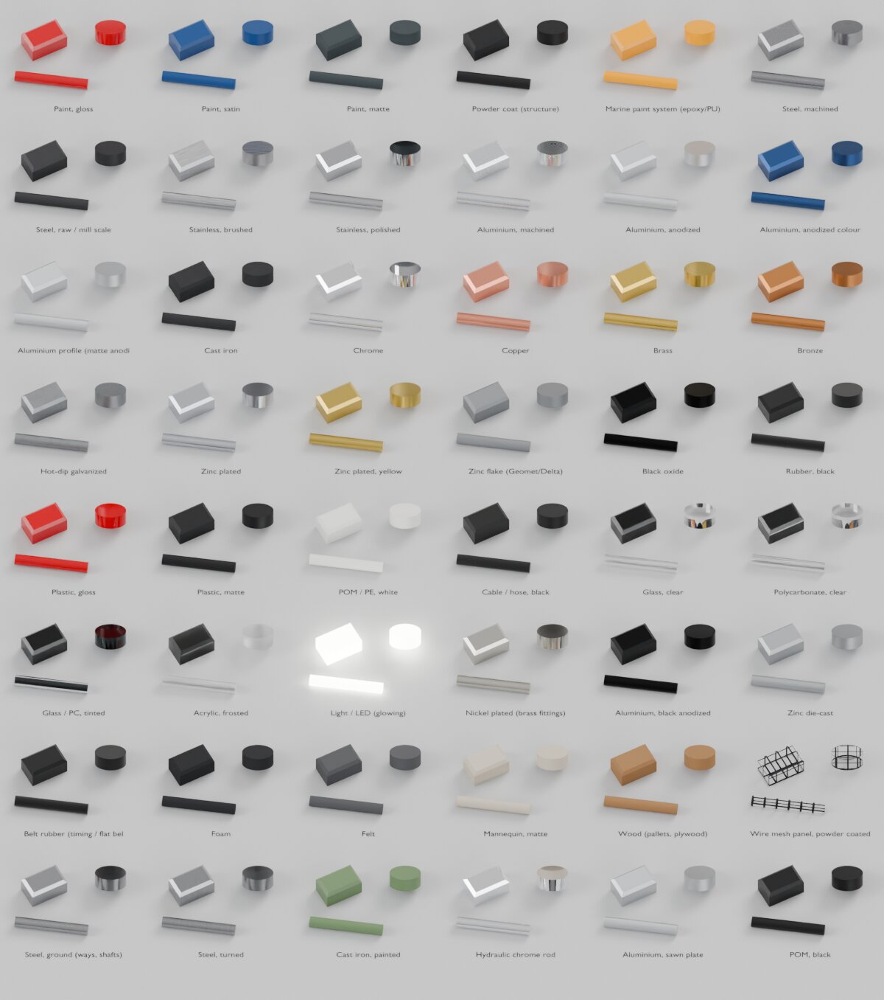

- **Metals** have the fine marks of how they were made, read from the part's own shape, so every copy
  looks the same: **Steel, ground** (fine straight lines along the part's longest side – ways, shafts),
  **Steel, turned** (rings round the part's round axis), **Aluminium, machined** (faint face-milling
  arcs), **Stainless, brushed** (brushed along the longest side), **Hydraulic chrome rod** (mirror-like,
  polished along the rod). The marks are smaller than a millimetre: close up you see them, from a
  distance the metal just looks real.
- **Anodised aluminium** (natural, black, colour) has the soft satin sheen of real anodising.
- **Raw stock for milling**: **Aluminium, sawn plate** (rolled plate, a little dull, faint rolling lines
  along its longest side), **Steel, raw / mill scale**, **Cast iron**, **POM / PE, white** and **POM,
  black**. Give the block one of these: the faces the bit cuts get a fresh-cut look of their own (4 Motion >
  Milling > Cut faces).
- **Cast iron** as cast (rough, slightly mottled) and **Cast iron, painted** (paint over the casting's
  waviness, any RAL colour).
- **Paint**: gloss, satin and marine paint have a little orange peel (seen in reflections), powder
  coat its fine structure.
- **Rubber** is not pure black: a soft sheen and a little dust. **Glass and polycarbonate** look like
  glass in Cycles and in Fast preview.

Projects made with an older version get the new looks when you open them; every group keeps its
material and colour.

**More in this section**

- **Select its parts** selects them in the view; **Show only these** hides all other parts
  (**Show everything again** in 2 Structure brings them back).
- **Put selected in**: the parts selected in the view go into this group, whatever the rules say.
  **Back to the rules**: the rules decide again for them.
- **Make it a rule** under "Everything in … to this group" (shown when a subassembly is selected in
  2 Structure): every part in that subassembly goes into this group, also in later revisions.
- **+** adds a group; **−** removes the selected group (its parts are sorted again by the rules).
- Click a part in the view (with **Part** chosen in 2 Structure): a box shows its group, CAD colour
  and CAD material, with **Move selected to group…**.
- **Sort parts into groups** sorts everything again with the rules. Parts you put in a group yourself
  stay there.

### Rule sets

A **rule set** is one way of naming and sorting: the sorting rules, the material of each group, and the
group names. Make one for your company, and one for each client whose STEP files use other names. Each
project uses one rule set, shown at the top of 3 Looks next to **Rule set**. **Standard** is built in
and cannot be changed; make a copy to change it.

**Make your own rule set**

1. Open **Manage rule sets** and click **Copy…**. Type a name, for example your company, and click
   **Save**. The project now uses the copy.
2. Change what you want: group materials (above), [sorting rules](#rules), **Make it a rule** in
   [Find & sort parts](#find).
3. A box appears: **Changed in this project: …** lists what differs from the saved rule set.
   **Save changes** puts the changes into the rule set, so other projects can use them. **Save as
   new…** makes another rule set of it. Changes you do not save stay in this project only.

**Switch a project to another rule set**

1. Click the name next to **Rule set** and pick another rule set.
2. A window first shows what will change: how many parts change group, which groups are new and which
   go away, how many parts are unsorted now and after. Click **Switch**.
3. The parts get their new groups and the groups their new materials. Parts you put in a group by hand
   stay where they are. <kbd>Ctrl</kbd>+<kbd>Z</kbd> goes back.

**More in Manage rule sets**

- **New, empty…** starts a rule set without rules: every part goes to Unsorted, and you build it up
  with Find & sort parts and **Make it a rule**.
- **Rename…** and **Delete…**. Projects that use the rule set keep their own copy of it.
- **New projects**: the rule set every new project starts with (also in Edit > Preferences >
  Add-ons > Fresing Render, **Default rule set**).
- Rule sets are files in the folder `Rule sets` in the shared library, so colleagues use the same ones.
  **Show the folder** opens it. Without a shared library they are kept on this PC, in
  `Documents\Fresing Render\Rule sets`.

**Good to know**

- A project keeps its own copy of its rule set, so it opens the same on another PC or when the shared
  library cannot be reached.
- When a colleague saved a newer version of your rule set, a box says "The library has a newer version
  of …": **Load it…** takes it over. **Save changes** warns you before it replaces a colleague's newer
  version.
- A rule set that is only in this project (for example after its file was deleted) shows "Only in this
  project" with **Save to library…**.
- Projects made with an older version open unchanged: their rules become a rule set called "From this
  project" (or Standard, when they were never changed).
- A [template](#schemes) remembers its rule set by name and keeps a copy: loading it uses the rule set
  from the library when it is there, otherwise the template's copy.

### Paint faces

Gives single faces of a part another look: a painted end face, a coloured edge strip, a label area.

1. **Paint with**: the group whose look the faces get. Empty: the group selected in the list above.
   For a new colour, first add a group with **+** and give it its material.
2. **Only this copy**: tick it to paint only the copy you click. Unticked, every copy of the part gets
   the same painted faces.
3. Click **Paint faces…**, then click faces on the model. A click paints the whole CAD face under the
   mouse; <kbd>Shift</kbd>+click gives a face back the look of its part. You can still turn and zoom
   the view. <kbd>Enter</kbd>, <kbd>Esc</kbd>, a right-click or **Done** ends and keeps what you
   painted; <kbd>Ctrl</kbd>+<kbd>Z</kbd> afterwards takes the painting back.
4. Click a part to see its painted faces under the button. **Other group…** gives a set of faces the
   look of another group; **Whole part** makes them look like the rest of the part again.

Faces painted in CAD are listed the same way. A sorting rule on their colour can give them another
material, for example "CAD colour is #C0C0C0 → Anodised"; only colour and CAD-material rules act on
single faces. A model update keeps the painted faces of parts whose faces did not change.

### Logos & stickers

Puts a logo, text, a type plate or a sticker on the machine itself. It lies on the face like a real
sticker, moves with its part (joints, animations, exploded views) and hides with it.

1. **Picture / Text / Sticker**: what goes on.
   - **Picture**: a logo or picture file. A PNG with a see-through background looks best; a JPG works
     too. The button right of the field lists the logos in the library (below).
   - **Text**: type it; `|` starts a new line, as in `Fresing|CNC 400`.
   - **Sticker**: ready-made, drawn by the app: CE mark, type plate, warning signs (general, hand
     crush, electricity, hot surface, hanging load), a straight arrow and a turning arrow.
2. **Only this copy**: tick it for something that differs per copy, such as a serial number.
   Unticked, every copy of the part gets it (a type plate on a bought motor).
3. Click **Add decal…**, then click the spot on the model where its centre goes. It lands flat on
   that face, upright. On a round face (a cylinder barrel, a drum, a tank) it wraps round like a real
   sticker. <kbd>Esc</kbd> or a right-click cancels.

Click a part to see its decals. The dot opens a decal's settings, the eye switches it off (it is kept,
but not shown or rendered) and × removes it (<kbd>Ctrl</kbd>+<kbd>Z</kbd> brings it back).

- **Move with the mouse**: the decal follows the mouse over its part, also onto another face of it.
  The mouse wheel turns it (15° a step, with <kbd>Shift</kbd> 5°), <kbd>Ctrl</kbd>+wheel makes it
  bigger or smaller. Click to put it down; <kbd>Esc</kbd> puts it back where it was.
- **Fit to face**: as big as fits on its face, centred on it. **Upright**: turned upright again.
- **Width** and **Height** in mm (with **Keep proportions** the other one follows), **Right** and
  **Up** move it on the face from the spot you clicked, **Turn** turns it, **Mirror** swaps left and
  right.
- **See-through**: 0 is a solid sticker. **Finish**: Matt, Satin, Gloss or Metal (a printed aluminium
  plate).
- Text and stickers: the **Colour** of the letters or symbol, and a **Background** and a **Border**,
  each on or off with its own colour. Text and type plates: the **Font file** (the button on the
  right lists the fonts on this PC). A type plate has Company, Type, Serial no., Year and Weight, and
  a small CE mark.
- Pictures: **White see-through** makes a white background see-through (for JPG logos).
- **Put it on this copy only** / **Put it on every copy** moves the decal between the two.

**All decals in this project** lists every decal; a click on one clicks its part. **Library of logos
and stickers**: put your logos as PNG files in the folder `Logos`, and stickers of your own in
`Stickers`, of the [shared library](#schemes) – the same library as the rule sets and templates.
They then show in the list next to Picture. Without a shared library these folders are in
Documents\Fresing Render.

Good to know:

- In the normal view (Solid) a decal shows as a see-through coloured patch. The picture itself shows
  in Material Preview and in renders.
- Pictures are kept inside the project: renders in the queue and the project on another PC have
  them, also when the picture file is gone.
- A model update keeps decals whose spot is still on the part, also when the part changed elsewhere.
  A decal whose face moved is switched off and named in the update report: open it, click **Move
  with the mouse** and click its new spot.
- A [template](#schemes) keeps the decals with the names of their parts: used on another machine, it
  puts them on parts with the same name, where the spot lies on the part.

### Find & sort parts

The quickest way to sort the unsorted parts, or to give one kind of part its own look.

1. Type a word of the part name. Several words: all must be in the name. `*` stands for any text, as
   in `M6*20`.
2. The list shows the names found, how many parts, and their group now. Tick the ones you want (the
   two buttons on the right tick or untick all of them). **Select the ticked parts in the view** shows
   where they are.
3. **Put ticked in new group '…'** makes a new group named after your search; **Put ticked in a
   group…** uses an existing one. Then give the group its material (above).
4. **Make it a rule → …** saves the search as a sorting rule for the selected group: the next
   revision sorts itself the same way.

Also here: **Common words in unsorted parts** (only when parts are unsorted; one click searches for
the word) and **Only inside …** (searches only the subassembly selected in 2 Structure). **Show only
the unsorted parts** (above, in red) shows what still needs a group.

### Sorting rules

The rules decide each part's group. They are checked from the top, and the first rule that fits a part
decides. The order is: fasteners → part type → CAD material → CAD colour → Unsorted.

- The tick switches a rule on or off; the number shows how many parts it caught.
- Click a rule to change it: **If** [*what*: part name, assembly path, CAD colour, finish, part type,
  CAD material…] [*test*: contains, is, starts with, matches pattern…] [*value*] → **Group**. A group
  name may hold {color}, {finish}, {kind}, {part_type} or {cad_material}: then you get one group per
  colour, finish, type or material. Rest the mouse on a choice in the lists to see what it means.
- **+** adds a rule at the top of the list (so it wins) for the group selected in 3 Looks; **From
  clicked part** adds one "Part name contains *the name of the part you clicked*". The arrows move the
  selected rule up or down, **−** removes it.
- **Defaults** replaces all rules with those of Standard. Projects made before version 0.2.8 that
  still had the old built-in rules get the new ones when they are opened; your own rules are kept.
- After changing rules, click **Sort parts into groups** in 3 Looks.
- The rules belong to the project's [rule set](#rule-sets): the header says **changed** when they
  differ from it. **Save changes** at the top of 3 Looks keeps them for other projects.

### Paint schemes & templates

- A **paint scheme** stores the material and colour of every group, for example "Customer blue" and
  "Fresing grey". **+** saves the colours you have now; **Use** switches every group at once.
- A **template** keeps the rule set, paint schemes, background and image settings, and the logos and
  stickers on parts ([Logos & stickers](#decals)), for the next project. **Save** writes a template file, **Load** reads one, **Library** picks one from the shared
  library.
- The **shared library** is a folder, for example on the network, with a folder `HDRI` (360° photos),
  a folder `Templates`, a folder `Rule sets` and the folders `Logos` and `Stickers`. Set it once: Edit > Preferences > Add-ons > Fresing
  Render > **Shared library**. **Default template** there is used for every new import; **Default rule
  set** is the rule set new projects start with.

## 4 Motion – joints, poses and exploded views

A **joint** lets a subassembly rotate (a boom on its pin) or slide (a trolley, a cylinder rod).

**Add a joint**

1. Click what should move. With **Subassembly** chosen in 2 Structure, one click takes the whole
   subassembly. "Selected: …" shows what you clicked.
2. Click **Add rotate joint** or **Add slide joint**.
3. Click the pivot on the model: a **hole or shaft** (the axis goes through its centre) or a **flat
   face** (the axis stands at right angles to it). The line at the bottom of the window says what to
   do; you can still turn and zoom the view. <kbd>Esc</kbd> or a right-click cancels.

**Use a joint**

- Drag its slider in the list, or the big **Angle** / **Distance** field, or type a value. 0 is the
  position in the CAD file.
- **CAD (0)**, **Min** and **Max** jump to those positions. **Limits** keeps the joint between the two
  values next to it.
- **Show joint arrows in the view** shows or hides the joints' axes (and the cylinders' pin markers).
- **Set-up** (the fold): what moves (**Add** and **Remove** use the selected parts, **Select** selects
  what the joint moves), the axis (eyedropper: click a new pivot; ⇆ turns the direction around; **X Y Z**), the type (**Rotate**
  / **Slide**) and **Sits on**: the subassembly this joint is mounted on, so it moves along with it –
  the crane's trolley sits on the boom.
- **−** next to the list removes the joint; its parts go back to their CAD position. Joints that
  followed it stay where they are and move by themselves from then on.
- **Everything back to CAD position** puts every joint and moved subassembly back.

**Two or more joints on one subassembly**

A subassembly can have several joints, and their moves add up: a carriage that slides 1000 mm in Y
and then 500 mm in X ends up at X +500 / Y +1000; a crane jib slews and then luffs.

1. Click a subassembly that already moves with a joint and click **Add rotate joint** or **Add slide
   joint** as usual. Above the buttons it says "Adds a joint on top of '…': the moves add up".
2. The new joint rides on the older one: its axis moves along with it. In the list it is indented
   under that joint, and its details say "Rides on '…'".
3. **Swap order** lets the other joint ride on this one instead. With two slides nothing changes; with
   a rotation it does (turn then slide, or slide then turn).

Removing a joint from such a stack gives what it moved back to the joint under it. In **Set-up** of
the lower joint, "Moves:" lists everything it moves and "Carries:" names the joints riding on it.

> When an animation is built (6 Animation), the joints follow it. **Stop it to move joints by hand**
> (in the red box) frees them.

### One joint moves others: couplings

A joint can **follow** another joint: when that one moves, this one moves with it. One joint then
drives a whole mechanism – and one animation step moves it all.

| Mechanism | Leader → follower | Ratio to type |
| --- | --- | --- |
| Gear pair, belt, chain | rotate → rotate | **turns per turn**: −0.5 for a meshing gear twice as big (meshing gears turn the other way); 1 for a belt over two equal wheels |
| Telescope section, gripper jaws | slide → slide | **mm per mm**: 1 for a telescope section; −1 for the second jaw |
| Spindle, ball screw, rack and pinion, winch rope | rotate → slide | **mm per turn**: the pitch (5 for a 5 mm screw); π × Ø for a pinion or drum |
| Rolling wheel, pinion on a fixed rack | slide → rotate | **° per mm**: 360 ÷ (π × Ø) |

1. Select the joint that should follow (the gear, the second jaw, the nut, the wheel) in the joint list.
2. Click **Follows a joint**. It picks a joint to follow; change it in the **Joint** field.
3. Type the **ratio** (its label says the unit, e.g. **° per mm**). The line under it says it in other
   words: "One turn every 157.1 mm: a wheel of Ø50.0 mm rolling along". **Offset** is where it stands
   when the joint it follows is at 0 (usually 0).
4. Move the leading joint: the follower moves along. Its own value is purple and cannot be dragged.

- **Chains** work: a motor drives a spindle, the nut carries a trolley, the trolley's wheels roll.
- **Telescope**: add the second section's joint to a section that already moves with the first one
  (it rides on it, see above), then **Follows a joint** picks the first section by itself. With
  ratio 1 the second section goes twice as far.
- Two joints that follow each other are refused, with the reason in red under the field.
- A following joint is not moved by hand, by poses or by animation steps: move the joint it follows.
  Poses only store the joints that move by themselves.
- Its **Limits** do not stop it: they warn ("Beyond its limits now"), and so does Build & play.
- **Moves by itself** ends the coupling; the joint stays where it is. The leading joint shows
  "Drives '…'".

**Motors**

Tick **Motor (turns without end)** on a rotate joint (a drum, a fan, a drive): it has no limits and
the angle is also shown in turns ("= 2.50 turns"). In 6 Animation, the step **Run motor** turns it at a
speed you set.

Couplings, motors and their settings stay through a model update (1 Import) and in saved projects,
also when the PC does not allow scripts in project files.

### Cylinders

A hydraulic cylinder or an electric linear actuator hangs between two pins: one on the machine (the
barrel's end) and one on the part it moves (the rod's eye). The app keeps both eyes on their pins: when
the arm moves, the barrel turns about its pin and the rod slides in or out.

**Add a cylinder**

1. Make the joint for the arm first (Add rotate joint above, on the arm's pivot).
2. In 4 Motion > **Cylinders**: click the barrel (the tube with its end cap and eye – in the view, or its
   row in 2 Structure) and press **Barrel**. Then click the rod (with its piston and eye) and press **Rod**.
   A tick shows what is picked.
3. Press **Add cylinder** and click the **barrel's pin** (on the machine side), then the **rod's pin**
   (on the moving part). Click the pin itself or the hole it sits in; the line at the bottom of the
   window says which one is next. <kbd>Esc</kbd> cancels.

Move the arm: the cylinder goes along (**Follows the arm**). Two cylinders side by side on one arm each
get their own entry. The list shows how far each rod is out.

**Set the stroke instead: Drives the arm**

Press **Drives the arm** and set the **Stroke** (how far the rod is out, 0 = fully in): the arm turns to
match, worked out exactly from the triangle pivot – barrel pin – rod pin. **Fully in**, **CAD** and
**Fully out** jump there. The arm's joint now stops where the cylinder does (its Limits are set from the
cylinder). A cylinder that pushes a carriage on a slide works the same way.

- **Closed length** (pin to pin with the rod fully in) and **Full stroke** come from the parts: how far
  the piston can go back to the end cap and out to the gland. "measured" means they were found that way;
  "rough guess" means the parts did not show it – type the values from the cylinder's data sheet.
- In 6 Animation, the step **Move cylinder** moves the rod from one stroke to another; the arm moves
  with it, at the cylinder's pace. Poses and saved scenes keep the arm's position, so the stroke too.
- When drive mode is not possible, the reason is shown in red (for example: nothing moves the rod's pin
  yet, or the arm's joint does not turn about the pins' direction).

**Set-up** (the fold): other parts for the barrel or rod; **Stages** for a telescopic cylinder (select its
sections between the barrel and the rod, then press it: each section slides out the same share of the
travel); which part holds each pin (select the part, then **Barrel pin** or **Rod pin**); **Pins again**
(click both pins again); **Select parts**. The cylinder's pin markers show and hide with **Show joint
arrows in the view**.

Cylinders stay through a model update (1 Import) and in saved projects, also when the PC does not allow
scripts in project files. **−** next to the list removes a cylinder: its parts go back to their CAD place.

### Mechanisms

A mechanism is a set of arms or links that hold each other in a closed loop, so they cannot each have a
joint of their own: a **scissor lift**, a **four-bar** or **parallel arm** (also a toggle clamp), a
**slider-crank**, and other linkages that move in one plane (all pins pointing the same way). You drive
one link – by its angle, by the platform's height or with a cylinder – and every other link follows,
exactly, without ever flipping over to the other way the links could be put together.

**Add a mechanism**

1. In 4 Motion > **Mechanisms**, pick the **Type**: Scissor lift, Four-bar or parallel arm, Slider-crank,
   or Other linkage. The steps in the panel change with it.
2. Click the **base** – the frame or chassis it stands on, which does not move with it – and press
   **Base**. (Without a base, the rest of the subassembly the links are in is the base. Pick it whenever
   that subassembly also holds other moving parts, such as the lifting cylinder.)
3. Select every moving link: each arm or link one subassembly (Ctrl+click in the view, or in
   2 Structure). For a scissor lift: every arm and the platform. For a four-bar: the crank, the coupler
   and the rocker. For a slider-crank: the crank, the rod and the slider or piston. Click the link that
   drives **last** (for a scissor lift it does not matter: the arm on the fixed pin drives).
4. Press **Add mechanism**. The pins are found by themselves: where two links have a hole or shaft on the
   same line. A scissor's rollers run on the base and under the platform, along the line from the fixed
   pin to the roller; a slider slides along its own round face (a piston's outside, a guide bore). Arms
   made of two side plates that share all their pins count as one arm.

The panel shows what it found (Set-up: links, pins, rollers, sliders) and the reason when something does
not fit (for example: an arm that is pinned to the base twice cannot move).

**Move it**

- **Height** (scissor lift): the platform's pin above the base's fixed pin, in mm. Type it or drag it;
  **Lowest**, **CAD** and **Highest** jump there. The arms stop where they stand straight up, and at the
  bottom before they lie flat (2 % of the highest height: flat arms could fold either way).
- **Drive angle**: the angle of the drive joint (0 = as in the CAD model). It is a normal joint in the
  joint list above, named after the mechanism ("Scissor lift drive"): its limits are set to how far the
  mechanism can go; a four-bar whose crank can turn all the way round has none. Poses, saved scenes and
  the animation steps Move joint and Run motor move it like any joint, and it can follow another joint
  (couplings) – the mechanism goes along.
- **A cylinder**: add the cylinder (Cylinders, above) with its pins on the base and on an arm, or between
  two arms. It follows the mechanism; with **Drives the arm** its stroke moves the mechanism.
- When a position cannot be reached (a link too short, a roller beyond its line) the mechanism stays at
  the last position it can reach and says why in red.

In 6 Animation, the step **Lift height** raises or lowers a scissor lift's platform from one height to
another. When the animation is built, every link gets its place on every frame, so videos and the render
queue need nothing else, also on a PC that does not allow scripts in project files.

Mechanisms stay through a model update (1 Import: the pins are found again on the new revision) and in
saved projects. The joint list does not let you change or remove the drive joint while the mechanism uses
it. **−** next to the list removes a mechanism: its parts go back to their CAD place (and the drive joint
goes too, when the mechanism made it).

### Way covers

A **way cover** is the row of steel sections that slide into each other and cover a machine axis, so chips
and coolant stay off the guide ways. Here the sections follow the axis by themselves: you pick them once, and
every move of the axis – by hand, in a pose, in a Move joint or Run motor step, from a G-code program – opens
and closes the covers.

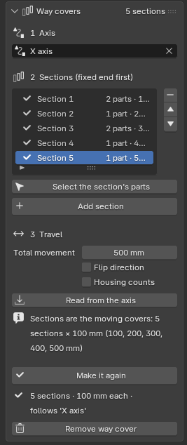 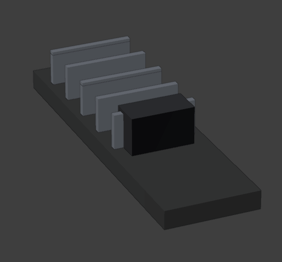

**Set it up**

1. In 4 Motion > **Way covers**, step **1 Axis**: pick the **slide joint** the covers follow (the machine axis,
   made in Joints above). A machine without a joint yet: click the carriage and press **Make one from the
   selection**, then click a hole or face for the direction.
2. Step **2 Sections**: click the parts of one cover section – any number of parts or subassemblies – and press
   **Add section**. Do the same for every section, starting at the **fixed end** and working towards the
   moving end. The arrows next to the list change the order; **−** takes a section out; **Select the
   section's parts** shows which parts it holds. A part can be in one section only, and a part that already
   moves with a joint (or follows one) is refused, with the reason.
3. Step **3 Travel**: **Total movement** is how far the axis moves in all; **Read from the axis** takes it from
   the axis limits (Min and Max). **Flip direction** opens the covers the other way round.
4. Press **Make it**. The panel says what it made, for example "5 sections · 100 mm each · follows 'Y axis'".

**How the travel is shared out.** Every section slides the same distance relative to its neighbour. With the
axis moving 500 mm and five sections, the sections stand 100, 200, 300, 400 and 500 mm from their CAD place
when the axis is at 500 mm – 100 mm each. With three sections it is 167, 333 and 500 mm. The line under
the travel fields always says what you get, in plain words.

Some covers are drawn with the **housing** (the part on the fixed side that never moves) as the first section.
Tick **Housing counts** for those: the first section stays, the others share the travel in one step less –
five sections over 500 mm give 0, 125, 250, 375 and 500 mm.

**Changing it later.** Adding, removing or reordering sections, changing the travel, Flip and Housing counts
re-share the travel at once. Sections you added since **Make it** need **Make it** once more. **Remove way
cover** removes the sections' joints and puts their parts back; the axis joint and everything else stay as
they are.

Under the hood each section is an ordinary slide joint ("Way cover Section 1") that follows the axis (see
couplings, above), so the covers move in animations, in saved scenes and in the render queue, also on a PC that
does not allow scripts in project files. They stay through a model update (1 Import) and in saved projects.
To move the covers in a video, use the animation step **Move joint** on the axis – nothing else is needed.

### Poses & exploded views

A **pose** stores every joint position and every moved subassembly: "Working", "Transport",
"Exploded".

1. Set the joints (and explode, if you want).
2. Click **+** and type a name.
3. **Use** puts the model in that pose again; ↻ overwrites the selected pose with the positions now.

**Exploded view**

1. Select the subassembly to explode, in the view or in 2 Structure. "Explodes: …" shows which.
2. **Pieces**: **Subassemblies** (those inside it) or **Every part**. **Direction**: **Outwards**,
   **Along X**, **Along Y** or **Up / down**. **Distance**: 0.5 moves each piece half its distance
   from the centre.
3. Click **Explode**. To keep it, save it as a pose (**+** above). **Everything back to CAD position**
   (4 Motion) puts it together again.

### Milling

Show a CNC machine at work: you pick the **milling bit** and the **workpiece** (the raw block), and
wherever the bit moves through the block in the animation, material disappears – in the view, while
you scrub or play, and in the render queue. No modelling needed. The motion comes from the
animation (6 Animation): joints that move the head, the table or both.

1. Click the bit in the view. "Clicked: …" shows the part; click the bit itself, not its holder.
2. Click **Use as bit**. Under the list you read what was recognised, for example "Flat end mill
   Ø10.0 mm, 40 mm long". Flat, ball, corner radius, V-bit and drill are recognised; any other shape
   is used as it is. Several bits are allowed (for example two spindles).
3. Click the raw block and then **Use as workpiece**. It keeps its looks; from now on it shows the
   milled shape.
4. Build an animation in 6 Animation that moves the bit through the block (**Build & play**). A moment
   later the cut follows the timeline: drag the time slider back and forth, or play. The line with
   the frame number shows how big the milled shape is and how long one frame took.

Good to know

- **Shape**: **From its shape** reads the shape from the part. When the part is drawn simplified (or
  with its holder), pick the type and type in **Diameter**, **Corner radius** or **Tip angle** and
  **Length** yourself. **Tip at the other end** turns the bit round when the wrong end cuts.
- **Finished part (optional)**: click the CAD model of the finished part (in the same place as the
  block) and **Use as finished part**. The bits never cut below its surface, so the end result is
  exactly the CAD part even when the motion goes a little too deep. It is hidden: it is only the
  limit. The **X** next to it stops using it and shows it again.
- **Detail**: **Fine** for close-ups (the bit's circle has 64 corners), **Normal**, **Fast** for long
  programs.
- **Cut material** off shows the block as it came from CAD; the set-up is kept.
- **Cut faces**: the faces the bit makes get a look of their own, the block keeps its look outside.
  **Automatic (fresh cut)** makes it from the block's material in 3 Looks: any aluminium (sawn plate,
  anodised, profile) cuts to bright *Aluminium, machined*; raw, ground or plated steel to *Steel,
  machined*; stainless to machined stainless; cast iron to bare grey machined iron; brass, bronze and copper
  to the same metal, brighter; plastics to the same plastic, a little more matte. Paint and other looks stay
  as the block. **Same as the block** shows the cut in the block's own look; **Pick a material…** takes
  any ready-made material (one that takes a colour uses the block group's colour). The line under it says
  what the cut faces show. A face of the block that is only partly cut keeps the block's look. Renders in
  the queue show the same.
- A logo or text on the block (3 Looks > Logos & stickers) stays where it is while milling, and can be
  changed as usual.
- After a change to the animation the cut is read again by itself (in the render queue too, before
  it renders). **Reset workpiece** starts again from the uncut block if something does not look right.
- **More > Stop milling** removes the set-up: the block is whole again.
- A model update (1 Import) keeps the set-up when the bit and the block are still in the model.
- Straight moves are cheap; curved moves (arcs) cost more. Measured on the 2-core test machine with a
  200 × 200 mm block: about 4 ms per frame for a zig-zag pocket with a flat Ø10 bit, 11 ms with a
  ball Ø10, about 11 ms for a round pocket made of short pieces.

#### Chips

While the bit cuts, chips fly off it – in the spindle's turning direction, up out of the cut – and land
on the block, the table and the machine bed, where they pile up. They look like the real thing for the
workpiece's material and the bit:

| Material | End mill | Ball end mill | Face mill | Drill | Engraving / V-bit |
| --- | --- | --- | --- | --- | --- |
| Aluminium | shiny curls | small commas | flat commas, thrown far | long spirals out of the hole | fine dust |
| Steel | blue-brown commas (temper colours) | small commas | commas | spirals | dust |
| Stainless steel | longer commas, a little golden | small commas | commas | spirals | dust |
| Brass / bronze / copper | small crumbs | crumbs | crumbs | short commas | dust |
| Cast iron | grey crumbs | crumbs | crumbs | crumbs | dust |
| Plastic (POM, PE, nylon, acrylic) | long ribbons in the block's colour | ribbons | ribbons | spirals | short ribbons |
| Wood / MDF | shavings with dust | dust | shavings | shavings | dust |

1. Set up milling first (above), so the bit cuts in your animation.
2. Open **Chips** (under Milling) and pick **Few** or **Realistic**. The chips are worked out at once;
   the line under the settings says how many and how long it took.
3. Scrub or play: the chips fly while the bit cuts and stay where they land. Renders in the queue show
   them too – the queue works them out by itself before the first frame.

Good to know

- **Material**: **From the workpiece** reads it from the block's name ("BLOCK AlMg3", "Plaat RVS 316",
  "POM blok", "MDF plaat" …), then from its material in 3 Looks; the line under it says what was found and
  why. Pick a material to choose yourself.
- **Few** shows about one chip in eight (at most 3,000 at a time) and is quick. **Realistic** makes as
  many chips as the removed material would (at most 25,000 at a time; when there are more, the oldest
  lying ones shrink away).
- Chips lying on the block are gone when the bit cuts there later. Chips on the table move along with the
  table; chips that fall off the table stay on the machine bed (or the floor).
- **More > Spindle turns**: clockwise (M3, the usual) or counter-clockwise (M4): the chips fly the other way.
  **More > Coolant mist** adds a fine mist of drops around the bit that fades after a moment.
- **Clear chips** removes every chip from the project and sets Chips to None.
- The same set-up gives the same chips every time, on every PC, whatever frame you look at first.
- Chips land on what is below them seen from above: they do not land on the head or a part that hangs over
  the table, and they do not bounce off the head.
- Working them out and rendering them takes time. Measured on the 2-core test machine (test mill, rendered
  on the processor at 640 × 360, Preview):
  - working them out: under 1 s for a short cut; about 4 s for a 46-second pocket program (1,158 frames);
  - one rendered frame, slot 50 × 10 × 5 mm in aluminium: 26.0 s without chips, 26.5 s with Few (150 chips),
    28.8 s with Realistic (1,218 chips in the picture);
  - a bigger cut (90 × 10 × 15 mm): 24.4 s without chips, 32.2 s with about 6,200 aluminium curls (+32 %),
    29.9 s with 25,000 brass crumbs (the limit, +23 %);
  - showing a frame in the view: 8–17 ms on top of the milling.

#### Air blast

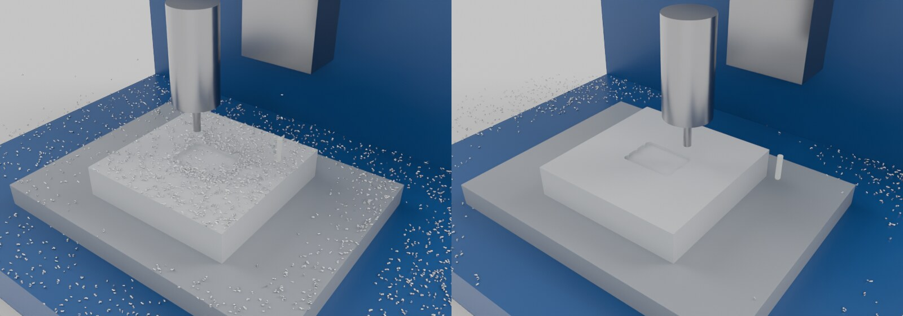

On a real machine, air blows the chips away while it cuts, and the operator blows the part clean at the end.
The app does the same, so the finished part stays visible. Air needs a **Run G-code program** step (the
program says when air is on) and chips (above).

1. In 4 Motion > **CNC machine**, open the fold **Air blast**.
2. **Air on code** / **Air off code**: the M-codes your machine uses – **M7** and **M9** on most machines
   (M9 always stops M7 and M8), or a user code **M100 … M199**. The air blows from the on code to the off
   code. **Air always on while the spindle turns** is for programs without an air code.
3. **Air from**:
   - **Through the spindle**: the air comes out at the tool's tip, blows down along the tool and moves with
     it. Where it hits the floor of the cut it fans out and blows the chips away round the tool.
   - **External nozzle**: click the nozzle part in the view and press **Use clicked part** (its tip is read
     from its shape: the end nearest the workpiece), or press **Click point** and click the spot where the
     air comes out. It blows towards the middle of the workpiece; **Aim at the workpiece** aims it again,
     the arrows button turns it round, and the fold **Nozzle tip and aim** lets you drag the direction. The
     nozzle moves with the part it is on (the head, or it stands still on the frame).
4. **Strength** (Soft / Normal / Strong), **Cone angle** (how wide the jet spreads) and **Reach** (how far it
   blows). Normal blows most chips off the part from a nozzle within about 10 cm of the cut; from further
   away use Strong.
5. **Show air** draws the jet as a faint cone while the air blows (off by default: real air is invisible).
6. Build the animation in 6 Animation. The step says when air is on ("Air: on 1 time, 3.1 s in all"),
   **Details** too, and 4 Motion > Milling > Chips shows it.

Chips that fly through the air are pushed away, chips lying in the jet are picked up again and land further
away – on the table, the machine bed, in the corners – not back on the part. The same frame gives the same
chips every time.

**Blow the part clean at the end**: tick it in the Run G-code program step and set **Time at end** (2 s,
0.5–10 s). The step gets that much longer: the tool goes up (15 mm over the highest cutting move), the air
blows with the valve fully open, and the last frames show the clean part. Through the spindle the tool goes
over the cut area in passes; an external nozzle blows from where it is. It works with or without air codes
in the program.

Measured on the test mill (a 60 × 40 mm pocket, 4 mm deep, in 4 s of video, chips Realistic, about 6,200
chips, on the 4-core test machine, as in the picture above): 1,560 chips lie on the block at the last frame
without air; with air through the spindle (Normal) 0; from a nozzle on the head (Strong) 8; with only **Blow
the part clean** (2 s) 0. Working the chips out took 0.7 s without air and 0.9 s with air and a 1 s clean
blast; showing a frame in the view 14 ms without and 12 ms with air; one rendered frame (processor,
800 × 560, 32 samples) 19.7 s without and 18.7 s with air.

#### Coolant

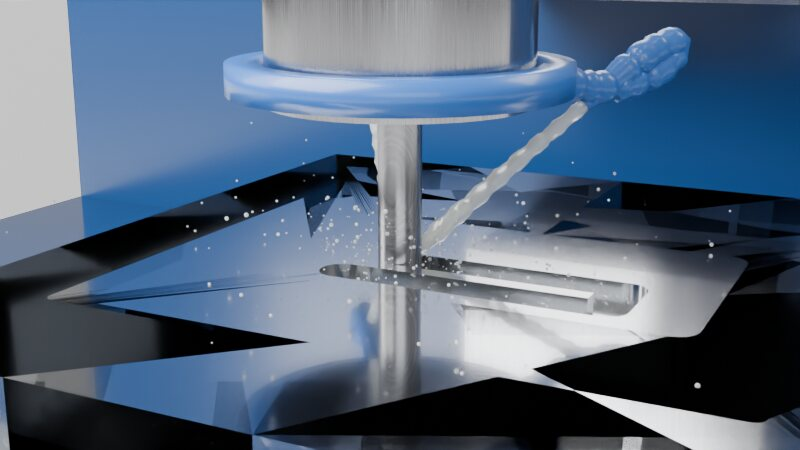

A milling video with coolant looks like the real machine: when the program says **M8**, milky coolant squirts
from the nozzles onto the tool, splashes where the tool cuts, the block, the table and the vise get a wet sheen
and the chips come out wet. **M9** stops it and the parts dry a few seconds later. Coolant needs the CNC machine
set up (above) and a **Run G-code program** step; milling and chips are not needed, but they get wet too.

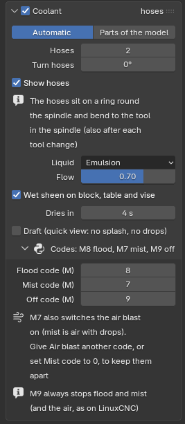 Coolant: automatic hoses, liquid, flow, wet sheen, drying, draft, the M-codes">

1. In 4 Motion > **CNC machine**, open **Coolant** and tick **Coolant** in its title.
2. Where it comes from:
   - **Automatic** (the default): the app adds flexible hoses (the blue Loc-Line look) on a ring round the
     spindle, aimed at the tool's cutting edges. **Hoses**: 1 to 4 (2 is the default). **Turn hoses** turns
     them round the spindle, for example so they do not hide the tool from the camera. After each tool change
     they bend again to the new tool's length. **Show hoses** off: only the liquid shows (when your model has
     its own hoses in about the same place).
   - **Parts of the model**: click a nozzle part in the view and press **Use clicked part** (the coolant comes
     out of its end nearest the tool), or press **Click point** and click the spot where it comes out. Add every
     nozzle this way. For the nozzle selected in the list, **Aim at the tool** aims it again, the arrows button
     turns it round, and the fold **Nozzle tip and aim** lets you drag the direction. A nozzle moves with the
     part it is on.
3. **Liquid**: **Emulsion** (milky white, see-through – most machines) or **Cutting oil** (clear, slightly
   yellow). **Flow**: low gives thin streams and few drops, full gives thick streams and a lot of splash.
4. **Wet sheen on block, table and vise**: they get darker and glossier with drops on the sides while coolant
   flows; **Dries in** (4 s) is how long they stay wet after M9. The parts that get wet are found by themselves
   at **Build & play**: the workpiece and the parts round it and under it (not the head).
5. **Draft**: plain streams without splash and drops, for working in the view; switch it off for the video.
6. In 6 Animation, the Run G-code program step has a **Coolant** setting:
   - **From the program** (the default): **M8** floods, **M7** mists, **M9** stops both. The step says what it
     found, for example "Coolant: flood 1 time, 4.7 s".
   - **Flood while cutting** / **Mist while cutting**: for programs without coolant codes – coolant whenever
     the spindle turns.
   - **Off**: no coolant in this step, whatever the program says.

   Then press **Build & play**.

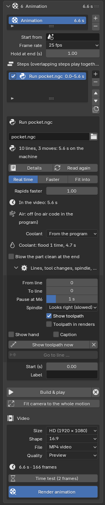

**Mist** (M7) shows a fine cone of tiny drops from each nozzle instead of a solid stream, and wets the parts
less. **M7 and the air blast**: Air blast also uses M7 by default. With coolant on, M7 then switches on mist
**and** the air (mist is air with drops), and M9 stops both, as on LinuxCNC. To keep them apart give Air blast
another code (for example M100), or set **Mist code** to 0 so M7 is only air. The codes are in the fold
**Codes** (Flood code, Mist code, Off code), for machines with their own numbers.

The splash is strongest while the tool cuts and weaker while it moves through the air with coolant on. Wet chips
leave the tool slower, hardly bounce and stay closer to the cut (on the test mill the pile was about a quarter
narrower), and they look darker and shinier until the parts dry.

Every frame of the coolant comes from the frame number alone – there is no simulation to run first – so the
render queue can render frames in any order and a frame always looks the same.

Measured on the test mill (a pocket with flood, two automatic hoses, 800 × 450, Cycles 64 samples on the processor
of the 4-core test machine): 42.0 s per picture without coolant, 47.1 s with it (+12 %: the jets, splash and hoses
about 7 %, the wet sheen about 5 %); EEVEE showed no difference. Working out a frame's coolant in the view takes
about 3.5 ms.

Not yet: coolant through the spindle (through the tool), mist or steam in the air, puddles that collect and
coolant that runs off the table.

#### Make a toolpath

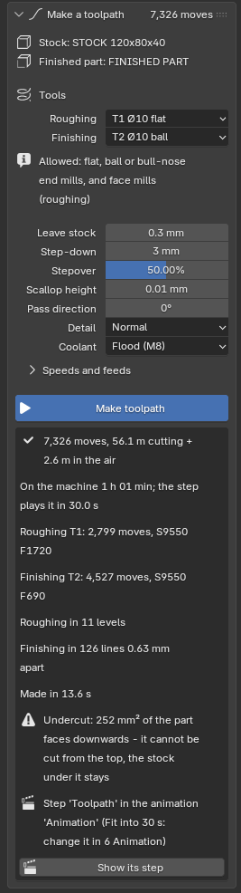

No CAM program yet? The app writes one itself: a block turns into your part in a roughing and a finishing pass,
never into the part. Good for a video of a part that has not been programmed in Fusion CAM.

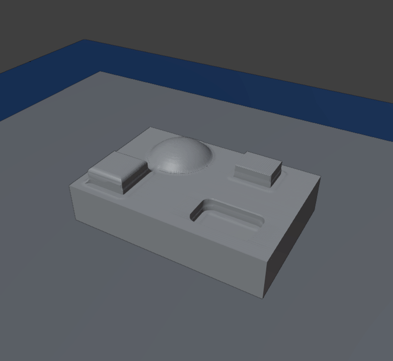

1. **Milling** (above): the raw block as **workpiece** and the CAD part it becomes as **finished part** (both at
   their place in the model: the part inside the block).
2. **4 Motion > CNC machine**: the X, Y and Z joints, the tool in the spindle, the block as **Workpiece** and the
   work zero (usually the top centre of the block). Add your tools to its **Tools** list (a face mill or end mill
   for roughing, a ball or bull-nose end mill for finishing).
3. Open **Milling > Make a toolpath**, pick the **Roughing** and the **Finishing** tool from the list. Allowed:
   flat, ball and bull-nose end mills, and face mills (for roughing). Pick **None** to leave a pass out.
4. Check the settings (below) and press **Make toolpath**. A progress line shows; **Cancel** (or Esc) stops it and
   changes nothing.
5. The program is written next to your project (`<project> toolpath.ngc`) and added as a **Run G-code program**
   step to the animation shown in 6 Animation (a new animation "Toolpath" when there is none). It plays in 30 s
   (**Fit into**; change it in the step). Press **Build animation**: spindle, tool change, coolant, chips and the
   drawn toolpath work as for any program.

The settings

- **Leave stock** (0.3 mm): what roughing leaves on the part for the finishing tool.
- **Step-down** (3 mm): how deep roughing cuts per level. Flat faces of the part (pocket floors, tops of bosses)
  get a level of their own, so they are roughed evenly.
- **Stepover** (50 %): how far apart the roughing lines are, as a share of the tool's diameter.
- **Scallop height** (0.01 mm): the ridges a ball or bull-nose tool may leave between two finishing lines on a flat
  face; the lines are set that close (a Ø10 ball: 0.63 mm apart).
- **Pass direction**: the direction of the lines (0° = along X).
- **Detail**: **Draft** is quickest (fewer lines and moves); **Normal**; **Fine** follows round shapes closest. The
  tool never goes into the part at any of them.
- **Coolant**: flood (M8), mist (M7), the air-blast code of the CNC machine, or none.
- **Speeds and feeds** (fold): left at 0 they are worked out from the stock material (aluminium, steel or POM,
  read from the stock's material in 3 Looks or picked) and the tool's diameter and flutes, at most 15,000 rpm.

How it cuts

- **Roughing** goes down level by level. Each level is cleared in lines across (zigzag), then the tool goes once
  round the part's walls, so the walls carry an even layer for the finish. Between areas it lifts just over the
  material, and it goes into material on a ramp (3°), never straight down.
- **Finishing** runs lines across the whole part at the pass direction. The tool follows the part's top within the
  detail's tolerance; on the test model it went at most 0.007 mm into it (the limit is 0.01 mm).
- **Holes through the part** are not drilled: the tool goes over them, the stock in them stays.
- **Undercuts** (faces that look down, under an overhang) cannot be reached from the top: the stock under them
  stays, and the result says so ("Undercut: … mm²").
- Only 3 axes, from the top (+Z of the work zero). The holder and spindle are not checked while the path is made:
  run 6 Animation > **Clash check** on the built animation.

Make toolpath again after changing a setting: the same step gets the new program. If you changed the program file
by hand since, the app asks first.

Measured on the 4-core web test machine, test model (block 120 × 80 × 40 mm with a pocket, rounded boss, dome and
an overhanging cap; flat Ø10 roughing, ball Ø10 finishing; reading the path before the cut: 1–2 s):

| Detail | Moves | Making it | Cut to the end in the view |
| --- | --- | --- | --- |
| Draft | 4,541 | 8 s | 39 s |
| Normal | 7,326 | 14 s | 59 s (75 s with the finished part kept as the limit) |
| Fine | 8,993 | 29 s | 106 s |

### CNC machine (G-code)

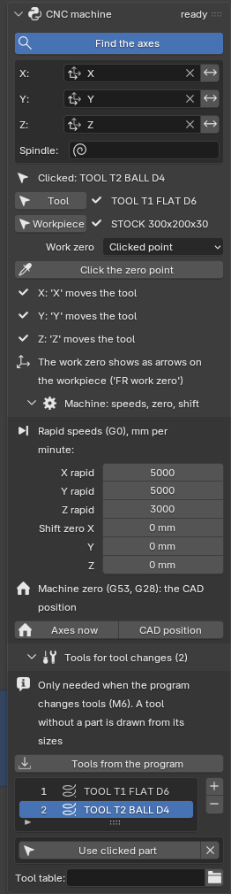
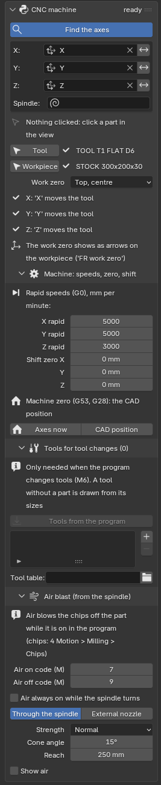

Let the machine run a real CNC program: you tell the app which joints are the machine's X, Y and Z (and the
spindle), which part is the tool and where the program's zero is on the workpiece. Then a step **Run
G-code program** in 6 Animation moves the machine exactly as the program would – the program your CAM
writes for the machine (Fusion: Manufacture > Post Process with the LinuxCNC post, a `.ngc` file).

**Set the machine up once**

1. Make a **slide** joint for each axis in 4 Motion (Z sitting on X, X on Y, as on the machine – or the
   table moving under the head) and, if you like, a **rotate** joint for the spindle.
2. In 4 Motion > **CNC machine** press **Find the axes**: it picks the slide joints that point along the
   model's X, Y and Z, and the motor as the spindle. Change one in the fields **X**, **Y**, **Z**,
   **Spindle** when it guessed wrong. The joint picked as the spindle gets **Motor** ticked by itself, so it
   turns without end.
3. Click the tool in the spindle (the cutter itself, not its holder) and press **Tool**. Its tip is the
   point the program steers.
4. Click the workpiece (the raw block) and press **Workpiece**.
5. **Work zero**: the same point as in the CAM set-up (Fusion: Setup > WCS) – the top centre or a top
   corner of the block, its bottom centre, or **Clicked point** with **Click the zero point** (a click near
   a corner snaps onto it). Arrows "FR work zero" show it on the block.

The lines under it say what the app worked out, for example "Y: 'Y' moves the workpiece" for a table that
moves. The program's **+X** always means: the tool moves towards +X *relative to the workpiece* (the CNC
rule), so a moving table goes the other way by itself. When an axis goes the wrong way, press the arrows
next to its field (**Reverse**).

**Machine: speeds, zero, shift** (fold)

- **X / Y / Z rapid** (mm per minute): how fast the machine moves on G0 (LinuxCNC's `MAX_VELOCITY` × 60). They set
  how long rapid moves take; feed moves take the program's F.
- **Shift zero**: moves the work zero along X, Y and Z, for a zero that is not on a corner or the centre.
- **Machine zero** (where `G53 X0 Y0 Z0` and `G28` go): the CAD position, or **Axes now** after
  you moved the joints to the machine's home position (usually Z right up). It keeps the rotary axes' A0 B0 C0
  too.

#### Rotary axes (4th / 5th axis)

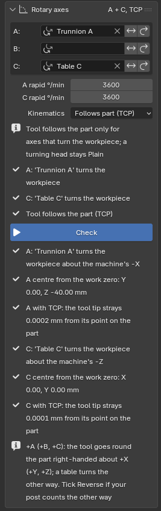

A rotary table (4th axis) or a trunnion (5th axis) turns the part under the tool. The program's **A**, **B** and **C**
turn rotate joints of your model, while X, Y and Z move as before; the material comes off in the right places on the
turning part, and the toolpath is drawn on the part and turns with it.

1. Make a **rotate** joint for each rotary axis in 4 Motion: the rotary table (a 4th axis), or the trunnion's tilt and
   its table (made after the tilt, so it rides on it).
2. In 4 Motion > CNC machine > **Rotary axes**, pick them as **A** (turns about X), **B** (about Y) or **C** (about Z).
   Any of the three can stay empty.
3. Next to each: **Reverse** (the arrows) when your program turns the other way, **Wrapped** (the loop) for an axis
   that counts 0 … 360° and keeps turning (LinuxCNC `WRAPPED_ROTARY`: `A90` turns the + way to 90°, `A-90` the − way
   to 90°). Below: the **rapid** speed of each axis in degrees per minute.
4. **Kinematics**:
   - **Plain** (most 4th-axis set-ups, LinuxCNC `trivkins`): A, B, C are just the joints' angles; your CAM post
     already worked out X, Y and Z for the turned part. The post needs the rotary axis' centre: **Check** says where
     it is from the work zero.
   - **Follows part (TCP)** (tool follows the part): the program is written for the part as it lies at A0 B0 C0, and
     the app moves X, Y and Z so the tool tip stays on that point while the table turns. Only for axes that turn the
     part (a rotary table, a trunnion); a turning head stays Plain.
5. Press **Check**: each axis turns through its range in the view, and the lines say which way it turns the part,
   its centre from the work zero, and – with TCP – how far the tool tip strays from its point on the part (should be
   0.00 mm). A wrongly picked joint shows at once.

+A (+B, +C) means the tool goes round the part right-handed about +X (+Y, +Z), like X/Y/Z where + is the tool's move
relative to the part: a rotary table therefore turns the other way. When your post counts the other way, tick
Reverse.

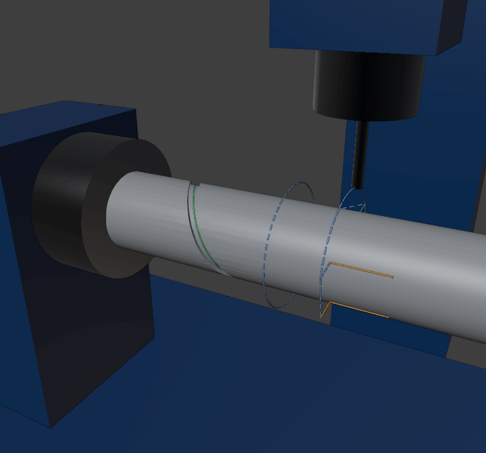

**What the program may use**: A, B, C on G0, G1, G2, G3 (on an arc the rotary axis turns evenly along the arc),
G28 / G30, G53, G92 and G10 L2 / L20 with A, B, C, and G93 (inverse time: F = 1 / minutes for the whole line) and back
with G94. The feed follows LinuxCNC: F is mm/min along X, Y and Z when they move; a line that only turns a rotary axis
takes F as degrees per minute. A rotary word on a drilling-cycle line is left out (and reported); U, V, W are not
supported.

**What follows the part**: the milled shape, the toolpath, chips that landed on the workpiece, and whatever sits on
the rotary table (chuck, vise, fixture – they hang under its joint). Chips on the table or the bed stay. Coolant and
air aim at the tool as before. Tool changes (by hand, carousel, double arm) keep the rotary axes where they are.

**Milling on a turning part**: while an axis turns, the app reads the tool more often (each cut piece at most 0.5°
of turn, the tool tip's chord within the detail level's tolerance: 0.005 mm at Normal), so a wrapped slot is smooth.

### Tools

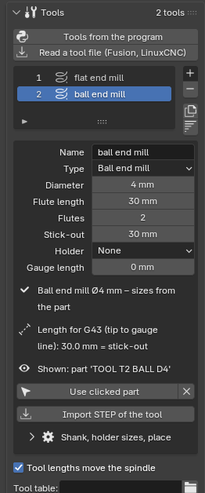

One **tool list** per project (4 Motion > CNC machine > **Tools**). Every tool of a program has a row: its
**T** number, a type and its sizes. Each tool **looks like the real one and cuts with its own shape** – also
after a tool change (M6): while T3 is in the spindle, the workpiece is cut with T3's sizes. (Cutting needs
4 Motion > Milling with the tool in the spindle as its bit and the block as workpiece.)

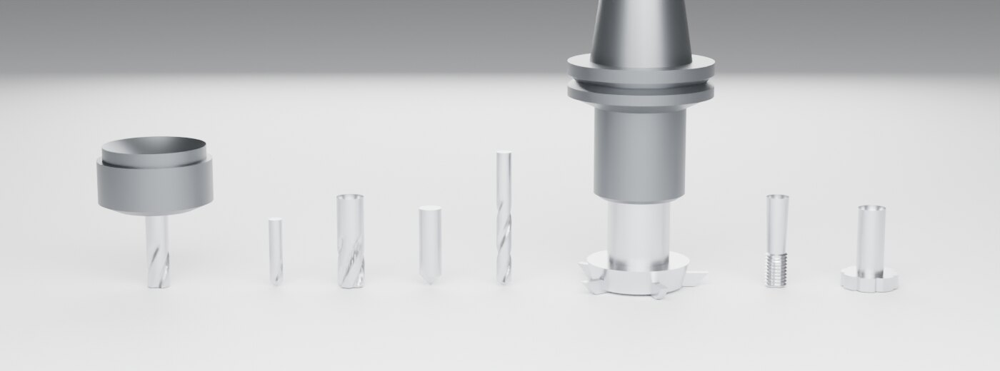

**Fill the list**

- **Tools from the program** adds a row for every tool the program uses, with the sizes from the tool
  comments Fusion writes at the top of the program (`(T2 D=8. CR=0. - flat end mill)`) or from the tool
  table.
- **Read a tool file**: a **Fusion tool library** (`.json`, or `.tools` as Fusion exports it – vendor
  libraries too) or a **LinuxCNC tool table** (`tool.tbl`). New T numbers are added; a tool already in the
  list gets the file's sizes. Fields the app does not know are skipped; a type it does not have (a lollipop
  mill, a reamer, a tap) is read as the nearest type, with a note in the row (the **i** at its end).
- **+** adds a tool of the type you pick, with sizes a common tool of that type has, so it works at once;
  **−** removes it, the two buttons below copy it and sort the list by T.

**Types and their sizes**

| Type | Sizes |
| --- | --- |
| Flat end mill | Diameter, flute length, flutes |
| Ball end mill | Diameter, flute length, flutes |
| Bull-nose end mill | Diameter, corner radius, flute length, flutes |
| Spot drill / chamfer mill | Diameter, tip angle (90°) |
| Drill | Diameter, point angle (118°), flute length |
| Face mill | Diameter (at its tip), inserts, insert size, lead angle (90° square shoulder, 45°) |
| Thread mill | Diameter, pitch, flute length |
| Slot / T-slot cutter | Diameter, cutting width, neck diameter |

**Flute length** is how far up the tool cuts; a size left at 0 is what the type usually has. **Stick-out** is
how far the tool comes out of its holder (tip to the holder's nose). **Holder** draws a simple **ER collet**,
**SK40**, **BT30**, **BT40** or **HSK63** holder above the tool; leave it at **None** when your model's spindle has
its own. The line under the sizes says what the row is, for example "Flat end mill Ø8 mm – sizes from the program
comment", and the line below it the tool's **length for G43**: from the tip to the holder's gauge line (where it
meets the spindle), that is the stick-out plus the holder's length.

With **Tool lengths move the spindle** ticked (as a tool length offset G43 does), a tool that is longer than the
one in the spindle moves the spindle up by the difference, so every tool's tip is where the program says; the
spindle adjusts right after the swap. Tools in different holders work too: a face mill 40 mm out of a 45 mm BT30
arbor (85 mm) and an end mill 38 mm out of a 60 mm BT30 chuck (98 mm) differ by 13 mm. For a tool shown by a part
or a STEP model with its holder inside, type the **Gauge length** (tip to gauge line, as on the tool's data sheet
or the presetter) into the row: it wins over stick-out + holder. Projects from before 0.2.38 whose tools all sit in
one kind of holder move the spindle as before.

Sizes that look wrong (a tool wider than 250 mm, longer than 300 mm, flutes longer than the stick-out) give a
warning above the row – nothing is refused.

**What it looks like**

- **Drawn from the sizes** (no part, no STEP): flutes along a helix, inserts round a face mill, teeth on a
  thread mill or slot cutter, and the holder if one is picked.
- **Import STEP of the tool**: a manufacturer's STEP model of the tool, or the tool in its holder (from the
  maker's website). The app reads it like any STEP file, finds its axis and its tip, and reads its sizes into
  the row as a first guess: the **outer diameter over the flutes**, the stick-out up to where the holder starts.
  The tip: for a model lying along X with its gauge line (or the shank's end) on the file's origin – the way
  ToolsUnited and Hoffmann models come – the end the tool reaches out to from there; for a holder alone, the
  nose side (the flange sits next to the gauge line); otherwise the end on the file's origin, else the narrower
  end. **Tip at the other end** turns it round.
- **Use clicked part**: a part of your model (for example a tool standing in the carousel). At the tool change
  it disappears from there and shows in the spindle. Its sizes are read from the part too.
- **×** goes back to the shape drawn from the sizes.

Whatever it looks like, **the tool cuts with the sizes in the row**: check them after a STEP or a part was read
(fluted end mills are read on their outer diameter since 0.2.36; before, one was read too small).

**Shank, holder sizes, place** (fold): the shank diameter, the holder's nose diameter and length (from its nose
to its gauge line), the **Gauge length** of a drawn tool (0: stick-out + holder), and where the tool is when the
program starts (**Spindle**, a changer **Pocket**, the
**Bench**) – used by the tool changer.

**A tool the program uses is not in the list**: the program step in 6 Animation says "T7 (line 42) is not in
the tool list". Pick a type next to **Add T7 as** and press it: the row gets the program's sizes when the
program has a tool comment for T7. Until then T7 is drawn from the program's sizes (or as a Ø6 mm flat end mill)
and Build warns.

The chips (4 Motion > Milling > Chips) follow each tool's type: a face mill throws flat commas, a drill makes
spirals; a thread mill and a slot cutter make chips like an end mill.

### Tool changes

Every tool change (M6) in the program plays by itself – on a machine without a tool changer, on one with a
carousel or umbrella tool changer (ATC), and on one with a double-arm tool changer. Set it up in 4 Motion > CNC machine > **Tool changes**; what the video shows (the
pause, the hand, a caption, the changer's speed) is set in the program step in 6 Animation.

**Manual** (no tool changer)

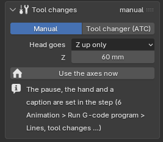

At each M6 the head goes to the change position, pauses, and goes back to where the program left off; the tool is
swapped half way through the pause. **Head goes**:

- **Where it is** – the head stays (as your program left it, for example after `G53 G0 Z0`).
- **Z up only** – Z goes to the change position's **Z** (machine coordinates, G53), X and Y stay.
- **Change position** – the head goes to X, Y, Z (like LinuxCNC's `TOOL_CHANGE_POSITION`), Z first.

**Use the axes now** takes the position the axes are at: move them there first (a pose, or the joints' sliders).

In the program step (6 Animation > **Run G-code program** > **Lines, tool changes, spindle, toolpath**):

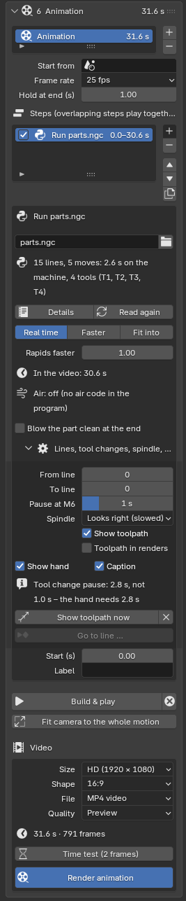

- **Pause at M6**: 1 second by default, 0 to 5 s with the slider. A long pause is boring in a video; the travel to
  the change position comes on top.
- **Show hand** (off by default): a gloved hand reaches in, takes the old tool out of the spindle, brings the new
  one and pushes it in, and leaves. It needs 2.8 seconds: a shorter pause grows to that, and the step says so
  ("Tool change pause: 2.8 s, not 1.0 s – the hand needs 2.8 s"; also under **Details**). With a longer pause the
  hand waits outside while fetching the new tool.
- **Caption**: a caption such as "Tool change: T3 Ø50 face mill" during every change of a video, in the brand
  kit's caption look (6 Animation > Video finishing). A name typed in the tool's row is added: "Tool change: T3 Ø5
  drill (Gühring 5 mm)".

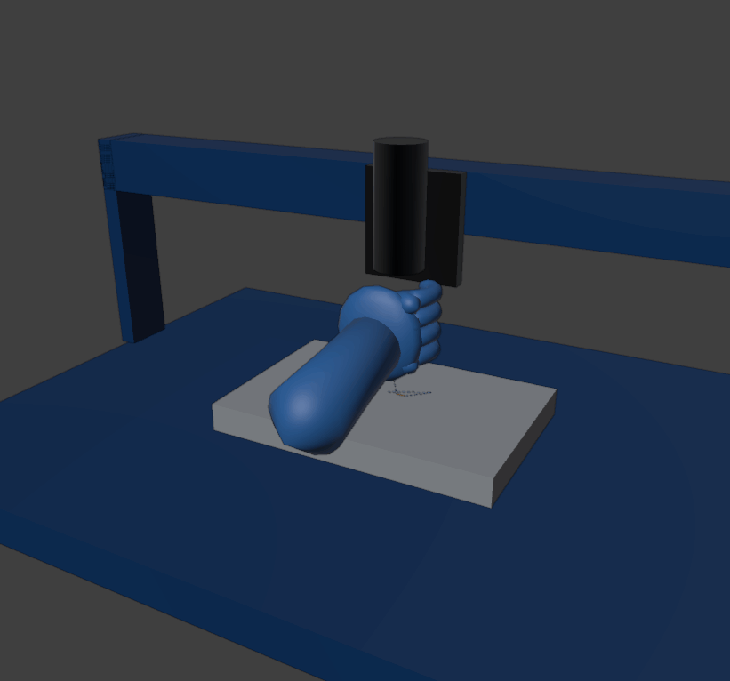

**Carousel / umbrella** (called **Tool changer (ATC)** before 0.2.51; it works as before)

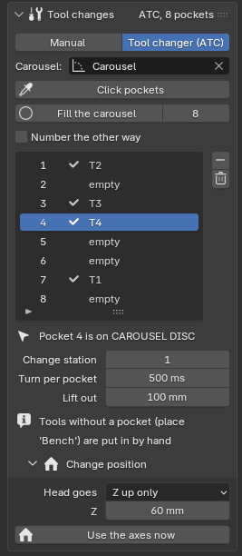

The tools stand in **pockets**, visible from the first frame (a pocket stays empty when its tool is in the
spindle). At each M6: the head goes above the old tool's pocket while the carousel turns that pocket to the
spindle, the spindle goes down and leaves the old tool in its own pocket, goes up, the carousel turns the
**shortest way** to the new tool's pocket, the spindle goes down, takes the new tool, goes up and back to the
program.

1. Optional, for a carousel: make a **rotate** joint for it in 4 Motion and pick it as **Carousel**. Without one
   the pockets are a **rack**: the head goes to each tool's pocket itself.
2. **Click pockets**, then click where each tool's holder sits (the pocket's fork or ring, at the height of the
   holder's flange); Esc when done. They are numbered in the order you click, shown in the view as small arrows
   "FR pocket 1", "FR pocket 2" … and move with the part you clicked. A carousel: click pocket 1 only, set the
   number of pockets and press **Fill the carousel**: they are put evenly round its axis (**Number the other way**
   for clockwise).
3. Which tool stands where: the row's **Pocket** in Tools (fold **Shank, holder sizes, place**); 0 means the pocket
   with its T number. A tool of your CAD model standing in the carousel (picked with **Use clicked part**) is found
   in the pocket it stands in. Place **Bench**: the tool has no pocket and is put in by hand (with the pause and the
   hand, as on a manual machine).
4. **Change station**: the pocket that is at the spindle when the carousel is as in the CAD model (usually 1).
   **Turn per pocket**: how long the carousel takes from one pocket to the next on the machine. **Lift out**: how
   far the spindle goes up out of a pocket.

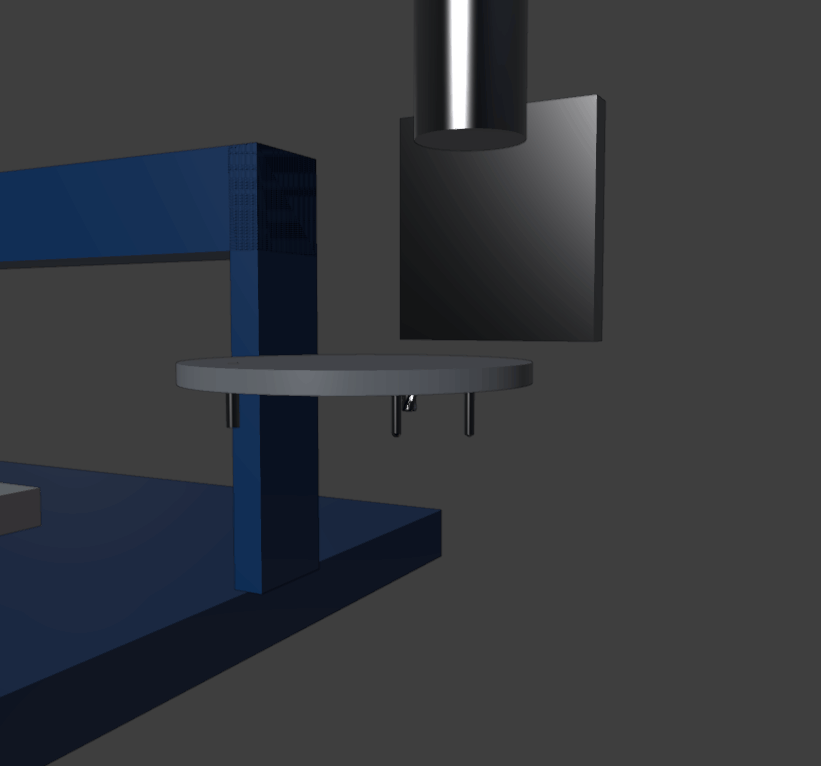

The spindle meets each pocket exactly: the app works out where the axes must be from the pocket's point and the
spindle's gauge line (the tool in the spindle's **Gauge length**, else its length). In the program step:

- **Changer**: an animation of the rest of the changer (an arm, a cover, the carousel moving in) made as an
  animation of its own with the changer's joints. It plays at every change, split at **Swap at (s)**: the part
  before plays before the old tool goes into its pocket, the rest after the new one is in. A step in it that turns
  the carousel is left out (the app turns it) – as is one that moves X, Y or Z.
- **ATC speed**: 1 = as on the machine; 2 = the changer works twice as fast in the video, 0.5 half as fast. The
  head's travel follows **Rapids faster**.

**Double-arm**

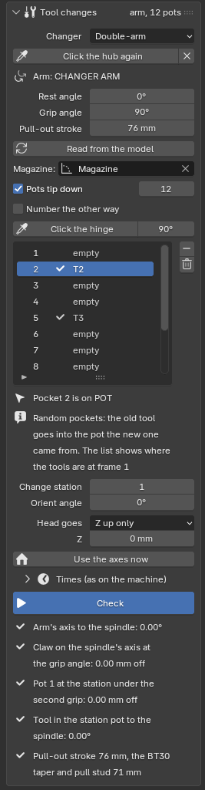

The tools stand in **pots** of a magazine beside the spindle; a swinging **arm** with a claw at each end swaps them.
At each M6:

1. Already at the **Tn** before the M6 (while the machine still cuts), the magazine turns the next tool's pot to the
   **change station** the shortest way, and the pot **tips down** so the tool hangs like the one in the spindle.
   Without an earlier Tn this happens at the M6.
2. The head goes to the **change position** and the spindle stops at its **Orient angle** (M19).
3. The arm turns from rest onto **both tools** at once, pulls them out, turns **half round**, pushes them in and
   turns back. The pot tips up again and the head goes back to the program.

**Random pockets**: the old tool goes into the pot the new one came from (as LinuxCNC's `RANDOM_TOOLCHANGER = 1`).
The app keeps track during the program; the pot list shows where the tools are at the first frame. A tool without
a pot (place **Bench**) is put in by hand at the change position, with the pause and the hand.

Set it up – the app makes every joint it needs:

1. Make a **rotate** joint for the magazine in 4 Motion and pick it as **Magazine**. Set the number of pots.
2. Press **Click the arm's hub** and click a round face of the arm's hub (if the arm is several parts, select its
   subassembly first). The app makes the arm's turn and its pull-out stroke (two joints, "Changer arm turn" and
   "Changer arm stroke") and reads the **Grip angle** from the arm's round claws. **Pull-out stroke** is set for the
   spindle tool's holder (76 mm for BT30). **Rest angle** 0° means the arm rests as in the CAD model. **Read from
   the model** reads both again; type a value when the arm should turn the other way.
3. Pots that lie down and tip at the station: tick **Pots tip down**, press **Click the hinge** and click the hinge
   (its pin or bore) of the pot under the arm's second claw. The app puts a pot in every place round the magazine
   and makes a tip joint for each ("Pot 1 tip" …). Pots that are already parallel with the spindle: **Click
   pockets** on the station pot and **Fill the carousel**, as for a carousel.
4. Set the **change position** (the head must go there: **Z up only** or **Change position**). With a spindle joint,
   **Orient angle** is the spindle's angle at the change (0° = as in the CAD model).
5. Press **Check**: it plays one change in the view and says what does not fit – the claw not on the spindle's axis
   (more than 0.1 mm off: change the grip angle or the change position), the station pot not under the second
   claw, a stroke too short for the holder's taper and pull stud.

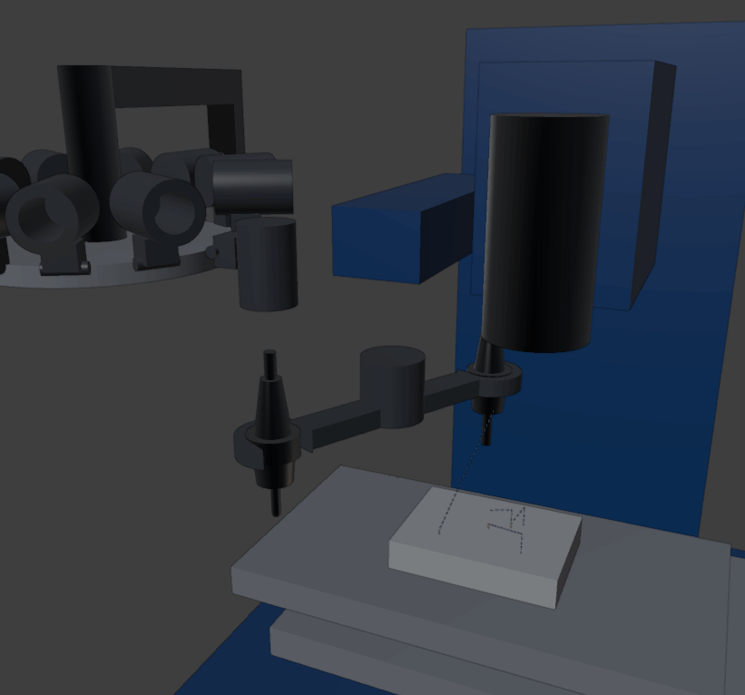

**Times (as on the machine)** (a fold): **Grip** (turning onto the tools, and back), **Pull out** (and push in),
**Half turn**, **Pot tips**, **Turn per pot**. At **ATC speed** 1 a BT30 tool-to-tool change takes about 1.6 s;
**ATC speed** in the program step makes it faster or slower in the video. Every tool is held by the spindle, the
arm or a pot at every frame: at each hand-over the two meet within 0.01 mm, so nothing jumps.

**Timing**: the step's length includes every change. With **Fit into** the changes may take at most half of the
seconds: when they would take more they are all shortened by the same factor (each turn at least 0.2 s, the hand
at least 2.8 s) and the step's Details say so; the cutting gets the rest and stays exactly on the program.
`T1 M6` while T1 is already in the spindle does nothing (as on the machine).

**Projects from before 0.2.45**: a step with a **Tool changer** animation makes the machine an ATC when the
project is opened, without pockets: the animation plays at every M6 as before and the head stays. Projects without
one are Manual with the head staying; their changes now take the **Pause at M6** (1 s unless you had set another
time). **Tool lengths move the spindle** (Tools, on by default since 0.2.36) moves the spindle by the difference
of the tools' lengths after a change; for the old look – every tool's tip where the first one's was – untick it.

## 5 Scene & Render – background, light, camera and image

Everything around the model – light, background, floor, cameras – and the picture itself: its size,
its quality, and the render. Also the one-click **turntable video**.

### Light look

The quickest start: click one of the five **Light look** buttons at the top. Each sets the light, the
background and the floor in one go; change anything below afterwards. The button of the look you see
stays pressed.

| Look | What you get |
| --- | --- |
| **Product studio** | A classic product photo: big soft main light from the front left, a soft fill from the right, two rim lights behind that outline the edges; light grey background with a soft shadow. |
| **White, endless** | The machine on an endless pure-white background with a soft shadow under it, in bright soft light. The background in the picture is exactly white (good for brochures and web shops). |
| **Dark studio** | Black background, a main light from the front left and bright rim lights behind: shiny edges, dramatic. |
| **Outdoor sun** | Blue sky, the sun from the front left, sharp shadows. On the sea, the deck or the quay only the weather changes. |
| **Overcast** | Grey, cloudy sky without sun: soft light, soft shadows, calm and true colours. On the sea, the deck or the quay only the weather changes. |

### Background & surroundings

**Background** says where the machine stands. The list has four groups:

- **Studio**: **Solid colour**, **None (transparent)** (a PNG for slides) or **Sky** (daylight with
  sun).
- **Photo**: **360° photo** – a photo all around the machine that is both background and light.
  With **Stand on its ground** ticked, the photo's floor lies flat under the machine and catches its
  shadow, so the machine stands in the photo. **Photo taken at** is the height the photo was taken
  from (most: 1.5–2 m): change it until the machine has the right size against the photo's floor.
  The small icon next to **Photo** picks a photo from the shared library; **How to get free 360°
  photos** opens a list of good free photos (harbours, workshops, halls) and how to add them.
- **Offshore**: **Open sea**, **Vessel deck**, **Quayside** – sea to the horizon under a sky with a
  sun.
- **Workshop**: **Clean factory hall**, **CNC machining hall**, **Assembly hall**, **Warehouse**.

The offshore and workshop surroundings are made by the app itself and grow with the machine. The
machine's lowest point stands on the floor, deck or quay, centred; the machine itself is not moved.

Their settings appear under the choice:

- **Sea**: **Calm** or **Rough**. **Waves**: **Foam** on the wave tops, **Moving** waves in videos
  (off: the sea stands still). **Water level** (open sea only) raises or lowers the water.
- **Detail**: **Simple** (fewer things around the machine, renders fastest) or **Detailed** (more
  containers, workbenches, racks; real waves near the machine).
- A hall never hides the machine: the walls are only seen from inside, so a camera outside the hall
  looks straight in, and anything that would stand between the camera and the machine (a column, a
  rack) is left out of the picture. When the camera is higher than the lamps, the roof is left out
  too.
- **More** (the fold): **Floor lower by** lowers the floor a little; **Show in the view** hides the
  surroundings while you work (renders always include them); **Fit surroundings to the model** after the
  machine changed (a new revision, parts removed in Clean-up). Importing another model leaves the surroundings
  where they are; if it sticks out, a note offers the same button. Parts you only hide do not move the
  floor.

### Light

- **Light**, with a solid colour, no background or a hall: **Product studio**, **White studio**,
  **Dark studio**, **Soft studio** (the soft studio light of earlier versions; old projects keep it),
  **360° photo** or **Sky**. A 360° photo background gives its own light; Sky and offshore are lit by
  the sky.
- **Weather** (wherever the sky gives the light): **Sun** or **Overcast**. With sun: **Sun height**
  (low = long shadows and warm light).
- **Turn light** (or **Turn sun**, **Turn photo**) turns the light around the machine. **Brightness**
  and **Exposure** make the picture lighter or darker.
- The line under them says it in words, for example "Main light from the front left, high · normal
  brightness". Front is where the **Front** camera looks from.
- **Floor** (studio backgrounds only): **None** (the model floats), **Shadow only** (an invisible
  floor that only shows shadows: the usual choice) or **Visible floor** (with **Own colour** if you
  want). **Gap** moves the floor a little away from the model.
  The floor is placed once under the model's lowest point. A picture sits under the model as it is shown; a **video**
  keeps the floor of its first frame, so a part that swings below it is cut by the floor in every frame. A picture
  of one frame of a built animation (**Current view** in the render queue) uses the video's floor too, so it looks
  exactly like that frame of the video.

Render time, measured on a slow 2-core test machine without a graphics card: the 360° photo and
the offshore surroundings take about as long as the studio; the halls 1.4 to 2.8 times as long.

### Props for scale

Things everyone knows the size of: **Person** (1.8 m), **20 ft container**, **Euro pallet**,
**Safety barrier**.

1. Click one: it stands next to the machine on the floor and is selected.
2. Move it with the arrows in the view (or press G); R turns it, X deletes it.
3. **Show props** hides or shows them all (a saved scene remembers it); **Delete all** removes them.

### Camera

Each camera is a button: click it to look through it and render from it. × removes it.

**Add a camera** in one click:

1. **Whole model**, or **Selection** (click a subassembly on the model first: only that fills the
   picture). **Space around**: **Tight**, **Normal** or **Roomy** (room for a title or logo).
2. Click a view: **Isometric** (the technical view without perspective: parallel edges stay parallel),
   **Front**, **Side**, **Top**, **3/4 hero, low** (low from the front right: the machine looks big)
   or **3/4 hero, high**. **More** has Iso front-right, Iso front-left, Iso back-right and Back.
3. Or turn the view until it looks right and click **Where I look now**.

The new camera becomes the active one and the view looks through it.

For the active camera:

- **Fit to the picture** moves it closer or further so the machine (or the selection) just fills the
  picture, keeping the side it looks from.
- **Lens (mm)**: 50 looks natural; 24–35 shows more and looks wider; 85–135 makes the machine look
  flatter. Press **Fit to the picture** after changing it.
- **Background blur**: **None**, **A little** (the background goes soft; the machine stays sharp) or
  **Strong** (like a product photo; parts far from the sharp spot go soft too). It looks the same on
  a small gearbox and on a 25 m crane. Each camera keeps its own. Not for Isometric (no perspective).
- **Sharp at**: the middle of the machine, until you click the eyedropper and then the spot that
  should be sharp (for example the gripper). A small ball marks it in the view; in pictures it moves
  with its part when joints move (a video keeps the sharp distance its start camera has). × makes the
  middle sharp again.

### Turntable video

A video of the camera going once round the machine, as it looks now – in one click.

1. **Length (s)**: one full turn (10 s is a good start). **Camera height**: **Low**, **Middle** or
   **High**. **Quality**: try **Fast preview (EEVEE)** first; a turntable has hundreds of frames.
2. Click **Make turntable video**. It goes into 7 Render queue and the queue starts; keep working, or
   close the app. The line under the button shows how far it is.
3. The video loops: its end joins its start without a jump, so it can play on repeat on a screen or
   a website.

It starts on the side the active camera looks from and keeps the whole machine in the picture all the
way round, with the active camera's lens and background blur (in a turntable, the middle of the
machine stays sharp). The button makes three things you can also look at yourself: the camera
**Turntable camera**, the saved scene **Turntable** and the animation **Turntable** in 6 Animation.
To change the video's size, shape, frame rate or file: change them there, then click **Make
turntable video** again (it fits the camera and the turn to them). Also click it again after
changing the machine or the background; it makes the turn anew, so steps you added to the
animation "Turntable" are replaced.

In a hall the panel says that halls take 1.4 to 2.8 times as long to render as the studio (measured
on a test PC without a graphics card) and offers **Use Simple (faster)**.

### Brand kit & logo

A brand kit is a company's look for its videos and pictures: the logo, two colours, a font and a contact
line. You work for your own company and for others, so there is one kit per company; every project uses
one, and a kit is stored in the shared library (the folder **Brand kits**, next to **Rule sets**; without a
shared library it is in your Documents folder, under Fresing Render).

1. Type a name in **Kit** (the company).
2. **Logo**: pick the logo picture. It must be a **PNG or JPG** (a PNG with a see-through background looks
   best). A logo in another format, such as SVG, cannot be used: export it as PNG first.
3. **Card colour** is the background of the title and end card, **Text colour** the colour of the words on
   them. **Font** is optional (a .ttf or .otf file); empty uses the app's own font. **Contact** is the line
   under the logo on the end card, for example the website and e-mail address.
4. **Save kit** puts it in the library. The arrow next to **Kit** lists the saved kits: pick one to fill in
   everything at once. This project keeps its own copy, so it still opens the same on a PC without the
   library. **Delete** removes the saved kit from the library only.

**Logo on images** puts the logo in a corner of every still image you render (**Corner**, **Size**).

### Watermark

Words across the picture, for a draft you send before the final render.

1. **Words**: **DRAFT**, **CONFIDENTIAL** or **Own text**. **Size** is how tall the letters are,
   **See-through** how strong they are (1 = solid).
2. Switch **Watermark on the next renders** on. Every image or video you render, or add to 7 Render queue,
   while it is on gets the watermark; the job remembers it (its name says "with watermark").
3. Switch it off again, add the same render to the queue once more, and the final comes out clean. The
   project does not change.

It works for stills and for MP4 videos (not for PNG frames).

### Labels

A label is a few words in a box with a thin line to a spot on a part: "Gripper", "Cylinder Ø63", "Max.
25 t". It shows in stills and in MP4 videos, in the brand kit's colours and font.

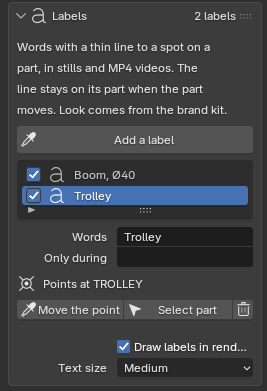

1. Press **Add a label**, then click the spot on the machine that the label should point at. (Esc cancels.)
2. Type the words in **Words**. The label is in the list; the tick in front of it switches it on or off.
3. The box goes beside the machine by itself, near its spot, never on top of another label. You do not
   place it.
4. The spot belongs to the part you clicked: when that part moves in an animation, the line follows it in
   every frame. When the part is hidden (a **Hide** step, or its subassembly is hidden), its label is hidden too.
5. **Only during**: pick an animation step and the label shows only while that step happens, fading in
   and out. Empty: all the time. In stills every label that is on shows.
6. **Move the point** clicks a new spot; **Select part** shows which part the label points at.
   **Text size** makes all words bigger or smaller; **Draw labels in renders** switches them all off.

Labels do not look behind parts: a spot that is hidden behind another part still gets its line.

### Image size & render

1. **Format**: for screens (Presentation 16:9, Widescreen 21:9, Classic 4:3, Photo 3:2, Website square
   1:1, Social story 9:16, Web banner 3:1), for print (Brochure A4, Flyer A5, Poster A3 and A2, US
   Letter) or **Custom size**.
2. **Size** for screen formats; **Resolution** (150 or 300 dpi) and **Bleed** for print; and
   **Orientation**. The line under it shows the size in pixels.
3. **Quality**: **Draft** (quick check, half size), **Preview**, **Final** (clean) or **Best** (very
   clean, slow).
4. **Live preview** shows real materials and light in the view; click again to switch it off. Use it
   to judge light and colours before you render.
5. **Render image**. A render window shows the picture building up; it is saved by itself. **Open**
   and **Show in folder** appear under the button.

**Files & graphics card** (the fold): **File** PNG (sharp; transparency possible) or JPEG (small
files); **Folder** (empty: "Renders" next to the saved project, or Pictures\Fresing Render while the
project is not saved yet); **Graphics card** (on: render on the graphics card; off: on the processor);
**Open render folder**. A file is named after the project, the camera and the size, for example
`crane_Low_hero_1920x1080.png`; an earlier render is never overwritten (a number is added).

### Saved scenes

A **saved scene** keeps a whole set-up under one name: colours (paint scheme), pose, visibility,
camera, background and image size.

1. Set everything up the way it should look.
2. Click **+**. In the small window, type a name, and choose for colours, pose and visibility: **As it
   is now** (stored with the scene), **Leave as it is** (switching to the scene does not change it)
   or one of your saved schemes, poses or sets.
3. **Use** switches to the scene; ↻ overwrites it with what you see now.
4. **Queue this** or **Queue all** put the scene(s) in 7 Render queue: a set of pictures overnight.

## 6 Animation – make a video

An animation is a list of **steps** on a timeline. Steps that overlap in time play together.

1. Make the joints and poses first (4 Motion), and a saved scene to start from (5 Scene & Render).
2. Click **+** next to the animation list. Double-click its name to rename it.
3. **Start from**: the saved scene at the first frame. **Frame rate**: 25 fps is usual in Europe.
   **Hold at end**: how many seconds the last picture stays.
4. Add steps with **+** next to the list of steps and pick the kind of step. A new step starts when the
   one before it ends:

    - **Move joint**: a joint goes from where it is (or **From** a value) **To** a value.
    - **Go to pose**: everything moves to a saved pose.
    - **Camera**: **Cut to** a camera, **Move to** a camera (a smooth flight) or **Orbit** (turn around
      the model by an angle).
    - **Show** / **Hide**: a subassembly appears or disappears (select it, then **Use selected**).
    - **Run motor**: a motor turns at a speed (**Speed (rpm)**; a slide joint: **Speed (mm/s)**) for
      the step's duration. Joints that follow it move along (see couplings in 4 Motion).
    - **Move cylinder**: a cylinder's rod goes from where it is (or **From** a stroke) **To** a stroke
      in mm; the arm moves with it. It takes the cylinder selected in 4 Motion > Cylinders. With
      **Constant speed** the rod moves at an even pace, as a real cylinder does.
    - **Lift height**: a scissor lift's platform goes from where it is (or **From** a height) **To** a
      height in mm (pin to pin); every arm follows. It takes the lift selected in 4 Motion > Mechanisms.
    - **Run G-code program**: the CNC machine runs a program (see **Run a CNC program** below). Its
      length follows from the program.

5. For each step: **Start** and **Duration** in seconds, **Motion** (**Smooth** = slow start and
   stop, **Constant speed**, **Slow start**, **Slow stop**) and a **Label**. Untick a step to leave it
   out. The arrows change the order; the copy button copies a step (the copy starts when the original
   ends). A step for a joint that follows another joint is red: pick the joint it follows instead.

**Run a motor**

1. Tick **Motor** on the joint in 4 Motion (needed for more than 10 turns).
2. Add a step **Run motor**. It takes the motor (or the selected joint) and lasts 5 s.
3. Set **Speed (rpm)**; negative turns the other way. The line under it says how far it goes:
   12 rpm for 5 s at **Constant speed** is "1.00 turns in this step".
4. **Motion** sets the ramps: **Smooth** speeds up at the start and slows down at the end, **Slow
   start** / **Slow stop** only one of them, **Constant speed** none. **Ramp (s)** is how long speeding
   up and slowing down take; with ramps it turns a little less (0.90 turns with 0.5 s ramps).
**Run a CNC program**

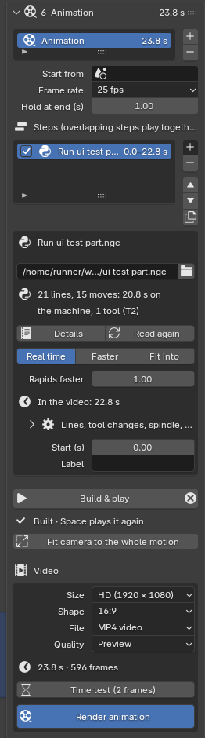

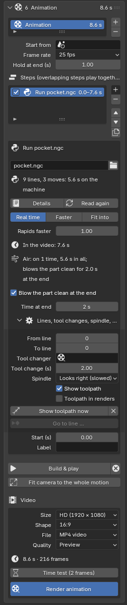

1. Set the machine up in 4 Motion > **CNC machine** (above).
2. Add a step **Run G-code program** and pick the program file (`.ngc`, `.nc`, `.tap`). The line under it
   says how many lines and moves it has and how long it takes on the machine. A copy is kept in the
   project, so the render queue and another PC have it too. Tip: keep the program (and the tool table)
   in the project's folder or a folder below it, after saving the project: it is then stored next to the
   project, and found there when the folder moves to another PC.
3. **Speed**: **Real time**, **Faster** (for example 10 × faster), or **Fit into** a number of seconds.
   **Rapids faster** lets the moves through the air go quicker again, so the video spends its time on the
   cutting. The line under it says how long the step lasts in the video.
4. **Build & play**. The tool follows the program exactly – also the arcs, between frames too, and while the
   spindle turns (the tip is put on the axis the spindle turns about). Milling reads the tool at every corner of
   the program as well, so a sharp corner is cut right into the corner even at a high feed. With
   **Show toolpath** the path is drawn on the block: cutting moves orange, turning green once cut, rapids
   dashed blue (**Toolpath in renders** shows it in pictures and videos as well).

The fold **Lines, tool changes, spindle, toolpath** holds:

- **From line** / **To line**: play only part of the program; the machine starts where the program would
  be at that line.
- **Tool changes**: **Pause at M6**, **Show hand** and **Caption** (manual), **Changer** and **ATC speed** (tool
  changer; a double-arm changer has **ATC speed** only) – see **Tool changes** in 4 Motion above.
- **Spindle**: a real 10,000 rpm spindle looks still or turning backwards in a video of 25 pictures per
  second, so it is slowed down to look right (at most 1/7 turn per picture). **Real speed** turns it at
  the program's S.
- **Go to line …** puts the timeline where the program starts a line.

Under the step's length: **Air: …** says when the program has air on (see **Air blast** in 4 Motion >
Milling), **Coolant** when coolant flows (shown when coolant is on, see **Coolant** in 4 Motion > Milling), and
**Blow the part clean at the end** with **Time at end** adds a final blast that leaves the part clean.

What the app reads (LinuxCNC's G-code, as CAM programs and hand-written programs use it): G0 G1, arcs G2
G3 in all three planes (I J K or R, helical, several turns), G4, G17–G19, G20/G21 inch and mm, G90/G91,
G90.1/G91.1, G93/G94/G95, work offsets G54–G59.3 and G10 L2/L20, G92, G28/G30, G53, the drilling cycles
G81 G82 G83 G73 G85 G86 G89 (G98/G99, repeats), F S T M3 M4 M5 M6 M30, M7 M8 M9 (air and coolant, see Air blast and Coolant), parameters (`#1`, `#<name>`),
expressions in `[ ]`, and O-word subroutines, loops and if/else (also a subroutine file `<name>.ngc` next
to the program). **Details** lists everything the app does not show, with its line numbers: cutter
compensation G41/G42 (the tool follows the programmed line), rotary axes A/B/C, threading, probing and
user M-codes. Moves are timed without acceleration: on the real machine short moves take a little longer.

Measured on the 4-core cloud test machine (test gantry): a program of 20,000 lines (short moves and arcs,
about 30 minutes on the machine, 45,349 frames at 25 fps) builds in 2–3 s, toolpath included; reading
60,000 lines takes under a second.

6. **Build & play** plays the animation in the view; <kbd>Space</kbd> plays it again. ⊗ next to it
   takes the animation off the model, so the joints can be moved by hand again.
7. **Fit camera to the whole motion** zooms the start camera out so nothing leaves the picture.

**Finishing: ready to post or send**

The **Finishing** fold at the end of this panel turns the MP4 into a video you can post or send as it is.
The look comes from the brand kit (5 Scene & Render > **Brand kit & logo**). It applies to MP4 videos, not
to PNG frames.

- **Shape** and **Framing**: for **1:1** and **9:16** videos, **Extend** keeps everything you see from side
  to side in the 16:9 picture and shows more above and below; **Crop** keeps what you see from top to
  bottom and cuts the sides. The cameras are not changed: only the copy that is rendered.
- **Logo**: a corner (top left, top right, bottom left, bottom right) and a **Logo size**, over the whole
  animation.
- **Title card**: a card with a **Title** and **Subtitle** in the kit's colours in front of the video;
  **Seconds** says how long it stays.
- **End card**: a card with the logo and the contact line at the end; **Seconds** says how long.
- **Captions from the step labels**: the **Label** of each step is shown at the bottom while that step
  happens, with a short fade. Only steps that have a label typed in get a caption; a caption stays
  at least a second and a half, and never runs into the next one.

The last line shows how long the finished video is: the cards come on top of the animation's own
length.

**Pictures and music**

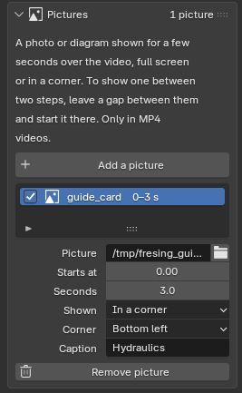 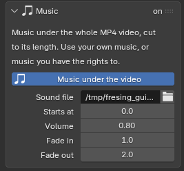

The **Pictures** fold shows a photo or a diagram for a few seconds over the video; the **Music** fold puts
a music file under it. Both only go into MP4 videos.

- **Add a picture**, pick the file (PNG, JPG, TIF, BMP or WebP). **Starts at** is counted from the start of
  the animation (a title card is put in front of that), **Seconds** says how long it stays, with a short
  fade in and out. **Shown**: **Full screen** (the picture fills the video, in the card colour) or **In a
  corner** (a small picture; the animation goes on). **Caption** is an optional line of text.
- To show a picture *between* two steps, leave a gap between them (start the second step a few seconds
  later) and start the picture at the end of the first one, full screen.
- **Music under the video**: pick a **Sound file** (WAV, MP3, OGG, FLAC or M4A). **Starts at** is where
  in the video it begins, **Volume** how loud, **Fade in** / **Fade out** how long it takes to come up and
  to go away. It is cut at the end of the video; a file shorter than the video just ends early.

Use music you have the rights to: the app does not check. The video gets a normal sound track (AAC), so it
plays everywhere.

**Clash check: parts that run into each other**

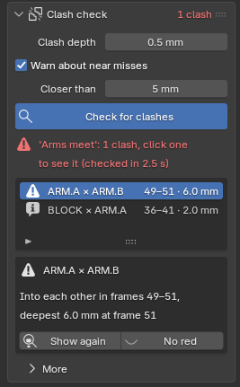 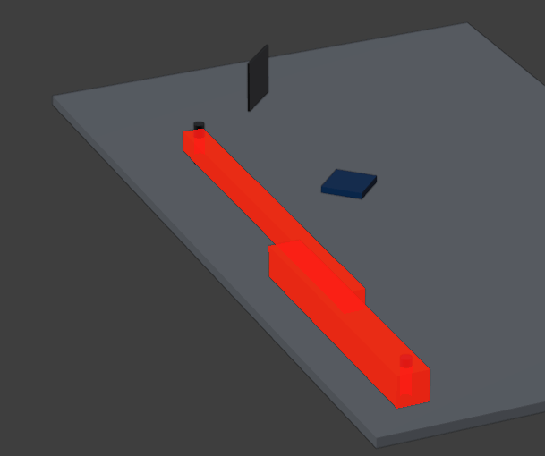

A part that drives through another one ruins a video, and can hide a real design fault. The **Clash check**
fold goes through the built animation and lists every two parts that run into each other.

1. **Build & play** the animation first.
2. **Check for clashes**. It shows how far it is; **Cancel** (or <kbd>Esc</kbd>) stops it. The panel's header
   then says **3 clashes**, **No clashes**, or **Not checked since the last Build**.
3. The list: the two parts (their names as in the tree), the frames from–to, and how deep they go into each
   other at the worst moment, deepest first. A marker on the time line shows where each clash starts.
4. **Click a row**: the time line goes to the moment they are deepest in each other, both parts are selected,
   drawn red and the view zooms to them. The red is only drawn in the 3D view: their material does not change
   and renders never show it. **No red** takes it off, **Show again** goes back to it.

What counts:

- **Clash depth** (0.5 mm): parts that go further into each other than this.
- Only parts that move against each other are compared. Parts that keep their place against each other the whole
  animation (a welded frame, a bolt in its hole, everything one joint carries) never are.
- Parts that already touch or overlap in the CAD model at the first frame (a pin in its bore, a press fit) only
  count when they go clearly deeper: by more than the clash depth plus half of the overlap they start with.
- Hidden parts are left out while they are hidden (Show / Hide steps, visibility sets).
- Milling: the cutting part of a tool (from its tip up to the end of its flutes, from the tool list) going
  through the workpiece is meant to cut: it is not a clash (a 45° face mill: as wide as the top of its inserts). The rest of the tool, its holder and the spindle are
  checked against the workpiece, the vice and the table. With milling on, the workpiece is checked as it is cut at
  that moment; without it the shank may follow the hole the flutes make. A tool in the spindle or standing in its
  changer pocket touches them on purpose.
- Chips, coolant, air, labels, logos and stickers, the toolpath, the surroundings and props are not parts:
  left out.
- Fast moves (G-code rapids, a turning arm) are checked between frames too, so a part cannot jump through
  another one in one frame step.
- **Warn about near misses** (off at first): also list parts that come closer than the distance under it
  (5 mm) without touching, when they were further apart at the first frame.

The result is kept with the project. Building the animation again with other steps clears it (the same steps
built again keep it). Building again *while* the check runs drops its result ("…built again while the clash check
ran: check again"): it would belong to neither build. You can scrub the time line while it runs; milling and coolant
follow. Adding an animation to the render queue that has clashes, or was never checked, gives a
one-line note in the status bar; the video is rendered anyway.

How long it takes, measured on the 4-core cloud test machine: the test crane's animations 0.1–0.3 s, the CNC
gantry's 2,983-frame tool-change program 7 s, the scissor lift and crank (49 parts that touch everywhere) 15 s,
the PC check's made-up 3,000-part machine 10 s long 73 s (its modules run through each other on purpose: 1,668
clashes). Expected on a PC with a fast processor: about half as long (not measured yet).

**Make the video**

1. **Size** (from 960 × 540 to 4K), **Shape** (**16:9**, **1:1**, or **9:16** upright for phones; the
   **Finishing** fold has the framing for the last two),
   **File** (**MP4 video**, plus the single frames; or **PNG frames only**) and **Quality**.
2. First check the motion with Quality **Fast preview (EEVEE)**: minutes instead of hours. Render the
   real video with **Preview** or **Final**.
3. **Time test (2 frames)** renders the first frame and a typical one with these settings, then shows
   how long the whole video will take. The test frame is kept, so you can check the look.
4. **Render animation** puts the video in 7 Render queue and starts the queue.

## 7 Render queue – render in the background

The queue renders pictures and videos with a second copy of the app in the background. Keep working,
or close the app and let it run overnight: the PC stays awake while it renders.

- **Current view** adds a picture of the model exactly as the view shows it now, from the active camera.
  In a built animation that is the frame you are on: its pose, the parts hidden at that moment and the
  camera where it is at that frame. **All scenes** adds one per saved scene.
  Videos come from **Render animation** in 6.
- **Start queue** starts rendering. While it runs: **Stop after this frame**, or **Stop now** (the
  frame being rendered is lost). **Start queue** later continues a video where it stopped. If you changed
  the animation or its settings in between, the video starts again from the first frame, so a video never
  mixes old and new frames (the job's message says so).
- **Start later** (under the list): pick **In …** and set hours and minutes (0–12 h), or **At …** and a clock
  time (today, or tomorrow when it has passed), then click **Start later**. The panel shows "Starts in 2 h 14 min –
  at 18:30" with **Start now** (starts at once) and **Cancel**. **The app must stay open and the PC on** until the
  time comes: a delayed start is not kept when you close the project or the app, and the panel says so if that
  happened. While it waits, Windows does not go to sleep by itself (shutting the PC down or closing the lid still
  stops it). Saving the project, also under a new name (**Save As**), keeps the delayed start.
  At the time it does exactly what **Start queue** does; if a render is still going then (a time test of the day),
  it starts as soon as that one has finished.
- **Render animation** and **Time test** while a delayed start waits render only that new job now; the jobs that
  were waiting still start at the set time. **Start now** starts them all at once (and ends the wait).
  **Update now** is refused while a delayed start waits: cancel it, or update when the queue has finished.
- Click a job to see its progress and messages; when it is done, **Open** plays or opens it and
  **Show in folder** opens Explorer with the file selected.
- **−** removes the selected job, also a waiting one while the queue runs: the queue then leaves it out.
  The brush removes all finished jobs.
- **Open log** shows the time per frame and any errors. A picture whose saved scene was deleted, or a
  renderer that could not start, shows as **Failed** with the reason.
- The queue belongs to its project: open another project while it renders and that project keeps its own
  list (open the first project again to follow it, also after closing and starting the app again). Starting a
  second project's queue while the first still renders asks first: both share the graphics card, so both take
  longer. The same jobs are never rendered twice: Start queue says so when they are already being rendered (also
  by a colleague's PC from the same shared folder). Files typed as `//…` (next to the project: 360°
  photo, logo, font, music, pictures) are found by the queue too.
- A video's sharp spot stays on its part, also when the part moves during the video or the start scene
  puts it elsewhere.

## Test tour – see every function work

After an update you want to see quickly that everything still works. The **test tour** is a set of small
projects, made from the app's own test models (a crane, a mill, a gantry, a cylinder, a scissor lift, a way
cover…), with every function already set up: 29 numbered **stops**, from materials and painted faces through
joints, cylinders and G-code to finished videos and the render queue. You look at each stop and say OK or Problem.

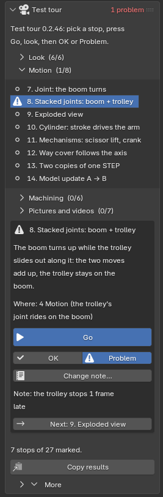

**Make it (once per version)**
1. **Help > Make test tour project…**, then **Make it**. It is made in the background in about 2 minutes (the
   bottom line of the window shows "Making the test tour: project 3 of 14 …"); you can keep working.
2. When it is ready a small window says so: click **Open test tour project**. Later: **Help > Open test tour
   project**. Save your own project first: changes that are not saved are lost when another project opens.

It goes to **Documents\Fresing Render\Test tour**: "Test tour 0.2.47.blend" (the crane, the one you open)
and a folder "Test tour 0.2.47 files" with the other projects. It is made new for every version, so it always
shows what this version can do.

**Go through the stops**
1. The **Test tour** panel is on top of the Fresing tab (only in a tour project). The stops are in four
   folds: **Look**, **Motion**, **Machining**, **Pictures and videos**; the numbers in brackets say how many
   you have marked.
2. Click a stop. Under the list you see what you should see and where the function is in the side panel.
3. Click **Go**. The app opens the stop's project if needed, sets up its saved scene, builds and plays its
   animation, selects the part and looks through the camera.
4. Look. Then click **OK** or **Problem** (click again to take the mark off). With a problem, click
   **Note…** and write in a few words what you saw.
5. **Next** goes to the next stop.

Your marks and notes are kept in a file next to the tour ("Test tour 0.2.47 results.json"), for every
project of the tour, also when you close the app.

**Send the results.** Click **Copy results** and paste the text into the lead chat: the version, your PC,
and every stop with OK / PROBLEM / – and your note. It is also saved as "Test tour 0.2.47 results.txt".

**Let it run by itself (10 to 15 minutes).** **More > Run the whole tour by itself** (or **Help > Fresing
Render PC check…** and pick **Test tour**) makes a fresh tour in the background, goes through every stop, checks
what can be checked with numbers (the boom turned, the rod's eye stays on its pin, the platform is at 1.5 m,
the tools go to their pockets…) and renders a small picture of each stop, or three frames of its motion. At
the end "Fresing Render test tour.html" opens in your web browser (it is on the Desktop too): a card per stop
with its picture, what you should see, and OK or FAILED. Start it, do something else, and later tick OK or
Problem in the panel while you look at the report. Your own marks are not touched. On the 4-core test machine
without a graphics card the whole run took about 3.5 minutes (measured); on your PC it uses the graphics card
and bigger pictures.

**More**: **Show the tour folder**, **Make the tour again…**.

## Tips

### Exporting from Inventor and Fusion

- **Inventor**: File > Export > CAD Format, file type STEP, then **Options**: set the Application
  Protocol to **214 – Automotive Design** (or 242). The older AP203 carries no colours or material
  names: everything comes in grey and unsorted.
- **Fusion**: the normal STEP export is fine. It writes colours, material names and appearance names
  ("Aluminum - Satin", "Rubber - Soft"), and Fresing Render uses them.
- One CAD colour per finish (for example all galvanised parts the same grey), plus one sorting rule,
  gives every revision the right materials by itself.
- Clear part names help the sorting: "PLATE RVS", "SHAFT D40", supplier order codes.

### Faster renders

- **Clean-up** inside parts and small screws nobody sees.
- Check with Quality **Draft** or **Preview**; check animations with **Fast preview (EEVEE)**.
- **Time test** before a long video, and render it overnight in the queue.
- Big overview pictures rarely need Detail **Fine**.
- In a hall, choose **Simple** for long videos; a 360° photo with **Stand on its ground** costs no
  more time than the studio.
- A turntable of 10 s has 250 frames: check it with **Fast preview (EEVEE)** first, and run a
  **Time test** of the animation "Turntable" in 6 Animation before a Final video.

## Troubleshooting

### The self-test

Start menu > Fresing Render > **Fresing Render - Self test** runs for a few minutes without a window
and writes "Fresing Render self-test.txt" on the Desktop. Each line checks one thing: the STEP reader,
importing on all cores, CAD material names, the app start, the graphics card, a test import, a render
on the graphics card and one on the processor, joints and animation, the video encoder, the render
queue, the time test and the update check. A line with `[FAIL]` says what went wrong: send the file
along when you ask for help.

### The PC check (after every update)

The PC check tests every main function of the installed version on your PC, with small test models
that come with the app (never your own files, unless you ask): import and sorting, painted faces, rule
sets, joints, couplings and motors, poses, model update, saving, surroundings, light looks, camera views,
blur, turntable, milling, pictures on the graphics card and on the processor, EEVEE, a video through the
render queue, the time test and the update check. It runs in the background; you can keep working.

**Start it**
1. Start menu > Fresing Render > **Fresing Render - PC check (quick)** (about 3 minutes: import, a
   joint, a picture on the graphics card, a short EEVEE video), or **Fresing Render - PC check (full)**
   (about 15 minutes: everything). Or in the app: **Help > Fresing Render PC check…**, pick **Quick** or
   **Full**, then **OK**.
2. A black window shows the steps as they run. Leave it open; it closes by itself.
3. At the end "Fresing Render PC check.html" opens in your web browser (it is on the Desktop too).

**Heavy: a real load test (10 to 20 minutes).** **Fresing Render - PC check (heavy)** (Start menu or
Desktop; or **Help > Fresing Render PC check…** and pick **Heavy**) makes an invented machine of about
3,000 parts (it is deleted afterwards), imports it on all cores, works with it (structure list, search,
Show only, explode, save and open), renders Cycles pictures at HD and 4K, EEVEE per frame at HD and 4K,
and a real 10 second animation (250 frames, EEVEE, 1920 × 1080) plus a 3 second Cycles clip through the
render queue, then the machine in the CNC hall and on the open sea (Detailed), a long milling cut with
chips (more than 100 frames), and the playback speed of the joints and couplings. With your own STEP file
(see below) Heavy also renders it at 4K and as a 3 second EEVEE video. The first seven steps took 12 minutes
on a 24-core PC with an RTX 3090 (measured); the three new ones should add a few minutes. It uses the whole PC and the graphics card for that time, so start it when you do not need
the PC. The report page updates itself while it runs and shows which step is busy, for how long and how
long it should take. In the report the pictures are large, with their size and quality under them, the
videos come as a contact sheet (eight frames across the video) and the last frame. Under each step it
says what the step shows and what it does not show. Heavy has its own history: its times are compared
with your last Heavy run. In its text block you also find the peak memory.

**To stop a Heavy check** that takes too long: in the app **Help > Cancel Fresing Render PC check**
(shown only while a check runs), or press **Ctrl+C** in the black window. A picture that is being
rendered is finished first. The report then opens with the steps that were done, marked "Cancelled".

**With your own model (optional).** Drag a STEP file onto **Fresing Render - PC check** on the Desktop
(the Start menu does not take files), or in **Help > Fresing Render PC check…** tick **Also test my own STEP file** and pick it (the
model of the open project is filled in already). The check then also measures your model: import time,
parts, unique parts, triangles, the share sorted by the rules, a picture on the graphics card and the
time per frame for **Preview** and **Fast preview (EEVEE)** at HD.

**What the report shows**
- On top: all OK, or how many functions failed, and how many there are to look at.
- **New in this version**: the functions that came since your last PC check.
- **Look at these**: what failed (with the reason), what got more than 25 % slower than in your last
  runs, and pictures that look different from last time or are black or empty.
- **Every function**: OK / FAILED / skipped, the time, the time last time and the change.
- **Pictures**: small pictures of the test renders, to see at a glance that they look right.
- The times are compared with the last runs **on this PC** (they are kept with the app's settings), so
  the first run has nothing to compare with yet.

**What to send back.** At the bottom, under **For the lead chat**, click **Copy** and paste the text
into the lead chat. It holds numbers only: version, processor, graphics card and driver, every line with
its result and time. No file names, part names or pictures of your model; the report itself stays on
your PC.

### Updates do not arrive

- The self-test line "Update check" says whether this PC reaches the update address (GitHub) and which
  version is the newest there.
- "Could not reach the update server": the PC has no internet, or a firewall blocks github.com or its
  download servers. Ask IT to allow them, or run the newest installer by hand.
- "The update did not work" after a restart: the app is still the old version and works as before.
  **Show the update log** opens the log of every step; send it along when you ask for help. Then try
  **Update now** again, or run the newest installer.

### Where are my renders?

- Project saved: in the folder **Renders** next to the project file. Not saved yet: in
  Pictures\Fresing Render. Unless a **Folder** is set (Image size & render > Files & graphics card).
- Videos: an MP4 file and a folder with the single frames. Time-test frames: in `Renders\_time_tests`.
- Quickest: **Show in folder** under Render image, or on a finished job in the queue.

### The side panel or the Fresing tab is gone

- Move the mouse over the view and press <kbd>N</kbd>, then click the **Fresing** tab on the right
  edge.
- Still missing? Run Install.bat again (it repairs the installation; projects and renders are not
  touched).

### Import problems

- The model lies on its back: import again with Up axis **Y up**.
- Round edges look coarse: Detail **Fine**.
- Everything grey and unsorted: the STEP file is probably AP203; export with AP214 (see Tips).
- "Could not mesh …": that part is left out, the rest is imported.

### Render problems

- Slow: is **Graphics card** on (Image size & render > Files & graphics card)? The self-test line
  "Graphics card" should name your graphics card. Lower the Quality or Size, or Clean-up parts nobody
  sees.
- "Add a camera first": click a view under **Camera** in 5 Scene & Render.
- Too dark or too light: **Exposure** and **Brightness** in 5 Scene & Render, or another **Light look**.
- A job in the queue failed: click it to read its message, and **Open log**.
