<!--
=====================================================================================================
NOTES FOR THE CHATS THAT EDIT THIS GUIDE (an HTML comment: not shown in the guide itself)
=====================================================================================================

Who reads it: Sebastian (the owner) and his colleagues. Engineers, not programmers, not Blender users.

Rules for the guide
- A task that changes what the owner sees updates its chapter here, in the same commit (CLAUDE.md
  section 6). Write for what is in main after your merge.
- Plain words, short sentences, the words on the screen (button names in **bold**, exactly as shown).
  Numbered steps for anything done in order; say what the user sees when it worked.
- One chapter per side-panel section, in the order of the panel. Each chapter: what it is for (one or
  two sentences), the panel picture, the steps, then the other buttons.
- Pictures: docs/img/, made with tools/guide_screens.py from the generic test crane only (the repository
  is public: never the owner's machines, part names or renders). Re-run the "panels" mode after
  changing a panel and replace the pictures of your sections; look at them before committing.
- Never promise numbers that were not measured; say where a measurement was made.
- Check the result: ~/venv/bin/python tools/build_guide.py, then open dist/guide/user_guide.html.

TOOLTIP STYLE GUIDE (every button and setting, CLAUDE.md section 6)
Blender shows the operator's docstring (or its description() for a button with options) and a
property's description when the mouse rests on it. The check: tools/tooltip_report.py; the list of
tooltips still to do: docs/TOOLTIPS-TODO.md.

 1. First what it does, starting with a verb ("Puts…", "Shows…", "Saves…"); for a setting, what it
    changes ("How finely round faces are turned into triangles").
 2. Then how to use it, or what happens next / where the result goes ("Then pick its material below",
    "Find it in 7 Render queue").
 3. The owner's words: part, subassembly, group, view, render, queue. No Blender or programming words
    (object, collection, operator, keyframe, viewport, enum, ID).
 4. Name other buttons exactly as they are labelled ("Show all brings them back").
 5. Numbers: unit and meaning ("in mm", "0 = CAD position", "lower = more blur").
 6. Say what cannot be undone and what is kept ("Parts you hid yourself stay hidden").
 7. One or two sentences, about 10–30 words. No full stop at the very end: Blender adds one.
 8. Never only the label again ("Open: Open this render" tells nothing).
 9. One operator on several buttons that do different things (Add / Remove / Select, Stop / Stop now,
    the queue_add buttons): give the operator a description(cls, context, properties) classmethod
    with one text per variant. Same text on different buttons = weak.
10. Icon-only buttons (+, −, ↻, arrows, ×, eyedropper): the tooltip is all the user gets: always say
    what it does to which item ("Removes the selected pose; the model does not move").
11. Choices (EnumProperty items) get their own description too: shown on each button of a row of
    choices and in the drop-down list.
12. Name fields in lists: give the PropertyGroup's `name` a description ("Name of the pose, used in
    saved scenes and animations. Double-click to rename"); without one the tooltip is empty, or
    Blender's programmer text "Unique name used in the code and scripting…".

Good examples
- Max size (mm): "Parts whose largest side is smaller than this (in mm) are picked by Select the small
  parts"   (now: "Size in mm" – too short)
- Render animation: "Renders this animation in the background and starts the queue (7 Render queue).
  Keep working, or close the app: it keeps going"   (now: "Add a render to the queue", shared by five
  buttons)
- Stop now: "Stops the render at once; the frame being rendered is lost. Start queue continues an
  animation where it stopped"   (now: the text of Stop after this frame – wrong for this button)
- ↻ next to Find in the tree: "Reads the model tree again (after parts were added, removed or
  renamed). Open and closed subassemblies stay as they are"   (now: "Rebuild the subassembly list")
- Detail (Draft / Normal / Fine): "How finely round faces are turned into triangles. Normal suits most
  renders; Fine for close-ups (slower import, more memory)"   (now: none)
=====================================================================================================
-->

# Fresing Render user guide

Fresing Render makes photo-realistic pictures and videos of large STEP assemblies – machines with
thousands of parts – without any 3D modelling. It is built on Blender, but you only need its
**Fresing** tab: work through the sections 1 to 7 from top to bottom.

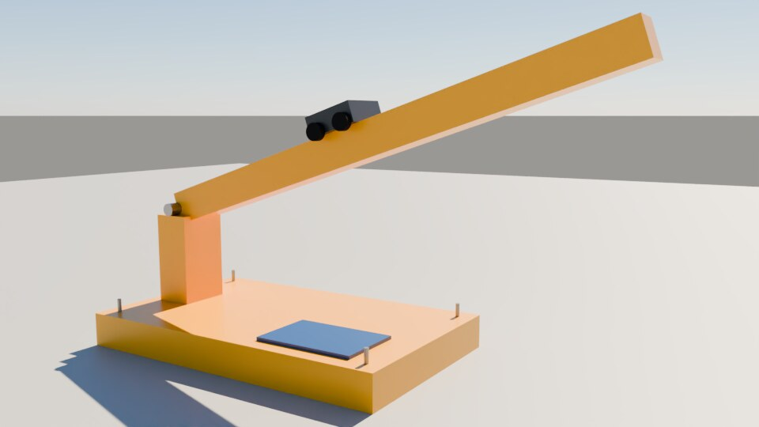

*All pictures in this guide show the small test crane that comes with the app's tests.*

## How the app is laid out

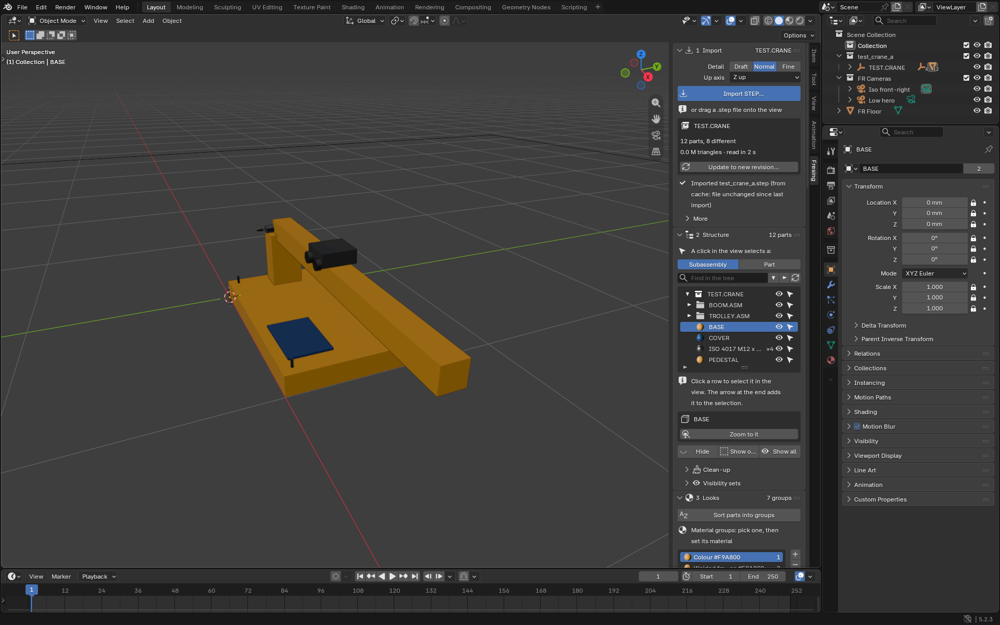

- The big area in the middle is the **view**: your model in 3D.
- On its right edge is the **side panel** with the **Fresing** tab. Hidden? Move the mouse over the
  view and press <kbd>N</kbd>.
- The other areas (the lists top right, the timeline at the bottom) are Blender's own. You rarely need
  them.

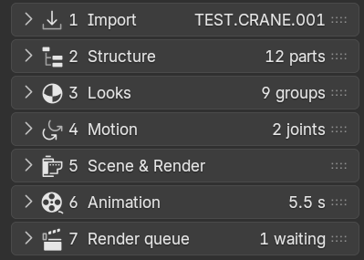

The side panel has seven sections. Click a section's name to open or close it. A closed section still
shows its state on the right: the model, the number of parts, unsorted parts (in red), joints, the
length of the animation, the progress of the queue.

Every section works the same way:

- Work from top to bottom: what you choose comes before the button that uses it.
- The main button of a section is big and blue.
- Click an item in a list; its details appear right under the list. Double-click a name to rename it.
- Rarely used settings are in folds that start closed (for example **More**).
- Rest the mouse on a button or setting to see what it does.
- <kbd>Ctrl</kbd>+<kbd>Z</kbd> undoes almost everything, <kbd>Ctrl</kbd>+<kbd>Shift</kbd>+<kbd>Z</kbd>
  redoes it.

This guide is in the app under **Help > Fresing Render user guide**, and in the Start menu under
Fresing Render.

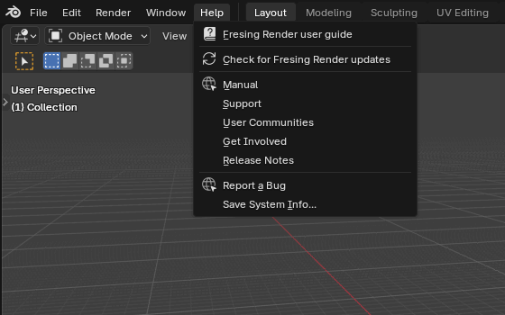

## Getting started: your first render in 10 minutes

### Install (once per PC)

1. Unzip the installer folder (FresingRender-…-windows.zip) anywhere, for example in Downloads.
2. Double-click **Install.bat**. If Windows says "Windows protected your PC", click **More info**, then
   **Run anyway**. Unpacking takes a few minutes without a progress bar: let it finish.
3. Start **Fresing Render** from the Desktop.
4. Once, recommended: Start menu > Fresing Render > **Fresing Render - Self test**. After a few minutes
   "Fresing Render self-test.txt" appears on the Desktop; every line should start with `[ OK ]`
   (see [Troubleshooting](#troubleshooting)).

README.txt in the installer folder has the details: company PCs, updates, removing the app.

### Updates: one click

New versions come to the app by themselves. A few seconds after the app starts it looks on GitHub for
a newer version. When there is one, **Update available** appears at the top of the Fresing tab:

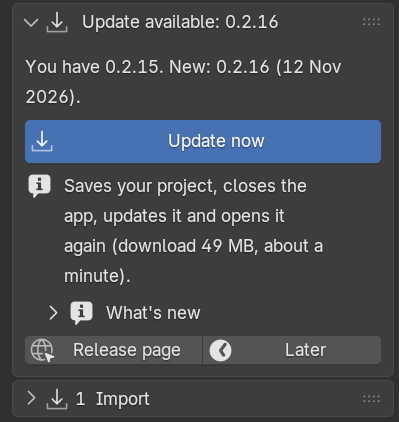

1. Open **What's new** to read what changed (it is the same text as on the release page).
2. Click **Update now**, then **Update now** again in the small window that asks.
3. The app downloads the new version (a minute or less), saves your project, closes, installs the
   update and opens again with the same project. Nothing else to do.
4. At the top of the Fresing tab it says **Updated to …**, with what's new. **Close** hides it.

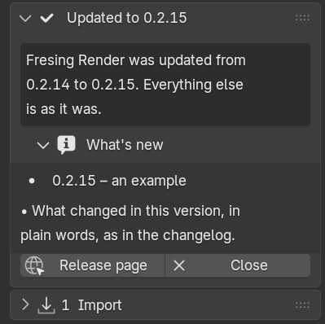

- **Later** hides the notice until the app starts again. **Help > Check for Fresing Render updates**
  asks at any time.
- A project that was never saved has to be saved first (**File > Save As**): the app says so. While the
  render queue runs or a STEP file is being imported, the update waits until you start it again.
- Your projects, renders, templates and settings stay as they are.
- Versions before 0.2.16 cannot do this yet: run the newest installer once over them
  ([Install](#start)). A version that needs a newer Blender also comes as an installer; the app then
  says so and links to its release page.
- The check needs internet access to github.com. Switch it off in **Edit > Preferences > Add-ons >
  Fresing Render > Check for updates at start-up**.

### Moving around in the view

| To | Mouse | Without a middle mouse button |
| --- | --- | --- |
| Turn the view | hold the wheel (middle button) and drag | drag the coloured axis ball, top right of the view |
| Slide the view | <kbd>Shift</kbd> + wheel button, drag | drag the hand icon under the axis ball |
| Zoom | turn the wheel | drag the magnifier icon |
| Zoom to what is selected | numpad <kbd>.</kbd> | **Zoom to it** in 2 Structure |
| Everything in view | <kbd>Home</kbd> | View menu > Frame All |

### Your first render

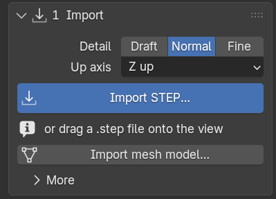

1. In **1 Import**, leave Detail on **Normal** and Up axis on **Z up**. Click **Import STEP…**, pick
   your .step file and click **Import STEP** in the file window. (Or drag the file from Explorer onto
   the view.)
2. A progress bar shows while the model is read; a big machine takes a minute or two. Then the model
   appears in the view and the sections 2 to 7 appear under 1 Import.
3. Save the project: **File > Save As**, in the folder of the job. Renders then go to a folder
   "Renders" next to the project file.
4. Look at the header of **3 Looks**. Most parts already have a material. Red "… unsorted"? That can
   wait for a first try; [3 Looks](#looks) explains it.
5. In **5 Scene & Render**, click a **Light look**: **Product studio** looks good straight away. The
   import has already added a camera ("Iso front-right").
6. Under **Image size & render**: Format **Presentation 16:9**, Size **HD (1080p)**, Quality
   **Preview** for a quick first look. Click **Render image**.
7. A render window opens and the picture builds up. When it is finished it is saved by itself;
   **Open** and **Show in folder** appear under the button.

For a better picture: Quality **Final**, another camera angle (**3/4 hero, low** under **Camera**, or
turn the view and click **Where I look now**), and **Live preview** to judge the light first.

## 1 Import – bring in the STEP model

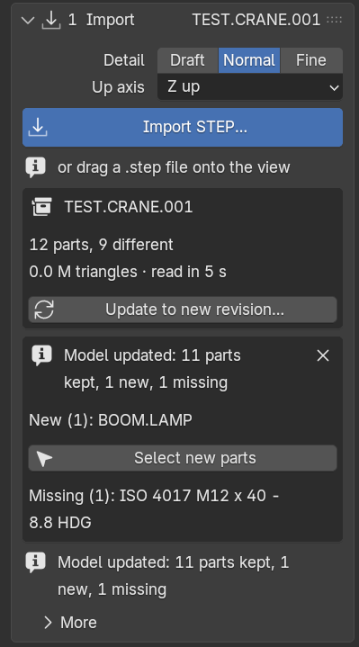

Reads a STEP assembly from Inventor, Fusion or any other CAD program, with its assembly tree, part
names, colours and material names. Later it updates the model to a new revision without losing
your work.

**Import**

1. **Detail**: **Draft** (fast, coarse curves), **Normal** (good for most renders) or **Fine** (smooth
   curves for close-ups; slower, more memory).
2. **Up axis**: **Z up** for most files. **Y up** when the model comes in lying on its back.
3. Click **Import STEP…** and pick the file, or drag a .step file onto the view.
4. Wait for the progress bar. Big files are read on all processor cores but one, so the PC stays
   usable. <kbd>Esc</kbd> with the mouse over the view cancels.

The box under the button then shows the model: its parts (placed, and how many different), its
triangles and how long the import took. An unchanged file imports again in seconds, from a stored
copy (**More > Clear import cache** throws those copies away if disk space is short).

**Update to a new revision**

1. Click **Update to new revision…** under the model's name and pick the new STEP file.
2. Your work stays: materials, painted faces, hidden parts, joints, poses, saved scenes and
   animations.
3. A report lists the parts that are **New** (**Select new parts** selects them, so you can give them
   a material) and **Missing**, and parts whose faces changed so their painted faces are gone (paint
   them again). × closes the report.

> **Projects on a shared drive:** when someone else has the project open, a red box "In use by
> *name* on *computer*" appears here. Save your changes under another name (File > Save As).

## 2 Structure – find, select, hide and lock parts

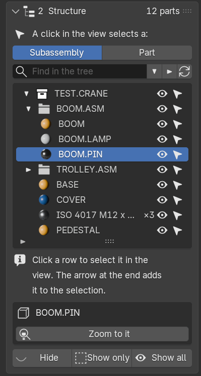

The tree shows the model like Windows Explorer: subassemblies with the parts inside them.

- **A click in the view selects a**: **Subassembly** (the whole subassembly of the part you click) or
  **Part** (only that part).
- Open or close a subassembly with its arrow. The two arrows next to the search box open or close all;
  ↻ reads the tree again.
- **Find in the tree**: type part of a name. The tree shows the matches with the subassemblies above
  them.
- Click a row to select it in the view. The arrow at the end of a row adds it to the selection, so you
  can select several. The eye hides or shows it (also in renders).
- Click a part in the view: the tree opens down to it and marks its row.
- Identical parts next to each other are one row ("× 4"). Identical subassemblies get a number at the
  end (":1", ":2"). The coloured ball is the part's material.
- Under the list: the selected row, **Zoom to it** and, for a subassembly, its lock. **Locked in place**
  (the normal state): it moves only with the subassembly it is in. Click it to unlock: it can then be
  moved on its own.
- **Hide** hides what is selected. **Show only** hides everything else; a red box "Showing only: …"
  with **Show everything again** brings the rest back. **Show all** shows everything you hid.

### Clean-up

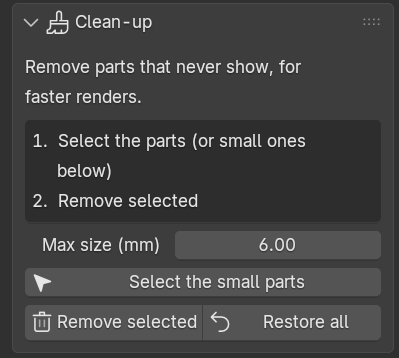

Removes parts that are never seen (inside parts, tiny screws), so renders get faster.

1. Select the parts, or set **Max size (mm)** and click **Select the small parts**.
2. Click **Remove selected**. They disappear from the view and from every render, but stay in the
   project: **Restore all** brings them back.

### Visibility sets

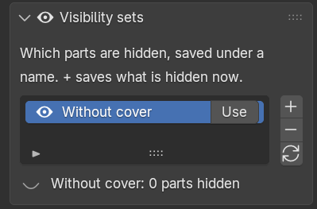

Saves which parts are hidden, under a name such as "Without cover".

1. Hide parts (the eye in the tree, or **Hide**).
2. Click **+** and type a name.
3. Later, **Use** hides and shows the parts exactly as saved. ↻ overwrites the selected set with what is
   hidden now, − removes the set.

## 3 Looks – materials and colours

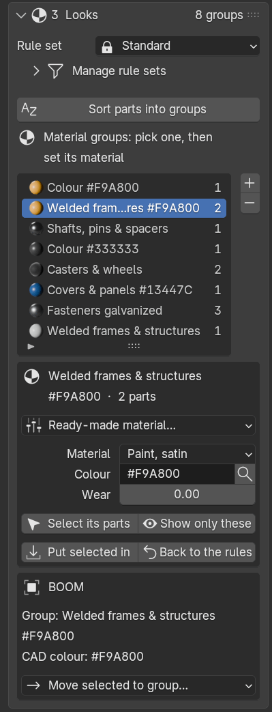

Every part is in a **material group**, and every group has one material. The import sorts the parts
into groups by itself, with the project's **rule set** (at the top of 3 Looks, see
[Rule sets](#rule-sets)). The built-in rule set **Standard** uses:

- **fasteners** – bolts, nuts, washers recognised by their DIN/ISO names – by type and finish
  (galvanised, stainless, black…);
- **part types** by name: profiles, shafts, chrome rods, cylinders, bearings, hoses, cables, cable
  chains, motors, sensors, guards and many more – also Dutch and German names and supplier order
  codes (Misumi, SMC, Festo, igus, HIWIN, THK, SKF, Sick, Omron and many more), also when the code
  sits inside a longer name such as "PSFJ20-300_SHAFT" or "_LMUW20_1";
- the **material name** in the STEP file (Fusion writes it);
- the **CAD colour**.

A part that fits nothing goes to **Unsorted**; the header then says "… unsorted" in red.

Faces painted in CAD come in painted: a face with its own colour or appearance in Inventor or Fusion
keeps it, and the rest of the part gets the part's material (see [Paint faces](#faces)).

**Give a group its material**

1. Click the group in the list (the number is how many parts it has; a brush with a number: a group
   used only by painted faces).
2. **Ready-made material…**: pick a machine material (aluminium profile, anodised, stainless, chrome,
   galvanised, rubber, POM, RAL paint…). Or choose a **Material** yourself and, for paints and
   plastics, a **Colour**: a RAL code (RAL 5010) or a hex code (#13447C). The magnifier picks from the
   RAL list.
3. The view shows the new colour at once (the real material in **Live preview**, 5 Scene & Render).

**More in this section**

- **Select its parts** selects them in the view; **Show only these** hides all other parts
  (**Show everything again** in 2 Structure brings them back).
- **Put selected in**: the parts selected in the view go into this group, whatever the rules say.
  **Back to the rules**: the rules decide again for them.
- **Make it a rule** under "Everything in … to this group" (shown when a subassembly is selected in
  2 Structure): every part in that subassembly goes into this group, also in later revisions.
- **+** adds a group; **−** removes the selected group (its parts are sorted again by the rules).
- Click a part in the view (with **Part** chosen in 2 Structure): a box shows its group, CAD colour
  and CAD material, with **Move selected to group…**.
- **Sort parts into groups** sorts everything again with the rules. Parts you put in a group yourself
  stay there.

### Rule sets

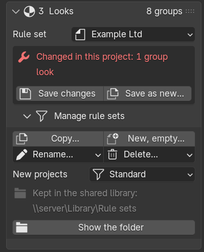

A **rule set** is one way of naming and sorting: the sorting rules, the material of each group, and the
group names. Make one for your company, and one for each client whose STEP files use other names. Each
project uses one rule set, shown at the top of 3 Looks next to **Rule set**. **Standard** is built in
and cannot be changed; make a copy to change it.

**Make your own rule set**

1. Open **Manage rule sets** and click **Copy…**. Type a name, for example your company, and click
   **Save**. The project now uses the copy.
2. Change what you want: group materials (above), [sorting rules](#rules), **Make it a rule** in
   [Find & sort parts](#find).
3. A box appears: **Changed in this project: …** lists what differs from the saved rule set.
   **Save changes** puts the changes into the rule set, so other projects can use them. **Save as
   new…** makes another rule set of it. Changes you do not save stay in this project only.

**Switch a project to another rule set**

1. Click the name next to **Rule set** and pick another rule set.
2. A window first shows what will change: how many parts change group, which groups are new and which
   go away, how many parts are unsorted now and after. Click **Switch**.
3. The parts get their new groups and the groups their new materials. Parts you put in a group by hand
   stay where they are. <kbd>Ctrl</kbd>+<kbd>Z</kbd> goes back.

**More in Manage rule sets**

- **New, empty…** starts a rule set without rules: every part goes to Unsorted, and you build it up
  with Find & sort parts and **Make it a rule**.
- **Rename…** and **Delete…**. Projects that use the rule set keep their own copy of it.
- **New projects**: the rule set every new project starts with (also in Edit > Preferences >
  Add-ons > Fresing Render, **Default rule set**).
- Rule sets are files in the folder `Rule sets` in the shared library, so colleagues use the same ones.
  **Show the folder** opens it. Without a shared library they are kept on this PC, in
  `Documents\Fresing Render\Rule sets`.

**Good to know**

- A project keeps its own copy of its rule set, so it opens the same on another PC or when the shared
  library cannot be reached.
- When a colleague saved a newer version of your rule set, a box says "The library has a newer version
  of …": **Load it…** takes it over. **Save changes** warns you before it replaces a colleague's newer
  version.
- A rule set that is only in this project (for example after its file was deleted) shows "Only in this
  project" with **Save to library…**.
- Projects made with an older version open unchanged: their rules become a rule set called "From this
  project" (or Standard, when they were never changed).
- A [template](#schemes) remembers its rule set by name and keeps a copy: loading it uses the rule set
  from the library when it is there, otherwise the template's copy.

### Paint faces

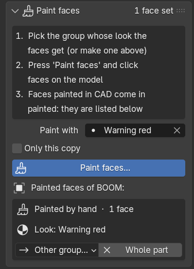

Gives single faces of a part another look: a painted end face, a coloured edge strip, a label area.

1. **Paint with**: the group whose look the faces get. Empty: the group selected in the list above.
   For a new colour, first add a group with **+** and give it its material.
2. **Only this copy**: tick it to paint only the copy you click. Unticked, every copy of the part gets
   the same painted faces.
3. Click **Paint faces…**, then click faces on the model. A click paints the whole CAD face under the
   mouse; <kbd>Shift</kbd>+click gives a face back the look of its part. You can still turn and zoom
   the view. <kbd>Enter</kbd>, <kbd>Esc</kbd>, a right-click or **Done** ends and keeps what you
   painted; <kbd>Ctrl</kbd>+<kbd>Z</kbd> afterwards takes the painting back.
4. Click a part to see its painted faces under the button. **Other group…** gives a set of faces the
   look of another group; **Whole part** makes them look like the rest of the part again.

Faces painted in CAD are listed the same way. A sorting rule on their colour can give them another
material, for example "CAD colour is #C0C0C0 → Anodised"; only colour and CAD-material rules act on
single faces. A model update keeps the painted faces of parts whose faces did not change.

### Logos & stickers

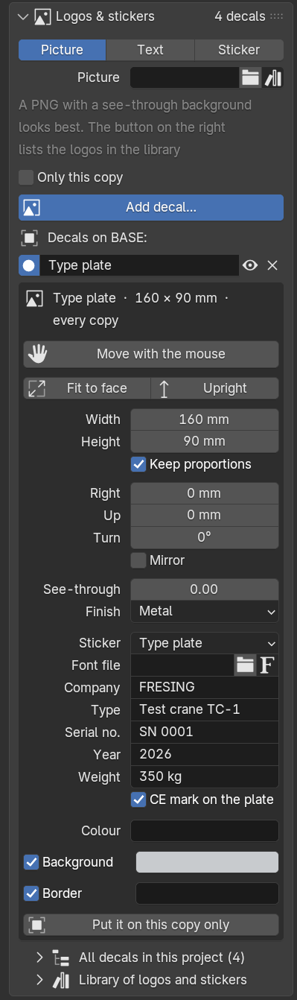

Puts a logo, text, a type plate or a sticker on the machine itself. It lies on the face like a real
sticker, moves with its part (joints, animations, exploded views) and hides with it.

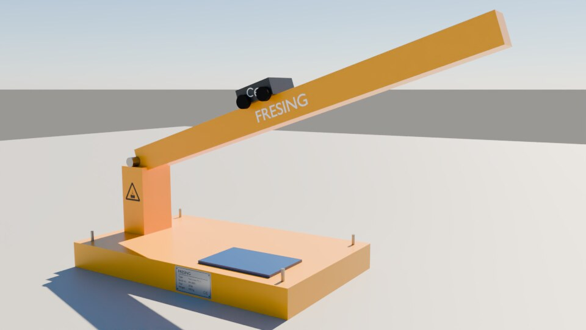

1. **Picture / Text / Sticker**: what goes on.
   - **Picture**: a logo or picture file. A PNG with a see-through background looks best; a JPG works
     too. The button right of the field lists the logos in the library (below).
   - **Text**: type it; `|` starts a new line, as in `Fresing|CNC 400`.
   - **Sticker**: ready-made, drawn by the app: CE mark, type plate, warning signs (general, hand
     crush, electricity, hot surface, hanging load), a straight arrow and a turning arrow.
2. **Only this copy**: tick it for something that differs per copy, such as a serial number.
   Unticked, every copy of the part gets it (a type plate on a bought motor).
3. Click **Add decal…**, then click the spot on the model where its centre goes. It lands flat on
   that face, upright. On a round face (a cylinder barrel, a drum, a tank) it wraps round like a real
   sticker. <kbd>Esc</kbd> or a right-click cancels.

Click a part to see its decals. The dot opens a decal's settings, the eye switches it off (it is kept,
but not shown or rendered) and × removes it (<kbd>Ctrl</kbd>+<kbd>Z</kbd> brings it back).

- **Move with the mouse**: the decal follows the mouse over its part, also onto another face of it.
  The mouse wheel turns it (15° a step, with <kbd>Shift</kbd> 5°), <kbd>Ctrl</kbd>+wheel makes it
  bigger or smaller. Click to put it down; <kbd>Esc</kbd> puts it back where it was.
- **Fit to face**: as big as fits on its face, centred on it. **Upright**: turned upright again.
- **Width** and **Height** in mm (with **Keep proportions** the other one follows), **Right** and
  **Up** move it on the face from the spot you clicked, **Turn** turns it, **Mirror** swaps left and
  right.
- **See-through**: 0 is a solid sticker. **Finish**: Matt, Satin, Gloss or Metal (a printed aluminium
  plate).
- Text and stickers: the **Colour** of the letters or symbol, and a **Background** and a **Border**,
  each on or off with its own colour. Text and type plates: the **Font file** (the button on the
  right lists the fonts on this PC). A type plate has Company, Type, Serial no., Year and Weight, and
  a small CE mark.
- Pictures: **White see-through** makes a white background see-through (for JPG logos).
- **Put it on this copy only** / **Put it on every copy** moves the decal between the two.

**All decals in this project** lists every decal; a click on one clicks its part. **Library of logos
and stickers**: put your logos as PNG files in the folder `Logos`, and stickers of your own in
`Stickers`, of the [shared library](#schemes) – the same library as the rule sets and templates.
They then show in the list next to Picture. Without a shared library these folders are in
Documents\Fresing Render.

Good to know:

- In the normal view (Solid) a decal shows as a see-through coloured patch. The picture itself shows
  in Material Preview and in renders.
- Pictures are kept inside the project: renders in the queue and the project on another PC have
  them, also when the picture file is gone.
- A model update keeps decals whose spot is still on the part, also when the part changed elsewhere.
  A decal whose face moved is switched off and named in the update report: open it, click **Move
  with the mouse** and click its new spot.
- A [template](#schemes) keeps the decals with the names of their parts: used on another machine, it
  puts them on parts with the same name, where the spot lies on the part.

### Find & sort parts

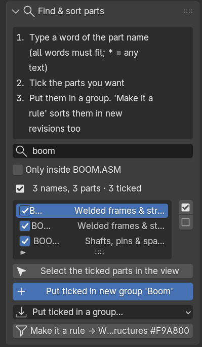

The quickest way to sort the unsorted parts, or to give one kind of part its own look.

1. Type a word of the part name. Several words: all must be in the name. `*` stands for any text, as
   in `M6*20`.
2. The list shows the names found, how many parts, and their group now. Tick the ones you want (the
   two buttons on the right tick or untick all of them). **Select the ticked parts in the view** shows
   where they are.
3. **Put ticked in new group '…'** makes a new group named after your search; **Put ticked in a
   group…** uses an existing one. Then give the group its material (above).
4. **Make it a rule → …** saves the search as a sorting rule for the selected group: the next
   revision sorts itself the same way.

Also here: **Common words in unsorted parts** (only when parts are unsorted; one click searches for
the word) and **Only inside …** (searches only the subassembly selected in 2 Structure). **Show only
the unsorted parts** (above, in red) shows what still needs a group.

### Sorting rules

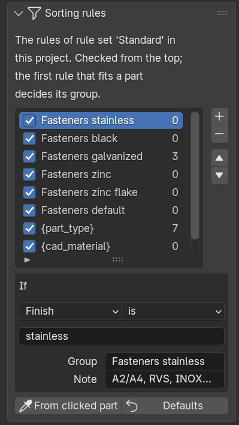

The rules decide each part's group. They are checked from the top, and the first rule that fits a part
decides. The order is: fasteners → part type → CAD material → CAD colour → Unsorted.

- The tick switches a rule on or off; the number shows how many parts it caught.
- Click a rule to change it: **If** [*what*: part name, assembly path, CAD colour, finish, part type,
  CAD material…] [*test*: contains, is, starts with, matches pattern…] [*value*] → **Group**. A group
  name may hold {color}, {finish}, {kind}, {part_type} or {cad_material}: then you get one group per
  colour, finish, type or material. Rest the mouse on a choice in the lists to see what it means.
- **+** adds a rule at the top of the list (so it wins) for the group selected in 3 Looks; **From
  clicked part** adds one "Part name contains *the name of the part you clicked*". The arrows move the
  selected rule up or down, **−** removes it.
- **Defaults** replaces all rules with those of Standard. Projects made before version 0.2.8 that
  still had the old built-in rules get the new ones when they are opened; your own rules are kept.
- After changing rules, click **Sort parts into groups** in 3 Looks.
- The rules belong to the project's [rule set](#rule-sets): the header says **changed** when they
  differ from it. **Save changes** at the top of 3 Looks keeps them for other projects.

### Paint schemes & templates

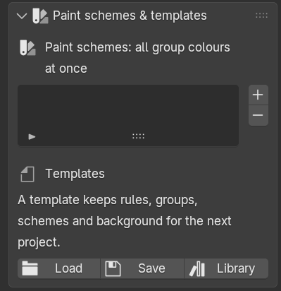

- A **paint scheme** stores the material and colour of every group, for example "Customer blue" and
  "Fresing grey". **+** saves the colours you have now; **Use** switches every group at once.
- A **template** keeps the rule set, paint schemes, background and image settings, and the logos and
  stickers on parts ([Logos & stickers](#decals)), for the next project. **Save** writes a template file, **Load** reads one, **Library** picks one from the shared
  library.
- The **shared library** is a folder, for example on the network, with a folder `HDRI` (360° photos),
  a folder `Templates`, a folder `Rule sets` and the folders `Logos` and `Stickers`. Set it once: Edit > Preferences > Add-ons > Fresing
  Render > **Shared library**. **Default template** there is used for every new import; **Default rule
  set** is the rule set new projects start with.

## 4 Motion – joints, poses and exploded views

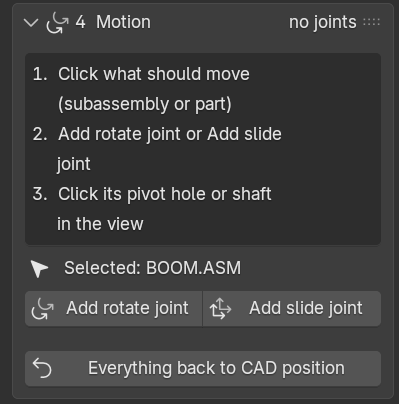

A **joint** lets a subassembly rotate (a boom on its pin) or slide (a trolley, a cylinder rod).

**Add a joint**

1. Click what should move. With **Subassembly** chosen in 2 Structure, one click takes the whole
   subassembly. "Selected: …" shows what you clicked.
2. Click **Add rotate joint** or **Add slide joint**.
3. Click the pivot on the model: a **hole or shaft** (the axis goes through its centre) or a **flat
   face** (the axis stands at right angles to it). The line at the bottom of the window says what to
   do; you can still turn and zoom the view. <kbd>Esc</kbd> or a right-click cancels.

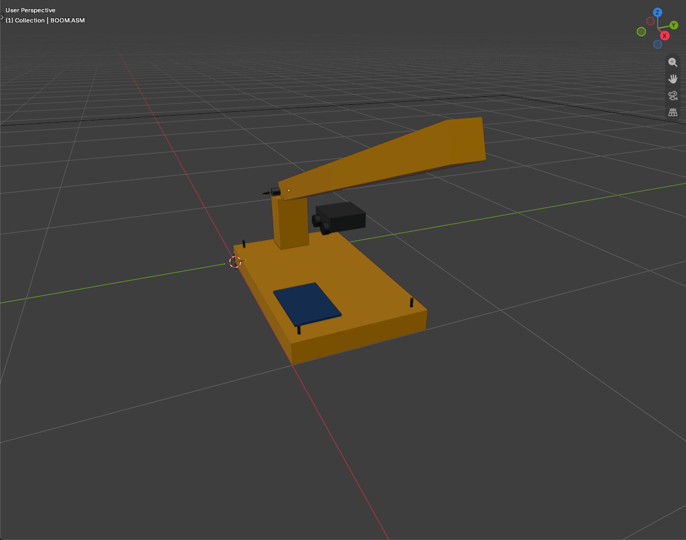

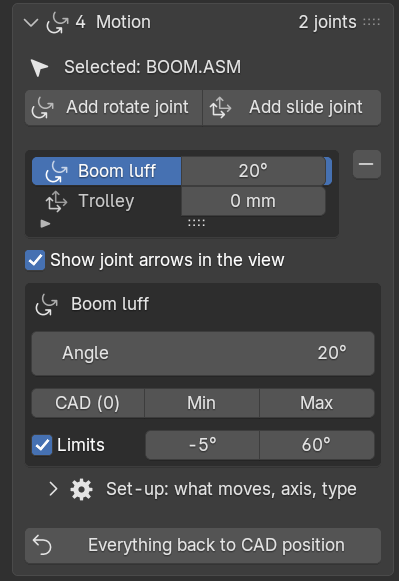

**Use a joint**

- Drag its slider in the list, or the big **Angle** / **Distance** field, or type a value. 0 is the
  position in the CAD file.
- **CAD (0)**, **Min** and **Max** jump to those positions. **Limits** keeps the joint between the two
  values next to it.
- **Show joint arrows in the view** shows or hides the joints' axes (and the cylinders' pin markers).
- **Set-up** (the fold): what moves (**Add** and **Remove** use the selected parts, **Select** selects
  what the joint moves), the axis (eyedropper: click a new pivot; ⇆ turns the direction around; **X Y Z**), the type (**Rotate**
  / **Slide**) and **Sits on**: the subassembly this joint is mounted on, so it moves along with it –
  the crane's trolley sits on the boom.
- **−** next to the list removes the joint; its parts go back to their CAD position. Joints that
  followed it stay where they are and move by themselves from then on.
- **Everything back to CAD position** puts every joint and moved subassembly back.

**Two or more joints on one subassembly**

A subassembly can have several joints, and their moves add up: a carriage that slides 1000 mm in Y
and then 500 mm in X ends up at X +500 / Y +1000; a crane jib slews and then luffs.

1. Click a subassembly that already moves with a joint and click **Add rotate joint** or **Add slide
   joint** as usual. Above the buttons it says "Adds a joint on top of '…': the moves add up".
2. The new joint rides on the older one: its axis moves along with it. In the list it is indented
   under that joint, and its details say "Rides on '…'".
3. **Swap order** lets the other joint ride on this one instead. With two slides nothing changes; with
   a rotation it does (turn then slide, or slide then turn).

Removing a joint from such a stack gives what it moved back to the joint under it. In **Set-up** of
the lower joint, "Moves:" lists everything it moves and "Carries:" names the joints riding on it.

> When an animation is built (6 Animation), the joints follow it. **Stop it to move joints by hand**
> (in the red box) frees them.

### One joint moves others: couplings

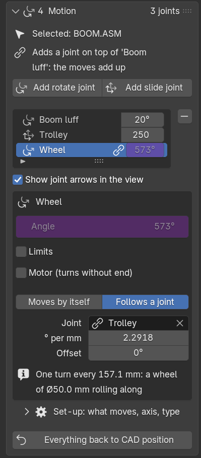

A joint can **follow** another joint: when that one moves, this one moves with it. One joint then
drives a whole mechanism – and one animation step moves it all.

| Mechanism | Leader → follower | Ratio to type |
| --- | --- | --- |
| Gear pair, belt, chain | rotate → rotate | **turns per turn**: −0.5 for a meshing gear twice as big (meshing gears turn the other way); 1 for a belt over two equal wheels |
| Telescope section, gripper jaws | slide → slide | **mm per mm**: 1 for a telescope section; −1 for the second jaw |
| Spindle, ball screw, rack and pinion, winch rope | rotate → slide | **mm per turn**: the pitch (5 for a 5 mm screw); π × Ø for a pinion or drum |
| Rolling wheel, pinion on a fixed rack | slide → rotate | **° per mm**: 360 ÷ (π × Ø) |

1. Select the joint that should follow (the gear, the second jaw, the nut, the wheel) in the joint list.
2. Click **Follows a joint**. It picks a joint to follow; change it in the **Joint** field.
3. Type the **ratio** (its label says the unit, e.g. **° per mm**). The line under it says it in other
   words: "One turn every 157.1 mm: a wheel of Ø50.0 mm rolling along". **Offset** is where it stands
   when the joint it follows is at 0 (usually 0).
4. Move the leading joint: the follower moves along. Its own value is purple and cannot be dragged.

- **Chains** work: a motor drives a spindle, the nut carries a trolley, the trolley's wheels roll.
- **Telescope**: add the second section's joint to a section that already moves with the first one
  (it rides on it, see above), then **Follows a joint** picks the first section by itself. With
  ratio 1 the second section goes twice as far.
- Two joints that follow each other are refused, with the reason in red under the field.
- A following joint is not moved by hand, by poses or by animation steps: move the joint it follows.
  Poses only store the joints that move by themselves.
- Its **Limits** do not stop it: they warn ("Beyond its limits now"), and so does Build & play.
- **Moves by itself** ends the coupling; the joint stays where it is. The leading joint shows
  "Drives '…'".

**Motors**

Tick **Motor (turns without end)** on a rotate joint (a drum, a fan, a drive): it has no limits and
the angle is also shown in turns ("= 2.50 turns"). In 6 Animation, the step **Run motor** turns it at a
speed you set.

Couplings, motors and their settings stay through a model update (1 Import) and in saved projects,
also when the PC does not allow scripts in project files.

### Cylinders

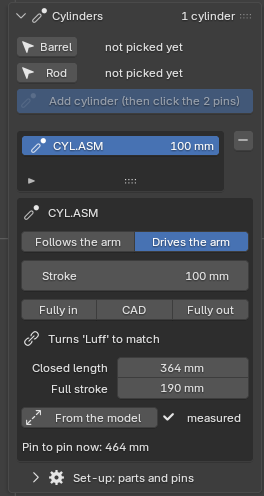

A hydraulic cylinder or an electric linear actuator hangs between two pins: one on the machine (the
barrel's end) and one on the part it moves (the rod's eye). The app keeps both eyes on their pins: when
the arm moves, the barrel turns about its pin and the rod slides in or out.

**Add a cylinder**

1. Make the joint for the arm first (Add rotate joint above, on the arm's pivot).
2. In 4 Motion > **Cylinders**: click the barrel (the tube with its end cap and eye – in the view, or its
   row in 2 Structure) and press **Barrel**. Then click the rod (with its piston and eye) and press **Rod**.
   A tick shows what is picked.
3. Press **Add cylinder** and click the **barrel's pin** (on the machine side), then the **rod's pin**
   (on the moving part). Click the pin itself or the hole it sits in; the line at the bottom of the
   window says which one is next. <kbd>Esc</kbd> cancels.

Move the arm: the cylinder goes along (**Follows the arm**). Two cylinders side by side on one arm each
get their own entry. The list shows how far each rod is out.

**Set the stroke instead: Drives the arm**

Press **Drives the arm** and set the **Stroke** (how far the rod is out, 0 = fully in): the arm turns to
match, worked out exactly from the triangle pivot – barrel pin – rod pin. **Fully in**, **CAD** and
**Fully out** jump there. The arm's joint now stops where the cylinder does (its Limits are set from the
cylinder). A cylinder that pushes a carriage on a slide works the same way.

- **Closed length** (pin to pin with the rod fully in) and **Full stroke** come from the parts: how far
  the piston can go back to the end cap and out to the gland. "measured" means they were found that way;
  "rough guess" means the parts did not show it – type the values from the cylinder's data sheet.
- In 6 Animation, the step **Move cylinder** moves the rod from one stroke to another; the arm moves
  with it, at the cylinder's pace. Poses and saved scenes keep the arm's position, so the stroke too.
- When drive mode is not possible, the reason is shown in red (for example: nothing moves the rod's pin
  yet, or the arm's joint does not turn about the pins' direction).

**Set-up** (the fold): other parts for the barrel or rod; **Stages** for a telescopic cylinder (select its
sections between the barrel and the rod, then press it: each section slides out the same share of the
travel); which part holds each pin (select the part, then **Barrel pin** or **Rod pin**); **Pins again**
(click both pins again); **Select parts**. The cylinder's pin markers show and hide with **Show joint
arrows in the view**.

Cylinders stay through a model update (1 Import) and in saved projects, also when the PC does not allow
scripts in project files. **−** next to the list removes a cylinder: its parts go back to their CAD place.

### Poses & exploded views

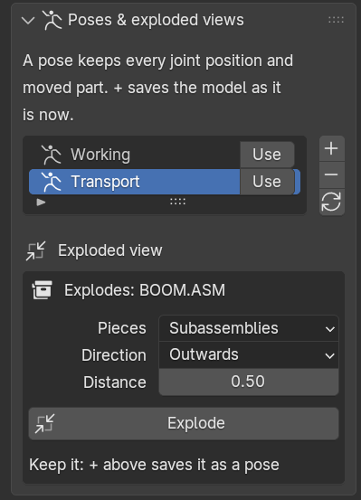

A **pose** stores every joint position and every moved subassembly: "Working", "Transport",
"Exploded".

1. Set the joints (and explode, if you want).
2. Click **+** and type a name.
3. **Use** puts the model in that pose again; ↻ overwrites the selected pose with the positions now.

**Exploded view**

1. Select the subassembly to explode, in the view or in 2 Structure. "Explodes: …" shows which.
2. **Pieces**: **Subassemblies** (those inside it) or **Every part**. **Direction**: **Outwards**,
   **Along X**, **Along Y** or **Up / down**. **Distance**: 0.5 moves each piece half its distance
   from the centre.
3. Click **Explode**. To keep it, save it as a pose (**+** above). **Everything back to CAD position**
   (4 Motion) puts it together again.

### Milling

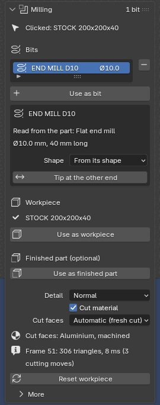

Show a CNC machine at work: you pick the **milling bit** and the **workpiece** (the raw block), and
wherever the bit moves through the block in the animation, material disappears – in the view, while
you scrub or play, and in the render queue. No modelling needed. The motion comes from the
animation (6 Animation): joints that move the head, the table or both.

1. Click the bit in the view. "Clicked: …" shows the part; click the bit itself, not its holder.
2. Click **Use as bit**. Under the list you read what was recognised, for example "Flat end mill
   Ø10.0 mm, 40 mm long". Flat, ball, corner radius, V-bit and drill are recognised; any other shape
   is used as it is. Several bits are allowed (for example two spindles).
3. Click the raw block and then **Use as workpiece**. It keeps its looks; from now on it shows the
   milled shape.
4. Build an animation in 6 Animation that moves the bit through the block (**Build & play**). A moment
   later the cut follows the timeline: drag the time slider back and forth, or play. The line with
   the frame number shows how big the milled shape is and how long one frame took.

Good to know

- **Shape**: **From its shape** reads the shape from the part. When the part is drawn simplified (or
  with its holder), pick the type and type in **Diameter**, **Corner radius** or **Tip angle** and
  **Length** yourself. **Tip at the other end** turns the bit round when the wrong end cuts.
- **Finished part (optional)**: click the CAD model of the finished part (in the same place as the
  block) and **Use as finished part**. The bits never cut below its surface, so the end result is
  exactly the CAD part even when the motion goes a little too deep. It is hidden: it is only the
  limit. The **X** next to it stops using it and shows it again.
- **Detail**: **Fine** for close-ups (the bit's circle has 64 corners), **Normal**, **Fast** for long
  programs.
- **Cut material** off shows the block as it came from CAD; the set-up is kept.
- After a change to the animation the cut is read again by itself (in the render queue too, before
  it renders). **Reset workpiece** starts again from the uncut block if something does not look right.
- **More > Stop milling** removes the set-up: the block is whole again.
- A model update (1 Import) keeps the set-up when the bit and the block are still in the model.
- Straight moves are cheap; curved moves (arcs) cost more. Measured on the 2-core test machine with a
  200 × 200 mm block: about 4 ms per frame for a zig-zag pocket with a flat Ø10 bit, 11 ms with a
  ball Ø10, about 11 ms for a round pocket made of short pieces.

#### Chips

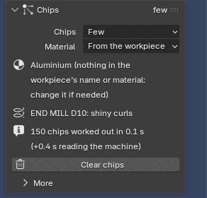

While the bit cuts, chips fly off it – in the spindle's turning direction, up out of the cut – and land
on the block, the table and the machine bed, where they pile up. They look like the real thing for the
workpiece's material and the bit:

| Material | End mill | Ball end mill | Face mill | Drill | Engraving / V-bit |
| --- | --- | --- | --- | --- | --- |
| Aluminium | shiny curls | small commas | flat commas, thrown far | long spirals out of the hole | fine dust |
| Steel | blue-brown commas (temper colours) | small commas | commas | spirals | dust |
| Stainless steel | longer commas, a little golden | small commas | commas | spirals | dust |
| Brass / bronze / copper | small crumbs | crumbs | crumbs | short commas | dust |
| Cast iron | grey crumbs | crumbs | crumbs | crumbs | dust |
| Plastic (POM, PE, nylon, acrylic) | long ribbons in the block's colour | ribbons | ribbons | spirals | short ribbons |
| Wood / MDF | shavings with dust | dust | shavings | shavings | dust |

1. Set up milling first (above), so the bit cuts in your animation.
2. Open **Chips** (under Milling) and pick **Few** or **Realistic**. The chips are worked out at once;
   the line under the settings says how many and how long it took.
3. Scrub or play: the chips fly while the bit cuts and stay where they land. Renders in the queue show
   them too – the queue works them out by itself before the first frame.

Good to know

- **Material**: **From the workpiece** reads it from the block's name ("BLOCK AlMg3", "Plaat RVS 316",
  "POM blok", "MDF plaat" …), then from its material in 3 Looks; the line under it says what was found and
  why. Pick a material to choose yourself.
- **Few** shows about one chip in eight (at most 3,000 at a time) and is quick. **Realistic** makes as
  many chips as the removed material would (at most 25,000 at a time; when there are more, the oldest
  lying ones shrink away).
- Chips lying on the block are gone when the bit cuts there later. Chips on the table move along with the
  table; chips that fall off the table stay on the machine bed (or the floor).
- **More > Spindle turns**: clockwise (M3, the usual) or counter-clockwise (M4): the chips fly the other way.
  **More > Coolant mist** adds a fine mist of drops around the bit that fades after a moment.
- **Clear chips** removes every chip from the project and sets Chips to None.
- The same set-up gives the same chips every time, on every PC, whatever frame you look at first.
- Chips land on what is below them seen from above: they do not land on the head or a part that hangs over
  the table, and they do not bounce off the head.
- Working them out and rendering them takes time. Measured on the 2-core test machine (test mill, rendered
  on the processor at 640 × 360, Preview):
  - working them out: under 1 s for a short cut; about 4 s for a 46-second pocket program (1,158 frames);
  - one rendered frame, slot 50 × 10 × 5 mm in aluminium: 26.0 s without chips, 26.5 s with Few (150 chips),
    28.8 s with Realistic (1,218 chips in the picture);
  - a bigger cut (90 × 10 × 15 mm): 24.4 s without chips, 32.2 s with about 6,200 aluminium curls (+32 %),
    29.9 s with 25,000 brass crumbs (the limit, +23 %);
  - showing a frame in the view: 8–17 ms on top of the milling.

## 5 Scene & Render – background, light, camera and image

Everything around the model – light, background, floor, cameras – and the picture itself: its size,
its quality, and the render. Also the one-click **turntable video**.

### Light look

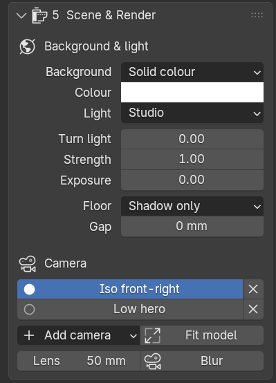

The quickest start: click one of the five **Light look** buttons at the top. Each sets the light, the
background and the floor in one go; change anything below afterwards. The button of the look you see
stays pressed.

| Look | What you get |
| --- | --- |
| **Product studio** | A classic product photo: big soft main light from the front left, a soft fill from the right, two rim lights behind that outline the edges; light grey background with a soft shadow. |
| **White, endless** | The machine on an endless pure-white background with a soft shadow under it, in bright soft light. The background in the picture is exactly white (good for brochures and web shops). |
| **Dark studio** | Black background, a main light from the front left and bright rim lights behind: shiny edges, dramatic. |
| **Outdoor sun** | Blue sky, the sun from the front left, sharp shadows. On the sea, the deck or the quay only the weather changes. |
| **Overcast** | Grey, cloudy sky without sun: soft light, soft shadows, calm and true colours. On the sea, the deck or the quay only the weather changes. |

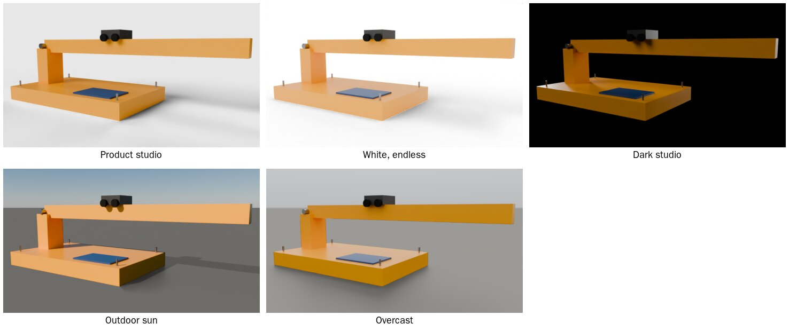

### Background & surroundings

**Background** says where the machine stands. The list has four groups:

- **Studio**: **Solid colour**, **None (transparent)** (a PNG for slides) or **Sky** (daylight with
  sun).
- **Photo**: **360° photo** – a photo all around the machine that is both background and light.
  With **Stand on its ground** ticked, the photo's floor lies flat under the machine and catches its
  shadow, so the machine stands in the photo. **Photo taken at** is the height the photo was taken
  from (most: 1.5–2 m): change it until the machine has the right size against the photo's floor.
  The small icon next to **Photo** picks a photo from the shared library; **How to get free 360°
  photos** opens a list of good free photos (harbours, workshops, halls) and how to add them.
- **Offshore**: **Open sea**, **Vessel deck**, **Quayside** – sea to the horizon under a sky with a
  sun.
- **Workshop**: **Clean factory hall**, **CNC machining hall**, **Assembly hall**, **Warehouse**.

The offshore and workshop surroundings are made by the app itself and grow with the machine. The
machine's lowest point stands on the floor, deck or quay, centred; the machine itself is not moved.

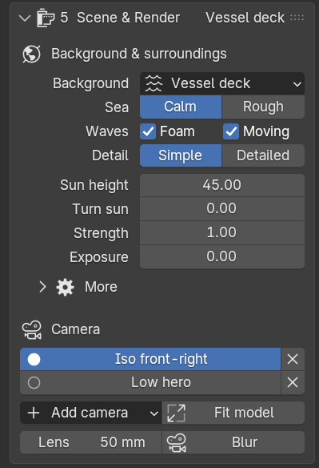

Their settings appear under the choice:

- **Sea**: **Calm** or **Rough**. **Waves**: **Foam** on the wave tops, **Moving** waves in videos
  (off: the sea stands still). **Water level** (open sea only) raises or lowers the water.
- **Detail**: **Simple** (fewer things around the machine, renders fastest) or **Detailed** (more
  containers, workbenches, racks; real waves near the machine).
- A hall never hides the machine: the walls are only seen from inside, so a camera outside the hall
  looks straight in, and anything that would stand between the camera and the machine (a column, a
  rack) is left out of the picture. When the camera is higher than the lamps, the roof is left out
  too.
- **More** (the fold): **Floor lower by** lowers the floor a little; **Show in the view** hides the
  surroundings while you work (renders always include them); **Put on the floor again** after the
  machine changed (a new revision, parts removed in Clean-up). Parts you only hide do not move the
  floor.

### Light

- **Light**, with a solid colour, no background or a hall: **Product studio**, **White studio**,
  **Dark studio**, **Soft studio** (the soft studio light of earlier versions; old projects keep it),
  **360° photo** or **Sky**. A 360° photo background gives its own light; Sky and offshore are lit by
  the sky.
- **Weather** (wherever the sky gives the light): **Sun** or **Overcast**. With sun: **Sun height**
  (low = long shadows and warm light).
- **Turn light** (or **Turn sun**, **Turn photo**) turns the light around the machine. **Brightness**
  and **Exposure** make the picture lighter or darker.
- The line under them says it in words, for example "Main light from the front left, high · normal
  brightness". Front is where the **Front** camera looks from.
- **Floor** (studio backgrounds only): **None** (the model floats), **Shadow only** (an invisible
  floor that only shows shadows: the usual choice) or **Visible floor** (with **Own colour** if you
  want). **Gap** moves the floor a little away from the model.

Render time, measured on a slow 2-core test machine without a graphics card: the 360° photo and
the offshore surroundings take about as long as the studio; the halls 1.4 to 2.8 times as long.

### Props for scale

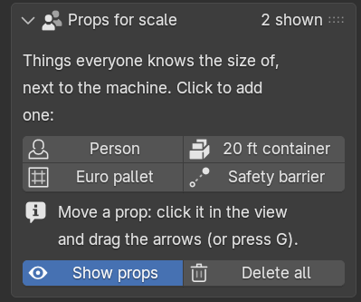

Things everyone knows the size of: **Person** (1.8 m), **20 ft container**, **Euro pallet**,
**Safety barrier**.

1. Click one: it stands next to the machine on the floor and is selected.
2. Move it with the arrows in the view (or press G); R turns it, X deletes it.
3. **Show props** hides or shows them all (a saved scene remembers it); **Delete all** removes them.

### Camera

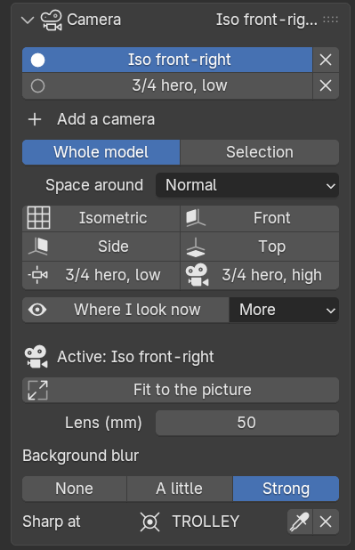

Each camera is a button: click it to look through it and render from it. × removes it.

**Add a camera** in one click:

1. **Whole model**, or **Selection** (click a subassembly on the model first: only that fills the
   picture). **Space around**: **Tight**, **Normal** or **Roomy** (room for a title or logo).
2. Click a view: **Isometric** (the technical view without perspective: parallel edges stay parallel),
   **Front**, **Side**, **Top**, **3/4 hero, low** (low from the front right: the machine looks big)
   or **3/4 hero, high**. **More** has Iso front-right, Iso front-left, Iso back-right and Back.
3. Or turn the view until it looks right and click **Where I look now**.

The new camera becomes the active one and the view looks through it.

For the active camera:

- **Fit to the picture** moves it closer or further so the machine (or the selection) just fills the
  picture, keeping the side it looks from.
- **Lens (mm)**: 50 looks natural; 24–35 shows more and looks wider; 85–135 makes the machine look
  flatter. Press **Fit to the picture** after changing it.
- **Background blur**: **None**, **A little** (the background goes soft; the machine stays sharp) or
  **Strong** (like a product photo; parts far from the sharp spot go soft too). It looks the same on
  a small gearbox and on a 25 m crane. Each camera keeps its own. Not for Isometric (no perspective).
- **Sharp at**: the middle of the machine, until you click the eyedropper and then the spot that
  should be sharp (for example the gripper). A small ball marks it in the view; in pictures it moves
  with its part when joints move (a video keeps the sharp distance its start camera has). × makes the
  middle sharp again.

### Turntable video

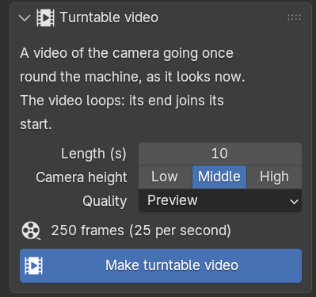

A video of the camera going once round the machine, as it looks now – in one click.

1. **Length (s)**: one full turn (10 s is a good start). **Camera height**: **Low**, **Middle** or
   **High**. **Quality**: try **Fast preview (EEVEE)** first; a turntable has hundreds of frames.
2. Click **Make turntable video**. It goes into 7 Render queue and the queue starts; keep working, or
   close the app. The line under the button shows how far it is.
3. The video loops: its end joins its start without a jump, so it can play on repeat on a screen or
   a website.

It starts on the side the active camera looks from and keeps the whole machine in the picture all the
way round, with the active camera's lens and background blur (in a turntable, the middle of the
machine stays sharp). The button makes three things you can also look at yourself: the camera
**Turntable camera**, the saved scene **Turntable** and the animation **Turntable** in 6 Animation.
To change the video's size, shape, frame rate or file: change them there, then click **Make
turntable video** again (it fits the camera and the turn to them). Also click it again after
changing the machine or the background; it makes the turn anew, so steps you added to the
animation "Turntable" are replaced.

In a hall the panel says that halls take 1.4 to 2.8 times as long to render as the studio (measured
on a test PC without a graphics card) and offers **Use Simple (faster)**.

### Brand kit & logo

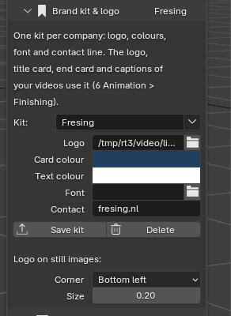

A brand kit is a company's look for its videos and pictures: the logo, two colours, a font and a contact
line. You work for your own company and for others, so there is one kit per company; every project uses
one, and a kit is stored in the shared library (the folder **Brand kits**, next to **Rule sets**; without a
shared library it is in your Documents folder, under Fresing Render).

1. Type a name in **Kit** (the company).
2. **Logo**: pick the logo picture. It must be a **PNG or JPG** (a PNG with a see-through background looks
   best). A logo in another format, such as SVG, cannot be used: export it as PNG first.
3. **Card colour** is the background of the title and end card, **Text colour** the colour of the words on
   them. **Font** is optional (a .ttf or .otf file); empty uses the app's own font. **Contact** is the line
   under the logo on the end card, for example the website and e-mail address.
4. **Save kit** puts it in the library. The arrow next to **Kit** lists the saved kits: pick one to fill in
   everything at once. This project keeps its own copy, so it still opens the same on a PC without the
   library. **Delete** removes the saved kit from the library only.

**Logo on images** puts the logo in a corner of every still image you render (**Corner**, **Size**).

### Watermark

Words across the picture, for a draft you send before the final render.

1. **Words**: **DRAFT**, **CONFIDENTIAL** or **Own text**. **Size** is how tall the letters are,
   **See-through** how strong they are (1 = solid).
2. Switch **Watermark on the next renders** on. Every image or video you render, or add to 7 Render queue,
   while it is on gets the watermark; the job remembers it (its name says "with watermark").
3. Switch it off again, add the same render to the queue once more, and the final comes out clean. The
   project does not change.

It works for stills and for MP4 videos (not for PNG frames).

### Image size & render

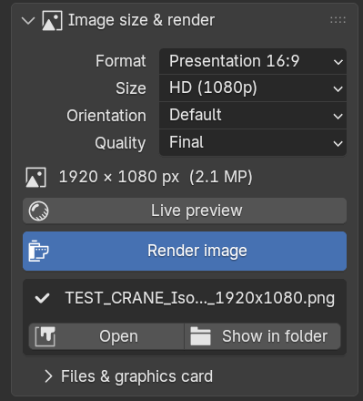

1. **Format**: for screens (Presentation 16:9, Widescreen 21:9, Classic 4:3, Photo 3:2, Website square
   1:1, Social story 9:16, Web banner 3:1), for print (Brochure A4, Flyer A5, Poster A3 and A2, US
   Letter) or **Custom size**.
2. **Size** for screen formats; **Resolution** (150 or 300 dpi) and **Bleed** for print; and
   **Orientation**. The line under it shows the size in pixels.
3. **Quality**: **Draft** (quick check, half size), **Preview**, **Final** (clean) or **Best** (very
   clean, slow).
4. **Live preview** shows real materials and light in the view; click again to switch it off. Use it
   to judge light and colours before you render.
5. **Render image**. A render window shows the picture building up; it is saved by itself. **Open**
   and **Show in folder** appear under the button.

**Files & graphics card** (the fold): **File** PNG (sharp; transparency possible) or JPEG (small
files); **Folder** (empty: "Renders" next to the saved project, or Pictures\Fresing Render while the
project is not saved yet); **Graphics card** (on: render on the graphics card; off: on the processor);
**Open render folder**. A file is named after the project, the camera and the size, for example
`crane_Low_hero_1920x1080.png`; an earlier render is never overwritten (a number is added).

### Saved scenes

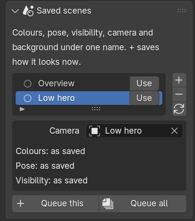

A **saved scene** keeps a whole set-up under one name: colours (paint scheme), pose, visibility,
camera, background and image size.

1. Set everything up the way it should look.
2. Click **+**. In the small window, type a name, and choose for colours, pose and visibility: **As it
   is now** (stored with the scene), **Leave as it is** (switching to the scene does not change it)
   or one of your saved schemes, poses or sets.
3. **Use** switches to the scene; ↻ overwrites it with what you see now.
4. **Queue this** or **Queue all** put the scene(s) in 7 Render queue: a set of pictures overnight.

## 6 Animation – make a video

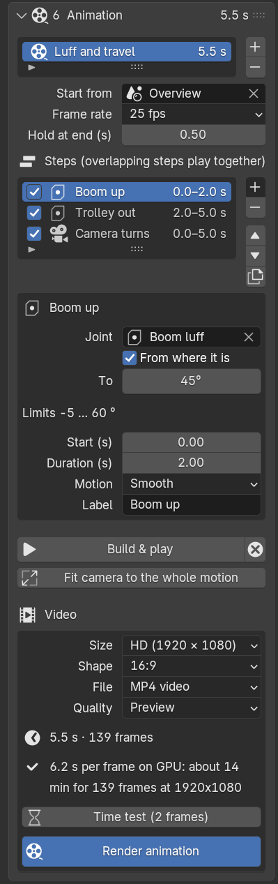

An animation is a list of **steps** on a timeline. Steps that overlap in time play together.

1. Make the joints and poses first (4 Motion), and a saved scene to start from (5 Scene & Render).
2. Click **+** next to the animation list. Double-click its name to rename it.
3. **Start from**: the saved scene at the first frame. **Frame rate**: 25 fps is usual in Europe.
   **Hold at end**: how many seconds the last picture stays.
4. Add steps with **+** next to the list of steps and pick the kind of step. A new step starts when the
   one before it ends:

    - **Move joint**: a joint goes from where it is (or **From** a value) **To** a value.
    - **Go to pose**: everything moves to a saved pose.
    - **Camera**: **Cut to** a camera, **Move to** a camera (a smooth flight) or **Orbit** (turn around
      the model by an angle).
    - **Show** / **Hide**: a subassembly appears or disappears (select it, then **Use selected**).
    - **Run motor**: a motor turns at a speed (**Speed (rpm)**; a slide joint: **Speed (mm/s)**) for
      the step's duration. Joints that follow it move along (see couplings in 4 Motion).
    - **Move cylinder**: a cylinder's rod goes from where it is (or **From** a stroke) **To** a stroke
      in mm; the arm moves with it. It takes the cylinder selected in 4 Motion > Cylinders. With
      **Constant speed** the rod moves at an even pace, as a real cylinder does.

5. For each step: **Start** and **Duration** in seconds, **Motion** (**Smooth** = slow start and
   stop, **Constant speed**, **Slow start**, **Slow stop**) and a **Label**. Untick a step to leave it
   out. The arrows change the order; the copy button copies a step (the copy starts when the original
   ends). A step for a joint that follows another joint is red: pick the joint it follows instead.

**Run a motor**

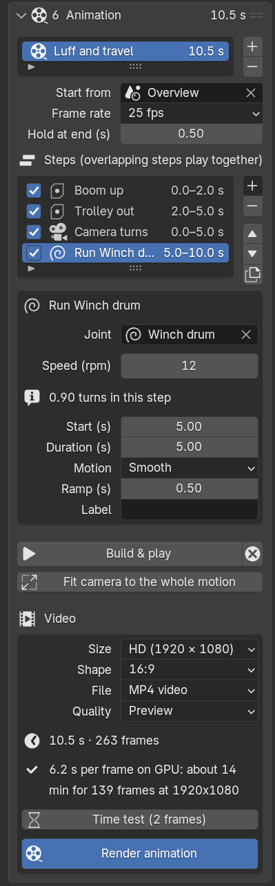

1. Tick **Motor** on the joint in 4 Motion (needed for more than 10 turns).
2. Add a step **Run motor**. It takes the motor (or the selected joint) and lasts 5 s.
3. Set **Speed (rpm)**; negative turns the other way. The line under it says how far it goes:
   12 rpm for 5 s at **Constant speed** is "1.00 turns in this step".
4. **Motion** sets the ramps: **Smooth** speeds up at the start and slows down at the end, **Slow
   start** / **Slow stop** only one of them, **Constant speed** none. **Ramp (s)** is how long speeding
   up and slowing down take; with ramps it turns a little less (0.90 turns with 0.5 s ramps).
6. **Build & play** plays the animation in the view; <kbd>Space</kbd> plays it again. ⊗ next to it
   takes the animation off the model, so the joints can be moved by hand again.
7. **Fit camera to the whole motion** zooms the start camera out so nothing leaves the picture.

**Finishing: ready to post or send**

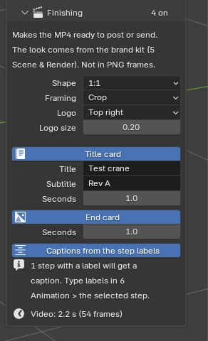

The **Finishing** fold at the end of this panel turns the MP4 into a video you can post or send as it is.
The look comes from the brand kit (5 Scene & Render > **Brand kit & logo**). It applies to MP4 videos, not
to PNG frames.

- **Shape** and **Framing**: for **1:1** and **9:16** videos, **Extend** keeps everything you see from side
  to side in the 16:9 picture and shows more above and below; **Crop** keeps what you see from top to
  bottom and cuts the sides. The cameras are not changed: only the copy that is rendered.
- **Logo**: a corner (top left, top right, bottom left, bottom right) and a **Logo size**, over the whole
  animation.
- **Title card**: a card with a **Title** and **Subtitle** in the kit's colours in front of the video;
  **Seconds** says how long it stays.
- **End card**: a card with the logo and the contact line at the end; **Seconds** says how long.
- **Captions from the step labels**: the **Label** of each step is shown at the bottom while that step
  happens, with a short fade. Only steps that have a label typed in get a caption; a caption stays
  at least a second and a half, and never runs into the next one.

The last line shows how long the finished video is: the cards come on top of the animation's own
length.

**Make the video**

1. **Size** (from 960 × 540 to 4K), **Shape** (**16:9**, **1:1**, or **9:16** upright for phones; the
   **Finishing** fold has the framing for the last two),
   **File** (**MP4 video**, plus the single frames; or **PNG frames only**) and **Quality**.
2. First check the motion with Quality **Fast preview (EEVEE)**: minutes instead of hours. Render the
   real video with **Preview** or **Final**.
3. **Time test (2 frames)** renders the first frame and a typical one with these settings, then shows
   how long the whole video will take. The test frame is kept, so you can check the look.
4. **Render animation** puts the video in 7 Render queue and starts the queue.

## 7 Render queue – render in the background

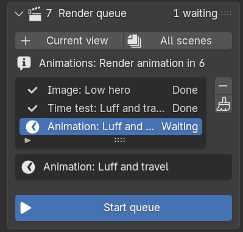

The queue renders pictures and videos with a second copy of the app in the background. Keep working,
or close the app and let it run overnight: the PC stays awake while it renders.

- **Current view** adds a picture of the model as it is now, from the active camera; **All scenes** adds
  one per saved scene.
  Videos come from **Render animation** in 6.
- **Start queue** starts rendering. While it runs: **Stop after this frame**, or **Stop now** (the
  frame being rendered is lost). **Start queue** later continues a video where it stopped.
- Click a job to see its progress and messages; when it is done, **Open** plays or opens it and
  **Show in folder** opens Explorer with the file selected.
- **−** removes the selected job; the brush removes all finished jobs.
- **Open log** shows the time per frame and any errors.

## Tips

### Exporting from Inventor and Fusion

- **Inventor**: File > Export > CAD Format, file type STEP, then **Options**: set the Application
  Protocol to **214 – Automotive Design** (or 242). The older AP203 carries no colours or material
  names: everything comes in grey and unsorted.
- **Fusion**: the normal STEP export is fine. It writes colours, material names and appearance names
  ("Aluminum - Satin", "Rubber - Soft"), and Fresing Render uses them.
- One CAD colour per finish (for example all galvanised parts the same grey), plus one sorting rule,
  gives every revision the right materials by itself.
- Clear part names help the sorting: "PLATE RVS", "SHAFT D40", supplier order codes.

### Faster renders

- **Clean-up** inside parts and small screws nobody sees.
- Check with Quality **Draft** or **Preview**; check animations with **Fast preview (EEVEE)**.
- **Time test** before a long video, and render it overnight in the queue.
- Big overview pictures rarely need Detail **Fine**.
- In a hall, choose **Simple** for long videos; a 360° photo with **Stand on its ground** costs no
  more time than the studio.
- A turntable of 10 s has 250 frames: check it with **Fast preview (EEVEE)** first, and run a
  **Time test** of the animation "Turntable" in 6 Animation before a Final video.

## Troubleshooting

### The self-test

Start menu > Fresing Render > **Fresing Render - Self test** runs for a few minutes without a window
and writes "Fresing Render self-test.txt" on the Desktop. Each line checks one thing: the STEP reader,
importing on all cores, CAD material names, the app start, the graphics card, a test import, a render
on the graphics card and one on the processor, joints and animation, the video encoder, the render
queue, the time test and the update check. A line with `[FAIL]` says what went wrong: send the file
along when you ask for help.

### Updates do not arrive

- The self-test line "Update check" says whether this PC reaches the update address (GitHub) and which
  version is the newest there.
- "Could not reach the update server": the PC has no internet, or a firewall blocks github.com or its
  download servers. Ask IT to allow them, or run the newest installer by hand.
- "The update did not work" after a restart: the app is still the old version and works as before.
  **Show the update log** opens the log of every step; send it along when you ask for help. Then try
  **Update now** again, or run the newest installer.

### Where are my renders?

- Project saved: in the folder **Renders** next to the project file. Not saved yet: in
  Pictures\Fresing Render. Unless a **Folder** is set (Image size & render > Files & graphics card).
- Videos: an MP4 file and a folder with the single frames. Time-test frames: in `Renders\_time_tests`.
- Quickest: **Show in folder** under Render image, or on a finished job in the queue.

### The side panel or the Fresing tab is gone

- Move the mouse over the view and press <kbd>N</kbd>, then click the **Fresing** tab on the right
  edge.
- Still missing? Run Install.bat again (it repairs the installation; projects and renders are not
  touched).

### Import problems

- The model lies on its back: import again with Up axis **Y up**.
- Round edges look coarse: Detail **Fine**.
- Everything grey and unsorted: the STEP file is probably AP203; export with AP214 (see Tips).
- "Could not mesh …": that part is left out, the rest is imported.

### Render problems

- Slow: is **Graphics card** on (Image size & render > Files & graphics card)? The self-test line
  "Graphics card" should name your graphics card. Lower the Quality or Size, or Clean-up parts nobody
  sees.
- "Add a camera first": click a view under **Camera** in 5 Scene & Render.
- Too dark or too light: **Exposure** and **Brightness** in 5 Scene & Render, or another **Light look**.
- A job in the queue failed: click it to read its message, and **Open log**.
