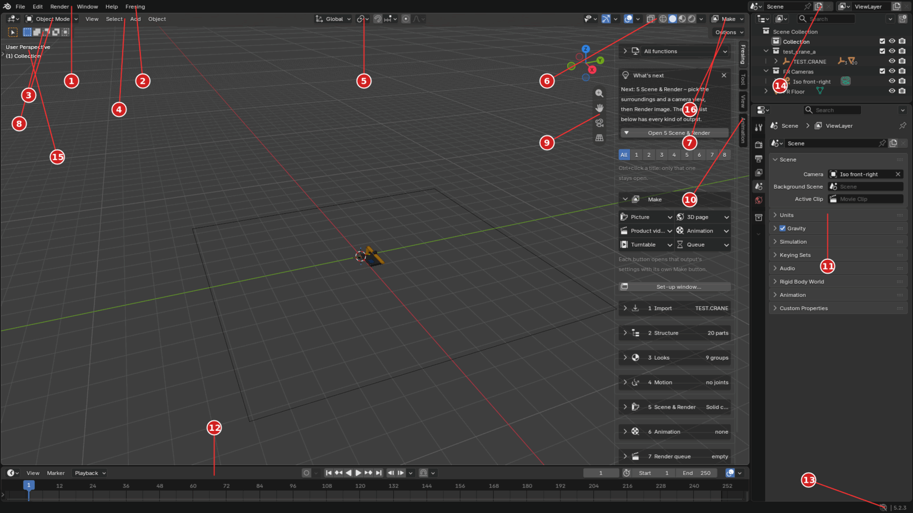

# 0222 – Study (findings only): which parts of Blender's own interface a Fresing Render user does not need

**Who:** worker · **Status:** done 20 Nov 2026 (study, no code – no lane) · **Branch:** `claude/admiring-ritchie-6ap2v0`
**Started by:** lead, 19 Nov 2026 (owner, 00:05: "I want the app as simple as possible, with the needed functions,
and my guess is that most users are not familiar with Blender … but the option to open it easily will be good")
· **Model:** Opus · effort Medium
**Area:** this file only (+ pictures under `tasks/img/0222/`, made from the invented demo / test models only)

## Goal

A list the owner can pick from in a few minutes: every part of Blender's own interface that a user of Fresing Render
still sees, and for each whether the app needs it, and what to do – **keep**, **hide** (with an easy way back, as
0221 does for the Outliner / Properties column), **replace** by a Fresing button, or **leave for now**. The owner's aim:
as simple as possible with the needed functions, for users who do not know Blender; Blender's tools stay reachable for
those who do.

## What to look at (0.2.168 + 0221's plan; the window as a new user meets it)

- The **splash**: Blender's "New File" list (General, 2D Animation, Sculpting, Storyboarding, VFX, More…), Recover
  Last Session, What's New (Blender's), Donate to Blender – next to the Fresing welcome.
- The **top bar**: File, Edit, Render, Window, Help – which items the app uses, which are Blender-only (e.g. Render >
  Render Image vs the app's Render queue, Edit > Preferences), Blender's workspace tabs if any show.
- The **3D view header**: Object Mode menu, View / Select / Add / Object menus, transform orientation, pivot, snapping,
  proportional editing, the overlay / gizmo / X-ray / shading buttons, Options.
- The **side panel's** Blender tabs (Tool, View, Animation) next to Fresing; the navigation gizmo.
- The **timeline** and the **status bar**; right-click menus in the 3D view; keys a new user hits by accident (Tab,
  G / R / S, X / Delete, Ctrl+Space…) – which the Client view already swallows (`lock.py`) and whether some should
  be off in Full access too.
- What the existing **workspaces** (0062) and the **Client view** already hide, so the study does not repeat them.

## For each row

What it is · what the app needs it for (with the function / guide anchor if any) · proposal (keep / hide with a way
back / replace / later) · how the way back would work · rough size (S / M / L) and risk (Blender updates, add-ons,
old projects, Windows) · one picture where it helps. Group the rows into 2–4 packages the lead can brief as tasks, in
the order that gives the owner the biggest "simpler" step first.

## Done when

- [x] The table above for every part listed, plus anything else found
- [x] 2–4 packages with model · effort and lane for each
- [x] Questions for the owner at the end (short, one line each)
- [x] No code changed; report merged to `main` (no release)

## Not in this task

Building anything. The Outliner / Properties column (0221). The Fresing tab's own panels (0062, 0200).

---

## Report (filled in by the chat that did the task)

**Chat / date:** Claude Code on the web, 20 Nov 2026 (branch `claude/admiring-ritchie-6ap2v0`). Version looked at: 0.2.173
on `main`, real Blender 5.2.3 under xvfb at 1920 × 1080, a fresh settings folder (`tools/web_install_app.py`), the
test crane `test_crane_a.step` only. Keys read from Blender's default key map in the same Blender. No code changed.

**Findings:**

What already goes (not repeated below): Blender's workspace tabs (hidden outside Full access, `lock.py`), the
toolbar (folded, back in Full access), in the Client view the Outliner, part of the File menu and the keys
Delete / X / Tab / Ctrl+Shift+S (0213; X / Delete still get through on the owner's PC – 0227). Coming with 0221:
the Outliner + Properties column (11) and the see-through side panel (Region Overlap off).

Pictures: `tasks/img/0222/window_numbered.png` (the numbers below), `splash.png`, `menus_topbar.png` (File, Edit,
Render, Window, Help), `menus_view3d.png` (View, Select, Add, Object, right-click).

"Full access" = the way back the app already has (Workspace > Full access shows Blender's tabs, toolbar, menus).
Size S = < ½ day, M = about a day, L = more.

| # | Part | What it is | Does the app need it? | Proposal | Way back | Size · risk |
| --- | --- | --- | --- | --- | --- | --- |
| – | **Splash: New File** (General, 2D Animation, Sculpting, Storyboarding, VFX, More…) | Blender's start templates | **No – and harmful**: measured, *General* opens a scene in **metres and EEVEE** with Blender's layout instead of mm + Cycles (`wm.read_homefile(app_template="")`); the Fresing panel still loads, so it looks like the app but renders and measures wrong | **Replace** by Fresing's lines: New project, Open…, Take the test tour, Demo project, User guide | Full access draws Blender's splash | S · low (splash already drawn into by `welcome.py`) |
| – | **Splash: Getting Started** (Manual, Support, User Communities, Get Involved, Blender Website), **What's New**, **Donate to Blender** | Blender's links | No (Fresing's What's new is in the Fresing menu) | **Hide** (keep one line "About Blender" in the Help menu's Blender part, see Help) | Full access | S · low |
| – | Splash: **Open…, Recover Last Session**, recent files | open a project, get back after a crash | **Yes** | **Keep** | – | – |
| 1 | **File** menu | Blender's file menu | Open, Open Recent, Revert, Recover, Save, Save As, Save Copy, Quit: **yes**. New > General / 2D Animation / … : **no** (as the splash; Ctrl+N opens the same list). Link, Append, Data Previews, External Data, Clean Up: **no**. **Defaults > Save Startup File**: no – it overwrites what a new project starts with. Import / Export: Blender's dozens of formats; the app has its own Import STEP… / mesh… and its own outputs | **Replace** New by "New project"; **replace** Import by the app's Import STEP… / Import mesh…; **hide** Link, Append, Data Previews, External Data, Clean Up, Defaults, Export (outputs are in Make) | Full access | S–M · low (`lock.py` already draws a shorter File menu for the Client view – same pattern) |
| 1 | **Edit** menu | undo, preferences, repeat, rename | Undo / Redo / Undo History, Preferences: **yes**. Menu Search (F3): useful to Blender users. Adjust Last Operation, Repeat Last / History, Rename / Batch Rename, Lock Object Modes: **no** | **Keep** Undo, Redo, Undo History, Menu Search, Preferences; **hide** the rest | Full access | S · low |
| 1 | **Render** menu | Blender's render | **Not as it is**: *Render Image* (F12) renders with Blender's own settings, not the app's Render image (no light look check, no saving into the project's folder); *Render Animation* (Ctrl+F12) writes frames to Blender's own output path; Render Audio, Lock Interface: no | **Replace** by the app's Render image, Render animation (Make), Render queue, View last render (F11) | Full access | S · low–medium (F12 key: package B) |
| 1 | **Window** menu | windows, workspaces, screenshots | Toggle Window Fullscreen, Save Screenshot: handy. **Next / Previous Workspace (Ctrl+Page Up / Down)**: harmful while the tabs are hidden – it switches to Blender's Modeling, Sculpting … with no tab to come back (read from `lock.py`, not clicked in this study). New Window / New Main Window: no | **Keep** Fullscreen, Screenshot, Show Status Bar; **hide** the rest; swallow Ctrl+Page Up / Down outside Full access (B) | Full access | S · low |
| 1 | **Help** menu | Fresing lines (guide, updates, PC check, test tour, demo, My usage, About) + Blender's Manual, Support, User Communities, Get Involved, Release Notes, Report a Bug, Save System Info | Fresing lines: yes. Blender's: rarely | **Move** Blender's lines into one sub-menu "Blender" at the bottom (Report a Bug / Save System Info stay findable for support) | – (always there) | S · low |
| 2 | **Fresing** menu | the app's own menu (0199) | **Yes** | **Keep** (0221 adds Show / Hide Blender's editors) | – | – |
| 14 | **Scene / View Layer** selectors (top right of the top bar) | Blender's scene and render-layer switch, + New / Delete scene | **No** – the app's "saved scenes" are its own, not Blender scenes; picking another or a new Blender scene shows an empty project | **Hide** (draw the top bar's right part empty outside Full access, as `lock.py` does with the left part) | Full access | S · low |
| 3 | **Object Mode** menu (3D view header) | Edit Mode, Sculpt, Vertex Paint … | **No** – Edit Mode on a part edits the one mesh all its copies share and every later model update overwrites it | **Hide** | Full access | S · low |
| 4 | **View** menu | toolbar / sidebar on-off, Frame Selected / All, cameras, viewpoints, navigation, play, viewport render | Partly: Sidebar (the Fresing panel), Frame Selected / All, Cameras, Viewpoint, Perspective/Orthographic, Play Animation | **Keep** (it is the "I'm lost in the view" menu); later maybe a shorter Fresing View | – | – |
| 4 | **Select** menu | Blender's selection tools | **No** – parts are picked in 2 Structure's tree or by clicking | **Hide** | Full access | S · low |
| 4 | **Add** menu (+ Shift+A) | add meshes, lights, cameras, empties … | **No** – the app adds cameras, lights, props, labels itself; a Blender object is unknown to the app (no part, no group) | **Hide** (and Shift+A in B) | Full access | S · low |
| 4 | **Object** menu | transform, apply, parent, duplicate, join, modifiers, delete … | **No** – most entries break what the app keeps on a part (its CAD place, its copies, its joints) | **Hide** | Full access | S · low |
| 5 | **Transform orientation, pivot, snapping, proportional editing** | Blender modelling settings | **No** (parts are locked in place; joints have their own axes) | **Hide** | Full access | S · low |
| 6 | **Selectability & visibility, gizmos, overlays, X-ray, the four shading buttons** | how the 3D view draws | Shading: yes (Solid / Material / **Live preview** = Rendered; the app keeps the last choice, 0198). Overlays: the floor and the joint arrows live there. Gizmos: the navigation gizmo (9). X-ray: handy to see inside | **Keep** (they are viewing, not editing); "Selectability & visibility" drop-down: hide | Full access | S · low |
| 7 | **Make**, and **Fresing** (when the panel is hidden) | the app's own header buttons | **Yes** | **Keep** | – | – |
| 8, 16 | **Tool header row** (the select-box mode buttons left, **Options** right) | settings of Blender's active tool | **No** – the toolbar is already folded, this row is its leftover; it costs a row of the view | **Hide** (`show_region_tool_header = False` where 0198 tidies the layout) | Full access shows it with the toolbar | S · low |
| 15 | Text top left of the view ("User Perspective", "(1) Collection") | Blender's view name + active collection | Little: "Camera Perspective" tells you that you look through a camera | **Leave for now**, or hide only "(1) Collection" (Blender has one switch for both: Overlays > Text Info) – owner's question 5 | – | S · low |
| 9 | **Navigation gizmo** (axes ball, zoom, pan, camera, ortho grid) | turn, zoom, pan with the mouse, look through the camera | **Yes** – the one way a user without a 3-button mouse habit moves round the model | **Keep** | – | – |
| 10 | Side panel tabs **Tool, View, Animation** (and **Item** when a part is active) | Blender's tool settings, view clip / 3D cursor, keying, the object's numbers | **No** – the app sets the view clip itself (0193), the Fresing panel shows what a part needs; a click on one of these tabs makes the Fresing panel "disappear" (the reason 0198 added the Fresing button) | **Hide** outside Full access. Blender gives no switch: their panel classes must be registered again with a `poll` (`panels.install` does the same for the app's own panels) | Full access | M · **medium**: touches Blender's own classes (VIEW3D_PT_*); another add-on's tab must still show; Blender 5.2.3 is pinned, so no surprise from updates |
| 12 | **Timeline** (bottom) | play, current frame, start / end, keying, markers | **Yes** – play, scrub, Milling follows it, Go to line puts it there; Start / End are set by Build | **Keep**; its header (View / Marker / Playback menus, the record button, Start / End that Build overwrites) **later**: a shorter header with play + frame + the step under the cursor | Full access | M · low |
| 13 | **Status bar** | mouse-key hints left, version right; the app puts lines there (0217) | Yes, quietly | **Keep** | – | – |
| 11 | Outliner + Properties column | – | – | **0221** (not this study) | Fresing menu | – |
| – | **Right-click menu in the view** | Copy / Paste / Duplicate / Rename / Mirror / Snap / Parent / Move to Collection / Insert Keyframe / **Delete** | **No** – all Blender editing; the Delete there gets past the keys | **Replace** by a short Fresing menu: Zoom to it, Show in 2 Structure, Hide / Show only this, Add a label here, Add joint here… (owner's question 2) | Full access: Blender's menu | M · low–medium (a Fresing context menu is new UI: tour stop, guide, PC-check line) |
| – | **Keys a new user hits by accident** (Full access aside) | Blender's default key map | G / R / S: already do nothing on a part (every part is "Locked in place", `logic.lock_all`). **X / Delete / Shift+X / Shift+Delete** delete a part; **Tab** / **Ctrl+Tab** Edit Mode; **Shift+D / Alt+D** duplicate (copies the app does not know, which keep the original's CAD place – CLAUDE.md §8); **Ctrl+J** join, **Ctrl+P / Alt+P** parent, **Ctrl+A** apply, **M / Shift+M** collections, **Shift+A** add, **Ctrl+H** hide other collections, **Ctrl+1/2** subdivision, **Ctrl+Page Up / Down** workspace, **F12 / Ctrl+F12** Blender's render, **I / K** keyframes over the app's built keys. Harmless or useful: H / Alt+H hide (but Build puts back what it saved), A select all, Home / numpad views, Z shading pie, Space play, Ctrl+Space maximise, Ctrl+Z, F3 search, N side panel | **Swallow** the harmful ones in every workspace but Full access with a one-line message "That is a Blender key – Workspace > Full access gives you Blender's keys" (the same keymap + `poll` route as the Client view, `lock._KEYS`); **F12 / Ctrl+F12 → the app's Render image / Render animation**; keep the rest | Full access | M · **medium**: shares `lock.py` with 0227 (whatever 0227 finds about X / Delete on Windows applies here); a Blender user's own key map changes may pass |

Other things found:
- The splash did not show the Fresing welcome in the test run because simulated events switch it off on purpose
  (`welcome.py`); on a real PC it sits on top of the splash. Replacing the splash's Blender lists (package A) leaves
  the welcome above Fresing's own lines – one window, one style.
- Blender's sidebar also registers a tab **glTF Variants** (Blender's glTF add-on) – it shows only for glTF data, so
  only after a mesh import; same treatment as Tool / View.
- Nothing above is saved in a project, except the tool-header flag of a screen; 0198's tidy on every load already
  covers that. Old projects open as before.

**Packages proposed** (one switch back for all of them: **Workspace > Full access**; all in the **Start & learn
lane**, because they touch `app_template/`, `ui_topbar.py`, `lock.py`, `ui_header.py` – after 0227 and 0221):

1. **A – A quiet window** (biggest step "simpler", low risk). The 3D view header without Object Mode, Select, Add,
   Object, transform orientation / pivot / snapping / proportional editing, and the selectability drop-down; the
   tool header row gone; the Scene / View Layer selectors gone; the splash with Fresing's own lines instead of
   Blender's (New project, Open…, Recover, recent files, test tour, demo, guide); File > New only "New project".
   How: patch `VIEW3D_HT_header.draw` / `TOPBAR_HT_upper_bar.draw_right` / `WM_MT_splash.draw` like `lock.py`
   patches the top bar's left part (keep the appended functions – Make, Fresing button – drawn). Tour stop, guide
   picture of the window, PC-check line. **Opus · Medium** (patching Blender's draw functions must keep add-ons'
   appended items). Rows 3, 4 (Select, Add, Object), 5, 6 (selectability), 8, 16, 14, splash, File > New.
2. **B – Blender's keys and the right-click menu** (stops the "my part is gone" accidents). Swallow the harmful
   keys outside Full access with a message; F12 / Ctrl+F12 do the app's Render image / Render animation; the
   right-click menu in the view becomes a short Fresing menu. **Opus · Medium**. After 0227 (same keymap code).
3. **C – Shorter top-bar menus** (File, Edit, Render, Window; Blender's Help lines into a "Blender" sub-menu) and
   the side panel's Blender tabs Tool / View / Animation / Item / glTF Variants hidden outside Full access.
   **Sonnet · Medium** for the menus; the tabs part **Opus · Medium** (re-registering Blender's own panel classes)
   – one task, Opus · Medium, or split the tabs off if the owner wants the menus sooner.
4. **D – later:** a shorter timeline header (play, frame, the step under the cursor), a Fresing View menu, the
   view's text overlay. Not briefed until the owner has used A–C.

Order: A → B → C (A changes what a new user sees first; B prevents the damage; C tidies what a user only meets
when opening menus).

**Questions for the owner:**
1. Is **Workspace > Full access** enough as the one way back to all of Blender's tools, or do you also want a switch in the Fresing menu (like 0221's)?
2. Right-click on a part: a short Fresing menu (zoom to it, show in the tree, hide, label here) – or nothing at all?
3. Should **F12** do the app's Render image (and Ctrl+F12 the animation) instead of Blender's render?
4. Splash: Fresing's lines only (New project, Open, recent files, test tour, demo, guide) – OK to drop Blender's lists and links there?
5. The grey text top left of the view ("User Perspective (1) Collection"): hide it, or keep it?
6. **H** hides a part in Blender – keep it for those who know it, or swallow it like Delete?
7. Order A (quiet window) → B (keys, right-click) → C (menus, Blender's side-panel tabs) – right, or B first?

**Owner's answers (20 Nov 2026, 16:22, to the lead):**
1. **Also a switch in the Fresing menu** – besides Workspace > Full access, one entry in the Fresing menu brings back all of Blender's tools (next to 0221's Show / Hide Blender's editors).
2. Right-click on a part: **a short Fresing menu** (zoom to it, show in the tree, hide / show only this, label here, add joint here).
3. **Yes** – F12 / Ctrl+F12 do the app's Render image / Render animation.
4. Splash: **Fresing's lines only** – Blender's lists and links dropped.
5. The view's grey text: **keep it for now** (package D later).
6. **H: keep it.**
7. Order **A → B → C**, all after 0221 (Start & learn lane).
