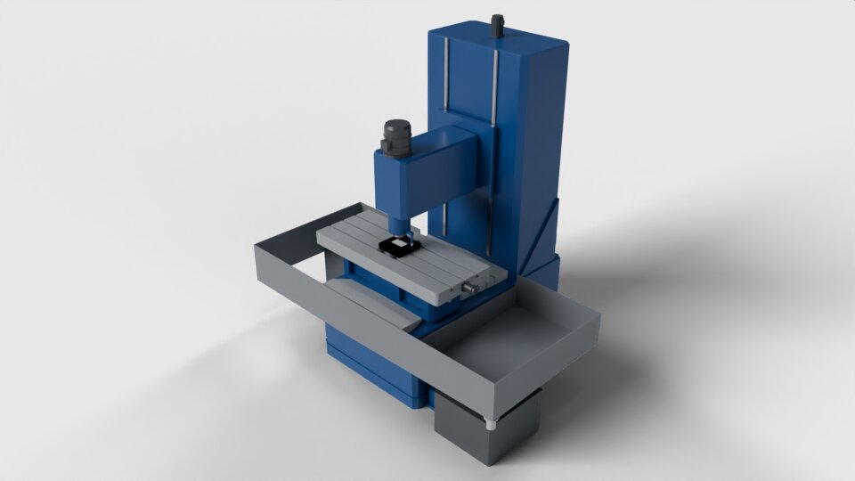
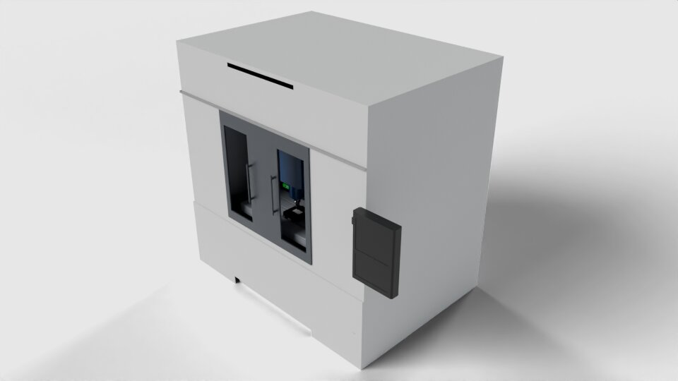

# 0249 – The small test mill replaced by a larger vertical machining centre (~1000 × 500 × 500 travel) – test mill, toolpath mill, the mill in its own enclosure with sliding doors

**Who:** worker · **Status:** done (0.2.195, 21 Nov 2026) – waited for 0230 (the `mill` set and `blender/lessons/mill.py`) and 0239
(`core/tc_person.py`) · **Branch:** `task/0249-larger-test-mill`
**Started by:** lead, 20 Nov 2026 (owner 23:35, screenshot of stop 54 "A person changes the tool": "this mill is not
allowed to be in Fresing Render. Replace it with a larger mill. This size gets closer to the one I'm building for
Fresing 400." His picks 23:40 in the answer box below.) · **Model:** Opus · effort High
**Area:** Test models lane – `tools/make_test_mill.py`, `tools/make_test_mill_cabinet.py` (becomes the VMC with its
own enclosure – keep the file name or rename with every caller), `tools/make_test_toolpath.py`, `tools/machine_parts.py`
(new shared parts only), their STEP files in `tests/data/` and `fresing_render/data/`; the tour sets that use them
(`mill`, `tools`, `marks`, `air`, `coolant`, `operator`, `toolpath`) and their checks / texts in `blender/tour.py`;
`blender/lessons/mill.py` (0230's mill lesson: part names, places, framing); `core/tc_person.py` / `blender/tc_person.py`
(the person's reach, stand spot, door, button – numbers only); `blender/toolpath.py` only where it holds this model's
numbers; `pccheck/checks.py` (the lines on these models); the tests that read them (list in "Where it is used");
`tools/guide_screens.py` + the guide pictures and texts of these stops; `tools/bench_*milling*.py`, `bench_chips.py`.
**Not** the double-arm, 4th- and 5th-axis mills (→ 0250), not the gantry router, not the demo.

## Why

The owner's own machine, the **Fresing 400**, is close in size to today's small test mill (bed 700 × 500, table
400 × 300) and is **not to be shown in any form** (owner 12 Nov). The test mills must be clearly a different, larger
class of machine, so nobody can read the Fresing 400 into them.

## Owner's picks (20 Nov 23:40)

- **Size:** a vertical machining centre (VMC) with travels about **X 1000 × Y 500 × Z 500 mm**, table about
  **1200 × 500**, about 2.5 m tall with its own enclosure.
- **Which:** all small mills – this task the test mill, the cabinet mill and the toolpath mill; **0250** the double-arm
  ATC mill and the 4th- / 5th-axis mills, built on this task's machine.
- **"A person changes the tool":** the machine stands on the floor **in its own sheet-metal enclosure with front
  sliding doors** (like a real VMC); the person opens the doors and reaches in. No separate cabinet stand.
- **Old copies:** from now on only – the small mill leaves `main` and every new release; old releases and git history
  stay (as for the vessel, 0226).

## The machine (invented – nothing of a real make, nothing of the Fresing 400)

- Fixed column behind the table (C-frame), the table moves in X on a saddle that moves in Y, the head in Z – the
  common VMC layout. Bed / column as heavy castings with ribs, chamfers; way covers on X and Y (the app's way covers
  can follow them – a bellows or telescopic look); a chip tray round the table.
- **Spindle taper BT40** (not BT30 – BT30 is the Fresing 400's): the BT30 tool holder of the cabinet mill becomes BT40,
  and every text that says BT30 for these stops says BT40 (stop 54, 58 "Tool change by hand (BT30)", guide).
- Enclosure: sheet-metal box with two front sliding doors with windows, a door handle, a control panel arm on the
  right (a plain box with a screen – no maker look), a work light, the release (drawbar) button reachable from the
  front. The person (`tc_person`) stands on the floor in front of the doors – no step, no stand.
- **Keep the workpieces, tools and programs:** the stock 200 × 200 × 40, the finished part, the end mill / ball mill,
  the clamps and the G-code / toolpath tests stay as they are, on the bigger table – put the **work zero in the same
  place relative to the stock** so the machining numbers, cut checks and tool marks need no new expected values where
  possible. Keep the part and assembly names the app and tests look for (`TABLE.ASM`, `X.ASM`, `Z.ASM`, `SPINDLE`,
  `END MILL D10`, `STOCK …`, `RELEASE BUTTON`, `SLIDING DOOR` …); add a `Y.ASM` / saddle only if the tests' joints are
  updated with it.
- **Coolant drain** (owner 20 Nov 23:50, for 0251's liquid): a chip tray under and round the table with a slope,
  troughs along the way covers and a **drain hole** (a separate part `COOLANT DRAIN`) – if 0251's report is out, use its
  list for the tray and drain; else a plain sloped tray to one drain at the front right.
- Detail and size: more detail than today is welcome (owner 22:19: somewhat larger files allowed) – **up to about 4 MB
  per STEP** (today 1.5–1.8 MB); report the sizes and the import time at Normal.

## Where it is used (lead's grep, 20 Nov – check it)

`blender/tc_person.py`, `blender/tour.py` (sets above), `pccheck/checks.py`; tests: `test_air`, `test_chips`,
`test_coolant`, `test_cut_normals`, `test_gcode`, `test_lightbake`, `test_lightbake_break`, `test_machining`,
`test_pccheck`, `test_section`, `test_tc_person_blender`, `test_tc_person_blender_independent`, `test_toolmarks_done`,
`test_toolmarks_moves`, `test_web3d`, `test_web3d_keys_blender`, `milling_crash_child.py`, `test_toolpath`,
`test_fast3axis_hole`, `test_machining_fixes`; tools: `facets_picture.py`, `guide_screens.py`, `ui_test_milling.py`,
`bench_chips.py`, `bench_milling.py`, `bench_milling_dense.py`, `dump_toolpath_program.py`. Guide pictures:
`air_blast.jpg`, `coolant.jpg`, `milling_marks.jpg`, `tools.jpg`, `toolchange_person*.jpg`, `view_toolchange_hand.png`,
`view_toolpath.png`, `panel_4_*` / `panel_6_gcode*` where the model shows. Also look in `site/`, `docs/`, the PC-check
report pictures and `fresing_render/web/` for any picture of the small mill.

## Checks

- Every test above green with the new model; numbers that had to change listed in the report with the reason.
- Stop 54 played through on the new machine: the person walks up, opens the sliding doors, reaches the holder and the
  button without the hands entering the castings or the enclosure (0239's stand spot + 0156's checks), lays the tool
  on the trolley, closes the doors; the clash check on the person and doors clean.
- Every stop of the sets above framed on the bigger machine (the whole machine or the cut, as each stop's text says);
  the tour record (`tour_versions`) re-recorded after merging `main` once.
- A search of the repository for the small mill's sizes / names in pictures and texts comes back empty (except
  `tasks/` and `CHANGELOG.md` history).
- The user guide and PC-check lines updated (`changed=` on the stops' entries).

## Report

Pictures of the new machine **from the test models only** (fine for the repository), the STEP sizes and import times,
the changed numbers, what 0250 should reuse (the shared parts in `machine_parts.py`), open points, the branch to
delete. Owner's PC steps: test tour > Machining > 54 and 58, Go; Milling a slot.

### Report (filled in by the worker, 21 Nov 2026, Claude Code on the web) – version 0.2.195

 

**The machine** (invented; `tools/make_test_mill.py`, `make_test_mill_cabinet.py`, `make_test_toolpath.py`): a VMC with
a fixed column (front 680 mm behind the spindle), the saddle on Y, the table 1200 × 500 on X (three 18 mm T-slots, open
at both ends), the head on Z; BT40 spindle (shaft Ø80, nose collar Ø116 on the housing), cartridge Ø150, ribbed column
and bed, telescopic Y way covers front (6 sections) and back (5), the chip tray of 0251's list (falls 2° to the front,
1.5° to a valley, Ø50 `COOLANT DRAIN` at its lowest point, `COOLANT TANK`), floor at z −900 (table top 930 mm above
it). Travels X ±500, Y −110…+390, Z −20…+480: checked with OpenCascade at every corner of the travel (and doors open
and shut) – no two parts that move against each other overlap. The enclosed version: sheet-metal enclosure 2.5 × 2.0 ×
2.5 m, two front sliding doors (handles Ø16 standing 55 mm out), toe recess, control panel on an arm, work light.
Stock, tools, programs, clamps and work zero are where they were: the cut checks kept their numbers.

| STEP | before | now | import at Normal (4-core web machine) |
| --- | --- | --- | --- |
| test_mill.step | 1.49 MB, 25 parts | 2.80 MB, 48 parts | 3.1 s |
| test_mill_cabinet.step | 1.83 MB | 3.37 MB, 56 parts | 3.8 s |
| test_toolpath.step | 1.50 MB | 2.83 MB | – |

**Decisions the brief left open** (say if you want them otherwise):
- **Axes:** the brief's layout means X moves the table now. The tests' X joint points to −x (a positive value moves
  the tool to +x on the block, as the machine's X+), so every slot, pocket and program kept its numbers. Tree:
  `Y.ASM` (saddle) > `X.ASM` (table, stock …), `Z.ASM` on the column – the same as the double-arm mill, so 0250 can
  share it. `TABLE.ASM` is gone (only the tests' axis lists used it).
- **Y travel 500 mm, but −110…+390 around the stock's middle** (the spindle reaches 140 mm past the table's front
  edge). Needed so a person reaches the spindle: the doors must clear the table at the front end of Y, and the
  person (0156/0157's figure) reaches about 0.52 m plus its lean. With ±250 the doors stood 0.53 m in front of the
  spindle and the operator came up 16 cm short.
- **No X way covers:** the X rails ride under the table (the blocks sit on the saddle), so nothing is open on X.
- **The person** (`core/tc_person.py`, `blender/tc_person.py`): lean up to **65°** (was 55°); the floor map keeps a
  door's closed place for walking only (open while it leans in) and also moves doors that follow the door joint;
  the operator opens the **left** door (the trolley stands on its right; with the right door the hand swept over the
  trolley) and the right one follows with ratio −1. `WORK_ROOM` stays 0.25 (a smaller one let the belly touch the
  closed doors).
- **Way covers in the tour:** `waycover.set_up_test_mill` (Y limits + both covers, k/N) runs in the tour's axis
  helper, the person's and the toolpath's set-ups; the mill lesson moves only X and Z and does not need them.

**Fix found on the way – chips:** a cross table's saddle is the chips' "carrier"; chips off its footprint went to
world space only below its lowest top (a cover skirt at −0.32 m), under the fixed way covers (−0.27 m), and fell for
ever (metres under the floor). `core/chips.py`: they go over when the next surface is a step below, and a chip under a
surface stops on the floor. New test `test_chips_off_a_cross_table_land_on_the_fixed_parts_beside_its_saddle` (fails
without the fix).

**Changed test numbers and why:** web 3D: 25 → 44 parts, the chip tray's sheet metal brings 2 pictures (looks still
shared: rails + spindle one picture); chips: fallen chips lie on covers / bed / tray / floor (was bed 0 / floor −60),
the riding chips' object moves (−50, 60) mm (the slot's X moves the table), the same-chips check allows 0.1 µm (7 nm
float rounding: the riding surfaces are read where the table stands when the chips are worked out); G-code: X moves
the workpiece (`moves_tool` [False, False, True]); air: the nozzle on the head no longer moves in X; three render
tests' cameras ride with the table; tool marks: the block only comes back to its Y and Z; person tests: door 0.35 m
to the left, the right door follows, "no door" tried with the doors hidden (shut doors: the Build rightly says the
hand does not reach). No cut, mark or toolpath number changed.

**Tests run here:** every file the brief lists, plus test_tour (102 + 1: the total build time 301 s > 240 s – one set
not of this task took 93 s while five test processes shared 4 cores; the seven mill sets build in 2–8 s each),
test_tour_clash for the 7 sets (0 clashes), test_lessons, test_tc_person*, the PC-check lines on these models (9 OK;
`web3d.export` cannot run in the pip bpy module here – no meshopt library – GitHub runs it in the real app).

**Guide:** texts (BT40, the enclosure, two doors: let the second door follow with ratio −1), pictures
`air_blast.jpg`, `coolant.jpg` (new maker `tools/guide_mill_pictures.py`), `toolchange_person*.jpg`,
`view_toolpath.png` made again; `milling_marks.jpg` shows only the block (kept). Panel pictures are unchanged
(no panel changed).

**For 0250:** reuse `machine_parts.rail_along` / `block_on` (rails in any direction), `way_cover_section`,
`sliding_door`, `bt40_holder_with_end_mill`, and `make_test_mill.machine()` (bed, column, saddle, table, tray, covers,
head); `waycover.set_up_test_mill` sets up the covers on any model with parts `WAY COVER Y FRONT/BACK k`.

**Open points:** the coolant picture's jet is faint (a 40 mm tool sits straight in the nose on the plain mill);
chips worked out at different frames differ by nanometres on this machine (above); the test_air queue render takes
about 45 s a frame here with other tests running – watch its time on GitHub.

**Subagents:** none (one design, files shared by every step). **Independent review:** none – no Windows code.

**Owner's PC:** after the update, Help > Make test tour project, open it, Machining > stop 54 "A person changes the
tool" > Go: the operator walks up, slides the left door open (the right one goes the other way), leans in, takes the
end mill out, lays it on the trolley, puts the ball mill in, closes the doors. Stop 58 "Tool change by hand (BT40)"
> Go: the gloved hand at the spindle. Learn > Milling a slot > View: the table moves the block under the bit.

**Branch:** `task/0249-larger-test-mill` – delete after merge.
