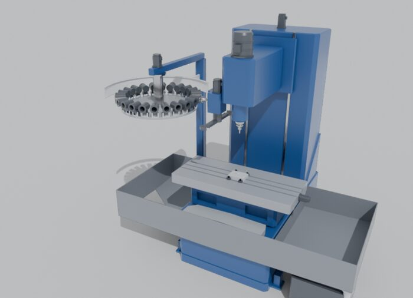
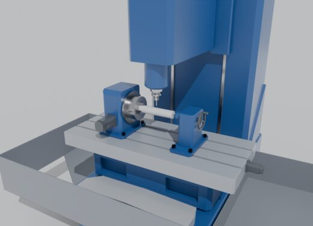
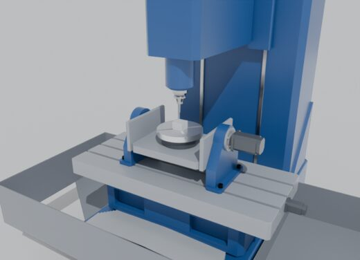

# 0250 – The double-arm ATC mill and the 4th- / 5th-axis mills rebuilt on 0249's larger VMC

**Who:** worker · **Status:** done (0.2.207, 23 Nov 2026) · **Branch:** `task/0250-larger-atc-rotary-mills`
**Started by:** lead, 20 Nov 2026 (owner 23:35 / 23:40 – all small mills replaced, see 0249) ·
**Model:** Opus · effort High
**Area:** Test models lane – `tools/make_test_atc.py`, `tools/make_test_4axis.py`, `tools/make_test_5axis.py`,
`tools/machine_parts.py` (reuse 0249's machine), their STEP files in `tests/data/` and `fresing_render/data/`; the tour
sets `atc` only where it uses these models, `doublearm`, `rotary4`, `rotary5` in `blender/tour.py`; `blender/doublearm.py`,
`blender/rotary.py`, `blender/toolpath.py` only where they hold these models' numbers; `pccheck/checks.py` (their lines);
`tools/make_site_web_models.py` and the **landing page's web model** if it is one of these; `tools/guide_screens.py` + the
guide pictures and texts of these stops; tests: `test_doublearm`, `test_rotary`, `test_toolmarks_done`,
`test_machining_fixes`, `test_pccheck`, `tools/ui_test_doublearm.py` (check with a grep – this list is the lead's).
**Not** the gantry router (`test_gantry.step`), not 0249's models.

## Why

Same as 0249: the **Fresing 400** (a mill of about today's test mills' size, with a **double-arm tool changer and BT30
holders**) is not to be shown in any form. Today's `test_atc.step` – a small vertical mill with a double-arm changer –
is the closest of all; it goes first in this task.

## What to build

- **Double-arm ATC mill:** 0249's VMC (~1000 × 500 × 500 travel, BT40) with a double-arm tool changer and a
  **side-mounted chain or disc magazine of 24 pockets or more** beside the column (a common big-VMC layout, unlike a
  small mill's) – invented, no maker look. Keep the joints, part names and the tool-change sequence the app and tests
  read (`doublearm.py`); new numbers for the reach, swing and times where the bigger machine needs them.
- **4th axis:** the same VMC with a rotary table (A axis) and a tailstock on its table, sized for it (faceplate
  Ø200–250).
- **5th axis:** the same VMC with a trunnion (A tilts, C turns) on its table (table Ø200–320) – or a larger 5-axis
  layout if it reads better; keep the TCP stop (63) working.
- Workpieces, tools and programs kept where possible (same rule as 0249: work zero in the same place relative to the
  stock).
- Up to about 4 MB per STEP; the site's web model (if it is one of these) kept small enough for the page (report its
  size and load time before / after).
- Old copies: from now on only (old releases and history stay).

## Checks

- Every test above green; changed numbers listed with the reason.
- Stops 60–63 (tool changer, double-arm, 4th axis, 5th axis TCP) played through: no clashes, the tool change times
  shown match the bigger arm, the TCP keeps the tool tip on the part.
- Guide pictures and texts of these stops re-made; PC-check lines updated; `tour_versions` re-recorded after merging
  `main` once.
- A search for the small mills' sizes / names in pictures and texts comes back empty (except `tasks/` and
  `CHANGELOG.md`).

## Report

Pictures from the test models, STEP sizes, import times, the web model's size if changed, changed numbers, open points,
the branch to delete. Owner's PC steps: test tour > Machining > 60–63, Go; the landing page's 3D model if changed.

### Report (filled in by the worker, 22–23 Nov 2026, Claude Code on the web) – version 0.2.207

  

**The machines** (invented; all three are `make_test_mill.machine()` of 0249 – bed, column, saddle on Y, table on X,
head on Z, chip tray, Y way covers – with new options `extra_table`, `extra`, `clamps`, `head_up`, `stock_part=None`;
test_mill / cabinet / toolpath give the same model as before):
- **Double-arm** (`make_test_atc.py`): the head in the change position 450 above the mill's (gauge line z 580), arm hub
  at x −230 (claws at x 0 and −460, BT40 claws Ø64.5, 95 mm stroke), the gearbox on a beam to the column's front; a
  **side disc magazine of 24 pots** (axis x −880, pots every 15°, mouth r 420, hinge r 360 in a clevis on the disc)
  on a beam from a stand behind the chip tray beside the column, a guard round its back. T1/T2 are now
  `TOOL T1 BT40 FLAT D10`, `TOOL T2 BT40 BALL D8`; stock, program, pots 2/5 and the random-pot order are as before.
- **4th axis** (`make_test_4axis.py`): headstock with faceplate Ø220, chuck Ø160, tailstock + handwheel on the table,
  A axis z 210; bar Ø50 × 240 as before; T1 Ø6 in a BT40 collet holder (`TOOL HOLDER BT40`, turns with the spindle).
- **5th axis** (`make_test_5axis.py`): trunnion supports on the table, cradle with shafts, rotary table Ø250, A axis
  z 260 (the table's top); block 60 × 60 × 40 as before; T1 50 out of its holder.
- Checked with OpenCascade (a throw-away script): no overlap in the CAD pose, the arm at rest / gripping / pulled and
  turned in 22.5° steps with T1 on it, the station pot tipped, pot 2 tipping with T2 (30/60/90°), the magazine turned,
  A at −120…120° (5-axis: beyond ±60° with the head up), the table at every corner of X and Y. Only touches: the tool
  in the table at the very bottom of Z (and the 5-axis A motor in the head there) – no program goes there.

| STEP | before | now | import at Normal (4-core web machine) |
| --- | --- | --- | --- |
| test_atc.step | 1.75 MB | 3.80 MB, 100 parts | 3.0 s |
| test_4axis.step | 1.67 MB | 3.35 MB, 49 parts | 3.1 s |
| test_5axis.step | 1.59 MB | 3.34 MB, 47 parts | 3.1 s |

**Changed numbers and why:** arm hub (−0.13 → −0.23, 0, 0.58), hinge (−0.52, 0, 0.64), magazine axis (−0.88, 0, 0.6),
24 pots (tests: 24 pockets, 2 + 24 app joints), stroke 76 → 95 mm (BT40), holders BT40; the test model's times for the
bigger arm (`doublearm.TEST_TIMES`: grip 0.35, pull 0.3, half turn 0.6, pot tips 0.5 s, 0.25 s per pot) – a change
1.9 s (was 1.6); A axis 0.15 → 0.21 (4th), 0.14 → 0.26 (5th); the two rotary tools' tips in their own coordinates
0.03 / 0.02 m (`test_a_tool_tip_never_comes_from_another_projects_tool` needs them to differ, so the 5-axis end mill
sticks out 50 instead of 40); `rotary.set_up_test_model` makes Y first and X along −x (the table moves); both set-ups
call `waycover.set_up_test_mill` (else the saddle ran through the covers: 4 clash rows in the 5-axis tour animation).
The site test's loop 10.1 → 10.5 s. No cut, TCP or hand-over number changed (hand-overs 0.0004 mm, TCP 0.0015 mm, cut
depths 0.003 mm in the PC check).

**Fix found on the way:** a project saved during a double-arm change and opened again worked out the work zero from
the hidden spindle tool's stale place (Blender never evaluated it after the load): 480 mm off on this mill, so the
program's timing and every change moved (the real-app test's "opened again" check failed). New `gcode.world_of` works a
hidden object's world matrix out from its parents (Machine's tool tip, work zero, `_world_points`). Test
`test_reopened_mid_change_keeps_the_work_zero` (fails by 480 mm without the fix).

**Web model** ("Turn it yourself", `tools/make_site_web_models.py test_atc`, Soft light): 1.73 → 2.42 MB page (glb
1.5 MB, 79,405 triangles), loop 10.08 → 10.48 s; headless Chromium without graphics card, page to first picture
incl. browser start: 1.5 s → 1.85 s. Caption: 24-pot side magazine. (The poster, old and new, carries the page's red
"without the graphics card" strip from the headless browser – an older open point of the poster maker.)

**Tests run here:** test_doublearm (10), test_rotary (15), test_machining_fixes, test_toolchange, test_gcode,
test_toolmarks_done (4-axis), test_clash (double arm), test_tour (105 passed), test_tour_clash for doublearm / rotary4 /
rotary5 (0 clashes), test_site, test_user_guide, test_updates, test_ci_tools, test_functions; the PC-check lines
`motion.doublearm`, `milling.rotary` (OK); real app `ui_test_doublearm.py` 19/19 (the hinge is now clicked from the
spindle's side at an angle: straight from the front the next pot stands in front of it – its pin ends stand 2 mm out
of the clevis for this).

**Guide:** texts (stroke 95 mm for BT40, the 24-pot magazine, the test mill's 1.9 s), pictures `panel_4_toolchange_arm`,
`view_toolchange_arm`, `panel_4_rotary`, `view_rotary` made again; the tour stops' texts (BT40, 24-pot side magazine)
and views. A search for the old mills (12 pots, BT30 tool names, moving column, x −130, z 140/150) finds only
`tasks/`, `CHANGELOG.md`, the generic BT30 holder type and the gantry's carousel (not these models).

**Runs on GitHub:** 2 – the branch's full run (45086260809, green; 29 min, other tasks' runs shared the runners) and a docs run after merging main (only task files had moved).

**Subagents:** none. **Independent review:** none – no Windows code.

**Open points:** the web model's poster strip (above); `tests/test_doublearm_core.py` keeps its own 12-pot numbers
(pure core, no model).

**Owner's PC:** after the update, Help > Make test tour project, open it, Machining > "Double-arm tool change" > Go:
the 24-pot magazine beside the column turns, a pot tips down, the arm swaps the BT40 tools. "4th axis: the bar turns"
and "5th axis: tilt and turn (TCP)" > Go: the rotary table and the trunnion on the larger mill's table. The landing
page's "Turn it yourself": the new mill.

**Branch:** `task/0250-larger-atc-rotary-mills` – delete after merge.
