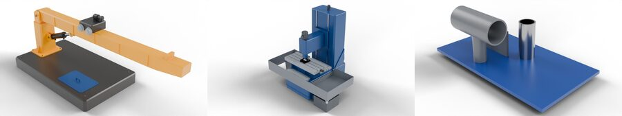
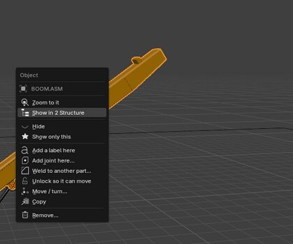
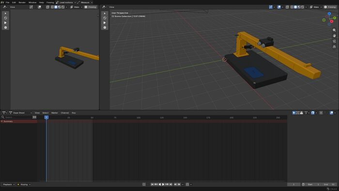
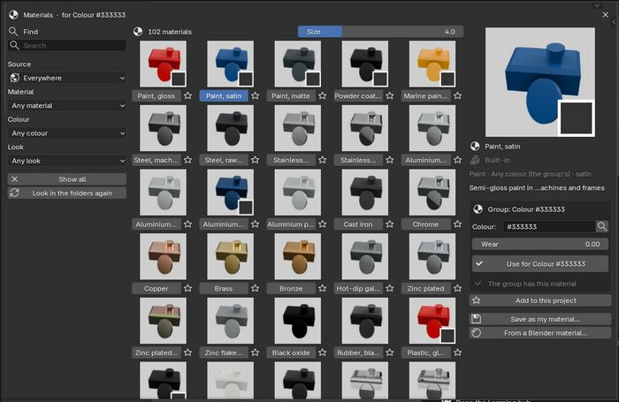
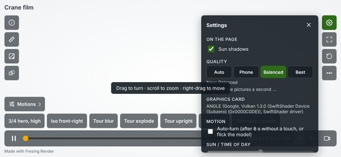

# 0328 – Bug and friction hunt round 8 (findings only): 0.2.160 to the newest, used as three kinds of user

**Who:** worker · **Status:** done (25 Nov, findings only) · **Branch:** none (report on `main`, touching only `tasks/` and `TASKS.md`)
**Started by:** lead, 25 Nov 2026 (owner 01:06: "Are there more tasks I can run overnight? I mostly want tasks to make
the app more user friendly right now.") · **Model:** Opus · effort High · **Place:** Claude Code on the web, environment
"CAD-render-animation". Findings only: no app code, no version, no test run of its own – it does not count towards the
code tasks.

## Goal

A ranked list of what breaks and of what makes the app **hard to use**, from 0.2.160 (the last hunt, 0209, ended at
0.2.159) to the newest, found by using it the way the owner's three kinds of user would. Grouped into fix tasks by lane,
so the lead can brief them tomorrow. The owner's aim: as simple as possible, **looks very good with no set-up**, every
function suited to all three levels.

## Who you are (three passes, one per user)

1. **Sales person, not technical** – Client view and the Sales workspace: open a project someone sent, look round,
   move the lead motions and joints (Sales may move joints since 0321 if merged), render a picture, make a short video,
   export the 3D page. Never opens Blender's own tools.
2. **CAD engineer new to rendering** – Essentials / Machine builder: first start (0276 set-up), import the test crane
   and the stress model's small size (`FRESING_PCCHECK_STRESS_SMALL=1`), sort into groups, pick materials (the picker
   if 0273 is merged), finishes, welds, joints, a lead motion, measure (0322 if merged), copy / place / remove,
   render, model update to a revision, backups, Settings window.
3. **Skilled animator** – Video producer / Full access: the animation panel, cameras, looks, render queue, Blender's
   own tools opened from the app and back (Fresing > Show all of Blender / Back), keys.

## What to look at

- Everything in `CHANGELOG.md` from 0.2.160 to the newest (read the headings first, then only what each pass needs).
- **Friction, not only bugs:** a step you could not find within ~30 s, a button whose words or tooltip did not tell
  you what happens, more clicks than needed, a panel that jumps (CLAUDE.md section 6 "The panel stays still"), a
  window that opens in a bad place or size, a question asked again and again, a default that looks poor without
  set-up, a text that assumes Blender knowledge, something that differs between workspaces for no reason, the
  Learning hub not leading to the function you need. Name the place exactly (`core/places.py` `where()`).
- **Looks with no set-up:** import the test crane, the test mill and the weldment with defaults, render a still at
  Draft and Normal: note every part that looks wrong or bare (2–3 small pictures at most, `tasks/img/0328_*`, test
  models only).
- 0209's rows: re-check that each fix holds (0213–0216, 0236–0239). The open points the lead keeps (progress note
  list, e.g. 0213 Set-up window Back / Next in the Client view, 0221 new window not tidied until the next load, 0241
  welcome box above the splash picture, 0271 keyboard-only work not seen as presence, 0179 the 3D page's settings menu
  covers the play bar): say for each whether it still stands and how much it hurts a user.
- Old projects saved by 0.2.159, 0.2.200 and 0.2.230 opened in the newest version: layout, workspace, everything
  builds the same.
- Tasks still running when you start (see `TASKS.md`): look at their area only once merged; note what you skipped.

## Rules

Public repository (CLAUDE.md section 6). Each row: who (sales / engineer / animator), what you did, what happened, what
should happen, how often, the smallest repeat case, kind (crash / lost work / wrong result / **friction** / looks /
small), how much it hurts (1–3), the lane, and a proposed fix in one line. Then a grouping into fix tasks by lane (two
fix tasks never share a file) – friction fixes that are small can be bundled per lane. Helper agents: at most 3, one per
pass is a good split; say which did what. Push only `tasks/0328-bug-and-friction-hunt-8.md` (+ small pictures) and
`TASKS.md`.

## Done when

- [x] Report: "In short (for the owner)" (≤ 8 lines: the 5 things that hurt users most), the rows, the grouping into
      fix tasks for the lead
- [x] Pushed to `main` touching only `tasks/` and `TASKS.md`; then check that main really contains your commit

---

## Report (filled in by the chat that did the task)

**Chat / date:** Claude Code on the web (Opus, effort High), 25 Nov 2026. Hunted on `main` = **0.2.244** (68009e8), 4-core
web machine, real app under xvfb (software drawing: llvmpipe – drawing times are not the owner's graphics card), Blender
as a module for logic. Three helpers, one per user kind (below). No app code, test or tool changed; no version; no test
run of its own.

### In short (for the owner)

- **A new user may never see the first-start set-up:** on the test machine it opens and closes itself after ~1.5 s, at
  every start (row 1). Please try a fresh start on your PC (lead gives steps).
- **Animators lose work without a word:** a key you change in the Graph Editor is put back by the next Build (and by
  every queued render); a Fade step throws away a part's own keys; clicking Turntable again deletes steps you added (rows 2–4).
- **"Back to the Fresing window" can leave you stuck** in Blender's Animation layout with no visible way back (row 5).
- **Client view not fully locked:** Ctrl+F2 renames parts and joints, Ctrl+, opens Blender's Preferences (row 7).
- **The workspaces don't match their job:** Video producer has no weather, light or turntable; the right-click menu offers
  functions the workspace hides; a red "In use but hidden" alarm on every normal project; every window opens top left
  over the left panel; the render result shows only the middle of the picture (rows 9–15).
- Good news: **old projects are safe** (138 projects made by 0.2.159 / 0.2.200 / 0.2.230: every animation builds the same),
  **the test crane and mill look good with no set-up** (picture below), and every 0209 fix re-checked still holds (one harder variant of row 5 does not).

### Rows (worst first)

Who: **S** sales person (Client view, Sales), **E** CAD engineer (Essentials, Machine builder), **A** animator (Video
producer, Full access). Kind: crash / lost work / wrong result / friction / looks / small. Hurts 1–3. "(code read)" =
cause found by reading only; everything else was seen and measured. Helper letters in "repeat case": A = sales pass,
B = engineer pass, C = animator pass, M = main session (scripts were in the session's scratch folder, not pushed: the
cases are written so they can be repeated by hand).

| # | who | what you did → what happened | what should happen | how often | smallest repeat case | kind | hurts | lane | proposed fix (one line) | where |
|---|---|---|---|---|---|---|---|---|---|---|
| 1 | E | Fresh settings folder (no `userpref.blend`, no start file), start the app → **"Set up Fresing Render" opens ~3.5 s after start and closes itself ~1.5 s later**; state stays `""`, so it flashes again at every start; the user lands in Essentials, nothing set up. `tools/ui_test_first_setup.py` fails here the same way (GitHub green: a timing race) | The set-up stays until Next / Skip / Close | 5 of 5 starts (1920×1080 and 1800×2600) + 1 of 1 repo test run | B: fresh user folder, `FRESING_WELCOME_TEST=1`, start; log who calls `close_window` | wrong result | 3 | Start & learn (first set-up, 0276) | `_on_load` must close only a set-up window the opened *project* brought (not the start-up file's own load, not one made after it) – e.g. a generation number | `first_setup.py` `_on_load` ~839–853: the start-up file's `load_post` arms `later()`, which waits while `ops_setup.busy()` (the new set-up window opening) and then closes it (traced: `close_window` from line 849) |
| 2 | A | Crane hub: Build "Boom up", move the last key of `Joint Boom (motion)["fr_value"]` 0.611 → 1.111 in the Graph Editor, Build again → **0.611 again, 0 warnings**; the queue and Ctrl+F12 build again first, so the edit never reaches a video. A hand key on a joint Build also keys is set aside while built (back after Stop), also silently | Keep the edit, or warn "You changed 1 key: Build replaces it – Keep / Replace" | 1 of 1 (deterministic; re-run by M) | C/M: build, edit the key, build | lost work | 3 | Motion (animation) | Fingerprint the FR actions at Build; at the next Build / queue job warn when they differ, offer "keep as my own keys" | `animation.py` `bake` ~626, `_channelbag` ~283; `queue.py` `_setup_animation` ~1018 |
| 3 | A | Key the COVER part's location by hand (`COVERAction`), build "Fade and trail" (a Fade step on COVER) → during Build its action is "FR visibility 1" (hand motion does not play); **after Stop it has no action, `COVERAction` 0 users – gone at the next save** | Set aside and put back, as `_channelbag` does for other parts | 1 of 1 (re-run by M) | C/M: hand-key a faded part, Build, Stop, save, reopen | lost work | 3 | Motion (animation) | `_shared_visibility` stores `USER_ACTION` / slot before assigning, `_drop_action` puts it back | `animation.py` `_shared_visibility` ~302, `_drop_action` ~439 |
| 4 | A | Add a step to "Turntable", change the turntable's seconds, click Turntable again → **steps 2 → 1, the user's step deleted silently**. Chain (code read): Turntable makes its animation the picked one, and Lead motions "+" and weather "Add at playhead" add to the picked one – their steps land there and the next Turntable click deletes them | Replace only the app's orbit step | 1 of 1 (re-run by M) | C/M: as described | lost work | 2 | Scene & Render (turntable) | Keep blocks that are not the tagged orbit; leave `animations_index` where it was | `turntable.py` `make` ~81 (`a.blocks.clear()`), ~93; `where("FRESING_PT_turntable")` = 5 Scene & Render > Turntable video |
| 5 | A | Fresing > Show all of Blender, pick Blender's "Animation" workspace tab, Fresing > Back to the Fresing window → **the window stays in Blender's Animation layout** (two 3D views, Dope Sheet, Fresing side panel closed) and the workspace tabs are now hidden: no visible way back (picture below) | Back returns to the layout the app uses | 1 of 1 | C: as described | friction | 3 | Start & learn (quiet window) | Show all remembers `window.workspace`; Back switches back to it (or "Layout") | `quiet.py` `FRESING_OT_blender_all.execute` ~431 |
| 6 | all | Real app: Add animation, then pick a RAL colour (RAL 1005), Ctrl+Z, Ctrl+Shift+Z → **one Ctrl+Z undid both**; redo brought back only the animation – the colour pick is lost. Same class without UNDO (code read): Load template, Template from library, 360° photo from library, Default rule set, Delete rule set, Render on | One undo step each | 1 of 1 | C: as described | lost work | 2 | Looks / Scene & Render (`ops_main.py`) | `bl_options = {"REGISTER", "UNDO"}` + a test that every operator writing scene data has UNDO | `ops_main.py` ~641, ~661, ~717, ~749 |
| 7 | S | Client view: Ctrl+F2 (or Edit > Batch Rename), Find "BOOM", Replace "GONE" → **"Renamed 6 of 44 Object(s)"** incl. "Joint Boom"; the lock stays on. Ctrl+, / Edit > Preferences opens Blender's Preferences (the extension can be switched off there) | Refused like X / Delete, with the status line | 2 of 2 (dialog), rename done 1 of 1 | A: as described | wrong result (lock leak) | 2 | Client view / workspaces | Swallow F2 / Ctrl+F2 / Ctrl+, outside Full access; hide Rename / Batch Rename / Preferences in the Edit menu there | `lock.py` `BLENDER_KEYS` (has neither – checked), `quiet.py` Edit menu |
| 8 | S, A | Lead motions ▾ slider moved on a **built** animation ("Boom and trolley" built, "Boom up and out" to 100 %) → the boom moves, then **snaps back at the next frame change** (Space, scrub, render) while the slider still says 100 %; nothing says "built" | Moving a lead slider takes the Build off (as `joints.set_table` does), or the popover says "Built – Stop animation to move" | 1 of 1 | C: as described | wrong result | 2 | Motion (lead motions) | `animation.clear_keys` + an INFO line in `lead_motions.apply` (and ▶ / Back to start) when built | `lead_motions.py` `apply` ~142 |
| 9 | S | Right-click a part in **Sales** → menu offers Show in 2 Structure, Add a label, Add joint…, Weld to another part…, Unlock, Move / turn…, Copy, Remove… – functions Sales hides. In the Client view "Show in 2 Structure" says "picked in 2 Structure" while 2 Structure is hidden (picture below) | Only entries whose function the workspace shows | 2 of 2 | A: right-click the boom in each workspace | friction | 2 | Workspaces (right-click) | Draw each entry only when `workspaces.shows(scene, <function id>)` | `context_menu.py` `_draw` ~152–180 |
| 10 | A, S, E | Workspace lists vs the job: **Video producer** hides Weather & time (and 0299's two-click change), Turntable, Render this view, joint sliders, Save start scene – but shows the Weather & time *step*, and Make still shows Render this view. **Animator** hides Light, Saved scenes, Weather, Turntable. **Sales**' Make has no Animation output, so Product video's "then Render animation" is only in the side panel (and its note points to "the list below", which the window does not have). **Essentials / Builder** hide `looks.picker`, `looks.finishes`, `import.update` by the list while the panels still show them (Favourites / What's new / learning go by the list). **Client view** shows Import STEP… as its blue button | Each workspace has what its job needs; the list matches what is drawn | deterministic | C: `core/workspaces.shown_functions(builtin(...))`; A, B: screenshots | friction | 2 | Workspaces (`core/functions.py`) | Add weather (+ presets, change), turntable, render_view, joint sliders, start_scene_save to Video producer; light, save, turntable to Animator; Animation output (or a "Render the video" button) to Sales; `looks.picker` wherever `looks.materials` is; no import in the Client view | `core/functions.py` `TASK_WORKSPACES` ~92–175, `FAMILY_WORKSPACES["import"]`; `core/workspaces.py` BUILTIN |
| 11 | S, A | Open a colleague's project, pick Sales (or Video producer on the hub) → a **red** "In use but hidden: 4 famil…" (cut off) + Show, for a normal finished project (joints, animations, labels). The project opens in the sender's workspace: the sales person picks Sales every time | A grey one-line hint in task workspaces; a per-user "open projects in" choice | every open | A: open a saved crane project, pick Sales | friction | 2 | Workspaces / left panel | Grey hint, shorter text; Settings > General "Open other people's projects in: their workspace / mine" | `workspaces.py` `on_load` / `ensure`, `ui_left.py` alert row |
| 12 | S, E | Open the function / output windows (set-up, More materials…, Settings, Learn…, Restore a backup…, Move / turn, Picture, 3D page, Product video, Keep open, Set-up window) → **all at the same top-left spot** (x 2, y ≈ 27), over the left panel and over each other (Settings hidden behind Learn); each draws empty or half-fitted for 1–3 s; Blender's "Item" / Tool / View / Animation tabs in some (xvfb has no window manager: Windows may differ) | First open beside the side panel or over the view's middle, the next offset ~30 px | 6 of 6 + 5 of 5 | A, B: open them one after another | friction | 2 | Windows (`ops_setup` / `ops_make` / `form_window`) | Place a first-time window next to the side panel / centred, cascade by ~30 px; hide Blender's tabs in the Set-up / Picture windows | `ops_setup._open_window` / `_finish`, `ops_make.py` |
| 13 | E, S, A | Render image right after import (default 1920×1080) → Blender's image editor (991×602) shows the picture at 1:1: **only the middle is visible** (the camera frames the whole model: corners at 0.07–0.93 × 0.03–0.97); header "ViewLayer / Combined", "Frame:1 \| Time … Mem …", Slots; F12 opens the same | The whole picture, fitted; app words (Open, Show in folder, Close) | 3 of 3 | A, B, C: Render image / F12 | friction | 2 | Render / output (quiet window) | `image.view_all(fit_view=True)` after a render; tidy the image editor's header outside Full access (`quiet.swap`) | `ops_main.RenderStill`, `lock.FRESING_OT_key_render` ~594, `quiet.py` |
| 14 | S | Make > 3D page > Export… (23.6 s) → the window (357×582) looks unchanged: the result (file, **Open page**, Show in folder) and "Not in the web model" are **below the window's edge**, no scroll hint | The result where the eye is (under Export…), or the window fits its content | 2 of 2 | A: export any project | friction | 2 | Web 3D | Result row directly under Export…, or size the window to the content | `ui_web3d.py` ~86–96, `ops_make.py` window size |
| 15 | S | Make > 3D page before any Build → "Include animation" greyed, no reason; the Film ticks appear only after a Build whose camera moves | "Build & play an animation first" + a button | 1 of 1 | A | friction | 2 | Web 3D | Say why it is greyed, offer Build | `ui_web3d.py` ~56–66 |
| 16 | S | Client view, a built animation → Build & play greyed ("Turn the steps into keyframes … viewport … Disabled: Client view"); Space / the timeline ▶ still play it: **no app button to play** a finished project | A Play button when built | 2 of 2 | A: build in Sales, switch to Client view | friction | 2 | Left panel | In the Client view draw Play (`screen.animation_play`) when built; tooltip in plain words | `ui_left.py` ~355–361 |
| 17 | S | Click a section / sub-panel title on its icon or the empty right part → **nothing**; only the words open it (3 Looks: icon x 1671 and right part x 1800 left it closed; the Joints fold only on its arrow) | The whole title row opens it, as Blender's own panels | 4 of 4 | A: click 3 Looks' icon | friction | 2 | Side panel (`panels.py`) | Make the row's left part one expanding toggle, or put the state inside the toggle | `panels.py` `draw_title` ~331–348 |
| 18 | E | Sort parts into groups → stress model (small): **56 groups, 44 named by a hex code** ("Signal towers & lamps #33363B / #D9E6F2 / #ADB2B8", "Colour #DBAD1F"), 17 with 1–2 parts; test mill 14 groups, 4 "Colour #…", "Plates, blocks & brackets" three times; crane "Colour #333333", cut "Welded frame…ures #F9A800". The material picker's title says "for Colour #333333" | Colour words people know ("yellow", "dark grey"), close colours of one kind in one group | deterministic | B, M: import + Sort the test mill / stress small | friction | 2 | Looks / rules | Name colours in words (hex in the tooltip); merge close colours of one kind | `core/rules` group naming, `ui.py` ~775 |
| 19 | E | More materials… (picker, 0273) → names cut at ~9 characters ("Stainless…" twice, "Aluminium…" three times, "Zinc plated…"), several look the same (picture below) | Whole names (two lines) or wider cells | 1 of 1 | B | friction | 2 | Looks / material picker | Two-line labels or wider cells | `ui_material_picker.py` `_short(e.name, 9)` ~318 |
| 20 | E | Weldment (`test_weldment.step`) imported with defaults → the short "POST" tube is sorted as **Shafts, pins & spacers** (ground steel: mirror-like), the other tubes and the fin as grey paint: a steel weldment in three looks (picture above, right). All parts carry the same CAD steel colour | One look for one weldment's steel (or plain steel) | deterministic | M: import, Render image | looks | 2 | Looks / rules (with 0287) | A short tube welded to a plate is a pipe, not a shaft; same CAD colour + steel → one group – decide together with 0287 (painted steel from Inventor) | part-type keywords (`POST`), `core/rules` |
| 21 | S | 3D page at phone landscape 932×430 (0179) → the settings menu covers the right half of the play bar (time, ½× 1× 2×, Film) and the views row; without the menu, Motions + a 7-button views row + the play bar take ~45 % of the height. 390×844 and 1280×720 fine (picture below) | Menu clear of the play bar; views as one pill (as in portrait) | 2 of 2 | A: `read_page` at 932×430 | looks | 2 | Web 3D | Short landscape: views as the pill, menu height capped above the play bar | `fr_player.js` |
| 22 | E | Lifting plan (test crane example), then the general **Remove…** (0292) on the placed crane → crane gone, but the plan still lists it (model gone), 1 joint "AT-40 · Hoist drum", 4 poses and **the hoist rope, drum and sheaves stay visible** ("FR rope AT-40" …, not hidden). The Remove window said "Goes: 1 model, 59 parts, 19 joints, 1 cylinder" | Remove of a crane = 8 Lifting plan > Remove (all of it), or the window says it is a crane | 1 of 1 | M: `set_up_example`, `remove.remove(scene, [crane.root])` | wrong result | 2 | Lifting (+ `remove.py` hook) | `remove.plan` / `remove` call `lifting.remove` for a crane root (as a hook) | `remove.py`, `lifting.remove` ~511 |
| 23 | E | Mesh (glTF) update, unnamed group B moved 100 mm **and both** its boxes 20 mm wider → "4 parts kept, 2 new, 2 missing", "Joint 'Work joint' removed", the Hide step lost. (0209 row 5's own case and three more variants hold) | The group node is the same tree node: its step, eye and joint stay | 4 of 4 | B: variant of 0237's test | lost work | 1 | Import (reimport) | Pair an unnamed group by its tree place when all its parts changed | `reimport._made_assemblies` / mesh pairing |
| 24 | E | Lifting example, then Remove the **load's** model → the load stays with **0 parts**, its CoG at a stale place (1.47, 0.11, 0.38 instead of 4.07, 1.5, 2.41), the readout still "Within entered limits, 16 %" (entered 1.2 t) | "This load has no parts left" in the plan and the readout | 1 of 1 | M | wrong result | 1 | Lifting | A load with no parts shows a red line, no use | `lifting.py` readout / `ui_lifting.py` ~265 |
| 25 | E | Stress small, Ctrl+V (Move / turn opening), X ~2 s later → **main window left split**: extra 3D-view strips with their own side panels, the left panel pushed right | The main view stays whole; a second window waits | 1 of 5 tries | B | looks | 2 | Windows | When a job is dropped (`not _alive`) close its pieces; refuse a second open while `busy()` | `ops_setup._run` ~430 (code read) |
| 26 | S | Build & play, then Show on the red alert → 4 Motion inserts a 97 px "Animation '…' is built … Stop it to move joints" box above "Everything back to CAD position"; after Show the Learning hub jumps up 30 px | CLAUDE.md 6 "the panel stays still" | always | A | looks | 1 | Motion / left panel | State on a fixed row or at the bottom of the box | `ui_motion.py`, `ui_left.py` |
| 27 | all | Blender's sidebar tabs Item / Tool / View / Animation beside "Fresing" in every workspace (Item with raw Location / Rotation once something is selected) | Only the app's tab outside Full access | always | A, B, C screenshots | friction | 1 | Quiet window | `quiet_panels`-style `poll` on Blender's sidebar panels in the main view outside Full access | `quiet.py` / `ops_settings.quiet_panels` |
| 28 | S | Pick a workspace; Build & play → Blender's redo panel "> Workspace" / "> Build & play" bottom left of the view (opening it offers the workspace list again) | No redo panel outside Full access | every time | A | looks | 1 | Quiet window | Hide the HUD region outside Full access (or drop REGISTER) | `ops_workspace.py` ~42 |
| 29 | E | After import: G on COVER → nothing; "'TEST.CRANE' is locked in place – right-click it > Unlock so it can move…" (every import locks the whole model) | "Press G again to unlock and move", or an Unlock button | 2 of 2 | B | friction | 1 | Place / move (0307) | A second G unlocks and moves | `place.py` move key |
| 30 | S, E | Any function's last message shows under **1 Import**: "Saved …/Renders/…png" (4 lines), "Rendering on CPU...", "Imported crane.step" after Sort (Sort writes none) | Each message beside its own button | always | A, B | small | 1 | Side panel (`ui.py`) + `ops_main` | 1 Import shows only import messages; Sort says "20 parts in 9 groups" | `ui.py` ~330–343, `ops_main` apply_rules |
| 31 | S | 3D page: every camera becomes a page view (Turntable camera, the set's working cameras); the export window lists 3 of 7, then "…" | Choose the views; app-made cameras off by default | 1 of 1 | A | small | 1 | Web 3D | Tick boxes per camera | `web3d.view_names` |
| 32 | S, A, E | Words: right-click menu title "Object"; "Camera Perspective" / "User Perspective" over the view; "CAD (0)", "Everything back to CAD position" in Sales; "keyframes … viewport" (Build & play tooltip); "Anim Player" and a red "fps: 1.90" in the status bar while playing; "(no subassembly with 5 or more parts (apart from the whole model))"; cut: "Lead motions as slid…", "Own folder: Ren…"; "Smaller file" names meshopt; 6 Animation: a fold "Make a product video" with the same button under it, step names cut ("The boom goes up, t…", "Trolley out: 100 …"); "0.0 M triangles" for 20 parts; set-up "Your PC": "draws: llvmpipe …; renders: CPU"; backups off says "Edit > Preferences > Add-ons > Fresing Render" (now Fresing Settings > Backups, and those preferences do not survive a restart – CLAUDE.md 8); the stress README says "1 Model > Import STEP" | Plain words, nothing cut | – | A, B, C | small | 1 | several (each file's own task) | A word pass per file, in the fix task that owns it | `context_menu.py`, `ui_motion.py`, `ops_main` anim_build, `ui_web3d.py`, `ui_left.py`, `ui.py` ~298, `core/first_setup.pc_summary`, `ops_backups.py` ~57, `tour.py` ~6317, `tools/make_test_stress.py` |
| 33 | S | Client view, Lead motions ▾ → "+", "Show every function", "Edit lead motions…" shown greyed | Not drawn when locked | always | A | small | 1 | Lead motions | Hide them when locked | `ui_lead_motions.py` |
| 34 | S | Make > Product video → its settings fold closed when the window opens, window mostly empty | Open in its own window | always | A | small | 1 | Make windows | Open the fold by default in the output window | product video panel |
| 35 | S | Build & play "Every function" (526 frames) → the timeline still shows 0–250 | Fit the timeline | 1 of 1 | A | small | 1 | Animation | View-all on the timeline after Build | `animation` build |
| 36 | E | Fresing > Learn… to find a function → sample projects mostly "View" only ("lesson coming"); nothing leads to model update, Place / Copy / Remove, backups, Settings – the engineer's daily functions | "How do I…" per function or a guide link | always | B | friction | 1 | Learning (0304) | Hand to 0304 (Learning hub round 2, open): short lessons or guide links for these | `ops_learning.py` Learn window |

**Seen in passing, not a user problem:** an app start runs `prune_old_caches`, which deletes every import cache with an
older `CACHE_VERSION` – also a half-written `.partial-…` folder that already holds its `tree.json` (its docstring says it
never touches `.partial`). Here a 0.2.159 import running at the same moment as a 0.2.244 start lost its cache (2 of 46
sets failed). Only when two app versions share one PC's cache at the same moment; hurts 0–1 (`importer/runner.py` ~308:
skip names with `.partial`).

### 0209's rows re-checked (fixes 0213–0216, 0236–0239)

| 0209 row | fixed by | result |
|---|---|---|
| 2 (Outliner in the Client view) | 0213 | **holds** – the timeline switched to Outliner becomes Info; A / X / Delete refused, 42 objects stay (side effect: the timeline stays an Info log until changed back) |
| 9 (lock after import + undo) | 0213 | **holds** – 66 objects, 0 clickable; 5 × Ctrl+Z → 42, 0 clickable, still Client view |
| 24 (greyed buttons in the Client view) | 0213 | **holds** – 61 functions with a button, 2 refused on purpose (`blender_editors` with its reason, `open_app_folder` only on an Install.bat install) |
| 6 (Make > 3D page no Export) | 0215 | **holds** (but row 14: its result is below the window's edge) |
| 1, 3, 4, 11, 12, 14, 15, 16, 32, 33, 36 (lifting) | 0214 | **hold** for their cases (their tests run on GitHub at every push, green); combined with newer functions (M): an update to **revision B** keeps the load (3 → 4 parts: the new part in the boom joins it; CoG 17 mm off, use 16.02 % both); Paste of a crane is refused with a plain line; a lead motion from crane poses builds. New: rows 22, 24 |
| 7 (water level + undo) | 0216 | **holds** – water 2 → 3 m, re-bake 4.2 s, cable 0.024 m over the seabed; Undo and a reopened copy the same |
| 8 (demo update read again) | 0216 | **holds for the public demo** (hoist wire 20.835 / 40.838 m before and after, 0 warnings); the old case is in the private kit |
| 27, 28, 29 (tension, frame after save, empty names) | 0216 | **hold** (no 5–22 kN spike; frame 150 kept; "" names put back) |
| 13, 19, 22, 25, 26, 34 (usage / start) | 0236 | **hold** (22 by code read: a use within 2 s of the last check shows at the next change) |
| 5 (mesh update, moved changed group) | 0237 | **holds** for its case; a harder variant still loses work (row 23) |
| 20 (riding camera re-bake) | 0238 | **holds** on the small demo – 1,496 steps for 1,489 frames, longest 0.19 s (was one 13 s call); full demo not tried |
| 18 (tool-change person) | 0239 | **holds** – machine moved 0 / 0.07,0.13 / 0.25 m: same spot (0.00, −0.68 m), same 5 touched parts at the same frames (whether touching the spindle housing is wanted was not judged) |

**The lead's open points:** **0213** Set-up window Back / Next in the Client view – **still stands** (opened in All
functions, switched to the Client view: Back / Next / Find the axes greyed with no reason; rare, hurts 1). **0179** 3D
page settings menu over the play bar – **still stands on landscape phones** (row 21; hurts 2 for phone viewers). **0221**
new window not tidied – **does not stand** for Window > New Window (a bare 3D view, small) or New Main Window (tidy);
not tried: a project saved with the column shown. **0241** welcome box above the splash picture – **gone** (What's new
sits below the picture, above Start). **0271** keyboard-only work not seen as presence – **still stands** (code read:
`PRESENCE_KEYS` = mouse moves, clicks, wheel only, `ops_settings.py` ~393; only the My usage time estimates; hurts 1).

### Old projects

The test tour made with **0.2.159 (46 projects), 0.2.200 (48) and 0.2.230 (44)** by their own code, every animation built
once with its own code and once with 0.2.244 (**128 animations**), every object's place, hiding and evaluated vertex
count compared at 4 frames, every list of settings counted: **identical** except two intended changes – the weather
set's moonlight mid-change (0.30–0.61 off at the 1/3 and 2/3 frames; 0299 slows the clock through sunset on purpose) and
0.2.159's moving cable drawn with 21,200 instead of 26,260 points (same place). No errors. In the **real app** own
crane projects saved by 0.2.159 / 0.2.200 / 0.2.230 and two tour hubs open with the side panel on Fresing, the left
panel shown (240 px), sections folded, no Outliner / Properties column, one window. (They open in All functions: saved
by a script, so no user workspace was stored – not a finding.)

### Looks with no set-up

Test crane, test mill and weldment, imported with defaults at Draft and Normal, Render image (Preview, 800 × 450, CPU):
**the crane and the mill look finished** – clean studio, soft shadows, paint, chrome rods, black fasteners; Draft and
Normal look the same at this size (2.3–3.7 s import, 125–175 s render here). The weldment: row 20 (no weld beads by
default – expected until 0323). Group names with hex codes: row 18.

### Measured, no row

Import: crane by drop 8.6–10 s (first time), 2 s from cache; stress small (1,643 placed / 332 unique parts) 37 s, 19 s
from cache. Stress small on llvmpipe: redraw 485 ms, click select ~1 s, joint drag step 405–457 ms (software drawing –
not the owner's card; 0326 is about this), Build 0.1 s, Sort 0.1 s. Model update crane lesson project → B: "19 kept,
1 new, 1 missing" in 0.1 s, joints / cylinder / scenes / animation / lead motion / hand-set material kept. Weld two parts
on the weldment: 4 seams, 0.07 s. Hoses: avoid set builds in 4.1 s. A queued 11-frame video: 34 s. Render this view:
the temporary camera is gone afterwards. 3D page with Film and 3 lead-motion sliders: the page's own self-test passes
(0 overlaps at the default size). First start: 6 clicks from the set-up to Import (Next ×5 + "Import your first STEP…")
or 1 (Skip) – when it stays open (row 1).

### Subagents

Three helpers (Opus), none wrote to the repository: **A** – the sales person (crane hub saved as a "sent" project, Sales
and Client view, lead motions, Render this view, product video, 3D page incl. phone sizes; 0209 rows 2, 6, 9, 24; open
points 0213, 0179, 0221); **B** – the CAD engineer (fresh first start, drop import, stress small, Sort, picker,
finishes, welds, joints, Measure, copy / place / G / R, model update, backups, Settings, Learn; 0209 rows 5, 13, 19, 22,
25, 26, 34; open points 0241, 0271); **C** – the animator (animation panel, Graph Editor / Dope Sheet edits, hand keys,
turntable, lead motion step, weather, queue, Show all of Blender / Back, F12, undo; 0209 rows 7, 8, 18, 20, 27–29).
The main session did the old projects, the looks, the lifting checks with the newer functions (rows 22, 24), read the
code of rows 1 and 7, and re-ran rows 2, 3 and 4 with C's scripts (same results).

**Not tried:** a real Windows PC and the graphics card (window places in rows 12–13 may differ under a real window
manager), Live preview / Material Preview (no drawing here), a real OS drag-and-drop (the drop was the FileHandler call),
picking weld faces / symbols / the weld list in the view, the finishes by eye, camera path / blur / sharp spot, renders
of the new looks (carbon / rust), Ctrl+F12 in the real app, rendering the product video or turntable (too slow on the
shared CPU), the full demo (row 20 on the small demo only), restoring a backup, Locations folders, making the Learning
hub. **Skipped because not merged:** 0295 (Keys tab), 0304 (Learning hub round 2), 0314 (Adjust a look), 0323 (welds
from CAD), 0287 (painted steel; waits).

**Runs:** none (findings only; pushes touch only `tasks/` and `TASKS.md`). Leftover: branch `task/0328-bug-hunt-8`
(report pushes only; can be deleted), no worktrees in the repository.

### Grouping into fix tasks (for the lead)

Two tasks never share a file. Rows 32's words go to the task owning each file.

- **F1 – Animation keeps the user's keys** (Motion lane, **Opus · Medium**): rows 2, 3, 4, 8, 35 (`animation.py`,
  `queue.py` (the warning before a queued Build), `turntable.py`, `lead_motions.py`). First: rows 3 and 2 (lost work).
- **F2 – First start and windows** (Start & learn / windows, **Opus · Medium**): rows **1**, 12, 25, 34, the 0213 open
  point (Set-up window in the Client view) and the "Your PC" words (`first_setup.py`, `core/first_setup.py`,
  `ops_setup.py`, `ops_make.py`, `form_window.py`, the product video panel). Row 1 first – and ask the owner to try a
  fresh first start on his PC (does the set-up stay?).
- **F3 – Quiet window and Client view lock** (Client view / quiet window, **Opus · Medium**): rows 5, 7, 13, 27, 28
  (`quiet.py`, `lock.py`, `ops_settings.quiet_panels` (its use for the main view), `ops_workspace.py`). Row 7 is a lock
  that does not lock; row 5 strands the user.
- **F4 – Workspaces match their job** (Workspaces, **Sonnet · Medium**): rows 9, 10, 11, 16, 26, 33 and the words in
  their files (`core/functions.py`, `core/workspaces.py`, `workspaces.py`, `context_menu.py`, `ui_left.py`,
  `ui_motion.py`, `ui_lead_motions.py`, `ui_top.py`). The owner may want to say what Video producer / Animator / Sales
  should hold (row 10's list is a proposal).
- **F5 – Undo steps and messages** (Looks / Scene & Render, **Sonnet · Medium**): rows 6, 30 + a test that every
  operator writing scene data has UNDO (`ops_main.py`, `ui.py` (message place, "0.0 M triangles")).
- **F6 – Side panel title rows** (Side panel, **Sonnet · Medium**): row 17 (`panels.py`) – small but felt everywhere;
  separate because `panels.py` is shared by every panel.
- **F7 – 3D page follow-ups** (Web 3D, **Sonnet · Medium**): rows 14, 15, 21 (0179), 31 and the meshopt word
  (`ui_web3d.py`, `web3d.py`, `fr_player.js`).
- **F8 – Group names and the weldment's look** (Looks / rules, **Opus · Medium**, with or after **0287** – same
  question of CAD colour vs material): rows 18, 20. Row 19 (picker names, `ui_material_picker.py`) goes to **0314**
  (Adjust a look, open – it works in the picker) or after it.
- **F9 – Lifting with Remove** (Lifting, **Sonnet · Medium**): rows 22, 24 (`lifting.py`, `ui_lifting.py`, one hook in
  `remove.py`).
- **Small, by owner:** row 23 (Import, `reimport.py` – after 0324 / 0325, same files; hurts 1), row 29 (Place, `place.py`),
  row 36 → 0304, backups words (`ops_backups.py`, `tour.py` – any small Start & learn task), stress README words
  (`tools/make_test_stress.py` – with 0325–0327), the cache prune note (`importer/runner.py` – with 0325), 0271's
  keyboard presence (usage; hurts 1).

Order: F2 row 1 (a new user's first minute), F1 rows 2–4 (lost work), F3 rows 5 and 7, then F4, F5, F6, F7, F8, F9.
