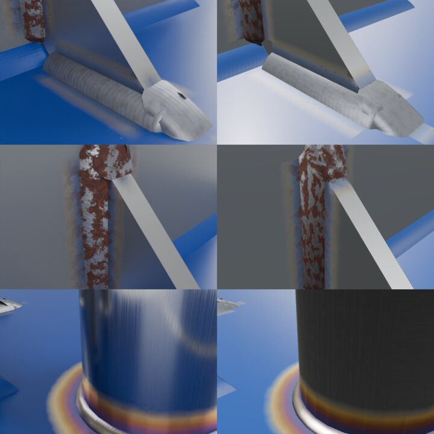
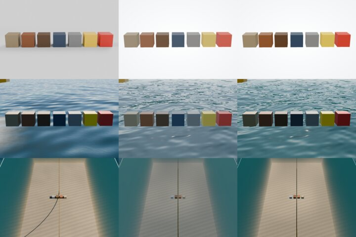

# 0369 – 3D page: welds with their ripples and heat tint + dark warm colours as in the app

**Who:** worker · **Status:** done (0.2.265) · **Branch:** `task/0369-welds-colours-3d-page`
**Started by:** lead, 25 Nov 2026 23:5x (owner allowed extra code tasks for the night; open points of 0319 and 0143)
· **Model:** Opus · effort Medium
**Area:** Web 3D lane – `blender/web3d.py`, `blender/web3d_env.py`, `core/web3d.py`, `core/web3d_env.py`,
`fresing_render/web/fr_page.js`, their tests, the guide's 3D page section, CHANGELOG. `pccheck/checks.py`: a new check
inside your own new function only (0348 adds to the file elsewhere – whoever merges second updates its branch).

**Not:**
- **The Welds lane's files – 0368 runs there:** `core/welds.py`, `core/weld_cad.py`, `blender/welds.py` (incl.
  `web_objects`), `blender/weld_looks.py`, `blender/weld_cad.py`. Read them; don't change them. If the export needs
  more than `welds.web_objects` gives, gather it in `web3d.py` from the weld objects (their material slots, the UV
  layer `fr_weld`, the heat-zone strips – 0368 keeps those names as today) and say in the report what the Welds lane
  could offer instead.
- `vessel_motion` files (0326).
- The demo vessel and its equipment (private) – use public test-tour models only.
- The format number on pages (0353) and the assets pack caps (0364) – later.

## Goal

On the 3D page, welds look like welds: the ripples along the bead and the heat tint beside it, as in the app's
renders. Dark warm colours (sand, rust, brown paint) on the page are no longer greyer than in the app.

## Background

- **Welds (0319's report, `tasks/0319-welds.md`):** the beads are exported in their colour / paint. The ripples and the
  heat tint are not: the page bakes 0.2 m tiles in the part's space, while they live on the weld's own UVs (`fr_weld`).
  The heat-zone strips are left out (`web3d.py` around line 117: `welds.web_objects`).
- **Colours (0143's report, `tasks/0143-web-sea-cutaway.md`):** the page's sand under the sea is greyer and darker.
  Mean RGB at the box's far end: app 105 / 96 / 79, page 70 / 77 / 76 – not the shadow. 0143 thought "the page's light
  makes dark warm colours greyer". Not checked whether it is only the seabed or all dark warm colours.
- Page budgets and quality levels: `core/web3d_env.QUALITY`; tiles 512 / 1,024 / 2,048 px per 0.2 m.

## What to do

1. **Welds:** bake each bead along its own UVs (the ripples, its finish, rust), plus the heat-zone strips (the tint
   fading from the bead). Keep the file small: one atlas or a few small tiles per weld kind, not a picture per weld. At
   Phone level they may stay plain if that keeps the page smooth (say so). A painted weld stays in its paint, as in the
   app.
2. **Colours:** compare app and page on a swatch set: dark warm (sand, rust, brown), dark cool, mid grey, bright paint,
   on Surroundings None, a sea set and under the sea. Use the same view, Cycles in the app, the page in headless
   Chromium. Find where the difference comes from (colour space of the baked tiles or of the seabed's numbers, tone
   mapping, the light picture, fog / water fade) and fix it at that place. Make nothing else worse.
3. The guide's 3D page section mentions the welds; the PC-check gets a check that a weld project's page holds the ripples
   / heat tint; the function list follows (CLAUDE.md section 6).

## Done when

- [x] The test weldment's page shows ripples and heat tint. A picture app vs page side by side is in the report. Page size
      and export time before / after are given.
- [x] Swatch table app vs page (mean RGB per swatch) before / after; dark warm colours within about 10 of 255 per channel
      of the app where the light is the same; the others no worse. Pictures side by side in the report for the owner.
- [x] `test_web3d*` green; new tests for the weld bake and the colour path; full suite passes; GitHub run green;
      CHANGELOG.
- [x] Report filled in, with the owner's line (which page to open on his PC to look at both). Merged, released.

---

## Report (filled in by the chat that did the task)

**Chat / date:** Claude Code on the web (Opus, effort Medium), 25–26 Nov 2026. Branch `task/0369-welds-colours-3d-page`,
released as **0.2.265**. No subagents (the weld bake, the colour fit and the light calibration share one file pair and
one measuring script; an independent review was not run – no Windows-only code).

**What changed:**
- **Welds on the page** (`blender/web3d.py`): weld beads and heat zones (`weld_heats`, `weld_kind`) are grouped by
  material; each weld look is baked **once as a strip** along the weld's own UVs (`Baker.weld`: a quad 64 mm along x
  the bead's real width, UV `fr_weld` = the weld's metres, `fr_weld_end` far away) – colour, roughness / metal, and
  for a heat zone its **cover** (the Mix with the Transparent BSDF, `weld_cover`) as alpha. The ripples: a baked Bump
  lost each ripple's sharp edge and kept the gentle slope (every texel leaned 5° the same way, ripples hardly
  visible), so the strip bakes the Bump's **height** and works the normals out (`weld_bump`, `height_normals`). The
  strip holds an even number of ripples (`core.weld_strip`: 64 mm, 1024 x 256 px at most, 512 x 128 at Phone) and is
  made to repeat along u only (`core.seamless_along`); materials carry `extras.fr_weld` = bead / heat, samplers
  REPEAT along x CLAMP across (`Gltf.sampler((s, t))`). A heat zone is BLEND, drawn over its part with a polygon
  offset and no shadow (`fr_page.js` `prepare`); a painted weld's heat zone (cover 0) is left out. The page reports
  `welds` {beads, heat} and `tone` in its state. Kept at Phone (the strips are small).
- **Colours – cause 1, the tone curve:** the app renders with Blender's AgX + "Medium High Contrast"; the page used
  three.js's own AgX, which is flatter: rust 152/98/67 where Blender gives 137/68/20 (11 of 255 on average over 40,000
  colours). The page now uses three's **CustomToneMapping** with three's AgX form and numbers **fitted to Blender's
  own transform** (`core/web3d_env.TONE` = `FR_TONE` in `fr_page.js`, a test compares them; `tools/fit_page_tone.py`
  makes the data with bpy and fits with scipy): 1.4 of 255 on average for surface colours, 2.3 over all incl. pure
  gamut-edge colours. `env.agx` (the background picture) uses the same curve; three's AgX stays as `agx_three`.
- **Colours – cause 2, the sea / sky light:** the page's drawn-sky sun was 3.2 x (1.0, 0.96, 0.90) at every height:
  about a quarter of the app's (Blender's physical sky) and too blue, its sky light ~1.4 x the app's. Parts lit by the
  sun – the seabed in the cut-away box (0143) – came out darker and greyer. A table measured against Cycles
  (`env.SKY_SUN`: sun height -> sun RGB strength, sky light x; a grey cube over a calm sea at 1, 5, 12, 22, 35/40, 55,
  70/80°) goes into the page (`sky.sun_table`) and the page interpolates it, also when the visitor moves the sun
  slider. The sky's picture keeps its own colours; clouds scale the sun as before. Pages without the table are as
  before.
- **Colours – cause 3, a small one:** a studio look / 360° photo lit the page with a sun in a fixed warm daylight
  tint; it now takes the colour of the picture's brightest spot (`env.brightest_colour`, `sky.sun_colour`).
- Not the cause: the baked tiles' colour space (linear, written as sRGB, read as sRGB – checked) and the water fade
  (inside the box the page subtracts the box from the water path, as the app).
- PC check line **web3d.welds** (Full, `MIN_LINES_FULL` 163); function `web.welds` (guide `web3d-welds`), `web.export`
  changed=0.2.265; guide sections "Welds on the page" and "The page's colours" (reading anchor `web3d-colours`), the
  Welds chapter's line updated. No tour stop (the page is not in the app; as `web.under` / `web.moving`).

**Tested and measured** (4-core web machine, no graphics card; Cycles 64 samples in the app, headless Chromium with
SwiftShader for the page; same camera, the page's free-area framing switched off with `frPage.setFree({})`):
- **Test weldment** (`tests/data/test_weldment.step`, `welds.set_up_test_model`, 7 welds, Texture size 1024): page
  **1.08 -> 1.33 MB** (glb), export **8.7 -> 8.5 s** (the weld strips 5.4 s of it; another run 8.8 s – about the same).
  13 weld looks on the page (7 beads, 6 heat zones), 1 left out (painted). Picture app (left) vs page (right): the MAG
  weld with spatter under the gusset, the rusty one up its side, the stainless all-round weld with its heat tint:
  
- **Swatch table** – mean RGB (11 x 11 px) of the front face (fronts) and top of 0.4 m cubes, app / page after /
  page before (main's page script); colours linear sand 0.25/0.19/0.11, rust 0.20/0.07/0.025, brown paint
  0.09/0.045/0.02, dark blue 0.03/0.05/0.09, mid grey 0.18, yellow 0.75/0.50/0.02, red 0.55/0.03/0.02, roughness 0.6:

  | Swatch | Surroundings None: app · after · before | Sea (front in shade): app · after · before | Sea, top in the sun: app · after · before |
  | --- | --- | --- | --- |
  | sand | 153/136/111 · 155/136/106 · 156/142/121 | 42/52/52 · 47/52/44 · 84/90/81 | 218/208/197 · 213/203/191 · 173/171/166 |
  | rust | 140/87/57 · 142/83/43 · 148/102/75 | 36/28/24 · 38/27/20 · 74/56/43 | 218/201/192 · 209/189/178 · 169/156/151 |
  | brown paint | 97/72/55 · 95/63/37 · 112/84/64 | 20/22/22 · 24/22/18 · 48/44/38 | 215/206/198 · 209/198/189 · 164/160/159 |
  | dark blue | 63/79/99 · 50/71/93 · 74/90/110 | 6/25/45 · 12/25/38 · 25/50/75 | 211/208/205 · 202/200/200 · 156/163/172 |
  | mid grey | 136/136/136 · 135/134/131 · 141/140/138 | 32/52/69 · 36/52/61 · 72/89/100 | 218/214/209 · 211/208/205 · 171/176/180 |
  | yellow paint | 209/179/103 · 211/185/93 · 203/181/115 | 89/92/1 · 100/95/0 · 132/128/60 | 239/225/201 · 237/225/198 · 207/197/163 |
  | red paint | 207/79/65 · 204/68/48 · 201/98/83 | 67/17/20 · 74/15/14 · 118/45/43 | 237/194/187 · 237/187/178 · 200/151/150 |

  **Under the sea** (sea cable test model, 15 m water, the cut-away box, camera above looking into it), app · after ·
  before: seabed at the box's far end **172/158/138 · 176/162/141 · 133/133/127**; cube tops on the seabed: sand
  190/171/148 · 181/165/142 · 146/142/131, rust 184/129/95 · 176/129/95 · 139/110/93, brown 144/107/80 · 145/112/85 ·
  111/98/87, mid grey 173/168/162 · 171/167/162 · 136/143/148.
  With the same light (sea, under the sea, None fronts) dark warm colours are now within about 10 of the app per
  channel, except the None fronts' blue channel (rust 43 vs 57, brown 37 vs 55: the plain page's light, below); the
  others are no worse, most much closer. Surroundings None tops are ~10–25 brighter than the app (also before).
  Pictures, rows None / sea / under the sea, columns app · page before · page after:
  
- The light table, one pass of the grey cube after calibration (top, app vs page): 5° 65/53/46 vs ~60 (second pass
  47/45/46, row raised after), 12° 128/115/101 vs 116/107/95 (row raised after), 22° 164/156/146 vs 158/152/141, 40°
  187/182/176 vs 185/179/174, 70° 200/196/192 vs 196/192/189; shade within ~10.
- Tests: new `tests/test_web3d_welds_blender.py` (6: the strips, sampler, UVs, left-out heat zone, bump / cover found,
  ripple normals from height, the page in headless Chromium draws the welds with tone "app", Blender's own transform
  vs the curve on 3,000 colours, sea page gets the sun table / studio page the picture's sun colour), new tests in
  `test_web3d_env.py` (tone vs Blender values, `FR_TONE` = `TONE`, the sun table, the spot colour) and
  `test_web3d_core.py` (strip length, `seamless_along`, sampler per direction). Locally: every `test_web3d*.py`,
  `test_web_player.py`, `test_functions.py`, `test_welds.py` – 325 passed (two browser tests failed once while my
  renders loaded the machine and passed alone). PC check line `web3d.welds` on the bpy module: OK, 11.5 s, the page
  drawn in Chromium. GitHub: see the run of the branch / main.

**For the owner – to look at both on your PC:**
1. Top bar: **Fresing** menu > **Open the Learning hub**.
2. In the Test tour panel: **Pick stop** > **Welds**, then **Go**.
3. Side panel **5 Scene & Render > Web 3D model**: press **Export…** and let it finish; then the folder button next to
   the file name, and double-click the `.html` file – it opens in Edge.
4. Turn the page's model to the stainless weld round the post (straw, purple and blue bands) and the grey MAG weld
   under the gusset (ripples, spatter); compare with **Render image** in the app. For the colours: the same with a
   project on the **Open sea** with the sea cut-away (the seabed's sand).

**What the Welds lane could offer** (the export gathers it itself today): `welds.web_objects` could hand over the heat
zones too (with their kind), and the weld materials could name their cover and ripple height outputs (two named
nodes), so the export need not recognise the Mix / Bump nodes.

**Open points / follow-up tasks:**
- The heat tint does not fade out at an open seam's ends on the page (the strip runs to the end).
- Surroundings None / studio looks: the page lights with the light picture **plus** an extra sun from its brightest
  spot – tops ~10–25 brighter than the app's, fronts a little bluer-short (rust, brown). A calibration of the photo
  light (sun share vs picture) as was done here for the sky; measure per studio look.
- The sun table is measured for a clear sky; Some clouds / Overcast keep the page's old factors (0.8 / 0.12) on top.
- Shaded faces at sea are a little less blue on the page than in the app (dark blue front 12/25/38 vs 6/25/45): the
  page's sky picture, not the curve.
- Polished metal (the stainless post) still reflects darker on the page than in Cycles (environment reflection, not
  colour) – as before.
- **GitHub runs: 4.** 1: two failures – a line `got["normal"] = np.…` tripped the id-property rule (test_idprops; renamed through a local name) and the page test hit Chromium crashing on the Linux runner (now checks the script with node there, as test_web3d_light_page). 2: version taken (0346 took 0.2.263). 3: green after re-running one real-app job (the crane lesson's Ctrl+Z test on a slow runner; 38/38 locally), but 0352 took 0.2.264. 4: 0.2.265, all 31 jobs green (run of 1e7c343).

