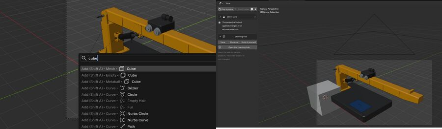
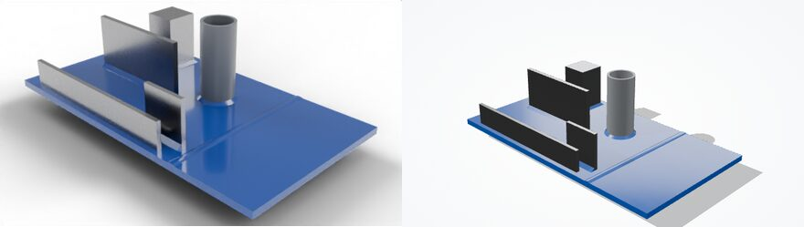
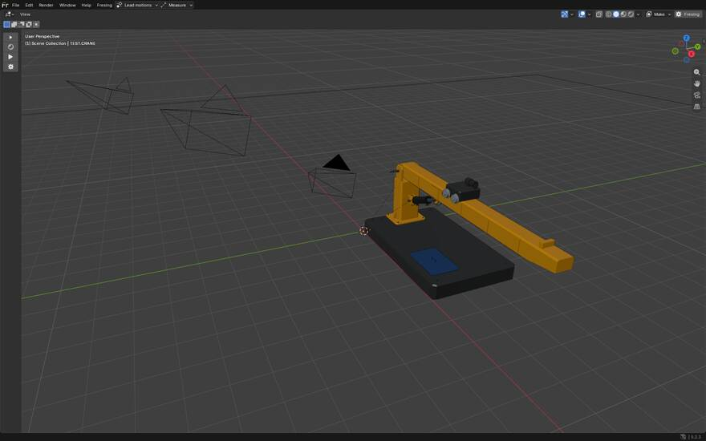

# 0380 – Bug and friction hunt round 9 (findings only): 0.2.247–0.2.270 used together

**Who:** worker · **Status:** done – findings (28 Nov) · **Branch:** `task/0380-bug-hunt-9` (task file + report only,
`[skip ci]`) · **Started by:** lead, 28 Nov 2026 · **Model:** Opus · effort High
**Area:** none – findings only, no code. Work on the **tag `v0.2.270`**, not on `main` (other tasks merge meanwhile).

## Goal

Twenty-four releases since 0328's hunt (25 Nov) – find what broke or got awkward when they are used together, as
0328 did: as a **sales person** (not technical), a **CAD engineer new to rendering** and a **skilled animator**.

## Scope

- Everything merged since 0328: 0330–0339, 0295 Keys tab, 0331 first start, 0332 quiet window + Client lock, 0333
  workspaces, 0325 long cables, 0326 joint drag, 0327 clash memory, 0346 coolant liquid, 0348 lift path, 0352
  compatibility kit (format number, newer-project message), 0354 assets registry (app without a pack), 0366 faster model
  build, 0367 shorter menus + hidden Blender tabs (**can every user still reach what he needs?**), 0368 welds at import,
  0369 welds + colours on the 3D page.
- Re-check 0328's 36 rows (fixed / still there).
- Big model: the stress model – import, update, drag, clash, save, web export.
- Old projects: only "opens without a crash or says re-import" (CLAUDE.md section 6 – the baseline rule).

## Report

A table like 0328's: row, persona, steps to repeat, what happens, expected, severity (crash / lost work / wrong /
friction), lane, file if known. Then proposed **fix tasks grouped by lane** (F1, F2 …) so two never share a file,
model · effort each. No fixes.

## Done when

- [x] The table, 0328's rows re-checked, fix tasks grouped by lane
- [x] Report filled in, pushed to the branch with `[skip ci]`; TASKS.md row "done – findings"

---

## Report (filled in by the chat that did the task)

**Chat / date:** Claude Code on the web (Opus, effort High), 28 Nov 2026. Hunted on the tag **`v0.2.270`** (a40be47)
on the 4-core web machine (15 GB, no graphics card). The app ran under xvfb, so drawing went through llvmpipe and its
times are not the owner's RTX 3090. The machine was shared by three helpers and the stress run, at a load of 4–7.
Blender as a module was used for the logic checks. Three helpers ran, one per user (end of the report).

**What changed:** nothing in the app. This report, three small pictures in `tasks/img/0380_*`, and the TASKS.md row.

### In short (for the owner)

- **One crash:** in a lifting plan, *Check along the path*, then **X**, then *Go there*, then **Ctrl+Z** closes
  Blender. It happened 3 of 3 times (row 1).
- **Animators still lose hand-edited keys** in many everyday cases. 0330 keeps them only when you press Build & play
  again straight away. Moving a lead motion, Make turntable again, hiding a part, going to a saved scene or Fit camera
  takes the Build off and drops the edits without a word. A new curve (e.g. the camera's focus) is dropped at every
  Build (rows 2–3).
- **The Client view still leaks:** Edit > Menu Search (F3) reaches all of Blender. "cube" + Return adds a cube to the
  locked project (row 4, picture). A lead motion in the Client view takes the Build off, and the client then has
  **no Play button and cannot build again** (row 5).
- **Back to the Fresing window from Blender's Modeling tab leaves you stuck** in Modeling (row 6, picture). This is
  0328's row 5 in a new place.
- **Build & play quietly puts Picture quality and size back** to the start scene's Final / HD. The next F12 took
  30 min instead of 1 min here (row 7).
- **Good news:**
  - 25 of 0328's 36 rows hold (8 partly, 3 still stand), and every lead open point checked except 0271.
  - 102 old projects (0.2.200 and 0.2.244) open without an error, and all 94 of their animations build.
  - The 11,228-part stress model passes every heavy step, with the same 42 clashes as before.
  - The first-start set-up now stays open.
  - The Keys tab keeps a changed key over a restart.

### Rows (worst first)

Who: **S** = sales person (Sales, Client view), **E** = CAD engineer (Essentials, Machine builder, Welding), **A** =
animator (Video producer, Animator, Full access). "(code read)" means the cause was found by reading only; everything
else was seen. Helper letters in "repeat case": hA = sales pass, hB = engineer pass, hC = animator pass, M = main
session. Their scripts were in the session's scratch folder and were not pushed: the cases are written so they can be
repeated by hand.

| # | who | what you did → what happened | what should happen | how often | smallest repeat case | kind | hurts | lane | proposed fix (one line) | where |
|---|---|---|---|---|---|---|---|---|---|---|
| 1 | A, E | Lifting set, Lifting plans: **Check along the path** → **X** (Stop) → **Go there** (C5) → **Ctrl+Z** → **Blender segfaults**. The trace: `_draw_bar` → `live_rows` → cached `Checks` → `line_pull` → `lifting.path_of(crane)` on a crane that the undo has freed. Go there also builds the animation without an undo step of its own. (A joint move + Ctrl+Z alone: no crash.) | Undo works | 3 of 3 | hC: tour set "lifting", the 4 clicks | **crash** | 3 | Lifting | Clear `_CHECKS` / `_LIVE` in `undo_post` / `redo_post`; look the crane up by name in the `line_pull` lambda; give Go there `UNDO` | `blender/lifting_path.py` `numbers` ~62, `checks` ~77, only `_load_post` ~586; `ops_lifting.py` ~873 |
| 2 | A | Change a built key by hand (Boom 0.611 → 1.111), then any of these: move a **lead motion** slider, **Make turntable**, **Hide selected**, **Go to a saved scene**, **Fit camera to the whole motion**. Each takes the Build off; the next Build gives 0.611 again with **no warning**. Fit camera keeps the animation built, and the edit is gone at once. | Keep the edits for the next Build of that animation, or warn before dropping them | 5 of 5 | hC (module): hub, Build "Boom up", last Boom key +0.5, then any of the five | **lost work** | 3 | Motion (animation) | `clear_keys` stores the edits (keys + print per animation) and the next Build puts them back | `animation.py` `clear_keys` ~541 (deletes PRINT); callers: `lead_motions.took_off` ~173, `turntable.make` ~54, `ops_main._take_build_off` ~87, `states.apply_shot` ~569, `ops_motion` fit camera ~1170 |
| 3 | A | (a) Built "Camera rides and flies": key the Animation camera's f-stop (a channel Build does not key) → next Build: **curve gone**, no warning. The same for a new curve on a joint's motion empty, where the warning even says "Kept your own change to the keys of joint 'Boom'". (b) Build "Boom up", edit, Build "Boom and trolley" → "Build replaced your own change …: the steps … changed" (wrong reason). Build "Boom up" again → edit gone. | New curves kept; edits kept per animation | 2 of 2; 1 of 1 | hC (module), as described | **lost work** | 2 | Motion (animation) | In `bake` copy F-curves of tagged actions that are not in the old PRINT; keep PRINT and the edits per animation name | `animation.py` `edited_keys` ~420, PRINT ~325, `bake` ~804 |
| 4 | S | **Client view: Edit > Menu Search… / F3**, "cube" + Return → **a cube is added** to the locked project; "camera" adds a camera; "save as" matched File ▸ Save and saved. The list also offers Object ▸ Delete, Link / Transfer Data, Add ▸ …, Help ▸ Blender ▸ Save System Info. | Menu Search off in the Client view (or refused like F2) | 2 of 2 adds, 10 words tried | hA: Client view, F3, "cube", Return | wrong result (lock leak) | 2 | Client view / quiet window | Leave `wm.search_menu` out of the quiet Edit menu when locked; swallow F3 in `BLENDER_KEYS` | `quiet.py` `EDIT_KEEPS` ~66, `_edit` ~243; `lock.py` `BLENDER_KEYS` ~499 |
| 5 | S | Client view on a built animation (Play shows) → Lead motions ▾ ▶ or a slider → the Build comes off (0330), **Play disappears**, Build & play is greyed ("locked … Full access unlocks it"). The message "…Build again" goes to the hidden 1 Import. The client cannot play the video again. | In the Client view the lead motion plays over the Build and Back to start gives it back, or Play rebuilds a project that was built | 2 of 2 | hA: build "Boom and trolley", Client view, Lead motions ▾ ▶ | wrong result | 2 | Lead motions / Client view | When locked, play the lead motion without taking the Build off (or put it back at Back to start) | `lead_motions.py` `took_off` ~173; `ui_left.py` `client_play` ~325; `lock.ALLOWED` |
| 6 | A | Full access → Blender's **Modeling** tab → Fresing > **Back to the Fresing window** → the quiet window **stays in Modeling**: one 3D view, no Fresing side panel, Blender's tool buttons instead of the left panel, no timeline, a redo panel. After that every Back lands on Modeling. Animation, Compositing and Geometry Nodes come back fine (11 tabs tried) | Back always returns to the app's layout | 1 of 1 | hC: Animator → Show all → Modeling → Back | friction | 3 | Quiet window | Back always switches to the app's layout; never store a Blender tab as the one to come back to (cause not traced) | `quiet.py` `back_workspace` ~579, `apply` ~676 |
| 7 | S | Set Quality **Draft**, Size **Preview**, then Build & play any animation → Quality back to **Final** and Size **HD** (the start scene's values), no word. The next F12 rendered at 512 samples: "Remaining 30:56" after 5 min (~1 min before the Build) | Build leaves the Picture settings alone, or says it changed them | 3 of 3 animations | hA (module + real app) | wrong result | 2 | Animation / saved scenes | The start shot does not put `OUTPUT_KEYS` back at Build (only Go to scene does), or it names the change | `states.py` `OUTPUT_KEYS` ~278, shot apply ~555 |
| 8 | S, A | Messages a user needs are drawn **only under 1 Import**, which Sales, Video producer and the Client view hide: the newer-project note once its popup is closed (File > Save not greyed; you find out at Ctrl+S), the lead motion's "took the Build off", the hide-part message. In Video producer 6 Animation still says "2.0 s" after the Build came off | A fixed line every workspace shows (left panel under Workspace) for look-only, "Build taken off" and similar states | always | hA, hC: Video producer, Build, Lead motions ▾ slider | friction | 2 | Left panel / side panel | Draw `last_message` and the look-only state on a fixed row of the left panel | `ui.py` ~343; `lead_motions.took_off` ~181 |
| 9 | E | Open a saved project, File > Quit → **`<project>.blend.inuse` stays**. At quit Blender switches the add-on off, `unregister()` removes the `_at_exit` handler, so `release()` never runs (traced). A colleague sees "in use by …" for up to 15 min | The lock goes with the app | 3 of 3 | hB: open a .blend, Quit, look in the folder | wrong result | 2 | Projects (shared folder) | `release(_STATE["path"])` in `unregister()` before `atexit.unregister` | `blender/project_lock.py` ~186–210 |
| 10 | E | Lifting example (crane + AT-40), set-down point (−2, 4.5, 0), Check along the path → **C5 red** "centre of gravity (2.71, −0.15) m lies outside its outriggers" from frame 261 (to 3.19 m), while **C1 says 25–39 % of the chart** (green) at the same moments. M: the crane file's `a` is 2.7 m, so the combined centre is just past the front pad line | C1 and C5 agree (a crane at 40 % of its chart is not outside its tipping line) – or the plan explains why | 1 of 1 | hB: as described, `live_rows(force=True)` at frames 261 / 300 / 384 | wrong result (**suspected** – not hand-checked) | 2 | Lifting | Check the sample AT-40's masses / `a` / chart and the frame of `sup.items` against C1; a hand calculation in the test | `core/lifting_path.py` ~407–425, `core/lifting.outriggers` ~816, `data/lifting/AT-40` `outriggers.a` |
| 11 | A | Lift path: change the slew key by hand (0.848 → 1.357 rad) → `stale()` stays False and the panel keeps the old rows (C5 134 kPa); Check again gives 127 kPa | "Out of date – check again" after a key change | 1 of 1 | hC (module): Propose, Check, edit a key | wrong result | 2 | Lifting | Put the built keys' print into `_key_now` | `lifting_path.py` `_key_now` ~296 |
| 12 | E | Model update crane A → B (and stress small A → B) → names get Blender's **".001"**: 1 Import says "TEST.CRANE.001", the view "BOOM.001"; stress small 1,357 → 1,752 objects with .00x. A second update (B → A) gives clean names, so they flip at every update (picture in the scratch folder) | The model keeps its names | 2 of 2 | hB: import crane A, Update to new revision… with crane B | looks | 2 | Import (reimport) | Give the new objects the old names once the old ones are gone | `reimport.update_model` ~724, `ui.py` ~289 |
| 13 | E | Stress small A → B (14 parts changed shape: a sheave Ø940 → Ø980, stiffeners 12 → 15 mm) → "**1643 parts kept, 0 new, 0 missing**", nothing says what changed (`report_notes` empty; the meshes are right). The update took 47.5 s, longer than the import (40.7 s) | "14 parts changed shape" + Select changed parts, as the mesh update says since 0325 | 1 of 1 | hB | friction | 2 | Import (reimport) | Count and list changed shapes in the STEP update report | `reimport.py` report lines |
| 14 | A | **Ctrl+F12** (or Render > Render Animation) on "Boom up" → the job is added **and the whole queue starts**: the still and video already waiting go first ("about 24 min left") | Render this animation now, or ask "2 jobs are waiting – only this / all" | 1 of 1 | hC: hub (2 jobs in its queue), Ctrl+F12 | friction | 2 | Render queue / keys | Start only the new job, or ask | `lock.py` `key_render` ~626 |
| 15 | S | 3D page of the weldment with CAD welds: bare-steel ribs and block **near black**, the blue plate's top washed out; in the app's render bright steel and full blue (picture). Phone and Best the same | Page colours as in the render (0369) | 2 of 2 | hA: import `test_weldment_cad_inventor.step`, export, open in Chrome | looks | 2 (if real) | Web 3D | **First check on a real graphics card** (headless Chrome here = SwiftShader); then metal against the page's environment | `web/fr_page.js` environment ~454 (guess) |
| 16 | S | Make > 3D page window (357 × 582) on the crane with 3 lead motions: **Export… / Open page half below the edge** before a Build, fully out of sight after (Film ticks) | Export in sight without scrolling | 2 of 2 | hA | friction | 2 | Web 3D / Make windows | Export… at the top, or the window sized to its content | `ui_web3d.py` ~92–100, `ops_make.py` window size |
| 17 | A | Full access, Build, Graph Editor, click BOOM → **no curves**; also with "Only Show Selected" off. They show only with Show Hidden on, because the keys sit on the hidden "Joint Boom (motion)". The guide's "change a key in the Graph Editor" (0330) is hard to follow | A few clicks | 2 of 2 | hC | friction | 2 | Motion + guide | A button "Edit keys in the Graph Editor" (sets the filters, selects the motion empties); steps in the guide | `docs/USER-GUIDE.md` ~5347, `ops_motion.py` |
| 18 | A | Coolant set: Build & play (it plays while the liquid is worked out), **Esc** to stop playback → **the liquid stops** ("Stopped: press Work out the liquid…"), playback goes on | Esc stops playback; only Cancel stops the bake | 1 of 1 | hC: tour set "liquid", CNC & machining, Build & play, Esc | friction | 2 | CNC (coolant) | Let Esc pass through the modal; Cancel only | `ops_liquid.py` `modal` ~84 |
| 19 | A | Full access: **F12 is Blender's own render** (4096 samples, 1920 × 1080, nothing saved, no app header); the Render menu and Ctrl+F12 are Blender's too (output "/tmp/") | Owner decides: the app's renders in Full access too, Blender's in a sub-menu – or keep "Full access = Blender" (0367 says so) | 1 of 1 | hC: Show all, F12 | friction | 1 | Quiet window / keys | Keep `key_render` and the quiet Render entries in Full access, Blender's under Render > Blender | `lock.py` poll `keys_quiet` ~612, `quiet._render` ~296 |
| 20 | S | Sales / Client view after Build & play with 4 Motion open: a ~55 px "built … Stop it" box appears under "Everything back to CAD position" and **every sub-panel below moves down**; Show on "4 hidden, in use" removes that line and the Learning hub moves up ~20 px (0328 row 26 partly) | The panel stays still | always | hA | looks | 1 | Motion / left panel | State on a fixed row; keep the hint row drawn when empty | `ui_motion.py`, `ui_top.py` ~52 |
| 21 | S | Newer-project copy: Save As makes "… (1).blend", but **the copy is look-only too** (Ctrl+S refused, reopened still look-only), unsaid. A colleague's newer project opens **two popups**, the colleague window on top hiding the look-only note, and offers "Switch to theirs" in a project that cannot be saved | One sentence "the copy stays look-only until you update"; no colleague window while look-only | 1 of 1 each | hA: raise `fr_saved_by` / `fr_format` in a copy, open | friction | 1 | Compat / workspaces | Add the sentence; skip `_popup_later` while `compat.blocked()` | `compat.py` `save_hook` ~200, `_tell_later` ~268; `workspaces.py` `_popup_later` ~589 |
| 22 | S | Colleague window (0333) says "**anna.berg** saved…" (the PC login); **Cancel and OK do the same**; once closed there is no other way to Switch to theirs (not in the Workspace menu) | One Close button; "Switch to <their workspace>" in the Workspace menu | always | hA | friction | 1 | Workspaces | One button; an entry in `FRESING_MT_workspaces` | `ops_workspace.py` ~415–440 |
| 23 | A, E | Workspace contents: **Animator** shows Weather but not the Weather step, Add at playhead or presets, nor Render this view, Save start scene and paint schemes (Video producer has them). **Machine builder** hides 3 Looks, so right after import + Sort it shows "1 hidden, in use"; an engineer's day spans Essentials, Builder and Welding – only All functions has it all | Same tools for both video jobs; Builder keeps the groups list | deterministic | `core/workspaces.shown_functions(builtin(...))` | friction | 1 | Workspaces | Add those ids to Animator; looks.groups / materials to Builder (or an "Engineer" set – owner) | `core/functions.py` `TASK_WORKSPACES`, `core/workspaces.py` "builder" |
| 24 | E | Outside Full access the **Item tab is gone** (0367) and nothing in the app shows a part's or assembly's **overall size**; there is no STL / OBJ / STEP export (only the 3D page's .glb) and no Append | Owner decides: a size line in Place / Measure; an "Export mesh…" in File | – | hB: menus and tabs | friction | 1 | Place / Measure (owner) | A "Size: L × W × H mm" line for the selection | `place.py` / measure (proposal) |
| 25 | A, E | Lift path animation: 15–22 steps, **12–18 named "Lift · Luff / telescope"**; the message says "9 steps". Remove the crane and then the load's model → the animation "Lift <load>" **stays**, its keys pointing at nothing | Distinct names, matching count; the animation goes with the crane | deterministic; 1 of 1 | hB, hC: Propose on the lifting set; two Removes | small | 1 | Lifting | Number the pieces or one step per stage; add the path animation to the crane's Remove plan | `core/lifting_path.py` `_write` ~248 / `SUB` ~815; `lifting.remove` ~511 |
| 26 | A | Coolant: **Flow** changed after a finished bake → "Not worked out for this Build yet", no automatic start; **Detail** changed right after Cancel → starts by itself although Cancel's tooltip says it won't | Every setting acts the same; the tooltip says what happens | 1 of 1 | hC | small | 1 | CNC (coolant) | Flow's update calls `settings_changed`; reword Cancel's tooltip | `liquid.py` `settings_changed` ~1128 |
| 27 | A | "Kept your own change…" is only a passing status-bar warning; 6 Animation says "'Boom up': 2.0 s, 51 frames"; X's tooltip does not say your changed keys go; `edited_text` ("the queue says it") is never called (code read) | Said where it stays | always | hC | small | 1 | Motion | State in 6 Animation; a line in X's tooltip | `animation.py` ~428, `ops_motion.py` ~1153, ~1199 |
| 28 | S, E | After an update 1 Import shows "Model updated: 19 parts kept, 1 new, 1 missing" **twice** (report box and grey line); the Client view's Play never says **Pause** while playing | Once; "Pause" while playing | always | hA, hB | small | 1 | Side panel / left panel | Skip `last_message` when it equals the report title; Play ⇄ Pause | `ui.py` ~328, `ui_left.py` ~377 |
| 29 | A | Graph Editor put in the timeline area in Full access **stays after Back** (Blender's full Graph header, the timeline gone); Fresing Settings > Keys > "Blender's own key settings" opens Blender's Preferences in every quiet workspace although Edit > Preferences is hidden there | The app's areas come back; consistent with the Edit menu | 1 of 1; always | hC | looks / small | 1 | Quiet window / Keys | Back puts the app layout's areas back; grey the Keys button outside Full access (as in the Client view) | `quiet.py`; `keys.py` ~387 |
| 30 | all | **Words and edges:** right-click menu titled "Object"; "Camera Perspective / (1) Scene Collection \| BOOM" over the view; "Anim Player" in the status bar while playing; the fold "Make a product video" with the same button under it; Render > Render Image tooltip "…in the box below" (no box in a menu); cut: "Include animati…", "Lead motions as slid…", "Folders for models, logos, rule s…", "Automatic (the …"; Keys tab's lone "`" row; Client view queue "Render animation in 6 Animation" (hidden there); **Edit > Preferences** still named in the tour's backups stop and in Check for updates (offline); Settings > Backups names no folder; small Blender region arrows at the edges of the app windows; the F12 window 511 × 332 cuts Show in folder / Close (xvfb) | Plain and whole | always | hA, hB, hC | small | 1 | several (each file's task) | A word pass per file in the task that owns it | `context_menu.py`, `ui_motion.py`, `quiet.py` render tooltip, `ui_web3d.py` ~56 / 76, `ui_settings.py`, `core/keys.NAMES`, `ops_queue`, `tour.py` ~6569, `updates.py` ~129, `ops_setup._dress` |
| 31 | all | Every start prints "Fresing Render: the project's format could not be read: '_RestrictData' object has no attribute 'filepath'": `compat.register` reads `bpy.data.filepath` while Blender starts. Console only | Silent | 29 of 29 starts | any start | small | 1 | Compat | Skip `check_open` while `bpy.data` is restricted (`_on_load` covers the file) | `blender/compat.py` ~502–507 |

### 0328's rows re-checked

| 0328 row | fixed by | result |
|---|---|---|
| 1 first-start set-up closes itself | 0331 | **holds** – 4 fresh starts: open 3.2–6.8 s after start, still open at 22 s; Skip closes it, the next start shows nothing |
| 2 Graph Editor edit replaced by Build | 0330 | **partly** – the direct case holds (kept with a warning, also over save + reopen, a renamed step, a deleted key, undo / redo around Build); rows 2, 3, 27 above do not |
| 3 Fade step drops a part's own action | 0330 | **holds** – back after Stop + save + reopen |
| 4 Turntable again deletes steps | 0330 | **holds** – the step stays, the picked animation stays |
| 5 Back leaves Blender's Animation layout | 0332 | **partly** – Animation, Compositing, Geometry Nodes come back; Modeling sticks (row 6) |
| 6 one Ctrl+Z undid two actions | 0334 | **holds (code read)** – RAL, template, 360° photo, lead step, lift propose / check, weld add have UNDO; Go there has not (row 1), the coolant bake is a modal |
| 7 Client view rename / Preferences | 0332 | **holds** – F2, Ctrl+F2, Ctrl+, swallowed; Edit has no Rename / Preferences. New leak: Menu Search (row 4) |
| 8 lead slider on a built animation | 0330 | **partly** – no snap-back, the Build comes off; the message is hidden in Sales / Video producer (row 8) and strands the Client view (row 5) |
| 9 right-click shows hidden functions | 0333 | **holds** – Sales / Client view: the part, Zoom to it, Hide, Show only this; title still "Object" (row 30) |
| 10 workspaces vs the job | 0333 | **holds** – Video producer, Animator, Sales' Make, Client view as asked; a new gap for Animator (row 23) |
| 11 colleague's project / red alarm | 0333 | **holds** – opens in Sales, Switch to theirs works, Don't show again survives a restart, the hint is grey; words row 22 |
| 12 every window top left | 0331 | **partly / not judged** – the placing is Windows only; under xvfb they still open at x 2 (worked out: x 1026–1614 beside the side panel). Try on the owner's PC |
| 13 render result shows only the middle | 0332 / 0334 | **holds** – Saved: <file>, Open, Show in folder, Close; fitted; no Frame / Time / Mem |
| 14 3D page result below the edge | 0336 | **partly** – Open page is on the Export row, but that row is below the edge on the crane (row 16) |
| 15 Include animation greyed without reason | 0336 | **holds** – "Build & play first", then the tick and the Film text |
| 16 no Play in the Client view | 0333 | **holds** – but lost after a lead motion (row 5), no Pause (row 28) |
| 17 title row only on its words | 0335 | **holds** – icon, empty part, state text, words, arrow: 6 of 6 |
| 18 group names by hex code | – | **still stands** – stress small 56 groups, 44 by hex; crane 5 of 9 |
| 19 picker names cut | 0314 | **partly** – ~11 characters now; "Stainless…" ×2, "Aluminium…" ×2 still look the same; 3 Looks' short list cuts at 9 |
| 20 weldment in three looks | – | **still stands – now four** (POST ground steel, GUSSET zinc die-cast, FIN / BRANCH "Colour #6B6E73", MAIN TUBE satin pipe) |
| 21 / 0179 3D page menu on a phone sideways | 0336 | **holds** – 932 × 430: views one pill, the menu ends above Motions and the play bar, no overlaps |
| 22 Remove of a crane | 0337 | **holds** – the window says it is a lifting crane; nothing left (new: the lift animation stays, row 25) |
| 23 mesh update, changed unnamed group | 0325 | **holds** – `tests/test_mesh_update_changed_group.py` 17 of 17; real-app variants not re-run |
| 24 load with no parts | 0337 | **holds** – "has no parts left" |
| 25 main window left split | 0331 | **holds** – Ctrl+C / V then X after 0.15 / 0.6 / 1.5 s, 5 windows 0.3 s apart: whole (a press while one opens is dropped with a line, not "waits") |
| 26 panel jumps (built box, Show) | 0333 | **partly** – the buttons above stay; the sub-panels below and the Learning hub still move (row 20) |
| 27 Blender's side-panel tabs | 0332 / 0367 | **holds** – only Fresing outside Full access, also with a part selected; all back in Full access |
| 28 redo panel | 0332 | **holds** – none after a workspace pick or Build (≈1 s visible after Back from Animation) |
| 29 G on a locked part | 0338 | **holds** – the Unlock box by the mouse, Return moves, Lock it again |
| 30 messages under 1 Import | 0334 | **holds** – Sort and Render image write beside their own buttons (Sales part by code read); new: other messages only there (row 8) |
| 31 every camera a page view | 0336 | **holds** – 6 of 7 ticked, Turntable camera off, page has 6 views |
| 32 words | several | **partly** – "Your PC", stress README, Edit and Help fine; "Object", "Camera Perspective", "Anim Player", the product-video fold, cut labels remain (row 30) |
| 33 greyed lead buttons in the Client view | 0333 | **holds** |
| 34 product video window empty | 0331 | **holds** – opens with its settings |
| 35 timeline does not fit | 0330 | **holds** – 526 frames: −10…538 |
| 36 Learn… for daily functions | (0304 open) | **still stands** – crane, mill, weather lessons; the rest "View; lesson coming" |

**The lead's open points:**
- **0213** (Set-up window Back / Next in the Client view): **fixed**. The buttons are greyed with the line
  "Client view: set-ups are locked. Workspace > Full access unlocks them".
- **0179**: fixed (row 21).
- **0241** (welcome box over the splash picture): gone. What's new after an update from 0.2.244 sits below the
  picture.
- **0271** (keyboard work as presence): **still stands** (code read: `PRESENCE_KEYS`, `ops_settings.py` ~403). 0377
  covers it.
- **0221** (new window not tidied): not re-checked.
- **0328's cache-prune note**: fixed (0325). `.partial` folders are skipped (`importer/runner.py` 317).

### Can every user still reach what he needs? (0367's menus and the hidden tabs)

- **Sales: yes.**
  - Fresing Settings… is in Edit, the Fresing menu and the gear.
  - Make covers export.
  - The app's Render Image / Animation / Queue / View Last Render are in Render.
  - The user guide is in Help, and Blender's own help is under Help > Blender.
  - The Client view's File menu says "Save As, Import and Export are off".
  - One hole: Menu Search (row 4).
- **Engineer: mostly.**
  - File has Import STEP / mesh / House Planner; Preferences is now Fresing Settings.
  - Missing outside Full access: **Export to STL / OBJ / STEP** (only the 3D page's .glb), **Append / Link** (no
    "take parts from another project"), and the **Item tab's location / dimensions**. Place gives position and turn,
    Measure gives distances, but nothing gives an overall size (row 24).
  - Units and the online-access switch are only in Full access, and two texts still point to Edit > Preferences
    (row 30).
- **Animator: yes, via Fresing > Show all of Blender.**
  - The quiet menus have **no line saying where the rest went** (Append, Export, New Window, the View tab's Lock
    Camera to View / clip / lens). An animator must already know the Fresing menu.
  - In Full access the Render menu, F12 and Ctrl+F12 are Blender's own (row 19).

### Big model: the stress model

The PC check **Stress** (`tools/ci_stress.py`, the full model: 11,228 placed / 1,995 unique parts, 206 MB STEP) ran on
the shared 4-core machine while the three helpers worked. Every line was OK. Four lines were "slow" against the
owner-PC limits, as expected on this machine:

| step | result |
|---|---|
| Model made | 88.6 s |
| Import at Draft | 133.6 s, 2.1 M triangles |
| Import at Normal | 168.9 s, 4.1 M triangles (0325's 13.9 → 4.1 M holds) |
| Lists, search, groups | 2.2 s, 58 groups |
| Select all, hover | 0.7 s; hover 7.5 ms (slowest 23 ms) |
| Solid view (llvmpipe) | first picture 14 s |
| Live preview | first picture 58 s, on the CPU |
| Joints + Build | 9.8 s (build 1.44 s); playback 23 ms per frame |
| **Joint drag** | **18.1 ms a step** (slowest 27 ms) – 0326 holds |
| **Clash check** | **61.6 s, 791 moments, 42 clashes** – the same as 0315 / 0327; peak 3.3 GB |
| **Save / open** | 0.84 s / 2.5 s, 16.9 MB |
| Backup | 0.7 s |
| Undo after Sort | 1.05 s |
| Render 4K (CPU, small) | 43 s |
| **Web export** | **69 s, 8.6 MB** |
| **Model update** (0.9 % changed) | **137 s** (build new 5.9 s, take apart 5.0 s, remove old 11.9 s; the rest is reading revision B). As in 0315 (131 s); it says nothing about which shapes changed (row 13) |

The highest peak memory was 3.9 GB (web export).

On the small stress model (hB), with real clicks:
- import by drop: 40.7 s;
- update A → B: 47.5 s;
- the update keeps joints, the hand material and a renamed group.

### Old projects (baseline rule: open without a crash, or say "re-import")

The test tour was made by **0.2.200** (47 projects; one set lost while making it – the old prune of two old
versions running at once, not 0.2.270) and by **0.2.244** (55 projects), each with its own code. Every project was
opened in 0.2.270 (Blender as a module, the app's load handlers on):
- **102 of 102 open**, with no traceback and no error line;
- the compatibility chain is quiet (nothing ran, nothing failed, not "newer");
- **all 94 animations build** without an error.

Faked newer project (hA, real app): the note says the version, Save is refused, Save As makes a copy, and Blender's
own save keeps the newer file aside. Words: row 21.

### Measured, no row

All on the shared 4-core web machine.

| What | Result |
|---|---|
| Crane import | 6.3 s |
| Crane update A → B | 11.9 s (joints, animations and a hand material kept) |
| Weldment with CAD welds | 9.5 s, "6 welds from the CAD file" |
| Gap weldment | 6.2 s, one butt weld; the filler bar left alone |
| Keys tab: X for Measure | refused (Remove has it) |
| Keys tab: K | taken with a warning |
| Keys tab: J | **J works after a restart** (kept in `fresing_settings.json`) |
| Key sheet | 7.9 KB |
| Client view lock | G / R / S / Ctrl+C / V / drag / X / Delete / H / Alt+H / Shift+D change nothing |
| Client view: rebind X to F2 | allowed, still removes nothing |
| Coolant (Draft, 385 frames) | worked out in 60.6 s; reused after reopen; Ctrl+Z during it refused with a line |
| Lift path | Check along 237–253 moments in 0.3–0.4 s |
| F12, Preview / Draft (480 × 270) | 45–66 s |
| Render this view | 54.5 s, its camera gone afterwards |
| 3D page export | crane 11.1 s; weldment 5.3 s |

### Grouping into fix tasks (for the lead)

Two tasks never share a file. The words of row 30 go to the task that owns each file. Order: F1, F2, F3, then the
rest.

- **F1 – Lifting path: the crash and the checks** (Lifting, **Opus · Medium**)
  - Rows **1**, 10, 11, 25.
  - Files: `blender/lifting_path.py`, `ops_lifting.py`, `core/lifting_path.py`, `core/lifting.py`, `blender/lifting.py`,
    `data/lifting/AT-40` (if its numbers are the cause).
  - Row 1 first. Row 10 needs a hand calculation first.
- **F2 – Animation keeps every edit** (Motion, **Opus · Medium**)
  - Rows **2, 3**, 7, 17, 27.
  - Files: `animation.py`, `ops_motion.py`, `states.py` (row 7), the guide's Graph Editor steps.
  - Fix row 2 inside `clear_keys`, so its callers (`lead_motions.py`, `turntable.py`, `ops_main.py`) need no change.
- **F3 – Client view lock and Back** (Quiet window / Client view, **Opus · Medium**)
  - Rows **4, 6**, 14, 19 (after the owner's choice), 29, plus row 30's Render Image tooltip.
  - Files: `quiet.py`, `lock.py`, `keys.py`.
- **F4 – Messages where the user is, Play in the Client view** (Left panel, **Sonnet · Medium**)
  - Rows **5**, 8, 28.
  - Files: `ui.py` (message rows), `ui_left.py`, `lead_motions.py`.
  - The `lock.ALLOWED` entry, if row 5 needs one, goes through F3 or after it.
- **F5 – Model update names and report** (Import, **Opus · Medium**)
  - Rows 12, 13.
  - File: `reimport.py`.
  - The `ui.py` line of row 12 is not needed if the names stay.
- **F6 – Workspaces and compat small points** (Workspaces, **Sonnet · Medium**)
  - Rows 20, 21, 22, 23, 31.
  - Files: `core/functions.py`, `core/workspaces.py`, `workspaces.py`, `ops_workspace.py`, `ui_motion.py`, `ui_top.py`,
    `compat.py`, `core/compat.py`.
  - The owner may want to say whether an "Engineer" workspace should exist (row 23).
- **F7 – Coolant and keys while baking** (CNC, **Sonnet · Medium**)
  - Rows 18, 26.
  - Files: `ops_liquid.py`, `liquid.py`.
- **F8 – 3D page window** (Web 3D, **Sonnet · Medium**)
  - Row 16, plus row 30's 3D page labels.
  - Files: `ui_web3d.py`, `ops_make.py` (its window size).
  - **Row 15 goes to 0382** (3D page light calibration, waits for 0353), after the owner looks at the weldment page on
    his PC.
- **F9 – The project lock at quit** (Projects, **Sonnet · Medium**)
  - Row 9.
  - File: `project_lock.py`.
  - Small, but a colleague is locked out for 15 min.
- **Still open from 0328 (unchanged):**
  - Rows 18 and 20 → with or after **0287** (Looks / rules).
  - Row 19 → a small picker task (`ui_material_picker.py`).
  - Row 36 → **0304**.
  - 0271 → **0377**.
- **Small, by owner:**
  - Row 24: a size readout and "Export mesh…" – the owner decides.
  - The rest of row 30's words: `context_menu.py`, `ui_settings.py`, `core/keys.NAMES`, `tour.py`, `updates.py`,
    `ops_setup._dress`, any Start & learn task.
  - Row 12 of 0328: window places, on the owner's PC.

### Helpers, runs, not tried

**Helpers** (Opus, none wrote to the repository; each had its own fresh settings folder of the real app):
- **hA, the sales person:**
  - a colleague's crane hub project saved in Machine builder, in Sales and the Client view;
  - the lock tried key by key, Menu Search, lead motions, the render window, the 3D page incl. 932 × 430;
  - the newer-project note.
- **hB, the engineer:**
  - 4 fresh first starts, window opening, drop imports of the crane and stress small, Sort, the picker;
  - CAD and gap weldments, model updates;
  - G-unlock, Remove of a crane / load, the lift path, the Keys tab with a restart, Learn….
- **hC, the animator:**
  - 0330's edits in many variants, Show all / Back from all 11 Blender tabs;
  - workspaces, Ctrl+F12 and the Render menu, the coolant bake, the lift path animation.
- **The main session:**
  - the stress model and the old projects;
  - read the code of rows 7 and 10 (the AT-40's `a` = 2.7 m) and row 31;
  - checked hC's crash logs (3 segfaults, operators called as buttons, Ctrl+Z as a real key).

**Runs:** none. This was findings only, and the pushes touch only `tasks/` and `TASKS.md`. Leftover: the branch
`task/0380-bug-hunt-9` holds this report and can be deleted once read.

**Not tried:**
- A Windows PC and a graphics card: window places, page colours (row 15), GPU renders.
- A real Explorer drag.
- Rendering a video or product video to its end.
- Printing the key sheet.
- The Learning hub build in the real app.
- The mesh-crane update variants in the real app.
- 0221.
- Old projects in the real app's layout. 0328 found them fine and nothing in this round touched that.
